# AI Buddy · AI 酱 · Local AI usage monitor and multi-character Galgame companion

[简体中文](README.md) · **English**

**Current release: [v1.7.7](https://github.com/lXiaoSel1/ai-buddy/releases/tag/v1.7.7)** · Fixes stutter and backward gaze when circling the pet with the mouse; see the [validation record](docs/VALIDATION-1.7.7.md)

## Overview

While your AI tools work and you wait for results, check how many tokens today has burned, then chat with the model girls for a bit～(∠・ω< )⌒★

AI Buddy (AI 酱) is a Windows desktop app. It reads your local AI-tool logs, totals token usage, estimates cost and groups work by project. It also brings the multi-character Galgame from [JAdpp/dsh-whale-galgame](https://github.com/JAdpp/dsh-whale-galgame) to the desktop, together with a desktop pet and separate chat and CG image connections:

- **A local ledger for 8 AI tools**: Codex, Claude Code, Gemini CLI, Kimi Code CLI, OpenCode, Cline, Roo Code and DeepSeek Harness. It reads the usage the logs actually report; missing fields show as "not provided" instead of being guessed from text length.
- **11 model girls**: DeepSeek, Grok, Seed, Kimi, Qwen, MiniMax, GPT, Gemini, Claude, GLM and Hunyuan, each with her own portrait, background, personality and voice, and her own affection and CG gallery.
- **Appearance and model are separate**: pick who appears on stage and which chat API replies independently. Qwen's look with Claude's API works fine.
- **More work, closer bonds**: while AI Buddy runs, new work tokens slowly turn into affection for the current character, and a level-up can produce a commemorative CG.
- **A 60fps transparent desktop pet**: it lives in a corner of the screen, jumps when a task finishes and reacts when one fails.
- **11 character themes, Chinese and English**: palettes come from each portrait. Keep one fixed or let it follow the current character.

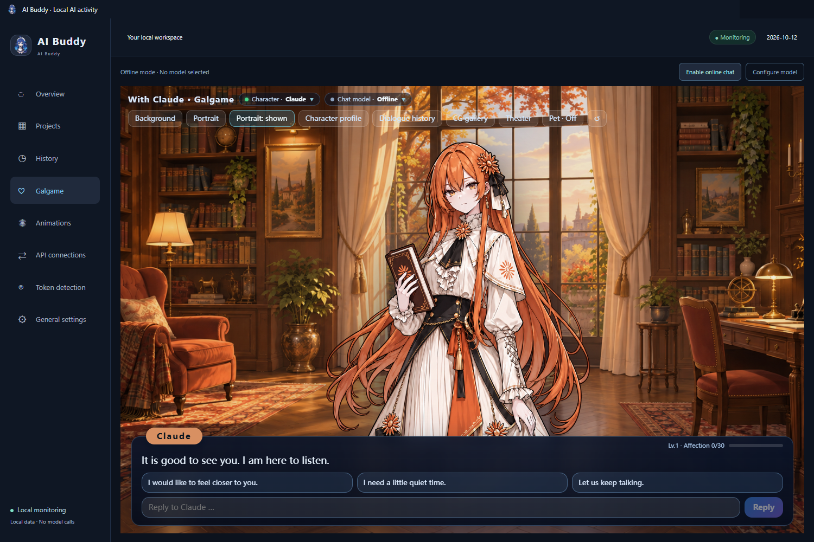

## What it does

- **Overview** has Usage, Cost and Quotas tabs with totals, per-tool cards and the five most recent work items.
- **Projects** sorts by total, input or output tokens or by name. **History** shows daily, weekly and monthly trends with a date range and time zone, and exports CSV or JSON.
- Tools, model developers and service platforms are recorded separately. Codex is a tool; OpenAI is a developer or platform. A model name alone does not prove the official API was used.
- **Cost estimates** multiply input, output, cache-read and cache-write tokens by their own rates; request counts are not a billing unit. Subscription tools show an API-equivalent reference, not your plan's bill. Missing usage or prices stay unknown instead of becoming zero. Prices come from models.dev and can be filtered, overridden or updated manually under Cost → Price settings.
- **Online quotas** are optional and cover Codex, Claude, GLM/Z.ai, Kimi Coding, MiniMax Coding, DeepSeek API balances and supported Gemini CLI accounts. Nothing is queried until you enable a service.
- Each character keeps her own level, chat history, background, CG gallery, recycle bin and portrait visibility. Switching characters restores her own background.
- Every turn offers three reply choices, or you can type freely.
- A CG used as the background hides the portrait by default, so the same character does not appear twice. Right-click a CG in the gallery to move it to the recycle bin; undo and restore are available.
- The history index persists, so a restart only checks new records. First indexing, replaced logs or index repair take longer.

<table>
  <tr>
    <td align="center">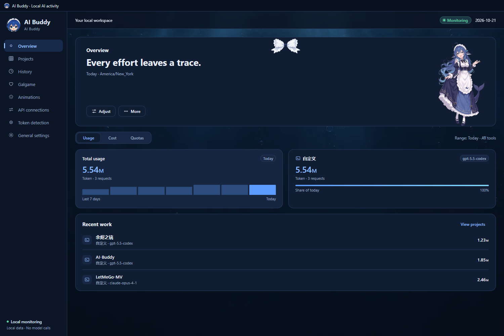 <strong>Overview</strong></td>
    <td align="center">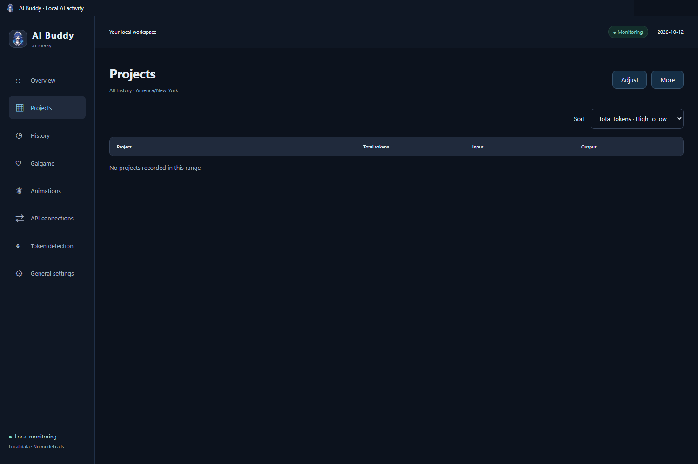 <strong>Projects</strong></td>
  </tr>
  <tr>
    <td align="center">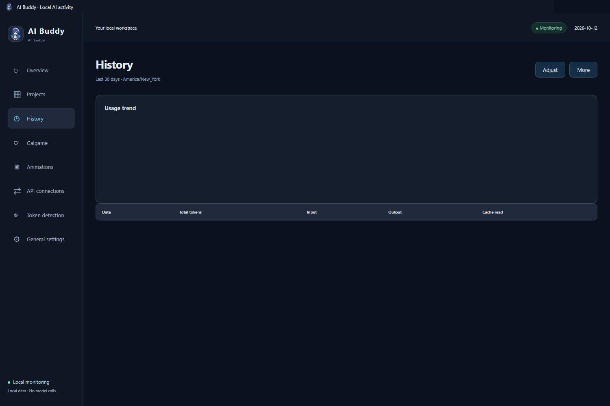 <strong>History</strong></td>
    <td align="center">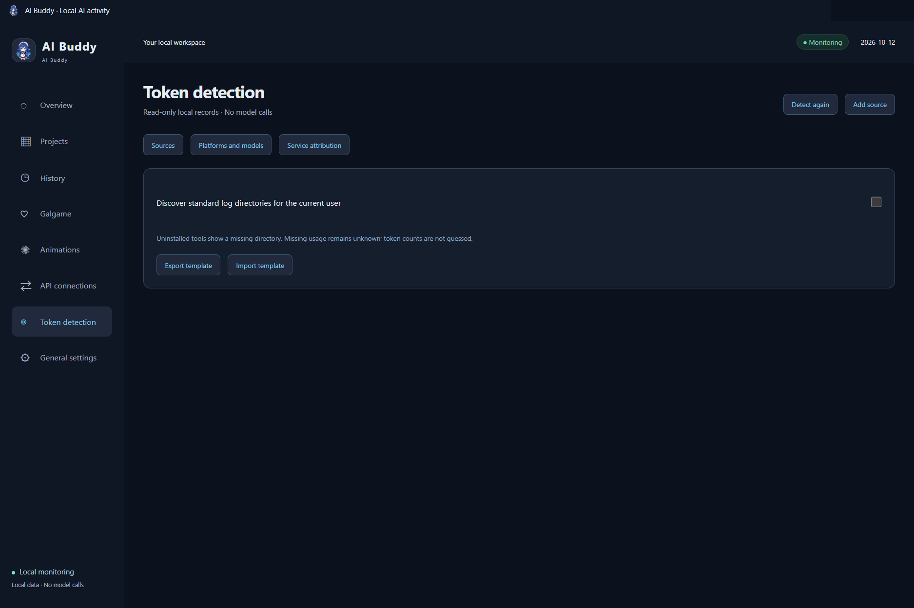 <strong>Token detection</strong></td>
  </tr>
  <tr>
    <td align="center">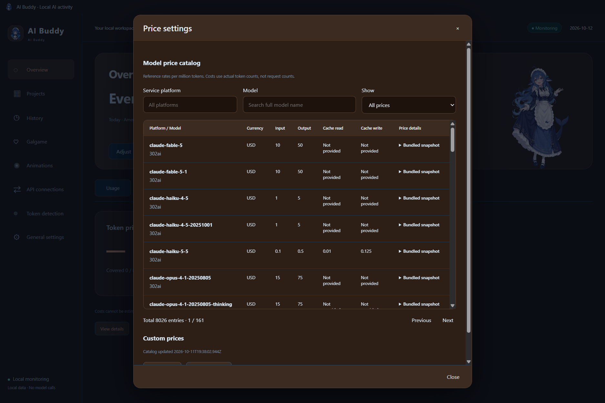 <strong>Price settings</strong></td>
    <td align="center">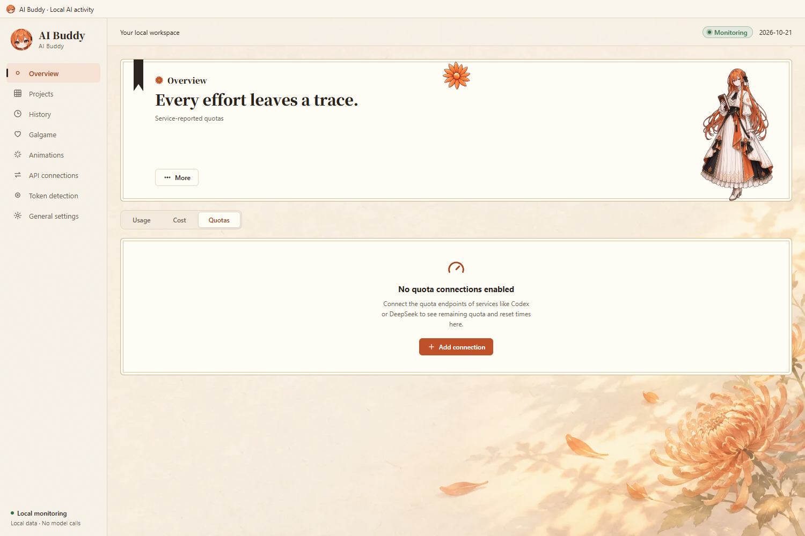 <strong>Online quotas</strong></td>
  </tr>
</table>

## Affection and local work

### Relationship progression

Every character starts independently at Lv.1 with 0 affection. The close, neutral and distant reply choices score +1, 0 and -1, in a random order each turn. Typed replies use simple keyword rules: words such as "like" or "good night" add a point, while "annoying" or "go away" remove one. Affection never drops below 0.

The level threshold is `30 + 15 × (Lv - 1)`, that is 30, 45, 60 and so on. Overflow carries into the next level, and there is no level cap. After 24 hours without interaction, every character loses 2 points per day, down to 0. Her tone has five stages and stays at the closest one from Lv.5 onward. With automatic CG enabled and an image connection configured, each level-up produces a commemorative CG.

### How local work affects characters

While AI Buddy runs, newly observed work tokens go into one shared balance; AI Buddy's own chat and image calls do not count. Every 5,000 tokens add 1 affection point to the current character, up to 3 points per settlement, with the remainder kept for next time. Settlement happens when you open the Galgame and before each message you send. Usage from before the app started is not counted retroactively.

When a log clearly records a finished task, the pet jumps twice and shows a completion bubble. When it records a failure, the pet plays the failure action once and asks you to take a look. Feedback is queued with failures first, then completions, then dialogue; each event is announced once, and events of the same kind within one second are merged. While you chat with DeepSeek in the Galgame, the pet also plays her emotion and shows a short reply in a bubble.

Unlike the upstream plugin, AI Buddy does not pass tool-log text to the Galgame. Characters do not bring up the specific tasks you are working on, and Theater does not gather material automatically.

## Bundled default art

The release bundles a default portrait and background for each of the 11 characters, 8 DeepSeek expression variants, and 15 transparent action videos plus 201 still frames for the pet. DeepSeek also has an optional seaside study, and 5 earlier backgrounds remain selectable. The previews below are downscaled; full-size images are in the release ZIP.

<table>
  <tr>
    <td align="center"> <strong>DeepSeek</strong></td>
    <td align="center"> <strong>Grok</strong></td>
    <td align="center">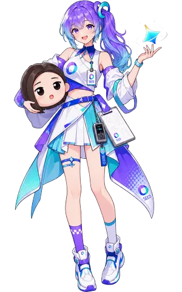 <strong>Seed</strong></td>
    <td align="center"> <strong>Kimi</strong></td>
  </tr>
  <tr>
    <td align="center"> <strong>Qwen</strong></td>
    <td align="center"> <strong>MiniMax</strong></td>
    <td align="center"> <strong>GPT</strong></td>
    <td align="center"> <strong>Gemini</strong></td>
  </tr>
  <tr>
    <td align="center"> <strong>Claude</strong></td>
    <td align="center"> <strong>GLM</strong></td>
    <td align="center"> <strong>Hunyuan</strong></td>
    <td></td>
  </tr>
</table>

Each character uses her own scene by default:

<table>
  <tr>
    <td align="center"> <strong>DeepSeek · Deep-sea palace</strong></td>
    <td align="center"> <strong>Grok · Night observatory</strong></td>
    <td align="center"> <strong>Seed · Sunlit greenhouse study</strong></td>
  </tr>
  <tr>
    <td align="center"> <strong>Kimi · Moonlit reading room</strong></td>
    <td align="center"> <strong>Qwen · Modern Chinese academy</strong></td>
    <td align="center"> <strong>MiniMax · Creative studio</strong></td>
  </tr>
  <tr>
    <td align="center"> <strong>GPT · Collaborative study</strong></td>
    <td align="center"> <strong>Gemini · Twin-window star studio</strong></td>
    <td align="center"> <strong>Claude · Amber writing room</strong></td>
  </tr>
  <tr>
    <td align="center"> <strong>GLM · Research library</strong></td>
    <td align="center"> <strong>Hunyuan · Mountain garden pavilion</strong></td>
    <td></td>
  </tr>
</table>

The pet and the Animations page share 15 transparent VP9 WebM videos at about 60fps, encoded quality-first (CRF 18), which cover 18 logical actions. Gaze directions and still emotional peaks use a small set of lossless WebP frames. The videos total about 38.8 MiB, or about 87.2 MiB with the stills.

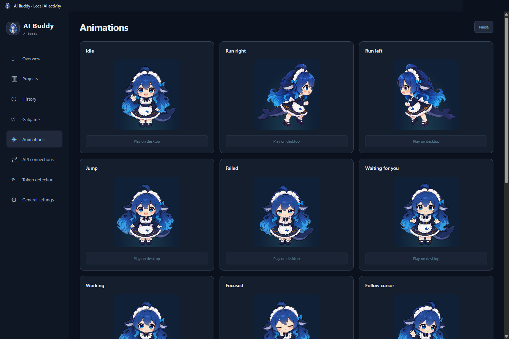

The 11 theme palettes come from the matching portraits. DeepSeek keeps its original deep-blue design; the other ten use softer medium-dark surfaces:

<table>
  <tr>
    <td align="center">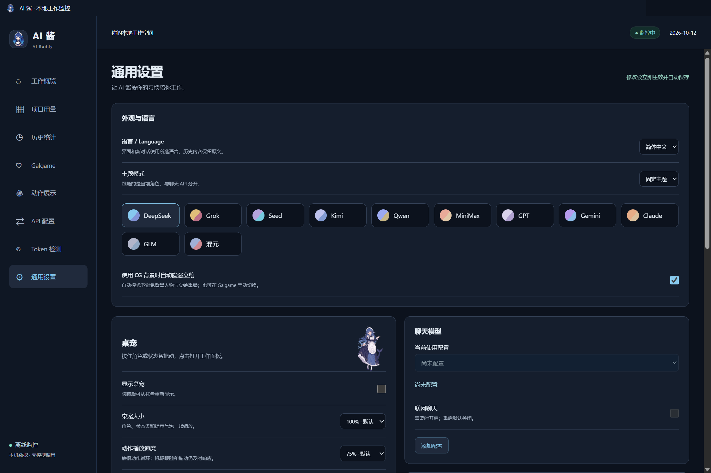 DeepSeek</td>
    <td align="center">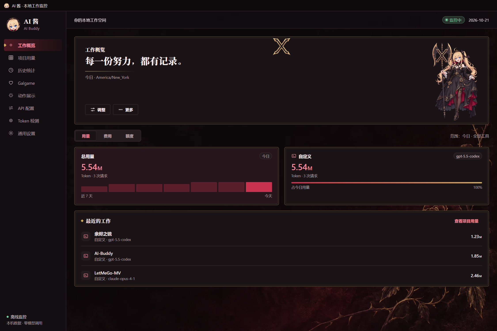 Grok</td>
    <td align="center">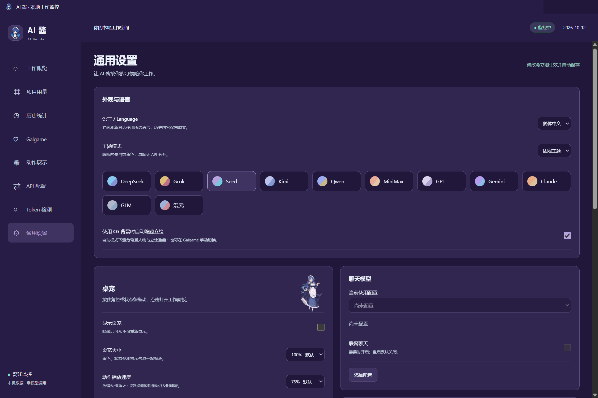 Seed</td>
    <td align="center">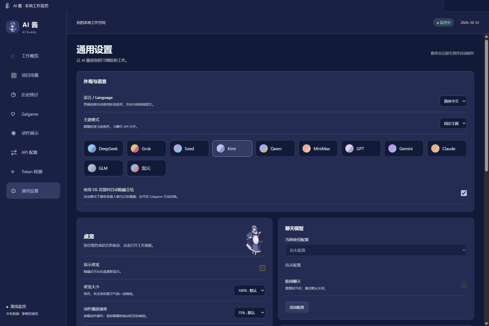 Kimi</td>
  </tr>
  <tr>
    <td align="center">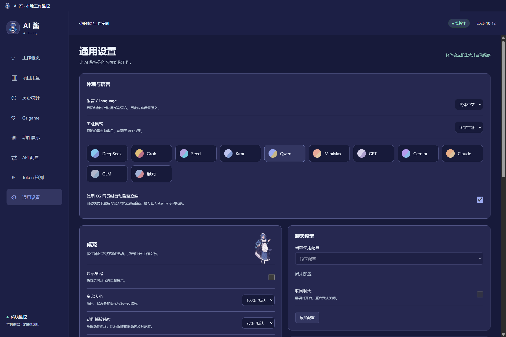 Qwen</td>
    <td align="center">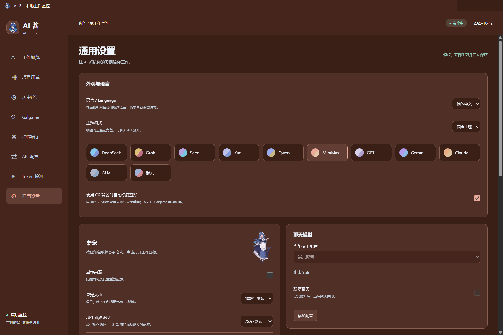 MiniMax</td>
    <td align="center">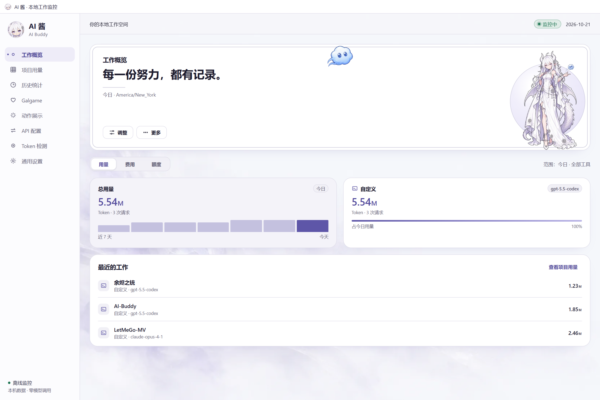 GPT</td>
    <td align="center">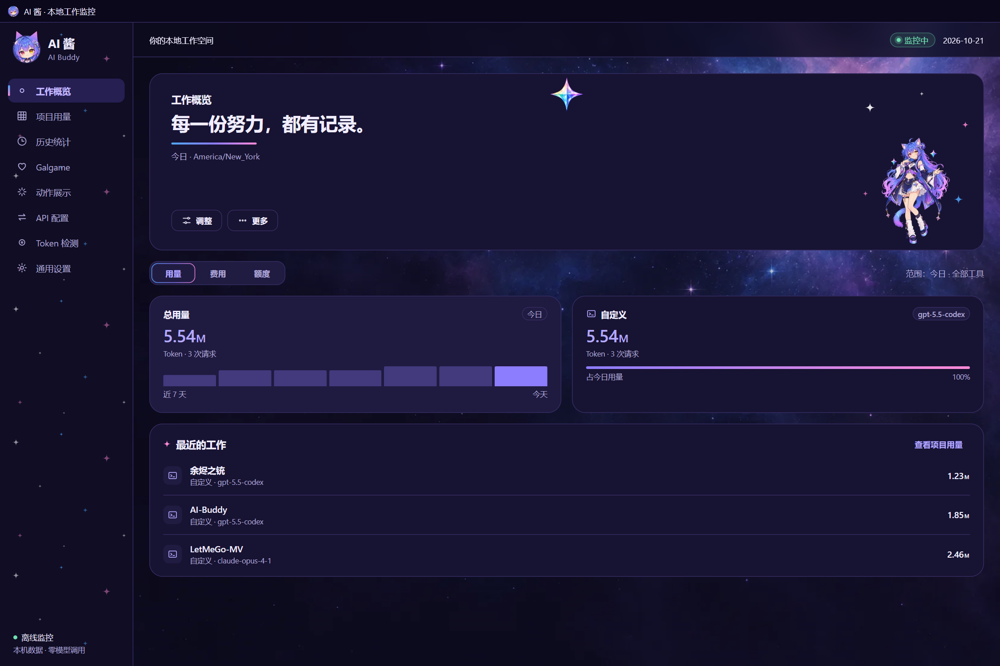 Gemini</td>
  </tr>
  <tr>
    <td align="center">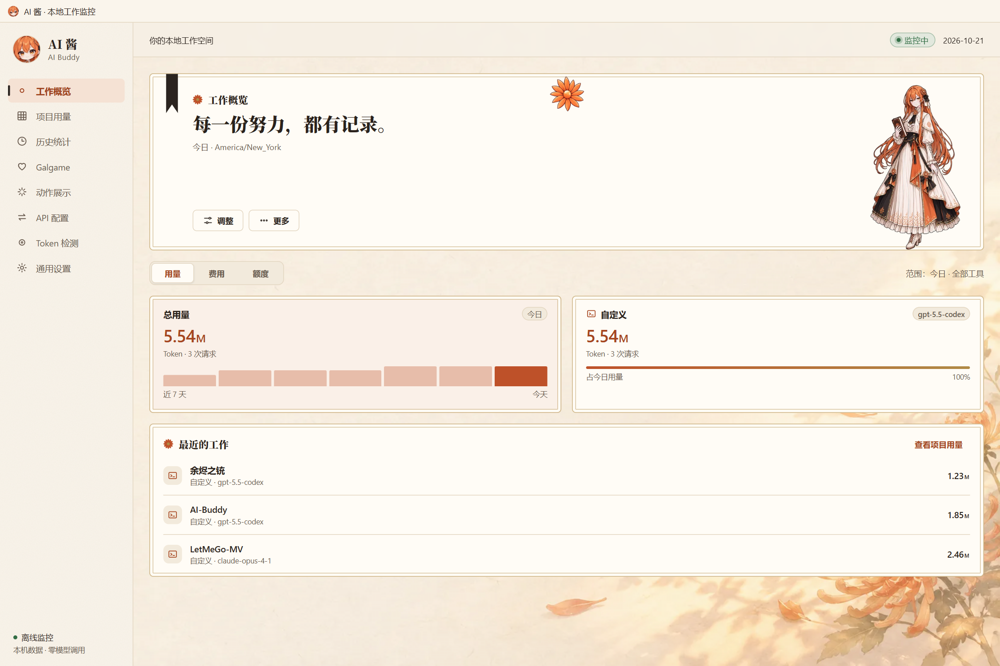 Claude</td>
    <td align="center">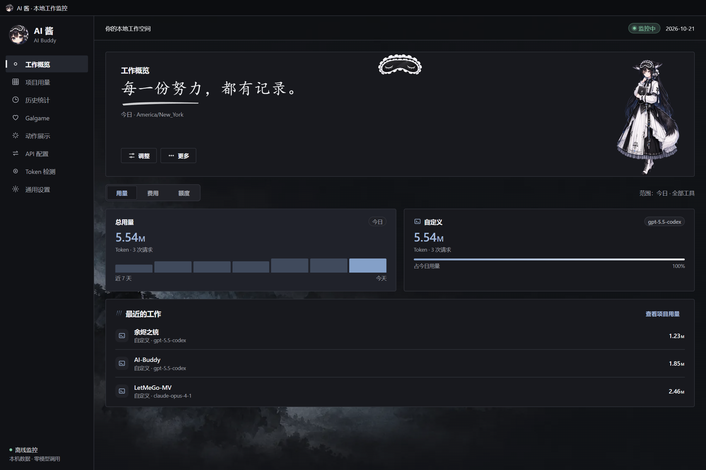 GLM</td>
    <td align="center">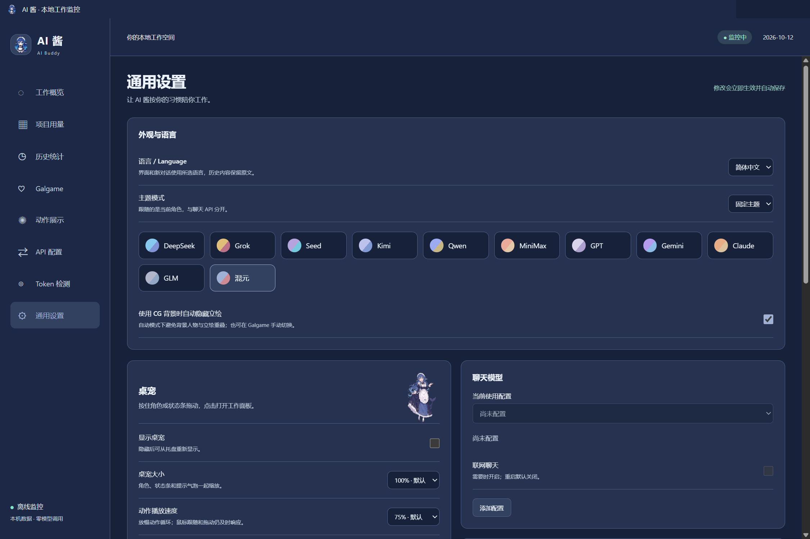 Hunyuan</td>
    <td></td>
  </tr>
</table>

The artwork has different sources and terms:

- DeepSeek's portrait, expression variants and the deep-sea palace and seaside study backgrounds come from upstream dsh-whale-galgame and belong to its 21 default images under CC BY-NC-SA 4.0.
- The other ten portraits and backgrounds were generated with an image tool, using character designs from a gallery as references; they are not the gallery files. The design authors are credited, but a general redistribution license for all ten references has not been verified.
- DeepSeek's motion videos were generated with MiniMax H3 and interpolated with RIFE. They are not claimed as MIT.

See [THIRD_PARTY_NOTICES.md](THIRD_PARTY_NOTICES.md) for per-file notes. The Galgame layout, dialogue box and controls are adapted from upstream in [`src/adapted/galgame-client.ts`](src/adapted/galgame-client.ts) and do not depend on an unpublished UI image pack.

## Install

Requires Windows 10/11 x64. AI Buddy is portable and bundles the Electron runtime; Node.js, Python and image tools are not needed.

1. Download `AI-Buddy-1.7.7-Windows-x64.zip` from [Releases](https://github.com/lXiaoSel1/ai-buddy/releases). The release assets give the exact size and SHA-256, including `SHA256SUMS-1.7.7.txt`.
2. Extract the whole ZIP to a writable location. You get an `AI-Buddy` folder.
3. Open the **AI-Buddy** folder and double-click **AI Buddy.exe** in its root. **AI Buddy.vbs / AI Buddy.cmd** are compatibility launchers that start the same program. Since 1.7.3, the root EXE validates the runtime and starts it directly, without the PowerShell `Get-FileHash` command; the 1.7.2 script launcher could exit on machines where that command is unavailable, and the old package only had the EXE under the versioned `runtime` folder.

Notes:

- Do not run it from inside the ZIP or copy only the executable; keep the folder structure.
- The executable is not commercially code-signed, so Windows may report an unknown publisher. Check the SHA-256 first if you like.
- On first launch it looks for common log folders under the current user. No AI tools installed? The companion features still work offline.
- This repository is private for review; downloads require access. The owner decides when to make it public.

Folder layout after extraction:

~~~text
AI-Buddy/
├─ AI Buddy.exe / AI Buddy.vbs / AI Buddy.cmd / Start-AI-Buddy.ps1   launchers
├─ builds/<version>/                                  app code and bundled resources
├─ runtime/AI-Buddy-<version>/AI Buddy.exe             Electron runtime
├─ local/current-build.json                            current version pointer
├─ local/data-v003/                                    your data, created on first run
├─ assets/  docs/  licenses/  数据源示例/ (source examples)
└─ README.md  LICENSE.md  THIRD_PARTY_NOTICES.md
~~~

### Update and remove

To update, choose **Quit** from the tray menu, extract the new ZIP to the same place so the new `AI-Buddy` folder overwrites the old one, and start it as usual. Your data lives in `local/data-v003`; the release package does not contain that folder, so extracting over it leaves it alone. Never replace it with an empty folder. Backing up `local/data-v003` before updating is a good habit.

To remove, quit and delete the whole `AI-Buddy` folder. Settings, data and interface caches all live under its `local/` folder, and AI Buddy adds no startup entry. Back up `local/data-v003` first if you want to keep chats and CGs.

### Run from source

You only need this to build it yourself. It requires Windows x64, Node.js 24 and npm:

~~~sh
npm ci
node scripts/build-public.mjs --resources="C:/path/to/AI-Buddy/builds/<version>"
npm start
~~~

`--resources` points to the `builds/<version>` folder of the matching portable release, the one containing `assets/frame-sequence-manifest.json`. The build reuses the released portraits and animations; nothing is regenerated. See [BUILD.md](docs/BUILD.md).

## Use and settings

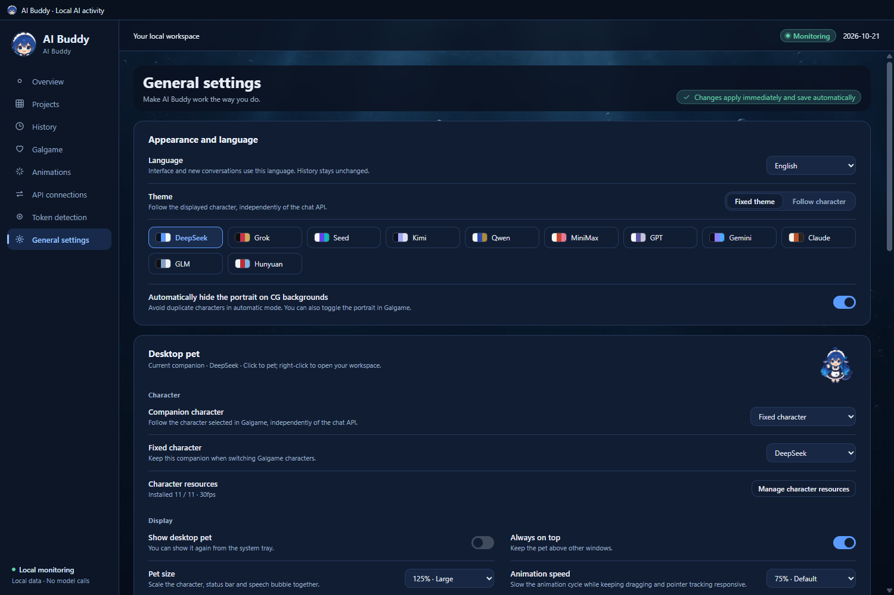

Clicking the pet makes her wave and opens Overview. Double-clicking the tray icon also opens the main window, and the tray menu goes straight to the Galgame, General settings or Animations, or shows and hides the pet.

### Token detection

On first launch AI Buddy looks in these places under the current Windows user:

| Tool | Default location |
|---|---|
| Codex | `.codex\sessions` and `archived_sessions`; `CODEX_HOME` overrides |
| Claude Code | `.claude\projects`; `CLAUDE_CONFIG_DIR` overrides |
| Gemini CLI | `.gemini\tmp` |
| Kimi Code CLI | `.kimi-code\sessions` and the older `.kimi\sessions` |
| OpenCode | `.local\share\opencode`; `XDG_DATA_HOME` or `OPENCODE_DB` also work |
| Cline / Roo Code | Extension storage of VS Code, VS Code Insiders, VSCodium and Cursor; Cline also `.cline\data\sessions` |
| DeepSeek Harness | `.dsh\sessions`; `DSH_HOME` overrides |

Portable editors, WSL or other users' folders must be added manually: in **Token detection**, click **Add source**, choose a tool template and the actual folder, run **Local parsing preview**, then **Save and enable**. Custom sources accept JSONL, Zstd-compressed JSONL, JSON, CSV and SQLite, support field mapping, and templates can be imported and exported. Removing a source never deletes the original logs or the usage already recorded.

### General settings defaults

| Setting | Default |
|---|---|
| Language | Follows the system language on first launch; Simplified Chinese or English |
| Theme mode | Fixed DeepSeek theme; can follow the current character instead |
| Show desktop pet | On |
| Pet size | 100%, from 75% to 150% |
| Animation speed | 75%, from 25% to 100% |
| Always on top, Click through transparent areas, Follow the pointer, Show status bar, Task feedback bubbles | On |
| Fallback polling interval | 1 second (file changes are read immediately) |
| Activity time display | New York time; system local time or UTC available |
| Statistics time zone | System local time |
| Update prices daily | Off |

Two switches live outside this table: **Online chat** is off after every restart and must be turned on manually, and **Generate CG automatically** is off on a fresh install. **Restore default settings** only resets the options above; the pet position, usage and Galgame data are kept.

### Character and chat model

In the Galgame toolbar, **Character** decides who appears and **Chat model** decides which chat connection replies; neither affects the other. **Background** and **Portrait** accept built-in choices or your own images (PNG, JPEG, WebP or AVIF, up to 12 MB each).

Since 1.7.2, single-character scenes use a closer framing: the face and upper body are larger, and the lower body continues behind the dialogue box. Multi-character scenes and the portrait pickers still show the full figure. The portrait button switches between shown, hidden and automatic; in automatic mode, a CG background hides the portrait.

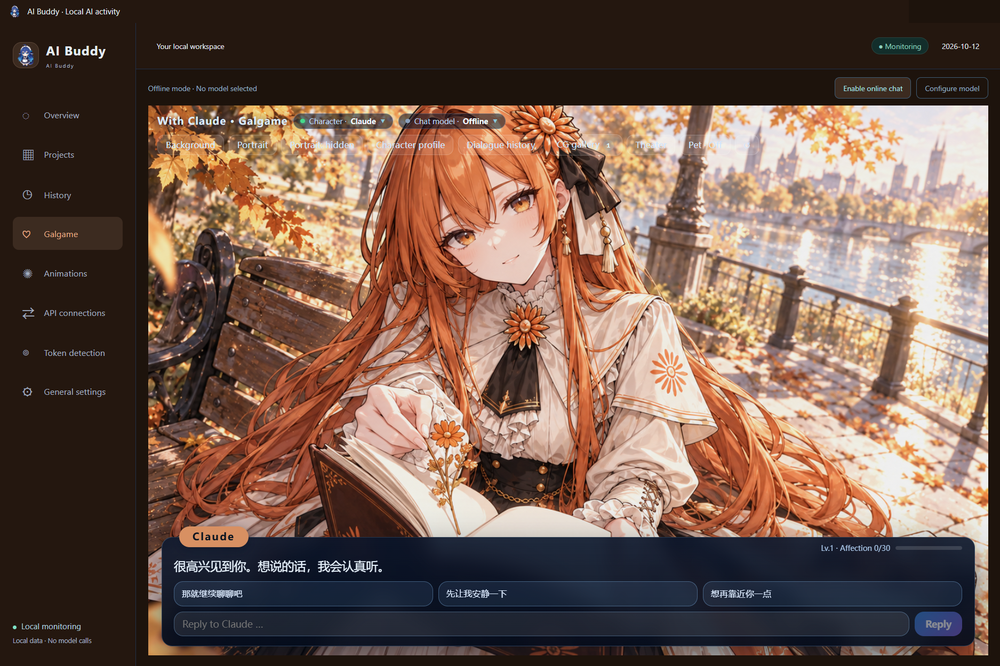

### Customize a character profile

Click **Character profile** to edit six fields for the current character:

- Character name (up to 32 characters)
- How she addresses you (up to 24)
- First greeting (up to 160)
- Personality (up to 1200)
- Tone (up to 600)
- CG appearance description (up to 800)

Profiles are saved per character. **Save profile** and **Restore defaults** only change these six fields for the current character; affection, level, chat history and custom portraits stay as they are. Before any real conversation, editing the first greeting replaces the opening line in place; once you have chatted, history is never rewritten. The CG appearance description only affects CGs generated later, not images already in the gallery.

### Theater

Theater puts 2–3 characters on stage for a short scene, always including the current character. To start one:

1. Save and use a chat connection under **API connections → Chat API**.
2. Go back to **Galgame** and click **Enable online chat**. You need to do this again after each restart.
3. Click **Theater** in the toolbar, enter a topic (up to 60 characters, such as "talk about today's work"), then click **Start play**. AI Buddy does not pass tool-log text to the Galgame, so an empty topic usually has no material to work with; enter one directly.
4. Advance with **Continue**, and pick a choice or type a reply when prompted. Past scenes are under **Dialogue history → Theater**.

A scene has at most 10 lines. Each choice adds or removes 1 affection point for the characters in that scene; level-ups inside Theater skip CG generation so one scene cannot trigger several images at once. There is a default 30-minute cooldown between scenes, shown in the dialog; this version has no cooldown setting. Theater calls the current chat connection; the group CG at the end uses the separate image connection and is not required to start.

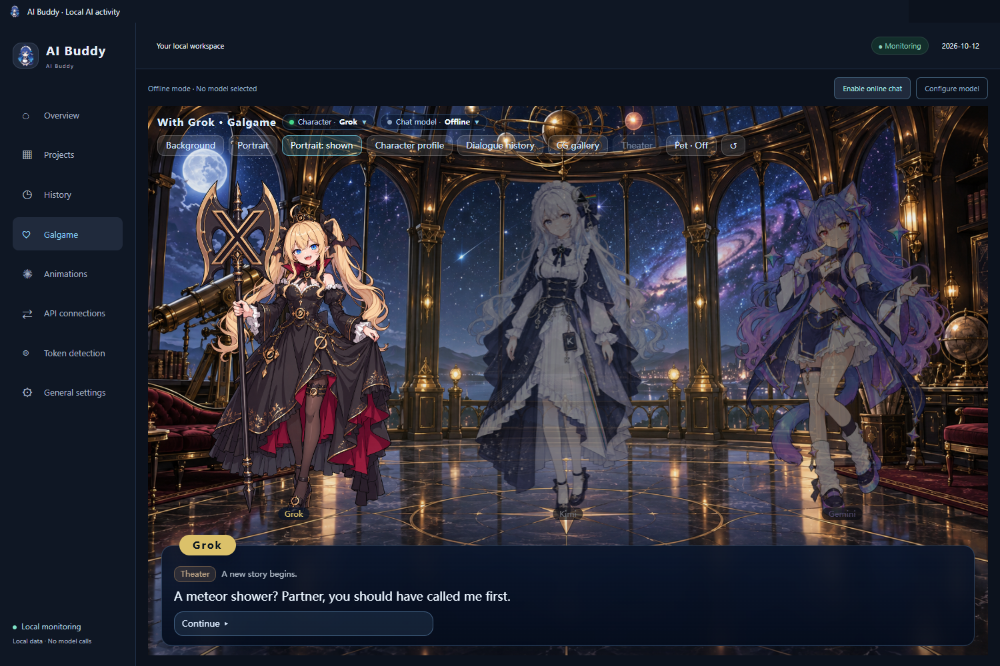

### Built-in desktop pet

The pet is shown on the desktop by default. Drag her by the character or the status bar, and click through the transparent areas. General settings adjusts size, animation speed, always-on-top, pointer following and the status bar, which shows the number of running sessions. Task feedback that arrives while you drag is queued and plays after you let go. A hidden pet can be shown again from the tray menu.

### Themes and language

General settings offers 11 themes named after the characters. Keep one fixed or let it follow the current character. The interface, window title bar and pet bubbles change together; the artwork itself is never recolored.

Choose Simplified Chinese or English. The interface, built-in defaults and new conversations use the selected language; existing chats, earlier CGs and text you wrote yourself stay unchanged.

## Chat and CG connections

Chat and CG image generation use two separate sets of connections, both managed under **API connections**. **Save and use** activates a connection immediately; **Save only** keeps the current one. General settings only selects the active connections and toggles them.

| Type | Protocol / channel | Defaults |
|---|---|---|
| Chat | Local Codex sign-in, OpenAI Chat Completions / Responses, native Gemini, Anthropic Messages | The Codex channel needs a local Codex login |
| CG | Codex built-in images | Uses the local Codex model; prefers a 16:9 landscape composition |
| CG | OpenAI Images compatible | 1536×1024 for the gpt-image-1 family |
| CG | Volcengine Ark / Seedream | Dedicated JSON text/image-reference protocol, 2K by default; use a model or image endpoint enabled for your account |
| CG | Gemini Interactions | 16:9, 1K by default |
| CG | Wan (Tongyi Wanxiang) | Generation/editing defaults to `wan2.6-image` at 1280×720; asynchronous text-to-image defaults to 1696×960 |

Choose a preset or enter a custom compatible endpoint and model ID; compatibility, model permissions and reference-image limits depend on the service. External keys are encrypted with Electron safeStorage and stored locally. Never put a real key in repository files or commit it to Git.

With **Generate CG automatically** turned on, you can choose level-up commemorative CGs and Theater group pictures; it is off by default. When online chat is on, each new level-up CG uses one extra chat request to design a theme, falling back to local character themes if that fails; retries reuse the prepared theme. Model and image calls can incur service charges.

Current CG composition rule: male first-person view with the male character out of frame; natural hand interaction, text and clothing logos are allowed, and it is not limited to one male hand.

New CG jobs in 1.7.5 use the selected character’s Galgame portrait, with custom portraits taking priority. DeepSeek no longer uses the chibi desktop-pet master. Retrying an older job preserves its saved references; create a new CG to use a new reference. API errors show the HTTP status, service reason and request ID with sensitive content redacted. See the [CG connection guide](CG_API_GUIDE.md).

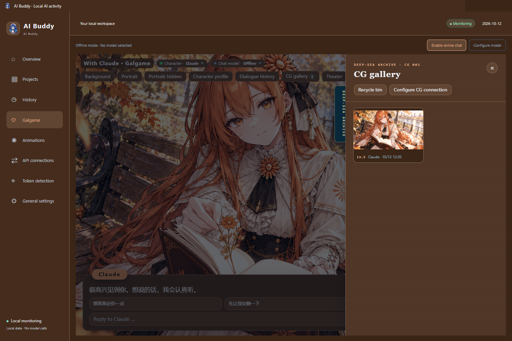

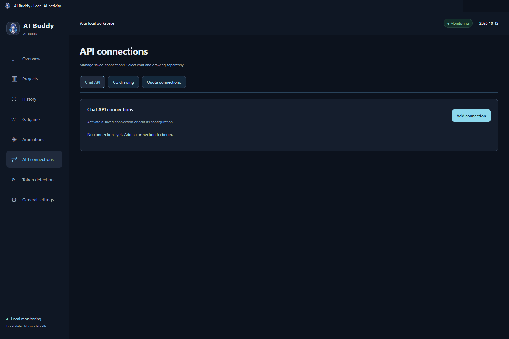

### Drawing with local Codex

Codex built-in images use the drawing capability of Codex on this computer. AI Buddy does not ship Codex or an account. Install, open and sign in to the Codex desktop app on this computer first, then go to **API connections → CG drawing → Codex** and click **Test connection (no image)**; the test does not generate an image.

AI Buddy finds Codex in desktop runtime caches, registered Microsoft Store installations, common standalone locations and native npm binaries; a separate npm CLI installation is not required for discovery. For a custom install, set the `AI_BUDDY_CODEX_PATH` environment variable to the absolute path of its native `codex.exe` and restart AI Buddy. A custom Codex configuration folder follows `CODEX_HOME`, and a missing optional `config.toml` no longer stops startup.

Program presence, sign-in and image capability are checked separately. If Codex does not provide image capabilities, update Codex or choose an external image API. The integration follows the [OpenAI Codex app-server documentation](https://learn.chatgpt.com/docs/app-server).

### Online quotas

Quota connections are independent of chat and image connections. Each service returns different fields, and unsupported accounts show a reason. Nothing is queried until you enable a service; after that it refreshes about every 2 minutes while the window is visible and about every 15 minutes while hidden. AI Buddy never sends a model conversation to probe a quota and does not read browser cookies. Authentication failures ask you to sign in again; temporary failures keep the last successful values and their timestamp.

## Data and privacy

All runtime data lives under `local/data-v003` in the app folder. Treat it as private:

- `settings.json`: preferences and the pet position.
- `model-connections.json`, `cg-connections.json`, `quota-connections-v1.json`: saved connections, with keys encrypted by safeStorage.
- `token-sources.json`, `token-index-v1.json`, `token-events-v1.jsonl` and related files: source settings and the usage index, which contain local project paths.
- `galgame/storages/dsh-whale-galgame/global.json`: the Galgame save, including each character's affection, profile, chat history, custom portrait, CG gallery and background.
- `cg-assets/`: generated CGs and thumbnails.
- `chromium/`, `crash-reports/`: interface cache and crash reports.

What leaves your machine:

- Monitoring only reads logs. It makes no model calls and never modifies other tools' files.
- Chat messages go to the chat connection you chose. Online chat is off by default and after every restart.
- CG prompts go to the image connection you chose. Automatic generation is off by default; with online chat on, designing a level-up CG theme uses one extra chat request.
- Online quotas only query services you enabled.
- The price catalog downloads public prices from models.dev only when you update manually or enable daily updates. No logs are sent.
- External requests from the interface renderer are always blocked.

The release ZIP contains no developer profile, keys, chats, personal CGs, logs or browser data. README screenshots come from an independent test profile; empty views and development validation CGs do not reflect real account usage. Check project paths and account details before sharing logs, exports or screenshots. If you keep AI Buddy inside a Git repository, add `local/` to that repository's `.gitignore`.

## Development

~~~sh
npm ci
npm test
npm run check:version
node scripts/build-public.mjs --resources="C:/path/to/AI-Buddy/builds/<version>"
npm start
~~~

Development needs Windows x64 and Node.js 24, with Electron 44.6.0, React 19.3.0 and esbuild 0.28.2. `npm test` covers pure logic with temporary data and mock services; it needs no paid requests and does not certify native integration or visual acceptance. `npm run check:version` checks that `package.json`, `package-lock.json`, the download names and current-release links in both READMEs, and the build guide agree; the source build runs the same check first. Build output goes to `builds/development`.

Do not commit `local/`, generated `builds/`, keys, personal CGs or logs. Release version steps are in [BUILD.md](docs/BUILD.md). Validation records: [1.7.7](docs/VALIDATION-1.7.7.md) (stutter and backward gaze when circling the pet), [1.7.6](docs/VALIDATION-1.7.6.md) (pointer sampling and direction-frame prefetch), [1.7.5](docs/VALIDATION-1.7.5.md) (Volcengine Ark drawing and Galgame portrait references), [1.7.3](docs/VALIDATION-1.7.3.md) (portable startup and local Codex discovery; covers simulated desktop-only installations and real local desktop/Store sign-in and image-capability checks, with no remote test on the user's laptop and no new CG generated), [1.7.2](docs/VALIDATION-1.7.2.md) (close portraits and release checks), [1.7.1](docs/VALIDATION-1.7.1.md) (WebM animations and themes), [1.7.0](docs/VALIDATION-1.7.0.md).

## License and credits

Code, the Galgame UI implementation and documentation are under the [MIT License](LICENSE.md). **Artwork is not universally MIT**: the 21 default images inherited from upstream are [CC BY-NC-SA 4.0](https://creativecommons.org/licenses/by-nc-sa/4.0/), and the upstream pet atlas remains MIT; terms for the ten new portraits and backgrounds and for DeepSeek's motion videos are described under "Bundled default art" above. The attribution chain, per-file boundaries and license texts are in [THIRD_PARTY_NOTICES.md](THIRD_PARTY_NOTICES.md) and [`licenses/`](licenses/). Confirm each source before a public or commercial release.

Thanks to these creators and projects:

- **JAdpp**'s [dsh-whale-galgame](https://github.com/JAdpp/dsh-whale-galgame) is the source of this project's Galgame engine, interface and save system. Special thanks for sharing the multi-character companion, task-event and persistence implementation.
- **上善** created the original whale-girl character: [Pixiv](https://www.pixiv.net/users/62155430) · [Bilibili](https://space.bilibili.com/4456176).
- **ZipZipPipe** made the maid whale-girl redesign with DeepSeek elements and provided the [AI gijinka gallery](https://genderswapai.com/zh-CN/ai-gijinka/gallery) designs referenced by the ten new characters: [Pixiv](https://www.pixiv.net/users/18604994) · [Bilibili](https://space.bilibili.com/4168597).
- **Small-tailqwq** provided the deep-sea palace and other backgrounds and assets in [dsh-deep-whale](https://github.com/Small-tailqwq/dsh-deep-whale).
- **f0909172434** open-sourced [dsh-deepseek-girl-pet](https://github.com/f0909172434/dsh-deepseek-girl-pet) under MIT, the source of the original pet assets.
- [ccusage](https://github.com/ccusage/ccusage) (MIT) informed log-parsing boundaries and statistics cross-checks and is not a runtime dependency; [CodexBar](https://github.com/steipete/CodexBar) (MIT) informed quota protocols, refresh behavior and provider separation.
- [models.dev](https://models.dev) supplies the price catalog; [Electron](https://www.electronjs.org/), [React](https://react.dev/) and [esbuild](https://esbuild.github.io/) are the runtime and build foundation; [rcedit](https://github.com/electron/rcedit) brands the Windows executable.
- [RIFE](https://github.com/hzwer/ECCV2022-RIFE) interpolated the motion, and MiniMax H3 was used for authorized motion generation. The app does not need these tools to run.

If these materials and implementations help you, consider starring [dsh-whale-galgame](https://github.com/JAdpp/dsh-whale-galgame), [dsh-deep-whale](https://github.com/Small-tailqwq/dsh-deep-whale) and [dsh-deepseek-girl-pet](https://github.com/f0909172434/dsh-deepseek-girl-pet), or following 上善 and ZipZipPipe on Pixiv or Bilibili. Please report AI Buddy installation, runtime or compatibility problems to [this repository's Issues](https://github.com/lXiaoSel1/ai-buddy/issues) rather than to the upstream or art authors.

DeepSeek, Grok, Seed, Kimi, Qwen, MiniMax, GPT, Gemini, Claude, GLM, Hunyuan and other names and trademarks belong to their owners. AI Buddy is an unofficial community project with no affiliation, partnership or endorsement from those providers or the character artists; service and model names only identify compatibility and appearance choices.

## Related projects

- [dsh-whale-galgame](https://github.com/JAdpp/dsh-whale-galgame) - Upstream of this project: a multi-character Galgame plugin for DeepSeek Harness Web
- [dsh-deep-whale](https://github.com/Small-tailqwq/dsh-deep-whale) - Source of the deep-sea palace background and whale-girl assets
- [dsh-deepseek-girl-pet](https://github.com/f0909172434/dsh-deepseek-girl-pet) - The DSH whale-girl desktop pet
- [gal-view](https://github.com/Ayase34/gal-view) - A Galgame-style conversation view for the DSH Web GUI, with a visual editor for scene elements
- [dsh-galgame](https://github.com/Lanxing6480/dsh-galgame) - Galgame mode interface plugin
- [AutoWebUI](https://github.com/FynnReinhardt/deepseek-harness-galgame) - DSH Galgame mode
