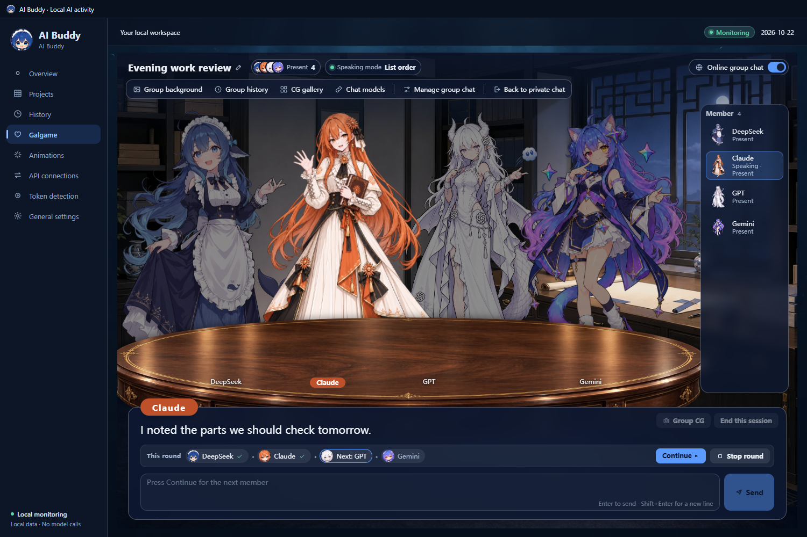
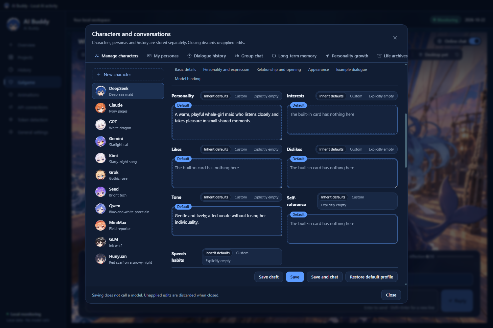
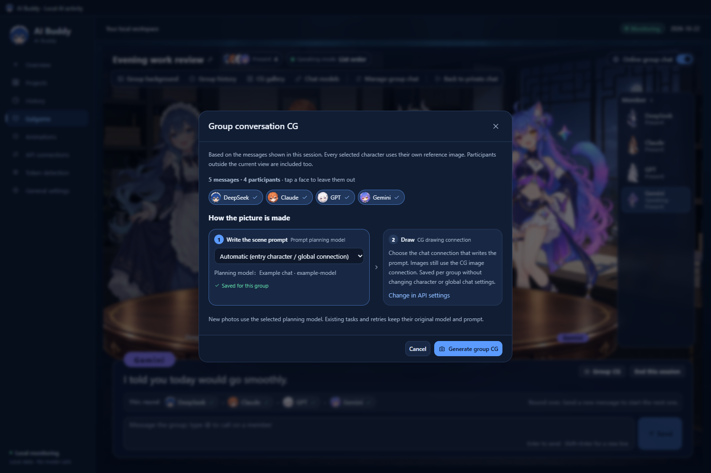
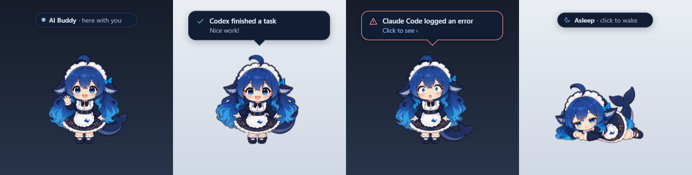

# AI Buddy · AI 酱 · Local AI usage monitor and multi-character Galgame companion

  
  
  
  
  
  
  
  
  

[简体中文](README.md) · **English**

<!-- ai-buddy-source-version: 1.9.0 -->
**Current release: [v1.9.0](https://github.com/lXiaoSel1/ai-buddy/releases/tag/v1.9.0)** · This release adds group chat, character cards and personas ("My personas"), a chat connection and effort for each character, plus long-term memory, personality growth and life archives. You can pat the desktop pet, walk her around or throw her, and she falls asleep when things are quiet. The whole interface was redesigned, and the 11 themes take their colors from the matching portraits. The 30fps and 60fps editions have the same features. See the [1.9.0 release notes](docs/RELEASE-1.9.0.md) and [validation record](docs/VALIDATION-1.9.0.md).

## Online installer (recommended)

[Download the Windows x64 installer](https://github.com/lXiaoSel1/ai-buddy/releases/download/v1.9.0/AI-Buddy-Setup-1.9.0-win-x64.exe), choose 30fps / 60fps and characters, then it downloads, verifies and installs. It supports adding characters later and offline import. To upgrade from 1.8.0, use this installer and pick the same folder. [Installation guide](docs/INSTALLER.md).

The installer is about 50 MiB. Downloading every character takes about **1.66 GiB** at 30fps or **2.33 GiB** at 60fps; picking fewer characters downloads less. The complete portable ZIP, split into parts, is the offline alternative; see [Install](#install).

## Overview

While your AI tools work and you wait for results, check how many tokens today has burned, then chat with the model girls for a bit～(∠・ω< )⌒★

AI Buddy (AI 酱) is a Windows desktop app. It only reads your local AI-tool logs, totals token usage, estimates cost and groups work by project. It also brings the multi-character Galgame from [JAdpp/dsh-whale-galgame](https://github.com/JAdpp/dsh-whale-galgame) to the desktop, together with a desktop pet and separate chat and CG image connections:

- **A local ledger for 8 AI tools**: Codex, Claude Code, Gemini CLI, Kimi Code CLI, OpenCode, Cline, Roo Code and DeepSeek Harness. It reads the usage the logs actually report; missing fields show as "not provided" instead of being guessed from text length.
- **11 model girls**: DeepSeek, Grok, Seed, Kimi, Qwen, MiniMax, GPT, Gemini, Claude, GLM and Hunyuan, each with her own portrait, background, personality and voice, and her own affection and CG gallery. You can also create your own characters.
- **Appearance and model are separate**: who appears on stage and which chat connection actually replies are chosen independently, and each character can be bound to her own connection and effort. Qwen's look with Claude's API works fine.
- **Group chat**: put several characters in one group around a round table. The first one replies on her own, the next ones take their turn when you click Continue, and they talk to each other too. Afterwards you can take a group CG.
- **She remembers, and slowly changes**: chat text is kept in full and long-term memory is consolidated every night at midnight. You can turn on personality growth for a character, and save, export and restore her whole "life".
- **More work, closer bonds**: while AI Buddy runs, new work tokens slowly turn into affection for the current character, and a level-up can produce a commemorative CG.
- **A transparent desktop pet for each of the 11 characters**: 24 actions each, at 30fps or 60fps. Pat her and she makes a face, she falls asleep after 5 quiet minutes, left-drag walks her along and right-drag throws her. She jumps when a task finishes and reacts when one fails.
- **11 character themes, Chinese and English**: colors, backgrounds and ornaments come from each portrait, 5 dark and 6 light. Keep one fixed or let it follow the current character.

## What it does

- **Overview** has Usage, Cost and Quotas tabs with totals, per-tool cards and the five most recent work items.
- **Projects** sorts by total, input or output tokens or by name. **History** shows daily, weekly and monthly trends with a date range and time zone, and exports CSV or JSON.
- Tools, model developers and service platforms are recorded separately. Codex is a tool; OpenAI is a developer or platform. A model name alone does not prove the official API was used.
- **Cost estimates** multiply input, output, cache-read and cache-write tokens by their own rates; request counts are not a billing unit. Subscription tools show an API-equivalent reference, not your plan's bill. Missing usage or prices stay unknown instead of becoming zero. Prices come from models.dev and can be filtered, overridden or updated manually under Cost → Price settings.
- **Online quotas** are optional and cover Codex, Claude, GLM/Z.ai, Kimi Coding, MiniMax Coding, DeepSeek API balances and supported Gemini CLI accounts. Nothing is queried until you enable a service.
- The **Characters and conversations** window manages character cards, personas, dialogue history, group chats, long-term memory, personality growth and life archives in one place.
- Each character keeps her own level, chat history, background, CG gallery, recycle bin and portrait visibility, and relationship progress is also kept per persona. Switching characters restores her own background.
- Every turn offers three reply choices; with an empty input box, press 1, 2 or 3 to pick one. You can also type freely.
- A CG used as the background hides the portrait by default, so the same character does not appear twice. Right-click a CG in the gallery to move it to the recycle bin; undo and restore are available.
- History is stored in local SQLite and read page by page on demand. Upgrades migrate the old index once, keeping original logs and snapshots. First indexing, replaced logs or index repair take longer.

<table>
  <tr>
    <td align="center"> <strong>Overview</strong></td>
    <td align="center"> <strong>Projects</strong></td>
  </tr>
  <tr>
    <td align="center"> <strong>History</strong></td>
    <td align="center"> <strong>Token detection</strong></td>
  </tr>
  <tr>
    <td align="center"> <strong>Group chat</strong></td>
    <td align="center"> <strong>Characters and conversations</strong></td>
  </tr>
  <tr>
    <td align="center"> <strong>Price settings</strong></td>
    <td align="center"> <strong>Online quotas</strong></td>
  </tr>
</table>

## Affection and local work

### Relationship progression

Every character starts independently at Lv.1 with 0 affection. The same character also keeps separate progress for each of your personas; if you prefer, switch her to one shared progress in "My personas" (the values are not added together). The close, neutral and distant reply choices score +1, 0 and -1, in a random order each turn. Typed replies use simple keyword rules: words such as "like" or "good night" add a point, while "annoying" or "go away" remove one. Affection never drops below 0.

The level threshold is `30 + 15 × (Lv - 1)`, that is 30, 45, 60 and so on. Overflow carries into the next level, and there is no level cap. After 24 hours without interaction, every character loses 2 points per day, down to 0. Her tone has five stages and stays at the closest one from Lv.5 onward. With automatic CG enabled and an image connection configured, each level-up produces a commemorative CG.

A left-click pat on the desktop pet also adds affection: at most 1 point per character every 60 seconds and 30 points a day, and the personas of the same character share this allowance. In group chat only what you say yourself affects affection, and each member is settled at most once per round.

### How local work affects characters

While AI Buddy runs, newly observed work tokens go into one shared balance; AI Buddy's own chat and image calls do not count. Every 5,000 tokens add 1 affection point to the current character, up to 3 points per settlement, with the remainder kept for next time. Settlement happens when you open the Galgame and before each message you send. Usage from before the app started is not counted retroactively.

When a log clearly records a finished task, the pet jumps twice and shows a completion bubble. When it records a failure, the pet plays the failure action once; click the error bubble to open Token detection. Feedback is queued with failures first, then completions, then dialogue; each event is announced once, and events of the same kind within one second are merged. While you chat with any Galgame character, the current pet acts out the emotion detected in the reply and shows its first sentence in a bubble (cut off after 40 characters), with built-in characters' names above it.

Unlike the upstream plugin, AI Buddy does not pass tool-log text to the Galgame, so characters do not bring up the specific tasks you are working on.

## Bundled default art

The package includes eleven default portraits, chibi desktop pets and backgrounds; DeepSeek's eight existing expressions and eighty new ones for the other ten characters; 264 separate transparent motion videos (24 per character); and gaze and emotion-peak stills. DeepSeek also has an optional seaside study, and five earlier backgrounds remain selectable. The previews below are downscaled; full-size images are installed with the app.

<table>
  <tr>
    <td align="center"> <strong>DeepSeek</strong></td>
    <td align="center"> <strong>Grok</strong></td>
    <td align="center"> <strong>Seed</strong></td>
    <td align="center"> <strong>Kimi</strong></td>
  </tr>
  <tr>
    <td align="center"> <strong>Qwen</strong></td>
    <td align="center"> <strong>MiniMax</strong></td>
    <td align="center"> <strong>GPT</strong></td>
    <td align="center"> <strong>Gemini</strong></td>
  </tr>
  <tr>
    <td align="center"> <strong>Claude</strong></td>
    <td align="center"> <strong>GLM</strong></td>
    <td align="center"> <strong>Hunyuan</strong></td>
    <td></td>
  </tr>
</table>

Each character also has her own chibi desktop pet with the same 24 actions. Here they are idling:

<table>
  <tr>
    <td align="center"> <strong>DeepSeek</strong></td>
    <td align="center"> <strong>Grok</strong></td>
    <td align="center"> <strong>Seed</strong></td>
    <td align="center"> <strong>Kimi</strong></td>
  </tr>
  <tr>
    <td align="center"> <strong>Qwen</strong></td>
    <td align="center"> <strong>MiniMax</strong></td>
    <td align="center"> <strong>GPT</strong></td>
    <td align="center"> <strong>Gemini</strong></td>
  </tr>
  <tr>
    <td align="center"> <strong>Claude</strong></td>
    <td align="center"> <strong>GLM</strong></td>
    <td align="center"> <strong>Hunyuan</strong></td>
    <td></td>
  </tr>
</table>

Each character uses her own scene by default:

<table>
  <tr>
    <td align="center"> <strong>DeepSeek · Deep-sea palace</strong></td>
    <td align="center"> <strong>Grok · Night observatory</strong></td>
    <td align="center"> <strong>Seed · Sunlit greenhouse study</strong></td>
  </tr>
  <tr>
    <td align="center"> <strong>Kimi · Moonlit reading room</strong></td>
    <td align="center"> <strong>Qwen · Modern Chinese academy</strong></td>
    <td align="center"> <strong>MiniMax · Creative studio</strong></td>
  </tr>
  <tr>
    <td align="center"> <strong>GPT · Collaborative study</strong></td>
    <td align="center"> <strong>Gemini · Twin-window star studio</strong></td>
    <td align="center"> <strong>Claude · Amber writing room</strong></td>
  </tr>
  <tr>
    <td align="center"> <strong>GLM · Research library</strong></td>
    <td align="center"> <strong>Hunyuan · Mountain garden pavilion</strong></td>
    <td></td>
  </tr>
</table>

The pet and the Animations page share transparent VP9 WebM videos at 30fps or 60fps. From 1.9.0 they are encoded at CRF 28; timing, canvas, size and transparency are unchanged. Each of the 11 characters has 24 motions: 18 everyday actions (idle, wave, happiness and the rest are made separately, and reviewing and seriousness do not share footage) and 6 interaction actions, falling asleep, sleeping, waking, take-off, flying and landing, which play on their own during sleep and throws. Cursor following uses a WebP Q95 still for every direction, with lossless alpha. Select a character on the Animations page to browse all of her actions; a card plays its preview when you hover it or reach it with Tab.

The colors, backgrounds and small header ornaments of the 11 themes all come from the matching portraits. DeepSeek, Grok, Kimi, Gemini and GLM are dark; Seed, Qwen, MiniMax, GPT, Claude and Hunyuan are light. Here is the Overview in each theme:

<table>
  <tr>
    <td align="center"> DeepSeek</td>
    <td align="center"> Grok</td>
    <td align="center"> Seed</td>
    <td align="center"> Kimi</td>
  </tr>
  <tr>
    <td align="center"> Qwen</td>
    <td align="center"> MiniMax</td>
    <td align="center"> GPT</td>
    <td align="center"> Gemini</td>
  </tr>
  <tr>
    <td align="center"> Claude</td>
    <td align="center"> GLM</td>
    <td align="center"> Hunyuan</td>
    <td></td>
  </tr>
</table>

The artwork has different sources and terms:

- DeepSeek's portrait, expression variants and the deep-sea palace and seaside study backgrounds come from upstream dsh-whale-galgame and belong to its 21 default images under CC BY-NC-SA 4.0.
- The other ten portraits and backgrounds were generated with an image tool, using character designs from a gallery as references; they are not the gallery files. The design authors are credited, but a general redistribution license for all ten references has not been verified.
- The chibi desktop pets of the ten new characters were generated from their portraits at the DeepSeek pet's proportions; they are not gallery files either.
- Character motion videos were generated with MiniMax H3 and interpolated with RIFE. New expressions and chibi designs retain their character-reference provenance; they are not universally claimed as MIT.
- The interface art added in 1.9.0, namely the 11 theme backgrounds and portrait ornaments, the pet's white-glove cursor and the group chat's round-table foreground, was generated with Codex's built-in image tool. It shows no characters and is not taken from any gallery. The glove only follows the interaction idea of QQ Pet's cursor switch; no Tencent cursor files were used. Each theme's cuff color is a script recolor of the same glove. The round heads in windows and the tray and the group member thumbnails are crops and resized copies of the existing portraits and pets.

See [THIRD_PARTY_NOTICES.md](THIRD_PARTY_NOTICES.md) for per-file notes. The Galgame layout, dialogue box and controls are adapted from upstream in [`src/adapted/galgame-client.ts`](src/adapted/galgame-client.ts) and do not depend on an unpublished UI image pack.

## Install

Requires Windows 10/11 x64. Use the online installer (recommended) or download the complete portable split archive. Both bundle their runtime; Node.js, Python and image tools are not needed. The two frame-rate editions have the same features, characters, save format and gaze precision; only the motion videos differ. With every character installed they take about 1.96 GiB (30fps) or 2.62 GiB (60fps), maintenance tool included.

### Online installer (recommended)

1. Download `AI-Buddy-Setup-1.9.0-win-x64.exe` (about 50 MiB) from the [v1.9.0 page](https://github.com/lXiaoSel1/ai-buddy/releases/tag/v1.9.0). It includes its own .NET runtime.
2. Choose the installation folder (default `%LOCALAPPDATA%\Programs\AI Buddy`), 30fps or 60fps, the characters to install and the initial character. The first-run defaults are 30fps, every character and DeepSeek.
3. Click install. The installer downloads from the pinned v1.9.0 release and checks SHA-256 for every package and file; every character takes about 1.66 GiB at 30fps or 2.33 GiB at 60fps. If a download is interrupted, run the same installer again with the same folder to resume.
4. Desktop and Start menu shortcuts are created by default. The installer does not turn on online chat, automatic CG, startup registration or background updates.

**Upgrading from 1.8.0**: the 1.8.0 installer is pinned to its own manifest and cannot find 1.9.0. Download the 1.9.0 installer and choose the existing installation folder. It takes over that folder and keeps your personal data, custom data folder, chat connections and character settings; a complete portable folder can be taken over the same way. Do not copy an old profile over the new folder.

### Portable split archive (offline)

1. From the same page, download every part of your edition plus the merge tools into one folder:
    - 30fps: `AI-Buddy-1.9.0-Windows-x64-30fps.zip.part01`, `.part02`, `AI-Buddy-1.9.0-Windows-x64-30fps.zip.parts.json`, `Combine-AI-Buddy-1.9.0.ps1` and `Combine-AI-Buddy-1.9.0-30fps.cmd`.
    - 60fps: `AI-Buddy-1.9.0-Windows-x64-60fps.zip.part01` to `.part03`, the matching `.zip.parts.json`, `Combine-AI-Buddy-1.9.0.ps1` and `Combine-AI-Buddy-1.9.0-60fps.cmd`.
2. Double-click the matching `.cmd`. It verifies each part, combines them and verifies the complete ZIP, using only the built-in Windows PowerShell. Do not extract an individual part. The combined ZIP is about 1.70 GiB (30fps) or 2.37 GiB (60fps).
3. Extract the combined ZIP to a writable location, open the `AI-Buddy` folder and double-click **AI Buddy.exe** in its root. `AI Buddy.vbs` and `AI Buddy.cmd` are compatibility launchers that start the same program.

Another offline route: put `install-manifest-1.9.0.json` and the resource ZIPs you need in one folder and select it as the installer's "Offline resource folder"; the same checks apply. The 1.7.10 offline packages remain on their original release page.

Notes:

- Do not run it from inside the ZIP or copy only the executable; keep the folder structure.
- Neither the installer nor the app is commercially code-signed, so Windows may report an unknown publisher. Check the files against `SHA256SUMS-1.9.0.txt` first if you like.
- On first launch it looks for common log folders under the current user. No AI tools installed? The companion features still work offline.
- The automatic GitHub **Source code** archives are source-only and do not run.
- This repository and official releases are public. Release packages exclude the developer's saves, connection secrets and local logs.

Folder layout after installation:

~~~text
<install folder>/
├─ AI Buddy.exe / AI Buddy.vbs / AI Buddy.cmd / Start-AI-Buddy.ps1   launchers
├─ builds/<version>/                       app code, motions and character resources
├─ runtime/AI-Buddy-<version>/             Electron runtime
├─ maintenance/1.9.0/AI Buddy Setup.exe    maintenance tool
├─ local/current-build.json                current version pointer
├─ local/installation.json                 installed edition and characters
├─ local/data-v003/                        your data, created on first run
├─ assets/  docs/  licenses/
└─ README.md  LICENSE.md  THIRD_PARTY_NOTICES.md
~~~

### Update and remove

Online install:

- Add characters, repair files or switch frame rate: click **Manage character resources** in General settings to open the maintenance tool, or run the same-version installer again. Characters that are not installed show as "Not installed" and open the installer only after you confirm; nothing downloads automatically.
- Upgrade: run the newer installer. It waits for chat and CG to finish, closes AI Buddy normally, and keeps the previous program version and your personal data.
- Roll back: click **Roll back** in the installer. It restores the program and launch pointer only and never overwrites newer progress with old saves. 1.9.0 writes new-format images and life / memory data; when you go back to 1.8.0, 1.7.10 or 1.7.9 and your data already contains them, the maintenance tool refuses the automatic downgrade and does not convert or delete that data.
- Remove: click **Uninstall…** in the installer. Personal data is kept by default; you can also tick deleting the default personal data (irreversible). A custom data folder is never deleted. The download cache `%LOCALAPPDATA%\AI Buddy\InstallerCache` stays for resuming and repair; delete it manually if you no longer need it.

Portable:

- Update: choose **Quit** from the tray menu, extract the new version over the same location and start it as usual. Your data lives in `local/data-v003`; the release package does not contain that folder, so extracting over it leaves it alone. Back it up before updating if you like.
- Remove: quit and delete the whole folder; AI Buddy adds no startup entry. Back up `local/data-v003` first if you want to keep chats and CGs.

### Run from source

You only need this to build it yourself. It requires Windows x64, Node.js 24 and npm:

~~~sh
npm ci
node scripts/build-public.mjs --resources="C:/path/to/AI-Buddy/builds/<version>"
npm start
~~~

`--resources` points to the `builds/<version>` folder of the matching portable release, the one containing `assets/frame-sequence-manifest.json`. The build reuses the released portraits and animations; nothing is regenerated. See [BUILD.md](docs/BUILD.md).

## Use and settings

A left click on the pet is a pat: she makes a face. A right click opens the pet menu: open the workspace, open the Galgame, let her nap (it becomes "Wake her up" while she sleeps), show the status bar and hide the pet. Clicking the status bar opens Overview. Double-clicking the tray icon also opens the main window; the tray menu has Overview, General settings, Animations and Open Galgame, plus showing the pet, drag mode and Quit.

### Token detection

On first launch AI Buddy looks in these places under the current Windows user:

| Tool | Default location |
|---|---|
| Codex | `.codex\sessions` and `archived_sessions`; `CODEX_HOME` overrides |
| Claude Code | `.claude\projects`; `CLAUDE_CONFIG_DIR` overrides |
| Gemini CLI | `.gemini\tmp` |
| Kimi Code CLI | `.kimi-code\sessions` and the older `.kimi\sessions` |
| OpenCode | `.local\share\opencode`; `XDG_DATA_HOME` or `OPENCODE_DB` also work |
| Cline / Roo Code | Extension storage of VS Code, VS Code Insiders, VSCodium and Cursor; Cline also `.cline\data\sessions` |
| DeepSeek Harness | `.dsh\sessions`; `DSH_HOME` overrides |

Portable editors, WSL or other users' folders must be added manually: in **Token detection**, click **Add source**, choose a tool template and the actual folder, run **Local parsing preview**, then **Save and enable**. Custom sources accept JSONL, Zstd-compressed JSONL, JSON, CSV and SQLite, support field mapping, and templates can be imported and exported. Removing a source never deletes the original logs or the usage already recorded.

### General settings defaults

| Setting | Default |
|---|---|
| Language | Follows the system language on first launch; Simplified Chinese or English |
| Theme mode | Fixed DeepSeek theme; can follow the current character instead |
| Show desktop pet | On |
| Companion character | Follow Galgame character; DeepSeek when switched to a fixed character |
| Pet size | 125%; 75%, 100%, 125% or 150% |
| Animation speed | 75%; 25%, 50%, 75% or 100% |
| Always on top, Click through transparent areas, Follow the pointer, Show status bar, Task feedback bubbles | On |
| Automatic sleep, Physical interactions (throw and charge) | On |
| Throw strength | Standard; Gentle, Standard, Strong or Exaggerated |
| Automatically hide the portrait on CG backgrounds | On |
| Maximum model output | 8,192 tokens; Auto or 256–65,536 |
| Fallback polling interval | 1 second (file changes are read immediately); 1, 2 or 5 seconds |
| Activity time display | New York time; system local time or UTC available |
| Statistics time zone | System local time |
| Update prices daily | Off |

Two switches live outside this table: **Online chat** is off after every restart and must be turned on manually, and **Generate CG automatically** is off on a fresh install. **Restore default settings** resets every option above: the language goes back to Simplified Chinese and a hidden pet is shown again. The chat and image connection choices and Token detection sources are not affected, and the pet position, usage and Galgame data are kept.

### Character and chat model

In the Galgame toolbar, **Character** decides who appears, which can follow the workspace or be fixed by hand; **Chat model** shows which chat connection and model actually reply for this character. Neither affects the other. The online chat switch sits at the right end of the toolbar. Click the title to rename it; each character keeps her own. **Background** and **Portrait** accept built-in choices or your own images (PNG, JPEG, WebP or AVIF, up to 12 MB each).

Single-character scenes use a close framing: the face and upper body are larger, and the lower body continues behind the dialogue box; the portrait pickers still show the full figure. The **Portrait** button in the toolbar switches between shown and hidden, and once you have changed it by hand a **Restore automatic** option appears; in automatic mode, a CG background hides the portrait.

### Characters and conversations

In the Galgame toolbar, **Manage characters**, **My personas**, **Dialogue history** and **Group chat** open the matching tab of the "Characters and conversations" window; long-term memory, personality growth and life archives also live there. Nothing saved in this window calls a model, and unsaved edits are discarded when you close it.

- **Manage characters**: each character card has four groups (basic details, personality and expression, relationship and opening, appearance) with 15 text fields and 3 images (portrait, background, CG reference), plus example dialogue, model binding and talkativeness. Every field can be set to "Inherit defaults", "Custom" or "Explicitly empty": inheriting shows the built-in profile's own text, and explicitly empty leaves the field blank instead of falling back to the default. A jump bar sits at the top of the form and the save buttons stay at the bottom; you can "Save draft" first. Built-in characters have "Restore default profile", which loads a draft that only takes effect once saved. "New character" adds your own: custom characters do not get generated images or a desktop pet, but you can upload a portrait, background and CG reference yourself, chat works without a portrait, and the desktop pet stays a built-in character. Persona fields and example lines take up to 20,000 characters each (the name up to 80), and images uploaded here are limited to 8 MiB.
- **My personas**: who you are, with a management name, the nickname characters call you, occupation, interests, background and communication preferences, plus a name and relationship you set for the current character. Conversations, drafts, reply choices and relationship progress are kept per persona; a character's progress can be switched between independent and shared. New conversations use the current persona, or the default persona if none is selected.
- **Dialogue history**: conversations on the left, searchable by text and date, with archived ones available too; the messages of the selected conversation show on the right without switching to it. You can star messages in the current conversation, and with "Allow correcting my messages" on you can correct what you said earlier. A correction keeps the original text and its versions, does not ask the model again and does not change affection; the character's lines cannot be edited. Conversations can be renamed, archived, exported as JSON and restored from JSON (up to 50 MiB). Theater scenes you played before are listed at the bottom under "Past skits" to read.

### Group chat

Create a group under "Characters and conversations › Group chat": enter a name, pick members and your persona (the persona cannot be changed after the group is created), write a scene, choose a speaking mode, then click **Save and enter**. There is no limit on members; up to 4 stand on stage at once (fewer in a narrow window), and whoever is speaking lights up. Turn on **Online group chat** at the right end of the toolbar first.

| Speaking mode | Who replies |
|---|---|
| Natural | @-mentioned members first; other members are picked at random according to the talkativeness on their character cards. If nobody is picked, one is chosen at random, so 0% does not mean silent |
| List order | Every present, unmuted member replies once, in list order |
| Manual | Only @-mentioned members reply |
| Rotating pool | One member per round, taking turns |

After you send a message, the first member replies on her own and the next ones speak when you click **Continue ▸**. The "This round" bar in the dialogue box marks who has spoken and who is next, and **Stop round** ends it at any time. Members also talk to each other, and sometimes argue. Typing @ shows the member list; muted members are never picked to reply, even if you @ them. A newly added member does not know what was said before she joined, nor what happened while she was away; when she comes back she keeps what she knew before.

Each member uses the chat connection on her own character card (by default, the global one), and you can change it member by member under **Chat models** in the group toolbar; each choice is saved immediately. This edits her character card, so her private chat changes too. A group has its own background (the round-table foreground can be turned off), its own chat log, which you can search and export, and its own CG gallery.

When a round is over you can click **Group CG**. The picture is made in two steps: first a "Prompt planning model" writes the image prompt from the conversation shown so far, then the CG image connection draws it. The planner is "Automatic" by default and uses the entry character's or the global chat connection; you can also pick one chat connection for this group, which is saved immediately. With online chat off, "Automatic" writes the prompt from a local template instead; if you picked a connection and online chat is off, it asks you to turn online chat on rather than quietly switching to another connection. Click an avatar to leave that member out of the picture. Group settings also offer "Generate a group CG when this session ends".

The finished picture goes into the group's own CG gallery:

The earlier Theater has been replaced by group chat and its toolbar entry is gone. Scenes you already played stay under "Past skits" at the bottom of "Dialogue history"; you can read them and still add a group CG to one, but new ones cannot be started.

### Long-term memory, personality growth and life archives

- **Long-term memory**: chat text is kept in full. Every night at midnight (local time), AI Buddy writes each character's summary of the day, Guide and core memories. Consolidation uses that character's chat connection and only runs while online chat is on; missed days are caught up the next time you turn online chat on (it is off after every start). The memory page is read-only: if something is remembered wrong, correct it in chat, or say something like "don't bring that up again"; the original text is still kept. Ordinary memories are not deleted over time. Personas do not share memories; in a group chat she only knows that group, while in private chat she can recall the groups she shared with you under the same persona.
- **Personality growth**: off by default; turn it on from its page, starting from the current profile or from a blank slate as a new life. While it is on, her persona changes slowly with your real conversations; name, persona and example dialogue become read-only, while appearance, chat connection and talkativeness can still be changed. The personality is shared per character; relationships stay separate per persona.
- **Life archives**: save a character's whole "life" (her card, her memories, and each persona's relationship and progress) as one archive that you can preview read-only, export as a ZIP, import, reset or restore. Reset and restore first save the current life as another archive and ask you to type the character's name to confirm; they do not roll back other characters or account usage. One archive can be up to 512 MiB; there is no limit on their number and they do not expire.

See [Long-term memory and life archives](docs/long-term-memory-lives.md) for details.

### Built-in desktop pet

Each of the 11 characters has her own pet. **Companion character** in General settings defaults to **Follow Galgame character**: whoever you switch to in the Galgame appears on the desktop. Choose **Fixed character** to keep the same one. Characters without installed resources show as "Not installed" and prompt you to add them; nothing downloads automatically. Chatting with any character makes the pet play the matching emotion; in group chat the pet stays the character you entered the group with.

- **Pat**: over her, the pointer turns into a white glove. Left-click and she makes a face while the glove gives a little poke.
- **Sleep**: after 5 quiet minutes (no new work tokens, interaction, task feedback or chat) she falls asleep and the status bar reads "Asleep · click to wake"; she stays awake while real chat and image requests are running. You can also let her nap from the right-click menu.
- **Walk her**: hold the left button and drag; she walks along with the pointer and stays where you let go.
- **Throw her**: hold the right button, drag a little and let go quickly, and she flies off, bounces off the screen edges and lands on her feet. While right-dragging, hold the left button to charge like a slingshot and release it to launch; the predicted path, landing point and strength are drawn on screen. Esc cancels. Adjust the throw strength in General settings; turning off "Physical interactions" stops throwing and charging, while walking her still works.
- **The status bar** shows her state, such as "AI Buddy · here with you", "Working · 2 sessions" or "Waiting for you · Codex". Hover it for a ×; after closing it you get an undo notice, and you can bring it back later from the right-click menu or General settings.
- The glove's cuff, the bubbles and the status bar follow the current theme; the taskbar and tray icons show the head of the pet currently on the desktop.

Transparent areas let clicks through. Task feedback that arrives while you drag is queued and plays after you let go. A hidden pet can be shown again from the tray menu.

### Themes and language

General settings offers 11 themes named after the characters, with colors, backgrounds and ornaments taken from the matching portraits, 5 dark and 6 light. Keep one fixed or let it follow the current character. The interface, window title bar, pet status bar and bubbles change together; the character images themselves are never recolored.

Choose Simplified Chinese or English. After switching, the interface and new conversations use the selected language; existing chats, earlier CGs and text you wrote yourself stay unchanged.

## Chat and CG connections

Chat and CG image generation use two separate sets of connections, both managed under **API connections**. **Save and use** activates a connection immediately; **Save only** keeps the current one. General settings only selects the active connections and toggles them. Each character uses the global chat connection by default, and you can give her her own under **Model binding** on her character card; in group chat every member uses her own.

| Type | Protocol / channel | Defaults |
|---|---|---|
| Chat | Local Codex sign-in, OpenAI Chat Completions / Responses, native Gemini, Anthropic Messages | The Codex channel needs a local Codex login |
| CG | Codex built-in images | Uses the local Codex model; prefers a 16:9 landscape composition |
| CG | OpenAI Images compatible | 1536×1024 for the gpt-image-1 family |
| CG | Volcengine Ark / Seedream | Dedicated JSON text/image-reference protocol, 2K by default; use a model or image endpoint enabled for your account |
| CG | Gemini Interactions | 16:9, 1K by default |
| CG | Wan (Tongyi Wanxiang) | Generation/editing defaults to `wan2.6-image` at 1280×720; asynchronous text-to-image defaults to 1696×960 |

A chat connection can set a reasoning effort, which applies to local Codex, OpenAI Responses and Chat Completions; local Codex uses low when none is set, and native Gemini and Anthropic Messages use the model default. A connection can also state its context window; if it does not and the model catalog has no figure, 272,000 tokens are assumed. If a reply from an external API connection is cut off by the output limit, it is retried once with double the limit (local Codex does not retry); if it is still cut off, the message suggests raising the output limit in General settings.

Choose a preset or enter a custom compatible endpoint and model ID; compatibility, model permissions and reference-image limits depend on the service. External keys are encrypted with Electron safeStorage and stored locally. Never put a real key in repository files or commit it to Git.

**Generate CG automatically** is off by default; when it is on, each level-up produces a keepsake picture. With online chat on, each new level-up CG uses one extra chat request to design a theme, falling back to local character themes if that fails; retries reuse the prepared theme. You can also click **Make keepsake CG** in the CG gallery to make one by hand. Group CGs are made by hand (or automatically at the end of a session, if the group setting is on) and only need an image connection. Model and image calls can incur service charges.

Current CG composition rule: male first-person view with the male character out of frame; natural hand interaction, text and clothing logos are allowed, and it is not limited to one male hand.

New CG jobs since 1.7.5 use the selected character's Galgame portrait as the reference, with custom portraits taking priority; DeepSeek no longer uses the chibi desktop-pet master. Retrying an older job keeps its saved references; create a new CG to use a new reference. Volcengine Ark errors show the HTTP status, the service's reason and the request ID with sensitive content redacted. See the [CG connection guide](CG_API_GUIDE.md).

### Drawing with local Codex

Codex built-in images use the drawing capability of Codex on this computer. AI Buddy does not ship Codex or an account. Install, open and sign in to the Codex desktop app on this computer first, then go to **API connections → CG drawing → Codex** and click **Test connection (no image)**.

AI Buddy finds Codex in desktop runtime caches, registered Microsoft Store installations, common standalone locations and native npm binaries; a separate npm CLI installation is not required for discovery. For a custom install, set the `AI_BUDDY_CODEX_PATH` environment variable to the absolute path of its native `codex.exe` and restart AI Buddy. A custom Codex configuration folder follows `CODEX_HOME`, and a missing optional `config.toml` no longer stops startup.

Program presence, sign-in and image capability are checked separately. If Codex does not provide image capabilities, update Codex or choose an external image API. The integration follows the [OpenAI Codex app-server documentation](https://learn.chatgpt.com/docs/app-server).

### Online quotas

Quota connections are independent of chat and image connections. Each service returns different fields, and unsupported accounts show a reason. Nothing is queried until you enable a service; after that it refreshes about every 2 minutes while the window is visible and about every 15 minutes while hidden. AI Buddy never sends a model conversation to probe a quota and does not read browser cookies. Authentication failures ask you to sign in again; temporary failures keep the last successful values and their timestamp.

## Data and privacy

All runtime data lives under `local/data-v003` in the app folder. Treat it as private:

- `settings.json`: preferences and the pet position.
- `model-connections.json`, `cg-connections.json`, `quota-connections-v1.json`: saved connections, with keys encrypted by safeStorage.
- `token-sources.json`, `token-index-v1.json`, `token-events-v1.jsonl` and related files: source settings and the usage index, which contain local project paths.
- `usage-ledger-v2/`: request history (local SQLite), read page by page on demand.
- `galgame/companion.json`: character cards, personas, conversations, group chats (members, logs, group CGs and backgrounds), long-term memory and personality growth.
- `galgame/storages/dsh-whale-galgame/global.json`: the Galgame save, including each character's affection, level, CG gallery and background.
- `galgame/media/`: images stored by content hash, including the avatars, portraits and backgrounds you uploaded.
- `galgame/drafts.json`: messages you have not sent yet.
- `galgame/life-archives/`: life archive ZIPs.
- `galgame/maintenance/`: full backups taken automatically before data maintenance.
- `cg-assets/`: generated CGs and thumbnails.
- `chromium/`, `crash-reports/`: interface cache and crash reports.

`settings.json`, `model-connections.json`, `cg-connections.json`, `companion.json` and the Galgame save are actually `.snapshots/` folders of the same name that hold recent versions: from 1.9.0, the latest 50 changes plus one per day for 90 days. The online installer's download cache is `%LOCALAPPDATA%\AI Buddy\InstallerCache`; it holds only install packages, no personal data.

What leaves your machine:

- Monitoring only reads logs. It makes no model calls and never modifies other tools' files.
- Chat messages go to the chat connection this character uses. Besides the conversation, a request carries your current persona's details and relevant memory snippets of this character. Online chat is off by default and after every restart.
- In group chat, every member who speaks sends one request through her own connection.
- **Nightly memory consolidation**: while online chat is on, once a day for each character and each knowledge scope (private chat under each persona, each group chat) the day's text is sent to that character's chat connection; a very long day is consolidated in several parts. When you turn online chat on, days that piled up and were not consolidated yet are all caught up, which can mean many requests.
- CG prompts go to the image connection you chose. Automatic generation is off by default; with online chat on, designing a level-up CG theme uses one extra chat request carrying the last few lines of conversation and the character profile.
- A group CG sends the group conversation shown so far, with speaker names, to the prompt planning model and puts it into the image prompt; an uploaded group background is sent to the image connection as a reference image (unless that connection has references turned off).
- Online quotas only query services you enabled.
- The price catalog downloads public prices from models.dev only when you update manually or enable daily updates. No logs are sent.
- External requests from the interface renderer are always blocked.

The release ZIP contains no developer profile, keys, chats, personal CGs, logs or browser data. README screenshots come from an independent test profile: usage figures are synthetic, chat replies come from a local test service, and the two CGs in the screenshots were generated on the spot with the developer's local Codex. They do not reflect real account usage or conversations. Check project paths and account details before sharing logs, exports or screenshots. If you keep AI Buddy inside a Git repository, add `local/` to that repository's `.gitignore`.

## Development

~~~sh
npm ci
npm test
npm run check:version
node scripts/build-public.mjs --resources="C:/path/to/AI-Buddy/builds/<version>"
npm start
~~~

Development needs Windows x64 and Node.js 24, with Electron 44.6.0, React 19.3.0 and esbuild 0.28.2. `npm test` covers pure logic with temporary data and mock services; it needs no paid requests and does not certify native integration or visual acceptance. `npm run check:version` checks that `package.json`, `package-lock.json`, the download names and current-release links in both READMEs, and the build guide agree; the source build runs the same check first. Build output goes to `builds/development`.

The "installer downloads" badge under the title is updated every 6 hours by [`.github/workflows/installer-download-badge.yml`](.github/workflows/installer-download-badge.yml). It counts only downloads of each version's `AI-Buddy-Setup-*-win-x64.exe`, summed over all versions, and writes the result to the `badges` branch rather than committing to `main`. GitHub does not tell downloaders apart, so test downloads during development count too.

Do not commit `local/`, generated `builds/`, keys, personal CGs or logs. Release version steps are in [BUILD.md](docs/BUILD.md). Validation records: [1.9.0](docs/VALIDATION-1.9.0.md) (group chat, character cards and personas, long-term memory and life archives, pet interactions, interface redesign; see also the [release notes](docs/RELEASE-1.9.0.md)), [1.8.0](docs/VALIDATION-1.8.0.md) (online installer and per-character packages), [1.7.10](docs/VALIDATION-1.7.10.md) (30fps / 60fps editions, request history in SQLite), [1.7.9](docs/VALIDATION-1.7.9.md) (consistent character size, action switching and hit-test fixes), [1.7.8](docs/VALIDATION-1.7.8.md) (separate desktop pets and expressions for all 11 characters), [1.7.7](docs/VALIDATION-1.7.7.md) (stutter and backward gaze when circling the pet), [1.7.6](docs/VALIDATION-1.7.6.md) (pointer sampling and direction-frame prefetch), [1.7.5](docs/VALIDATION-1.7.5.md) (Volcengine Ark drawing and Galgame portrait references), [1.7.3](docs/VALIDATION-1.7.3.md) (portable startup and local Codex discovery; covers simulated desktop-only installations and real local desktop/Store sign-in and image-capability checks, with no remote test on the user's laptop and no new CG generated), [1.7.2](docs/VALIDATION-1.7.2.md) (close portraits and release checks), [1.7.1](docs/VALIDATION-1.7.1.md) (WebM animations and themes), [1.7.0](docs/VALIDATION-1.7.0.md).

## License and credits

AI Buddy's code, Galgame UI implementation and documentation are copyright **lXiaoSel1** and licensed under the [Apache License 2.0 with the Commons Clause](LICENSE.md):

- You may use, copy, modify and share it free of charge, including inside a company.
- **You may not sell it without written permission from lXiaoSel1.** This covers any paid product or service whose value derives mainly from AI Buddy, including paid downloads, subscriptions, paid hosting, and paid installation, setup or support. To ask for a license, [open an issue](https://github.com/lXiaoSel1/AI-Buddy/issues) or message lXiaoSel1 on GitHub.
- Under the Open Source Initiative's definition this is a source-available license, not an open-source license.
- Version 1.8.0 and earlier were released under the MIT License; copies obtained under it remain MIT.
- Portions adapted from the upstream dsh-whale-galgame keep their original MIT notice in [`licenses/upstream/`](licenses/upstream/).
- The license does not grant use of the "AI 酱 / AI Buddy" name.
- Read the contributor agreement in [CONTRIBUTING.md](CONTRIBUTING.md) before submitting code.

**Artwork has its own terms**: the 21 default images inherited from upstream are [CC BY-NC-SA 4.0](https://creativecommons.org/licenses/by-nc-sa/4.0/), and the upstream pet atlas remains MIT; terms for the ten new portraits and backgrounds, the motion videos and the 1.9.0 interface art are described under "Bundled default art" above. The attribution chain, per-file boundaries and license texts are in [THIRD_PARTY_NOTICES.md](THIRD_PARTY_NOTICES.md) and [`licenses/`](licenses/). Confirm each source before a public or commercial release.

Thanks to these creators and projects:

- **JAdpp**'s [dsh-whale-galgame](https://github.com/JAdpp/dsh-whale-galgame) is the source of this project's Galgame engine, interface and save system. Special thanks for sharing the multi-character companion, task-event and persistence implementation.
- **上善** created the original whale-girl character: [Pixiv](https://www.pixiv.net/users/62155430) · [Bilibili](https://space.bilibili.com/4456176).
- **ZipZipPipe** made the maid whale-girl redesign with DeepSeek elements and provided the [AI gijinka gallery](https://genderswapai.com/zh-CN/ai-gijinka/gallery) designs referenced by the ten new characters: [Pixiv](https://www.pixiv.net/users/18604994) · [Bilibili](https://space.bilibili.com/4168597).
- **Small-tailqwq** provided the deep-sea palace and other backgrounds and assets in [dsh-deep-whale](https://github.com/Small-tailqwq/dsh-deep-whale).
- **f0909172434** open-sourced [dsh-deepseek-girl-pet](https://github.com/f0909172434/dsh-deepseek-girl-pet) under MIT, the source of the original pet assets.
- [ccusage](https://github.com/ccusage/ccusage) (MIT) informed log-parsing boundaries and statistics cross-checks and is not a runtime dependency; [CodexBar](https://github.com/steipete/CodexBar) (MIT) informed quota protocols, refresh behavior and provider separation.
- [models.dev](https://models.dev) supplies the price catalog; [Electron](https://www.electronjs.org/), [React](https://react.dev/) and [esbuild](https://esbuild.github.io/) are the runtime and build foundation; [rcedit](https://github.com/electron/rcedit) brands the Windows executable.
- [RIFE](https://github.com/hzwer/ECCV2022-RIFE) interpolated the motion, and MiniMax H3 was used for authorized motion generation. The app does not need these tools to run.

If these materials and implementations help you, consider starring [dsh-whale-galgame](https://github.com/JAdpp/dsh-whale-galgame), [dsh-deep-whale](https://github.com/Small-tailqwq/dsh-deep-whale) and [dsh-deepseek-girl-pet](https://github.com/f0909172434/dsh-deepseek-girl-pet), or following 上善 and ZipZipPipe on Pixiv or Bilibili. Please report AI Buddy installation, runtime or compatibility problems to [this repository's Issues](https://github.com/lXiaoSel1/ai-buddy/issues) rather than to the upstream or art authors.

DeepSeek, Grok, Seed, Kimi, Qwen, MiniMax, GPT, Gemini, Claude, GLM, Hunyuan and other names and trademarks belong to their owners. AI Buddy is an unofficial community project with no affiliation, partnership or endorsement from those providers or the character artists; service and model names only identify compatibility and appearance choices.

## Related projects

- [dsh-whale-galgame](https://github.com/JAdpp/dsh-whale-galgame) - Upstream of this project: a multi-character Galgame plugin for DeepSeek Harness Web
- [dsh-deep-whale](https://github.com/Small-tailqwq/dsh-deep-whale) - Source of the deep-sea palace background and whale-girl assets
- [dsh-deepseek-girl-pet](https://github.com/f0909172434/dsh-deepseek-girl-pet) - The DSH whale-girl desktop pet
- [gal-view](https://github.com/Ayase34/gal-view) - A Galgame-style conversation view for the DSH Web GUI, with a visual editor for scene elements
- [dsh-galgame](https://github.com/Lanxing6480/dsh-galgame) - Galgame mode interface plugin
- [AutoWebUI](https://github.com/FynnReinhardt/deepseek-harness-galgame) - DSH Galgame mode
