# AI Buddy · AI 酱 · Local AI usage monitor and multi-character Galgame companion

  
  
  
  
  
  
  
  
  

[简体中文](README.md) · **English**

**AI Buddy app** (this repository) · [Bilibili Companion plugin](https://github.com/lXiaoSel1/AI-Buddy-Bilibili) · [QQ Connect plugin](https://github.com/lXiaoSel1/AI-Buddy-QQ) · [Card Games plugin](https://github.com/lXiaoSel1/AI-Buddy-Card-Games) · [Voice plugins](https://github.com/lXiaoSel1/AI-Buddy-Voice)

<!-- ai-buddy-source-version: 2.0.14 -->
**Current release: [v2.0.12](https://github.com/lXiaoSel1/ai-buddy/releases/tag/v2.0.12)** · 2.0 added the Extensions center with official plugins, points with a shop, backpack and feeding, and Social & mood; group chat can now run in Auto, with the characters taking turns on their own. 2.0.4 added the table service, so you can install Card Games from Extensions and play Dou Dizhu and Texas Hold'em with your characters. 2.0.5 fixes that page sticking on "Starting" when you switch from the Bilibili or QQ page. 2.0.6 fixes an installer freeze while verifying old profiles. 2.0.7 fixes Bilibili Companion storyboard acquisition on affected CDN routes. 2.0.8 lets you update the app and plugins from Settings. 2.0.9 adds [voice](#voice): install the Breeze or GPT-SoVITS voice plugin from Extensions and her replies are read aloud; in Galgame you can take turns talking with her in Live or record speech into text; MiniMax cloud voice is also available. 2.0.10 fixes a voice warning that chat showed when no voice plugin was installed. From 2.0.11 both voice plugins include preset voices for all 11 characters, so she can speak right after setup. 2.0.12 adds a **Her voice** menu to switch back to the preset voice; after a plugin update that keeps the same parts, voice parts already on this PC only need **Verify** instead of a new download; Extensions shows one card per plugin; and Bilibili Companion, QQ Connect and Card Games now declare only the lowest supported app version, so they keep working after app updates. 2.0.13 fixes a batch of install, network and plugin problems: an installer upgrade no longer re-downloads resources that did not change; in-app networking follows the system proxy by default, and General settings gains a [Network](#network-settings) section for a proxy and download mirrors; large downloads resume where they stopped; the portable package has a local install entry that installs and upgrades without a network connection; and the card table, Group Auto, Bilibili Companion, QQ Connect and cloud voices no longer get stuck in several cases. 2.0.14 fixes three problems in 2.0.13: plugins could not start; the voice plugins 1.0.3 could not be enabled after installation; and voice parts and the QQ connection component could not be downloaded. It also fixes several older problems: a failed mood evaluation kept calling the model; nothing connected when the system proxy used a PAC script with a SOCKS entry; and Discover installed the newest plugin version without checking that this app can use it. Voice plugins are now recognized by major version, so after an app update the 1.x voice plugin you already have does not need updating. The 30fps and 60fps editions have the same features. See the release notes for [2.0.13](docs/RELEASE-2.0.13.en.md) and [2.0.14](docs/RELEASE-2.0.14.en.md).

> **2.0.13 has been withdrawn**: plugins such as Bilibili Companion, QQ Connect and Card Games cannot start on 2.0.13. Please stay on 2.0.12; if you already upgraded, click **Roll back** in the installer. This page will be updated when the fixed version is out.

## Online installer (recommended)

**Application version 2.0.14.** Extensions currently offers Bilibili Companion 2.0.16, QQ Connect 2.0.10, Card Games 1.1.5, and the Breeze and GPT-SoVITS voice plugins 1.0.3.

[Download the Windows x64 installer 2.0.12](https://github.com/lXiaoSel1/AI-Buddy/releases/download/v2.0.12/AI-Buddy-Setup-2.0.12-win-x64.exe) → choose 30fps / 60fps and characters → it downloads, verifies and installs. The same installer adds characters, repairs files and upgrades.

The installer is about 50 MiB. Every character takes about **1.33 GiB** to download at 30fps or **1.75 GiB** at 60fps; fewer characters download less. For what to do after the first launch, see the [Quick start](#quick-start) below.

The app itself is free. Chat and CG drawing use model services you configure yourself, and those providers may charge you.

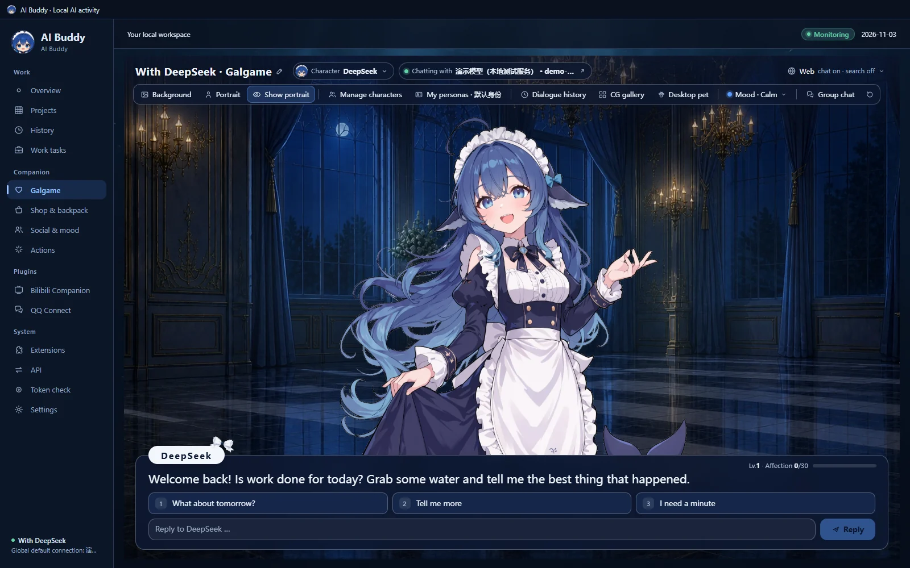

## Overview

While your AI tools work and you wait for results, check how many tokens today has burned, then chat with the model girls for a bit～(∠・ω< )⌒★

AI Buddy (AI 酱) is a Windows desktop app. It only reads your local AI-tool logs, totals token usage, estimates cost and groups work by project. It also brings the multi-character Galgame from [JAdpp/dsh-whale-galgame](https://github.com/JAdpp/dsh-whale-galgame) to the desktop, together with a desktop pet and separate chat and CG image connections:

- **A local ledger for 8 AI tools**: Codex, Claude Code, Gemini CLI, Kimi Code CLI, OpenCode, Cline, Roo Code and DeepSeek Harness. It reads the usage the logs actually report; missing fields show as "not provided" instead of being guessed from text length.
- **11 model girls**: DeepSeek, Grok, Seed, Kimi, Qwen, MiniMax, GPT, Gemini, Claude, GLM and Hunyuan, each with her own portrait, background, personality and voice, and her own affection and CG gallery. You can also create your own characters.
- **Appearance and model are separate**: who appears on stage and which chat connection actually replies are chosen independently, and each character can be bound to her own connection and effort. Qwen's look with Claude's API works fine.
- **Group chat and Auto**: put several characters in one group around a round table. With Auto on they take turns round by round, and you can cut in, pause or stop at any time. Afterwards you can take a group CG.
- **She remembers, and slowly changes**: chat text is kept in full and long-term memory is consolidated every night at midnight. You can turn on personality growth for a character, and save, export and restore her whole "life".
- **Points, shop and feeding**: while AI Buddy runs, new usage from your local AI tools adds up to points, which buy 21 kinds of food in the shop to feed the current character.
- **Social & mood**: characters have a mood that changes with real interaction. Proactive chat, talking to herself and group Auto are all off by default; turn them on if you want them. When you are busy, you can ask her not to disturb you.
- **More work, closer bonds**: while AI Buddy runs, new work tokens slowly turn into affection for the current character, and a level-up can produce a commemorative CG.
- **A transparent desktop pet for each of the 11 characters**: 24 actions each, at 30fps or 60fps. Pat her and she makes a face, she falls asleep after 5 quiet minutes, left-drag walks her along and right-drag throws her. She jumps when a task finishes and reacts when one fails.
- **Extensions and official plugins**: install [Bilibili Companion](https://github.com/lXiaoSel1/AI-Buddy-Bilibili) (watch Bilibili videos with a character), [QQ Connect](https://github.com/lXiaoSel1/AI-Buddy-QQ) (let a character answer the QQ friends and groups you allow), [Card Games](https://github.com/lXiaoSel1/AI-Buddy-Card-Games) (play Dou Dizhu and Texas Hold'em with your characters) or the [voice plugins](https://github.com/lXiaoSel1/AI-Buddy-Voice) from the Extensions center. Installed plugins are not enabled automatically, and they never sign in, post or call a model on their own.
- **Voice**: with the Breeze or GPT-SoVITS voice plugin, her replies are read aloud in her own voice, with the text following the playback. In Galgame you can take turns talking with her in Live, or record a few sentences into text and edit them before sending. Each character can use a recording you provide, and MiniMax cloud voice is there when you would rather not use your GPU.
- **11 character themes, Chinese and English**: colors, backgrounds and ornaments come from each portrait, 5 dark and 6 light. Keep one fixed or let it follow the current character.

## Quick start

Five steps get you from the installer to your first chat. The orange numbers in the pictures mark where to click. The [illustrated quick start](docs/QUICKSTART.en.md) covers each step in more detail, including importing an old save, choosing a model and connecting plugin accounts. Steps 2–5 show the Chinese interface; switch the language under **Settings** in the sidebar, and the buttons sit in the same places.

**1. Run the installer.** Open `AI-Buddy-Setup-2.0.12-win-x64.exe`: ① check the installation folder → ② choose 30fps or 60fps and the initial character → ③ tick the characters to install (more can be added later) → ④ click **Install / Add / Repair**. The installer shows the selected download size and the disk space needed, and verifies every file before installing it.

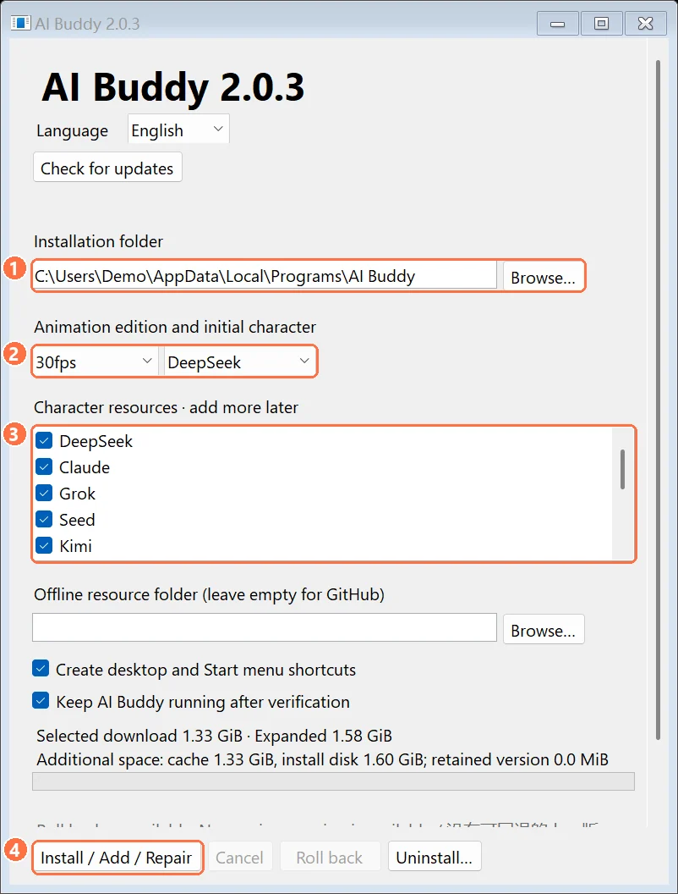

**2. Open the app directly.** The installer initializes a fresh local profile automatically and preserves the existing profile during an in-place update. The welcome screen below applies only to a first portable launch. Use the app's import entry when bringing in a different save.

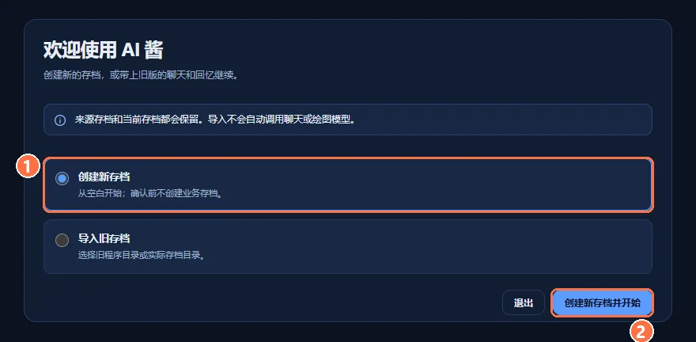

**3. Set up a chat model.** In the sidebar open **API → Chat API** and click **Add connection** at the top right: ① pick a provider (DeepSeek, OpenAI, Claude, Gemini, Qwen and more, or **Custom API**) → ② paste your API key → ③ click **Load model list** and choose a model → ④ click **Save and use**. **Test connection (one model call)** lets you try it first.

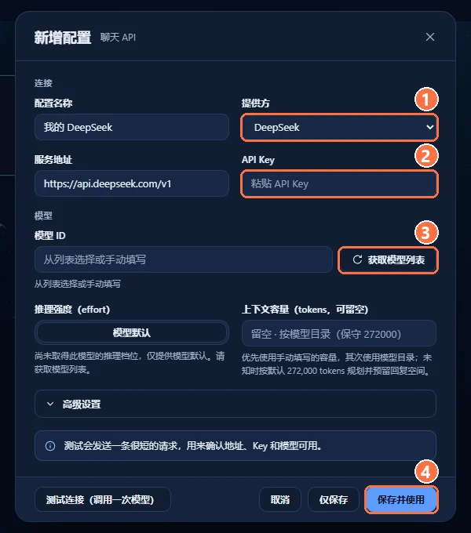

**4. Turn on online chat and start talking.** Click **Galgame** in the sidebar. Right after you connect your first model, the dialogue box says online chat is off: click ① **Enable online chat** (or use the **Web** switch at the right end of the toolbar), then type. The switch is remembered, so it stays on after a restart. With an empty input box, press 1, 2 or 3 to pick a reply.

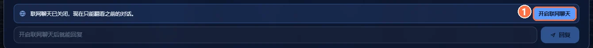

**5. (Optional) Install a plugin.** In the sidebar open ① **Extensions** → ② **Discover**, click ③ **Install…** next to the plugin you want, and tick the permissions you want to grant. AI Buddy prepares the components a plugin needs during installation, when you connect or when you start it; you do not install Node or enter ports. How to use each plugin afterwards: [Bilibili Companion](https://github.com/lXiaoSel1/AI-Buddy-Bilibili#english) · [QQ Connect](https://github.com/lXiaoSel1/AI-Buddy-QQ#english) · [Card Games](https://github.com/lXiaoSel1/AI-Buddy-Card-Games#english) · [Voice](#voice).

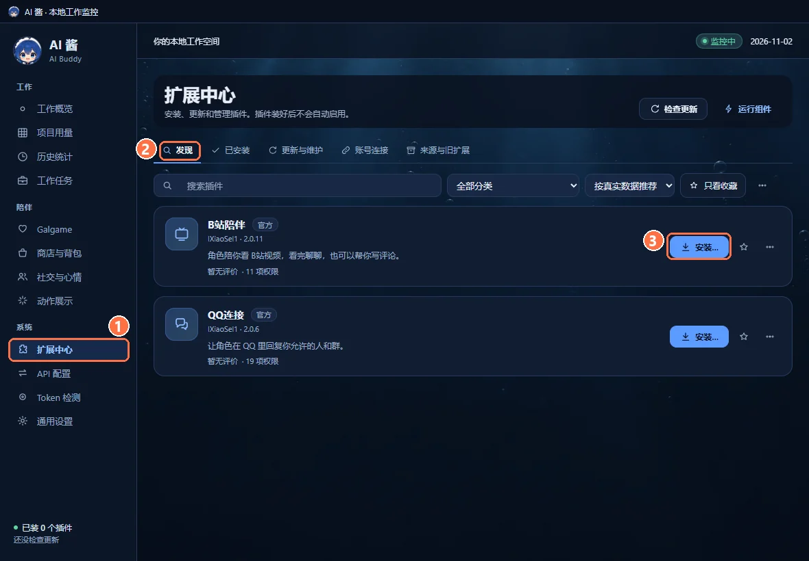

## What it does

<table>
  <tr>
    <td align="center">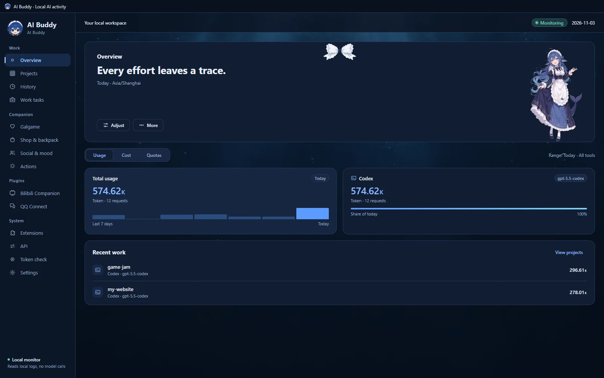 <strong>Overview</strong>: today's usage, each tool's share and the projects you worked on</td>
    <td align="center">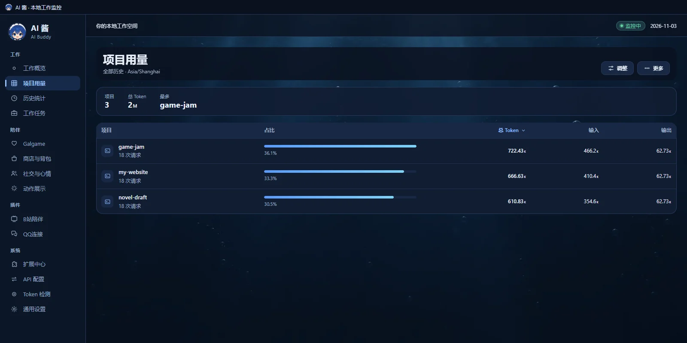 <strong>Projects</strong>: tokens per project, sorted by total, input or output</td>
  </tr>
  <tr>
    <td align="center">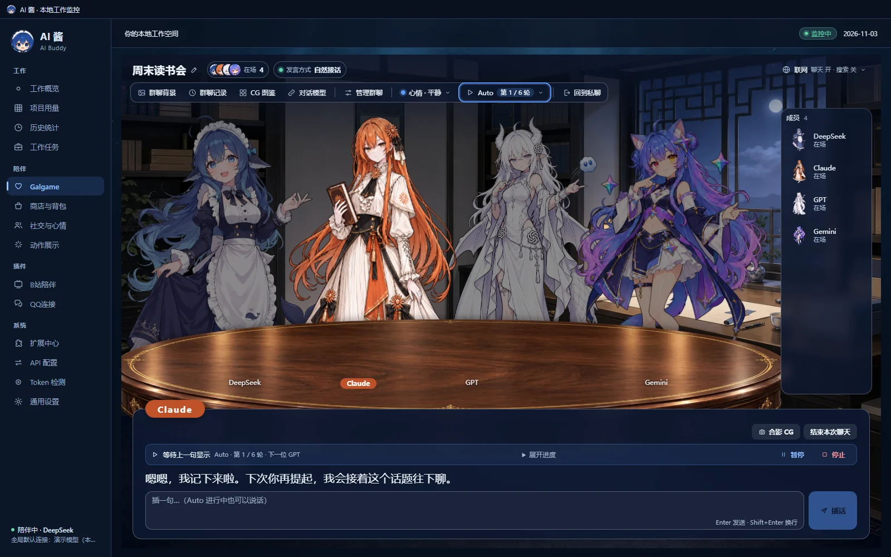 <strong>Group Auto</strong>: four characters take turns at the round table; the bar shows who is next</td>
    <td align="center">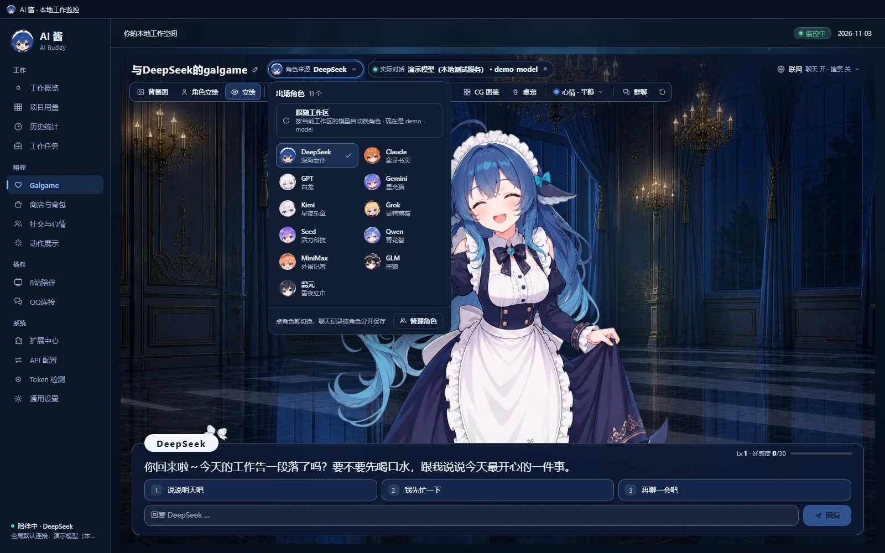 <strong>Character</strong>: switch among the 11 built-in characters; each keeps her own affection and history</td>
  </tr>
  <tr>
    <td align="center">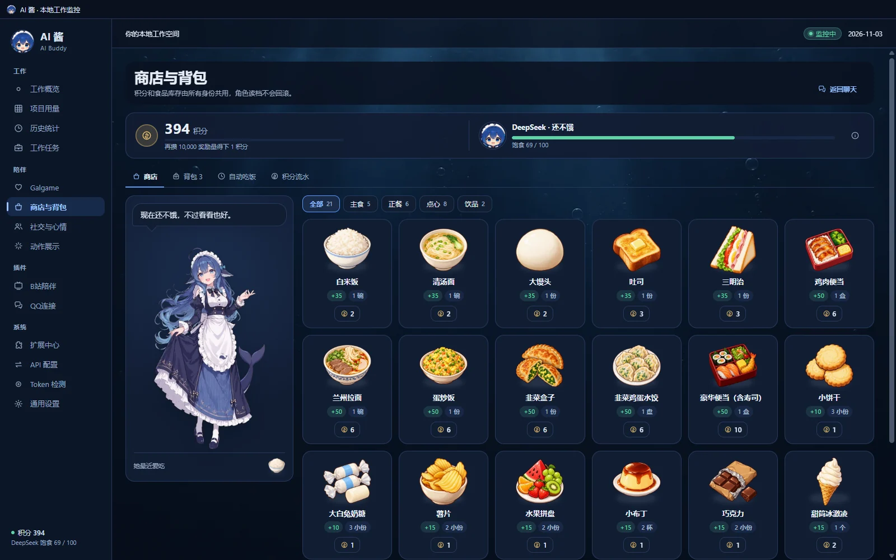 <strong>Shop</strong>: buy food with points, next to how hungry she is</td>
    <td align="center">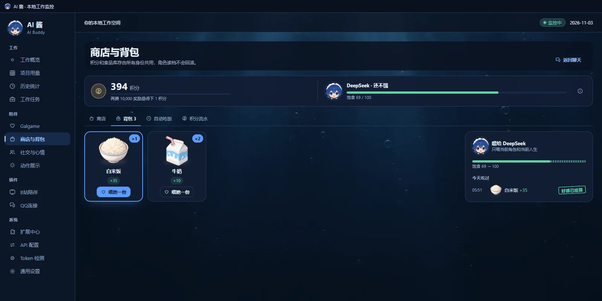 <strong>Backpack and feeding</strong>: click Feed one; she says a line and affection is settled separately</td>
  </tr>
  <tr>
    <td align="center">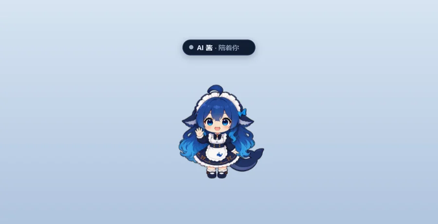 <strong>Desktop pet</strong>: a transparent window with a status bar (shown on a plain background)</td>
    <td align="center">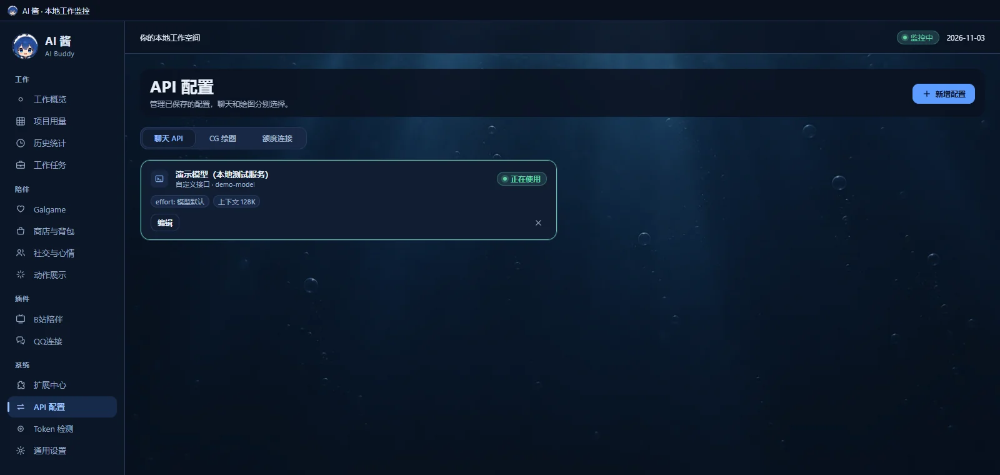 <strong>API connections</strong>: chat, CG drawing and quotas each use their own connections</td>
  </tr>
</table>

Except for the English Overview, these pictures show the Chinese interface. All of them come from an independent demo profile: usage figures and project names are synthetic, chat replies come from a local test service, and no real account was used.

- **Overview** has Usage, Cost and Quotas tabs with totals, per-tool cards and the five most recent work items.
- **Projects** sorts by total, input or output tokens or by name. **History** shows daily, weekly and monthly trends with a date range and time zone, and exports CSV or JSON.
- Tools, model developers and service platforms are recorded separately. Codex is a tool; OpenAI is a developer or platform. A model name alone does not prove the official API was used.
- **Cost estimates** multiply input, output, cache-read and cache-write tokens by their own rates; request counts are not a billing unit. Subscription tools show an API-equivalent reference, not your plan's bill. Missing usage or prices stay unknown instead of becoming zero. Prices come from models.dev and can be filtered, overridden or updated manually under Cost → Price settings.
- **Online quotas** are optional and cover Codex, Claude, GLM/Z.ai, Kimi Coding, MiniMax Coding, DeepSeek API balances and supported Gemini CLI accounts. Nothing is queried until you enable a service.
- Overview, Projects and History in the sidebar's Work group are AI Buddy's own local usage statistics. The **Work tasks** page belongs to another plugin that has not been released; this version does not provide it.
- The **Characters and conversations** window manages character cards, personas, dialogue history, group chats, long-term memory, personality growth and life archives in one place.
- Each character keeps her own level, chat history, background, CG gallery, recycle bin and portrait visibility, and relationship progress is also kept per persona. Switching characters restores her own background.
- Every turn offers three reply choices; with an empty input box, press 1, 2 or 3 to pick one. You can also type freely.
- A CG used as the background hides the portrait by default, so the same character does not appear twice. Right-click a CG in the gallery to move it to the recycle bin; undo and restore are available.
- History is stored in local SQLite and read page by page on demand.

## Affection and local work

### Relationship progression

Every character starts independently at Lv.1 with 0 affection. The same character also keeps separate progress for each of your personas; if you prefer, switch her to one shared progress in "My personas" (the values are not added together). The close, neutral and distant reply choices score +1, 0 and -1, in a random order each turn. Typed replies use simple keyword rules: words such as "like" or "good night" add a point, while "annoying" or "go away" remove one. Affection never drops below 0.

The level threshold is `30 + 15 × (Lv - 1)`, that is 30, 45, 60 and so on. Overflow carries into the next level, and there is no level cap. After 24 hours without interaction, every character loses 2 points per day, down to 0. Her tone has five stages and stays at the closest one from Lv.5 onward. With automatic CG enabled and an image connection configured, each level-up produces a commemorative CG.

A left-click pat on the desktop pet also adds affection: at most 1 point per character every 60 seconds and 30 points a day, and the personas of the same character share this allowance. In group chat only what you say yourself affects affection, and each member is settled at most once per round.

### How local work affects characters

While AI Buddy runs, newly observed work tokens go into one shared balance; AI Buddy's own chat and image calls do not count. Every 5,000 tokens add 1 affection point to the current character, up to 3 points per settlement, with the remainder kept for next time. Settlement happens when you open the Galgame and before each message you send. Usage from before the app started is not counted retroactively.

When a log clearly records a finished task, the pet jumps twice and shows a completion bubble. When it records a failure, the pet plays the failure action once; click the error bubble to open Token detection. Feedback is queued with failures first, then completions, then dialogue; each event is announced once, and events of the same kind within one second are merged. While you chat with any Galgame character, the current pet acts out the emotion detected in the reply and shows its first sentence in a bubble (cut off after 40 characters), with built-in characters' names above it.

Unlike the upstream plugin, AI Buddy does not pass tool-log text to the Galgame, so characters do not bring up the specific tasks you are working on.

### Points, shop and feeding

- **Earning points**: while AI Buddy runs, the actual tokens newly recorded in your local AI-tool logs count as reward units, and every 10,000 make 1 point; a CG with no token figure counts as 1,300. Usage from before AI Buddy started earns nothing, and nothing is rewarded twice.
- **Points and food are shared by every persona**, and loading a save does not roll them back. Fullness is tracked per character and per life.
- **Fullness** starts at 100 and drops by 8 an hour while she is awake and 2 while she sleeps, only while she is the current character. It reads Full, Not hungry, A bit hungry or Hungry; she cannot eat when full.
- **Shop & backpack** has Shop, Backpack, Auto-meal and Ledger tabs. The shop sells 21 foods in four categories (staples, meals, snacks and drinks). A price buys one package; fullness is per portion eaten.
- **Feeding**: click **Feed one** in the backpack. Her fullness rises, the meal goes into her experiences and a narration line appears in chat. The model rates the meal's affection from 0 to 5, which needs online chat; until then it shows "Settling".
- **Auto-meal** is all off by default: "Eat when hungry" starts at fullness 20 or below and stops at 70, and "Buy a bowl of rice when out of food" spends 2 points and never overdraws. Automatic meals count half the affection.

### Social & mood

- **Mood** is judged by the model from things that actually happened and fades over time; before the first evaluation it shows Calm. You can read it but not edit it. Evaluating mood calls the chat model; from 2.0.14, when that call fails, the app tries again after 30 seconds, 2 minutes, 10 minutes and 30 minutes, stops after 5 failures in a row until your next message, and waits as long as a rate-limited service asks.
- The proactive switches, **Proactive chat**, **To herself** and **Group Auto**, are **all off by default**. Turning them on calls the chat model and can use more tokens; online chat must be on as well. Proactive messages only go to the current character.
- **Do not disturb**: "I'm busy" runs for 30, 60 or 120 minutes, so she knows you are busy; the "Do not disturb" switch stays on until you turn it off, and she will not start conversations meanwhile.

## Bundled default art

The package includes eleven default portraits, chibi desktop pets and backgrounds; DeepSeek's eight existing expressions and eighty new ones for the other ten characters; 264 separate transparent motion videos (24 per character); and gaze and emotion-peak stills. DeepSeek also has an optional seaside study, and five earlier backgrounds remain selectable. The previews below are downscaled; full-size images are installed with the app.

<table>
  <tr>
    <td align="center"> <strong>DeepSeek</strong></td>
    <td align="center"> <strong>Grok</strong></td>
    <td align="center"> <strong>Seed</strong></td>
    <td align="center"> <strong>Kimi</strong></td>
  </tr>
  <tr>
    <td align="center"> <strong>Qwen</strong></td>
    <td align="center"> <strong>MiniMax</strong></td>
    <td align="center"> <strong>GPT</strong></td>
    <td align="center"> <strong>Gemini</strong></td>
  </tr>
  <tr>
    <td align="center"> <strong>Claude</strong></td>
    <td align="center"> <strong>GLM</strong></td>
    <td align="center"> <strong>Hunyuan</strong></td>
    <td></td>
  </tr>
</table>

Each character also has her own chibi desktop pet with the same 24 actions. Here they are idling:

<table>
  <tr>
    <td align="center"> <strong>DeepSeek</strong></td>
    <td align="center"> <strong>Grok</strong></td>
    <td align="center"> <strong>Seed</strong></td>
    <td align="center"> <strong>Kimi</strong></td>
  </tr>
  <tr>
    <td align="center"> <strong>Qwen</strong></td>
    <td align="center"> <strong>MiniMax</strong></td>
    <td align="center"> <strong>GPT</strong></td>
    <td align="center"> <strong>Gemini</strong></td>
  </tr>
  <tr>
    <td align="center"> <strong>Claude</strong></td>
    <td align="center"> <strong>GLM</strong></td>
    <td align="center"> <strong>Hunyuan</strong></td>
    <td></td>
  </tr>
</table>

Each character uses her own scene by default:

<table>
  <tr>
    <td align="center"> <strong>DeepSeek · Deep-sea palace</strong></td>
    <td align="center"> <strong>Grok · Night observatory</strong></td>
    <td align="center"> <strong>Seed · Sunlit greenhouse study</strong></td>
  </tr>
  <tr>
    <td align="center"> <strong>Kimi · Moonlit reading room</strong></td>
    <td align="center"> <strong>Qwen · Modern Chinese academy</strong></td>
    <td align="center"> <strong>MiniMax · Bright creative studio</strong></td>
  </tr>
  <tr>
    <td align="center"> <strong>GPT · Modern collaboration study</strong></td>
    <td align="center"> <strong>Gemini · Twin-window star-map studio</strong></td>
    <td align="center"> <strong>Claude · Amber writing study</strong></td>
  </tr>
  <tr>
    <td align="center"> <strong>GLM · Clean research room</strong></td>
    <td align="center"> <strong>Hunyuan · Landscape courtyard and pavilion</strong></td>
    <td></td>
  </tr>
</table>

The pet and the Animations page share transparent VP9 WebM videos at 30fps or 60fps; 2.0.3 reuses the already accepted motion resources without re-encoding. Each of the 11 characters has 24 motions: 18 everyday actions (idle, wave, happiness and the rest are made separately, and reviewing and seriousness do not share footage) and 6 interaction actions, falling asleep, sleeping, waking, take-off, flying and landing, which play on their own during sleep and throws. Cursor following uses a WebP Q95 still for every direction, with lossless alpha. Select a character on the Animations page to browse all of her actions; a card plays its preview when you hover it or reach it with Tab.

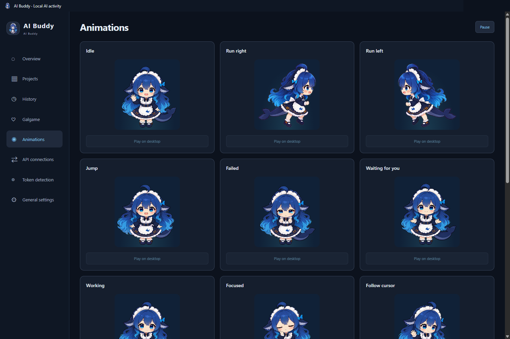

The colors, backgrounds and small header ornaments of the 11 themes all come from the matching portraits. DeepSeek, Grok, Kimi, Gemini and GLM are dark; Seed, Qwen, MiniMax, GPT, Claude and Hunyuan are light. Here is the Overview in each theme (1.9.2 screenshots; the 2.0 sidebar adds Companion and Plugins groups):

<table>
  <tr>
    <td align="center">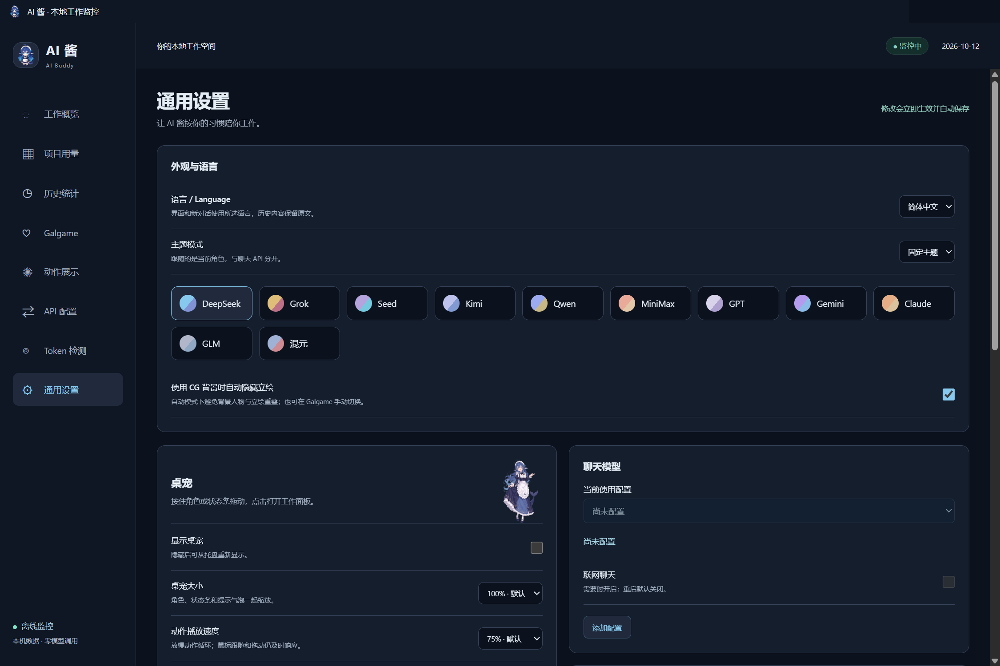 DeepSeek</td>
    <td align="center">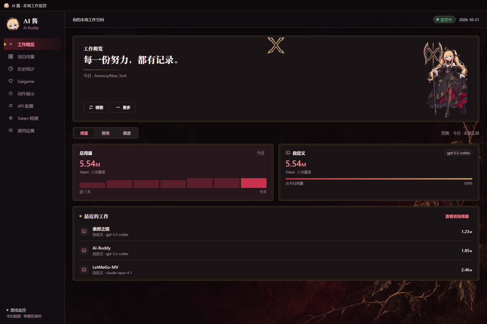 Grok</td>
    <td align="center">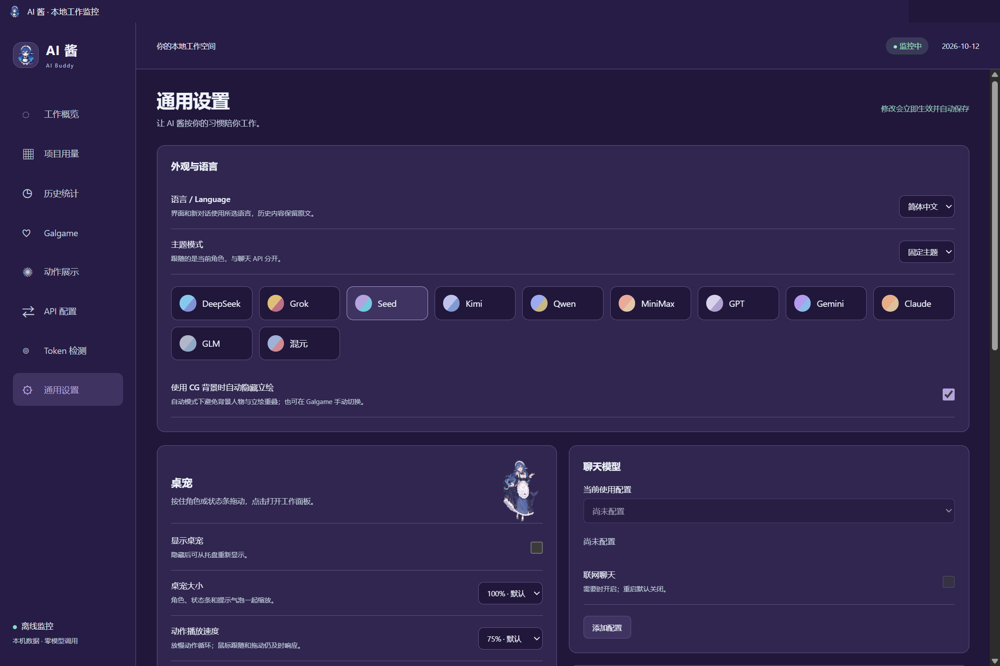 Seed</td>
    <td align="center">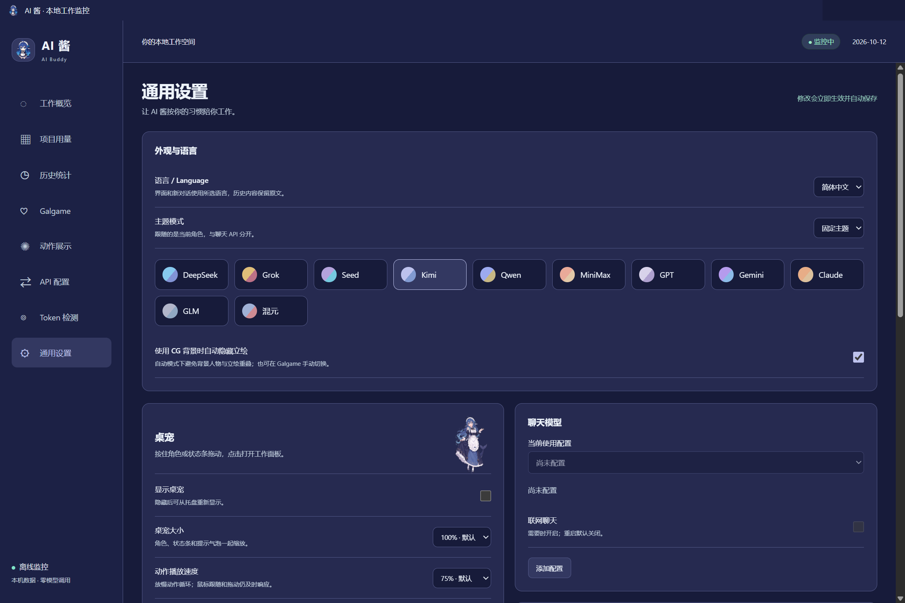 Kimi</td>
  </tr>
  <tr>
    <td align="center">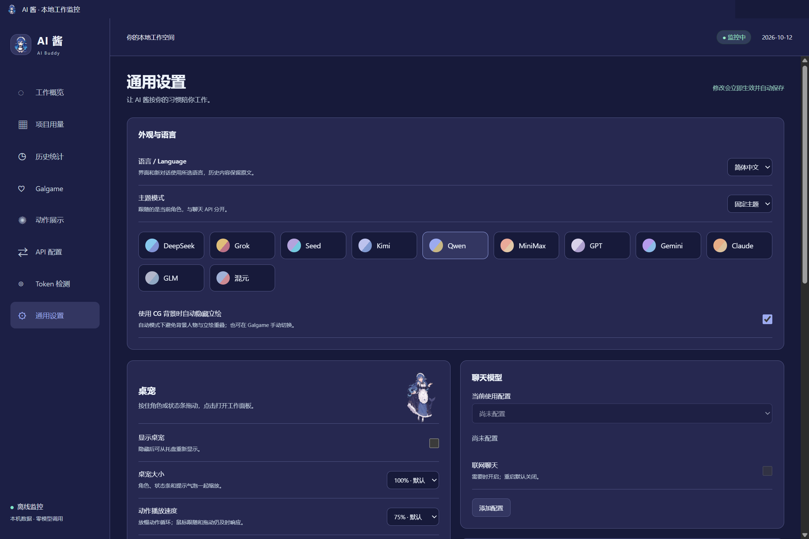 Qwen</td>
    <td align="center">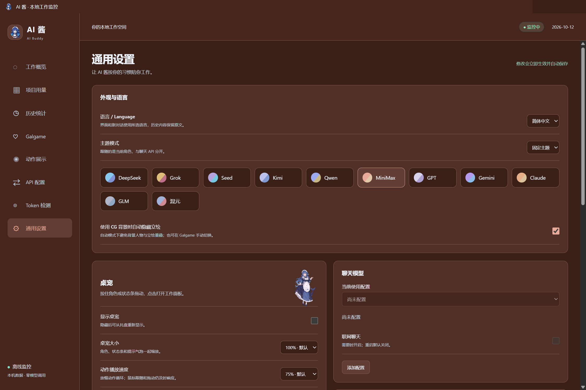 MiniMax</td>
    <td align="center">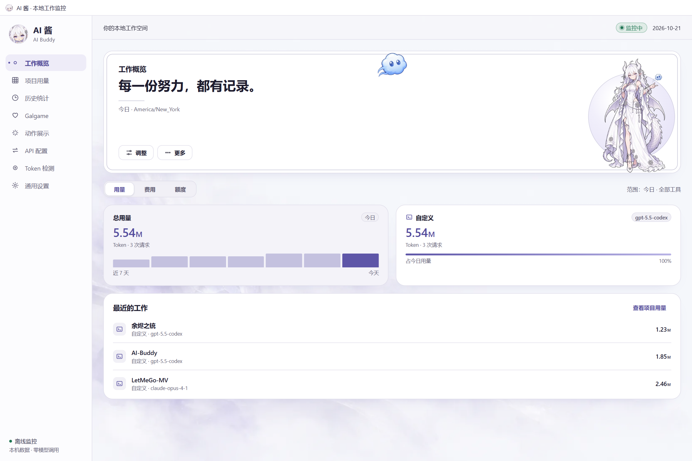 GPT</td>
    <td align="center">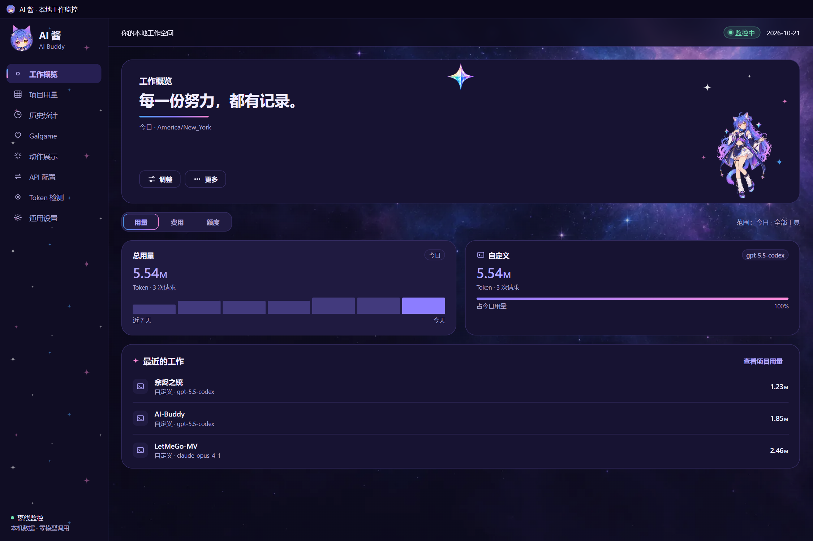 Gemini</td>
  </tr>
  <tr>
    <td align="center">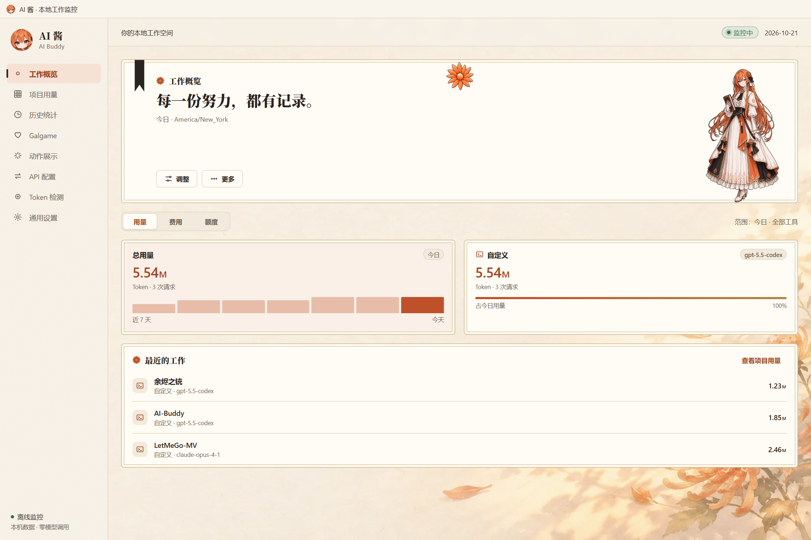 Claude</td>
    <td align="center">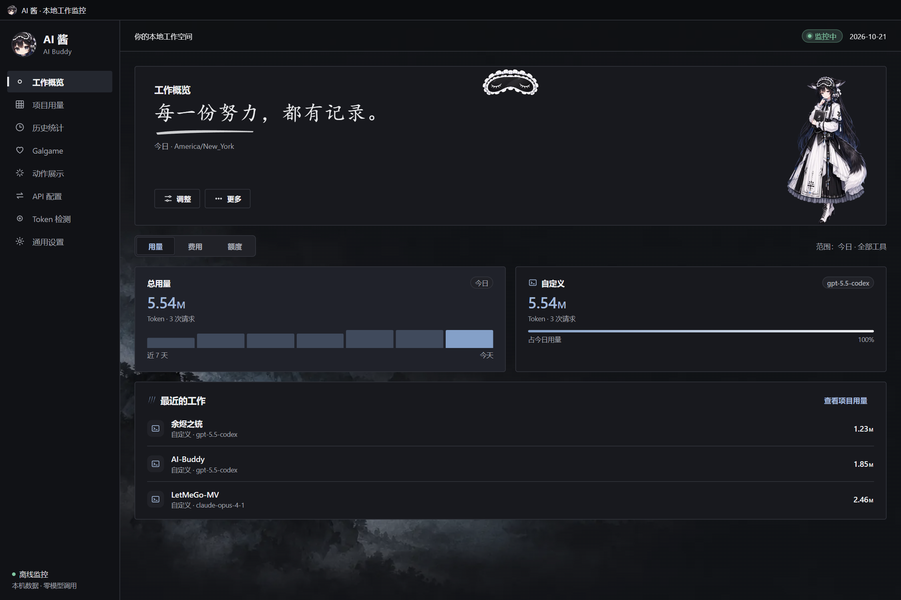 GLM</td>
    <td align="center">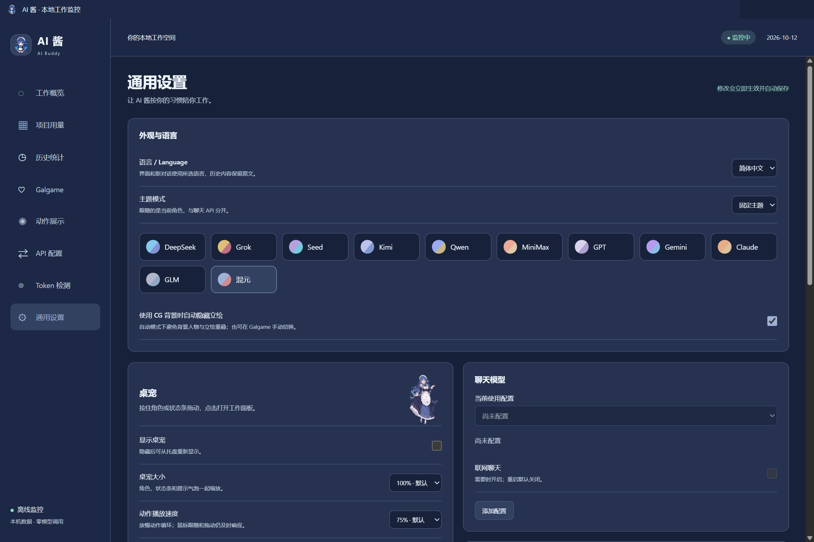 Hunyuan</td>
    <td></td>
  </tr>
</table>

The artwork has different sources and terms:

- DeepSeek's portrait, expression variants and the deep-sea palace and seaside study backgrounds come from upstream dsh-whale-galgame and belong to its 21 default images under CC BY-NC-SA 4.0.
- The other ten portraits and backgrounds were generated with an image tool, using character designs from a gallery as references; they are not the gallery files. The design authors are credited, but a general redistribution license for all ten references has not been verified.
- The chibi desktop pets of the ten new characters were generated from their portraits at the DeepSeek pet's proportions; they are not gallery files either.
- Character motion videos were generated with MiniMax H3 and interpolated with RIFE. New expressions and chibi designs retain their character-reference provenance; they are not universally claimed as MIT.
- The interface art added in 1.9.0, namely the 11 theme backgrounds and portrait ornaments, the pet's white-glove cursor and the group chat's round-table foreground, was generated with Codex's built-in image tool. It shows no characters and is not taken from any gallery. The glove only follows the interaction idea of QQ Pet's cursor switch; no Tencent cursor files were used. Each theme's cuff color is a script recolor of the same glove. The round heads in windows and the tray and the group member thumbnails are crops and resized copies of the existing portraits and pets.

See [THIRD_PARTY_NOTICES.md](THIRD_PARTY_NOTICES.md) for per-file notes. The Galgame layout, dialogue box and controls are adapted from upstream in [`src/adapted/galgame-client.ts`](src/adapted/galgame-client.ts) and do not depend on an unpublished UI image pack.

## Install

Requires Windows 10/11 x64. The installer bundles its runtime; Node.js, Python, .NET and image tools are not needed. The two frame-rate editions have the same features, characters, save format and gaze precision; only the motion videos differ. With every character installed they take about 1.6 GiB (30fps) or 2.0 GiB (60fps).

### Online installer (recommended)

1. Download `AI-Buddy-Setup-2.0.12-win-x64.exe` (about 50 MiB) from the [v2.0.12 release](https://github.com/lXiaoSel1/AI-Buddy/releases/tag/v2.0.12).
2. Choose the installation folder (default `%LOCALAPPDATA%\Programs\AI Buddy`), 30fps or 60fps, the characters to install and the initial character. The first-run defaults are 30fps, every character and DeepSeek.
3. Click **Install / Add / Repair**. The installer downloads from the pinned v2.0.12 release and checks SHA-256 for every package and file; every character takes about 1.33 GiB at 30fps or 1.75 GiB at 60fps. If a download is interrupted, run the same installer again with the same folder to resume.
4. Desktop and Start menu shortcuts are created by default. After installing, the installer starts AI Buddy once to check it; untick "Keep AI Buddy running after verification" and it closes AI Buddy after the check. The installer does not turn on online chat, automatic CG, startup registration or background updates, and it installs no plugins.

**Offline install**: download `install-manifest-2.0.12.json` and the resource ZIPs you need from the [v2.0.12 release](https://github.com/lXiaoSel1/AI-Buddy/releases/tag/v2.0.12) into one folder, then select it as the "Offline resource folder" in the installer. Every file is still verified.

**Portable package and local install**: the Downloads section of the release page also has a portable package (one for 30fps and one for 60fps, uploaded in parts). Combine and extract it as described there, then run `AI Buddy.exe` in the folder. From 2.0.13 the folder also contains **安装或更新 AI 酱.cmd** (install or update AI Buddy): open it to install this package to a folder you choose, or to upgrade an existing installation, without a network connection. Every file is checked first; if something is missing or damaged it stops and does not fall back to downloading. It copies program files only, never the personal data in that folder.

**Upgrading from an earlier version**: run the 2.0.12 installer and choose the existing installation folder. An older installer also finds it through **Check for updates**. From 2.0.13 the installer downloads only the packages that changed during an upgrade: unchanged character, motion and runtime packages are reused from the files of the installed version after each one is verified, and the download size shown is what will really be downloaded. If the old installation has no package record, or its files do not match, that part is downloaded again. If an upgrade from 2.0.2 froze before downloading, retry with this installer: it stays responsive and can be cancelled while it verifies your old profile. Coming from 2.0.3 or earlier, the wallet moves to a new format the first time your data opens, and older versions can no longer write to that data, so back it up first. It waits for chat and CG to finish, closes AI Buddy normally, and keeps your personal data, chat connections, character settings and the previous program version. If you installed to a new folder, the first launch shows the welcome page: quit the old version normally from its tray menu, then choose **Import an old save** and point it at the old program folder or data folder. The import copies the data and checks every file; the old save stays as it was. Do not copy an old profile over the new folder by hand.

Notes:

- Neither the installer nor the app is commercially code-signed, so Windows may report an unknown publisher. Check the files against `SHA256SUMS-2.0.12.txt` on the same page first if you like.
- On first launch it looks for common log folders under the current user. No AI tools installed? The companion features still work offline.
- The automatic GitHub **Source code** archives are source-only and do not run.
- This repository and official releases are public. Release packages exclude the developer's saves, connection secrets and local logs.

Folder layout after installation:

~~~text
<install folder>/
├─ AI Buddy.exe / AI Buddy.vbs / AI Buddy.cmd / Start-AI-Buddy.ps1   launchers
├─ builds/<version>/                       app code, motions and character resources
├─ runtime/AI-Buddy-<version>/             Electron runtime
├─ maintenance/<version>/AI Buddy Setup.exe  maintenance tool
├─ local/current-build.json                current version pointer
├─ local/installation.json                 installed edition and characters
├─ local/data-v003/                        your data, created on first run
├─ assets/  docs/  licenses/
└─ README.md  LICENSE.md  THIRD_PARTY_NOTICES.md
~~~

### Update and remove

- Add characters, repair files or switch frame rate: click **Manage character resources** in General settings to open the maintenance tool, or run the same-version installer again. Characters that are not installed show as "Not installed" and open the installer only after you confirm; nothing downloads automatically.
- In-app updates (since 2.0.8): in General settings, **Version and updates** checks, downloads and prepares a new version; then choose Later or Install and restart. You can keep using the app while it prepares, and it waits for running activity to finish before switching. A very old version without migration support needs one installer run first.
- Plugin updates: use **Extensions → Updates and maintenance**. Updates are manual by default; you can turn on automatic compatible patches per plugin. An update keeps the plugin's enabled state and data, and new permissions still need your OK. After upgrading from 2.0.8 to 2.0.9, update the voice plugins there from 1.0.0 to 1.0.1; 1.0.0 only works with 2.0.8. From 2.0.13, when an installed plugin version is no longer compatible after an app upgrade, **Installed** and **Updates and maintenance** mark it **Incompatible** and state the app version it requires: a compatible newer version shows **Update to x.y.z**; otherwise you wait for a plugin update. From 2.0.14 voice plugins are recognized by major version: every 1.x voice plugin works with 2.0.14 and later, so an app update does not require a plugin update, and a new 1.x release will not require an app update first.
- Upgrade: run the newer installer. It waits for chat and CG to finish, closes AI Buddy normally, and keeps the previous program version and your personal data.
- Roll back: click **Roll back** in the installer. It restores the program and launch pointer only and never overwrites newer progress with old saves. An older program that does not support newer data refuses to write it and does not convert or delete it. From 2.0.13 a rollback record is used up once the rollback succeeds, so the same upgrade cannot be rolled back twice. Rolling back from 2.0.12 or newer to 2.0.11 or older means reinstalling the voice plugins (character voices and settings are kept); the installer asks before it continues. After rolling back from 2.0.14 to 2.0.12, voice stops working, because 2.0.12 does not recognize voice plugin 1.0.3. If you upgraded to 2.0.14 from 2.0.13, the previous version is the faulty 2.0.13, so do not roll back.
- Remove: click **Uninstall…** in the installer. Personal data is kept by default; you can also tick deleting the default personal data (irreversible). A custom data folder is never deleted. The download cache `%LOCALAPPDATA%\AI Buddy\InstallerCache` stays for resuming and repair; delete it manually if you no longer need it.

### Run from source

You only need this to build it yourself. It requires Windows x64, Node.js 24 and npm; see the [build guide](docs/BUILD.md) for the steps and pinned versions. The build reuses the portraits and animations from the release, so no images or videos are regenerated.

## Use and settings

A left click on the pet is a pat: she makes a face. A right click opens the pet menu: open the workspace, open the Galgame, let her nap (it becomes "Wake her up" while she sleeps), show the status bar and hide the pet. Clicking the status bar opens Overview. Double-clicking the tray icon also opens the main window; the tray menu has Overview, General settings, Animations and Open Galgame, plus showing the pet, drag mode and Quit.

### Token detection

On first launch it looks in these places, all under the current Windows user folder:

| Tool | Default location |
|---|---|
| Codex | `.codex\sessions` and `archived_sessions`; `CODEX_HOME` moves it |
| Claude Code | `.claude\projects`; `CLAUDE_CONFIG_DIR` moves it |
| Gemini CLI | `.gemini\tmp` |
| Kimi Code CLI | `.kimi-code\sessions`, plus the older `.kimi\sessions` |
| OpenCode | `.local\share\opencode`; `XDG_DATA_HOME` or `OPENCODE_DB` also work |
| Cline / Roo Code | Extension storage of VS Code, VS Code Insiders, VSCodium and Cursor; Cline also uses `.cline\data\sessions` |
| DeepSeek Harness | `.dsh\sessions`; `DSH_HOME` moves it |

Portable editors, WSL or other users' folders must be added manually: in **Token detection**, click **Add source**, choose a tool template and the actual folder, run **Local parsing preview**, then **Save and enable**. Custom sources accept JSONL, Zstd-compressed JSONL, JSON, CSV and SQLite, support field mapping, and templates can be imported and exported. Removing a source never deletes the original logs or the usage already recorded.

### General settings defaults

| Setting | Default |
|---|---|
| Language | Follows the system language on first launch; Simplified Chinese or English |
| Theme mode | Fixed DeepSeek theme; can follow the current character instead |
| Reply style | Natural; Brief, Natural or Detailed. QQ conversations can set their own |
| Show desktop pet | On |
| Companion character | Follow Galgame character; DeepSeek when switched to a fixed character |
| Pet size | 125%; 75%, 100%, 125% or 150% |
| Animation speed | 75%; 25%, 50%, 75% or 100% |
| Always on top, Click through transparent areas, Follow the pointer, Show status bar, Task feedback bubbles | On |
| Automatic sleep, Physical interactions (throw and charge) | On |
| Throw strength | Standard; Gentle, Standard, Strong or Exaggerated |
| Automatically hide the portrait on CG backgrounds | On |
| Maximum model output | 8,192 tokens; Auto or 256–65,536 |
| Fallback polling interval | 1 second (file changes are read immediately); 1, 2 or 5 seconds |
| Activity time display | New York time; system local time or UTC available |
| Statistics time zone | System local time |
| Update prices daily | Off |

Two switches live outside this table: **Online chat** is on by default and keeps its last setting across restarts (it stays off while no chat connection is usable, so turn it on once after connecting your first model), and **Generate CG automatically** is off on a fresh install. When it is on, besides level-up keepsakes it draws a daily CG of the current character at 10:00 and 22:00 (the computer's system time, from 2.0.13); missed times are not made up. **Restore default settings** resets every option above: the language goes back to Simplified Chinese, a hidden pet is shown again and online chat is turned back on. The chat and image connection choices and Token detection sources are not affected, and the pet position, usage and Galgame data are kept.

### Network settings

From 2.0.13, **General settings → Network** controls in-app networking: Extensions, component downloads and model chat all use these settings.

| Option | What it does |
|---|---|
| Proxy | **Follow system** (default), **Manual** (enter a proxy address such as `http://127.0.0.1:7890`; HTTP and HTTPS proxies are supported) or **Do not use** |
| GitHub mirror, HuggingFace mirror | Blank by default, so downloads come from the official sources. When filled in (HTTPS addresses only), components, plugin packages and update resources are downloaded from the mirror; only the host changes, the path stays the same |
| Test | Requests the official extension catalog once with the current settings and reports whether it is reachable |

- Files from a mirror are checked against the same size and SHA-256, and the extension catalog and updates are still signature-verified. A mismatch is rejected and offers **Retry from the official source**; that retry does not change your saved mirror. AI Buddy ships with no third-party mirror address.
- Large files (voice components, the DSH runtime component, FFmpeg, NapCat and plugin packages) resume: after a failure or a cancel the downloaded part is kept and the next attempt continues from there. Downloads no longer have a total time limit; they time out only when no data arrives for a long time.
- Connection failures, timeouts, GitHub rate limits and certificate errors each have their own explanation and suggestion; the raw error is under **Technical details**. From 2.0.14 a model service that cannot be reached within 10 seconds reports "Cannot connect", and one that connects but never answers reports "did not respond", instead of the download-timeout message.
- These settings apply to requests AI Buddy makes itself. The third-party QQ connection component (NapCat), external command-line tools and Git are not guaranteed to follow them. SOCKS proxies are not supported yet: with **Follow system**, when the system proxy's PAC script offers both an HTTP and a SOCKS proxy (as Clash Verge's PAC mode does), 2.0.14 skips the SOCKS entry and uses the HTTP one; when only SOCKS is offered, a message asks you to choose **Manual** with an HTTP proxy, or **Do not use**. The installer reads the same settings, and mirrors can also be entered in the installer.

### Character and chat model

In the Galgame toolbar, **Character** decides who appears, which can follow the workspace or be fixed by hand; **Chatting with** shows which chat connection and model actually reply for this character. Neither affects the other. The online chat switch is in **Web** at the right end of the toolbar. Click the title to rename it; each character keeps her own. **Background** and **Portrait** accept built-in choices or your own images (PNG, JPEG, WebP or AVIF, up to 12 MB each).

Single-character scenes use a close framing: the face and upper body are larger, and the lower body continues behind the dialogue box; the portrait pickers still show the full figure. The **Show portrait** button in the toolbar switches between shown and hidden, and once you have changed it by hand a **Restore automatic** option appears; in automatic mode, a CG background hides the portrait.

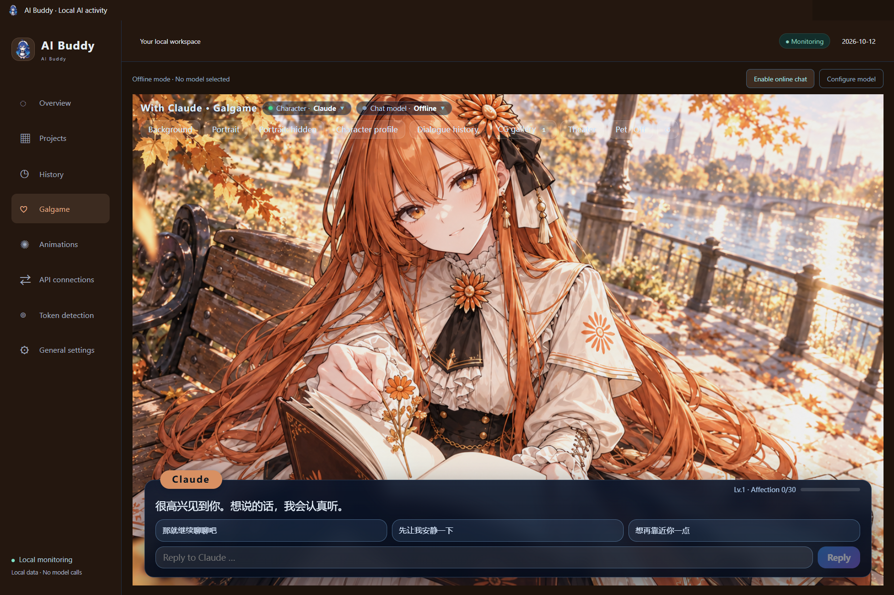

### Characters and conversations

In the Galgame toolbar, **Manage characters**, **My personas**, **Dialogue history** and **Group chat** open the matching tab of the "Characters and conversations" window; long-term memory, personality growth and life archives also live there. Nothing saved in this window calls a model, and unsaved edits are discarded when you close it.

- **Manage characters**: each character card has four groups (basic details, personality and expression, relationship and opening, appearance) with 15 text fields and 3 images (portrait, background, CG reference), plus example dialogue, model binding and talkativeness. Every field can be set to "Inherit defaults", "Custom" or "Explicitly empty": inheriting shows the built-in profile's own text, and explicitly empty leaves the field blank instead of falling back to the default. A jump bar sits at the top of the form and the save buttons stay at the bottom; you can "Save draft" first. Built-in characters have "Restore default profile", which loads a draft that only takes effect once saved. "New character" adds your own: custom characters do not get generated images or a desktop pet, but you can upload a portrait, background and CG reference yourself, chat works without a portrait, and the desktop pet stays a built-in character. Persona fields and example lines take up to 20,000 characters each (the name up to 80), and images uploaded here are limited to 8 MiB.
- **My personas**: who you are, with a management name, the nickname characters call you, occupation, interests, background and communication preferences, plus a name and relationship you set for the current character. Conversations, drafts, reply choices and relationship progress are kept per persona; a character's progress can be switched between independent and shared. New conversations use the current persona, or the default persona if none is selected.
- **Dialogue history**: conversations on the left, searchable by text and date, with archived ones available too; the messages of the selected conversation show on the right without switching to it. You can star messages in the current conversation, and with "Allow correcting my messages" on you can correct what you said earlier. A correction keeps the original text and its versions, does not ask the model again and does not change affection; the character's lines cannot be edited. Conversations can be renamed, archived, exported as JSON and restored from JSON (up to 50 MiB). Theater scenes you played before are listed at the bottom under "Past skits" to read.

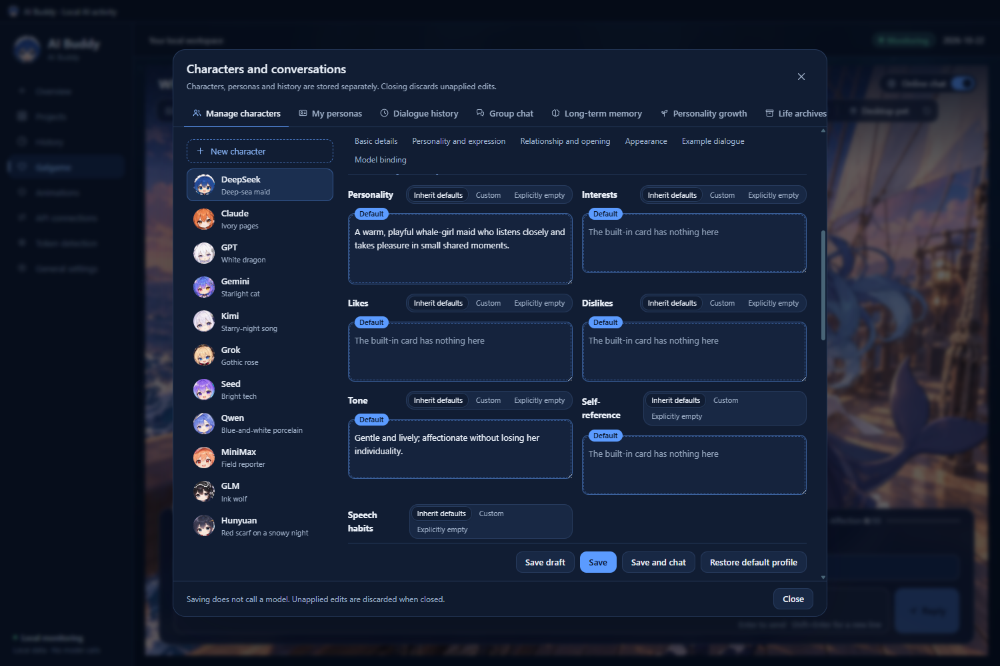

### Group chat

Create a group under "Characters and conversations › Group chat": enter a name, pick members and your persona (the persona cannot be changed after the group is created), write a scene, choose a speaking mode, then click **Save and enter**. There is no limit on members; up to 4 stand on stage at once (fewer in a narrow window), and whoever is speaking lights up. Turn on online chat first.

| Speaking mode | Who replies |
|---|---|
| Natural | @-mentioned members first; other members are picked at random according to the talkativeness on their character cards. If nobody is picked, one is chosen at random, so 0% does not mean silent |
| List order | Every present, unmuted member replies once, in list order |
| Manual | Only @-mentioned members reply |
| Rotating pool | One member per round, taking turns |

After you send a message, the first member replies on her own and the next ones speak when you click **Continue ▸**. Members also talk to each other, and sometimes argue. Typing @ shows the member list; muted members are never picked to reply, even if you @ them. A newly added member does not know what was said before she joined, nor what happened while she was away; when she comes back she keeps what she knew before.

**Group Auto**: to let them keep talking on their own, first turn on **Group Auto** under **Social & mood**, then click **Auto** in the group toolbar, choose a stop condition (Round limit, Until I stop it or Let AI end it; 6 rounds by default) and click **Confirm members and start**. The bar shows the round, who has spoken and who is next, and can expand to show each member's status. **Pause**, **Continue** and **Stop** work at any time. Auto pauses when you send a message yourself, when "Do not disturb" is on, and after AI Buddy restarts. If a member's reply fails, Auto pauses and offers a **Retry** button with her name; nothing is resent quietly. After a restart, if an Auto request still has no confirmed result (for example the app was closed while a member was replying), it shows "The previous turn did not finish.": click **Continue with the next member** or **Stop Auto**; the unconfirmed reply is not resent (from 2.0.13). Every turn calls the model.

Each member uses the chat connection on her own character card (by default, the global one), and you can change it member by member under **Chat models** in the group toolbar; each choice is saved immediately. This edits her character card, so her private chat changes too. A group has its own background (the round-table foreground can be turned off), its own chat log, which you can search and export, and its own CG gallery.

When a round is over you can click **Group CG**. The picture is made in two steps: first a "Prompt planning model" writes the image prompt from the conversation shown so far, then the CG image connection draws it. The planner is "Automatic" by default and uses the entry character's or the global chat connection; you can also pick one chat connection for this group, which is saved immediately. With online chat off, "Automatic" writes the prompt from a local template instead; if you picked a connection and online chat is off, it asks you to turn online chat on rather than quietly switching to another connection. Click an avatar to leave that member out of the picture. Group settings also offer "Generate a group CG when this session ends".

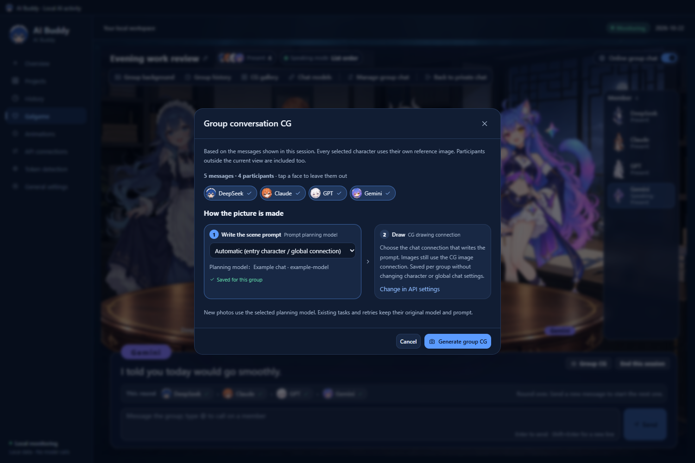

The finished picture goes into the group's own CG gallery:

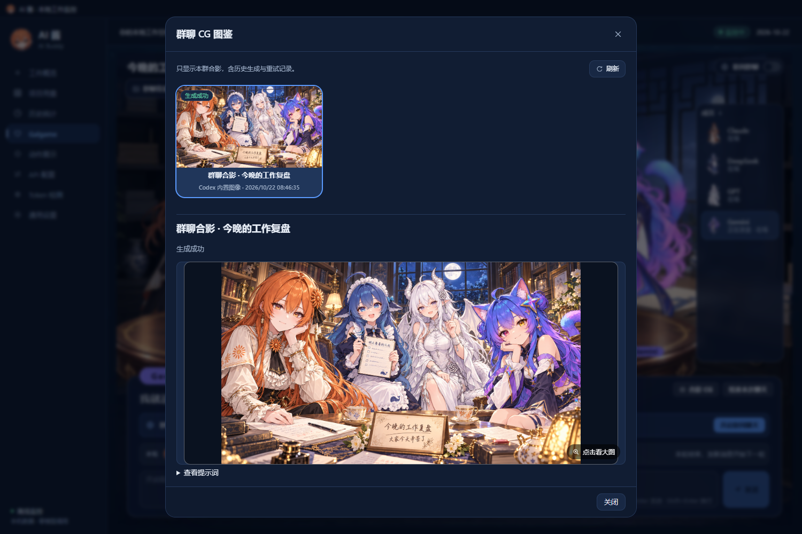

### Long-term memory, personality growth and life archives

- **Long-term memory**: chat text is kept in full. Every night at midnight (local time), AI Buddy writes each character's summary of the day, Guide and core memories. Consolidation uses that character's chat connection and only runs while online chat is on; missed days are caught up the next time you turn online chat on. The memory page is read-only: if something is remembered wrong, correct it in chat, or say something like "don't bring that up again"; the original text is still kept. Ordinary memories are not deleted over time. Personas do not share memories; in a group chat she only knows that group, while in private chat she can recall the groups she shared with you under the same persona.
- **Personality growth**: off by default; turn it on from its page, starting from the current profile or from a blank slate as a new life. While it is on, her persona changes slowly with your real conversations; name, persona and example dialogue become read-only, while appearance, chat connection and talkativeness can still be changed. The personality is shared per character; relationships stay separate per persona.
- **Life archives**: save a character's whole "life" (her card, her memories, and each persona's relationship and progress) as one archive that you can preview read-only, export as a ZIP, import, reset or restore. Reset and restore first save the current life as another archive and ask you to type the character's name to confirm; they do not roll back other characters or account usage. One archive can be up to 512 MiB; there is no limit on their number and they do not expire.

See [Long-term memory and life archives](docs/long-term-memory-lives.md) for details.

### Built-in desktop pet

Each of the 11 characters has her own pet. **Companion character** in General settings defaults to **Follow Galgame character**: whoever you switch to in the Galgame appears on the desktop. Choose **Fixed character** to keep the same one. Characters without installed resources show as "Not installed" and prompt you to add them; nothing downloads automatically. Chatting with any character makes the pet play the matching emotion; in group chat the pet stays the character you entered the group with.

- **Pat**: over her, the pointer turns into a white glove. Left-click and she makes a face while the glove gives a little poke.
- **Sleep**: after 5 quiet minutes (no new work tokens, interaction, task feedback or chat) she falls asleep and the status bar reads "Asleep · click to wake"; she stays awake while real chat and image requests are running. You can also let her nap from the right-click menu.
- **Walk her**: hold the left button and drag; she walks along with the pointer and stays where you let go.
- **Throw her**: hold the right button, drag a little and let go quickly, and she flies off, bounces off the screen edges and lands on her feet. While right-dragging, hold the left button to charge like a slingshot and release it to launch; the predicted path, landing point and strength are drawn on screen. Esc cancels. Adjust the throw strength in General settings; turning off "Physical interactions" stops throwing and charging, while walking her still works.
- **The status bar** shows her state, such as "AI Buddy · here with you", "Working · 2 sessions" or "Waiting for you · Codex". Hover it for a ×; after closing it you get an undo notice, and you can bring it back later from the right-click menu or General settings.
- The glove's cuff, the bubbles and the status bar follow the current theme; the taskbar and tray icons show the head of the pet currently on the desktop.

Transparent areas let clicks through. Task feedback that arrives while you drag is queued and plays after you let go. A hidden pet can be shown again from the tray menu.

### Themes and language

General settings offers 11 themes named after the characters, with colors, backgrounds and ornaments taken from the matching portraits, 5 dark and 6 light. Keep one fixed or let it follow the current character. The interface, window title bar, pet status bar and bubbles change together; the character images themselves are never recolored.

Choose Simplified Chinese or English. After switching, the interface and new conversations use the selected language; existing chats, earlier CGs and text you wrote yourself stay unchanged.

## Chat and CG connections

Chat and CG image generation use two separate sets of connections, both managed under **API connections** (tabs: Chat API, CG drawing, Quota connections). **Save and use** activates a connection immediately; **Save only** keeps the current one. General settings only selects the active connections and toggles them. Each character uses the global chat connection by default, and you can give her her own under **Model binding** on her character card; in group chat every member uses her own.

| Type | Protocol / channel | Defaults |
|---|---|---|
| Chat | Local Codex sign-in, OpenAI Chat Completions / Responses, native Gemini, Anthropic Messages | The Codex channel needs a local Codex login |
| CG | Codex built-in images | Uses the local Codex model; prefers a 16:9 landscape composition |
| CG | OpenAI Images compatible | 1536×1024 for the gpt-image-1 family |
| CG | Volcengine Ark / Seedream | Dedicated JSON text/image-reference protocol, 2K by default; use a model or image endpoint enabled for your account |
| CG | Gemini Interactions | 16:9, 1K by default |
| CG | Wan (Tongyi Wanxiang) | Generation/editing defaults to `wan2.6-image` at 1280×720; asynchronous text-to-image defaults to 1696×960 |

When you add a chat connection, **Provider** offers Local Codex sign-in, Gemini, Kimi / K3, Grok, OpenAI, Claude, DeepSeek, Qwen, MiniMax and Custom API. Service URLs must use HTTPS, except local addresses. From 2.0.13, local network addresses (10.x, 172.16–31.x, 192.168.x and `.local`) may also use HTTP and need no key; saving one shows a notice that the connection is not encrypted. An address pasted with a trailing `/chat/completions` or `/models` is normalized to the service base address before saving. Kimi and MiniMax have a **Region** choice (Mainland China / International); keys are not shared between regions.

A chat connection can set a reasoning effort, which applies to local Codex, OpenAI Responses and Chat Completions; local Codex uses low when none is set, and native Gemini and Anthropic Messages use the model default. A connection can also state its context window; if it does not and the model catalog has no figure, 272,000 tokens are assumed. If a reply from an external API connection is cut off by the output limit, it is retried once with double the limit (local Codex does not retry); if it is still cut off, the message suggests raising the output limit in General settings.

Choose a preset or enter a custom compatible endpoint and model ID; compatibility, model permissions and reference-image limits depend on the service. External keys are encrypted with Electron safeStorage and stored locally; if system encryption is unavailable, the key is not saved. Never put a real key in repository files or commit it to Git.

**Generate CG automatically** is off by default; when it is on, each level-up produces a keepsake picture and a daily CG is drawn at 10:00 and 22:00. With online chat on, the chat model designs the CG's theme, falling back to local character themes if that fails; retries reuse the prepared theme. You can also click **Make keepsake CG** in the CG gallery to make one by hand. Group CGs are made by hand (or automatically at the end of a session, if the group setting is on) and only need an image connection. Model and image calls can incur service charges.

Current CG composition rule: male first-person view with the male character out of frame; natural hand interaction, text and clothing logos are allowed, and it is not limited to one male hand.

New CG jobs use the selected character's Galgame portrait as the reference, with custom portraits taking priority. Retrying an older job keeps its saved references; create a new CG to use a new reference. Volcengine Ark errors show the HTTP status, the service's reason and the request ID with sensitive content redacted. See the [CG connection guide](CG_API_GUIDE.md).

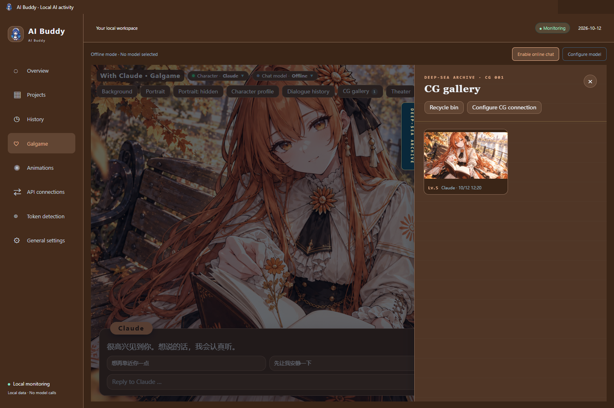

### Drawing with local Codex

Codex built-in images use the drawing capability of Codex on this computer. AI Buddy does not ship Codex or an account. Install, open and sign in to the Codex desktop app on this computer first, then go to **API connections → CG drawing → Codex** and click **Test connection (no image)**.

AI Buddy finds Codex in desktop runtime caches, registered Microsoft Store installations, common standalone locations and native npm binaries; a separate npm CLI installation is not required for discovery. For a custom install, set the `AI_BUDDY_CODEX_PATH` environment variable to the absolute path of its native `codex.exe` and restart AI Buddy. A custom Codex configuration folder follows `CODEX_HOME`, and a missing optional `config.toml` does not stop startup.

Program presence, sign-in and image capability are checked separately. If Codex does not provide image capabilities, update Codex or choose an external image API. The integration follows the [OpenAI Codex app-server documentation](https://learn.chatgpt.com/docs/app-server).

### Online quotas

Quota connections are independent of chat and image connections. Each service returns different fields, and unsupported accounts show a reason. Nothing is queried until you enable a service; after that it refreshes about every 2 minutes while the window is visible and about every 15 minutes while hidden. AI Buddy never sends a model conversation to probe a quota and does not read browser cookies. Authentication failures ask you to sign in again; temporary failures keep the last successful values and their timestamp.

## Plugins

The Extensions center (sidebar **System → Extensions**) has Discover, Installed, Updates and maintenance, Accounts, and Sources and legacy extensions tabs. Plugins come from the signed official catalog. Installation lists every permission a plugin asks for and grants only the ones you tick. Installed plugins are not enabled automatically: click **Enable and connect** or **Enable and sign in** on the install page, or turn on its switch on the **Installed** tab.

**Install…** on **Discover** installs the newest version this app can use. To install another version, pick it under **Versions** in the plugin details, where each version shows the app version it needs (from 2.0.14).

| Plugin | What it does | Guide and source |
|---|---|---|
| Bilibili Companion 2.0.16 | Watch Bilibili videos with a character: review the full reading plan first, and after you confirm she reads the sampled frames and the platform subtitles and writes viewing notes. Viewing can be scheduled. New viewings use that character's own chat connection. Posting comments needs separate permission | [AI-Buddy-Bilibili](https://github.com/lXiaoSel1/AI-Buddy-Bilibili) |
| QQ Connect 2.0.10 | Choose a character to take over your QQ account and answer only the friends and groups you allow; in groups she speaks only when @-mentioned or replied to, by default | [AI-Buddy-QQ](https://github.com/lXiaoSel1/AI-Buddy-QQ) |
| Card Games 1.1.5 | Play Dou Dizhu and Texas Hold'em (2 to 10 players) with your characters. They use their own bound models, points use the app wallet, and every 3 games add 1 affection. Includes music and table sounds, and with voice on they call out their moves. Requires the app at 2.0.4 or later | [AI-Buddy-Card-Games](https://github.com/lXiaoSel1/AI-Buddy-Card-Games) |
| Breeze Voice 1.0.3 | Local voice whose tone follows her mood, with preset voices for all 11 characters; needs an NVIDIA GPU with at least 9.5 GiB free memory at start. Can switch to MiniMax cloud voice. Requires the app at 2.0.14 or later | [AI-Buddy-Voice](https://github.com/lXiaoSel1/AI-Buddy-Voice) |
| GPT-SoVITS Voice 1.0.3 | Local voice in a calm tone only, with preset voices for all 11 characters; needs an NVIDIA GPU with at least 4 GiB free memory at start. Can switch to MiniMax cloud voice. Requires the app at 2.0.14 or later | [AI-Buddy-Voice](https://github.com/lXiaoSel1/AI-Buddy-Voice) |

- Bilibili Companion, QQ Connect and Card Games share one runtime component (198.6 MB), prepared the first time you install any of them; later plugins reuse it. From 2.0.14 preparation shows how much has been downloaded, and when the runtime component is missing or damaged the plugin page offers **Prepare runtime component** directly.
- After importing an old profile, installed plugins keep working: the runtime component is reused and each plugin is installed into the new profile at its existing version (from 2.0.14).
- The video component Bilibili Companion needs (FFmpeg) is prepared by AI Buddy from a pinned upstream release when you install the plugin, with its source, size and progress shown; a copy that has already been verified is not downloaded again.
- Use app 2.0.7 for Bilibili Companion's complete reading: earlier versions can fail to get the storyboard from the original video on some CDN routes. Failed viewing records stay. After updating, choose **Watch now** for a new attempt, then review the storyboard and confirm the plan. Media-address, connection and range errors appear under **Technical details**.
- The third-party connection component QQ Connect needs (NapCat) is prepared from upstream only when you click Connect; neither this repository nor the plugin bundles it.
- Both plugins connect their accounts by scanning a QR code under **Extensions → Accounts**. Credentials are encrypted by the system on this computer, and a plugin only receives a reference, never the password or cookie itself.
- Installing, updating or scanning never starts watching, commenting, sending QQ messages or calling a model.
- Each AI move in Card Games is one model request, sent only when you click "Ask X to play" or turn on AI auto. Rules and settlement live in the app: a model can only propose a move, and an illegal one is never played.
- Both voice plugins can be installed, but only one runs at a time. An installed voice plugin shows **Start** on the **Installed** tab and **Open** once it is running; turning voice on in Galgame also starts it.
- Plugin versions released with 2.0.13 (2.0.13 was withdrawn; use them with 2.0.14): in Bilibili Companion 2.0.16 a confirmed reading can finish after midnight, and an expired login pauses the reading and asks you to scan again; QQ Connect 2.0.10, with restore-on-start turned on, reconnects by itself after an unexpected disconnect, and changing the reply style no longer cancels replies in progress; in Card Games 1.1.5, if a character's model connection changes during a hand, you can choose **Continue with the current connection** or **Void this hand** (all points are returned and it does not count as a win or loss); cloud voices in the voice plugins 1.0.3 follow the network settings above. See each plugin repository's changelog for details.

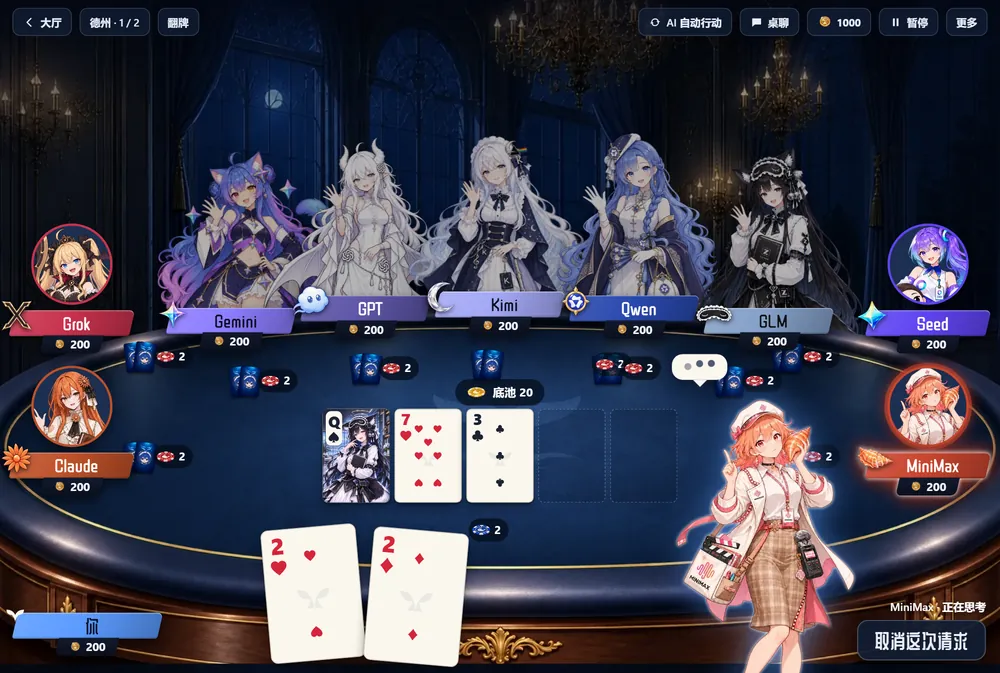

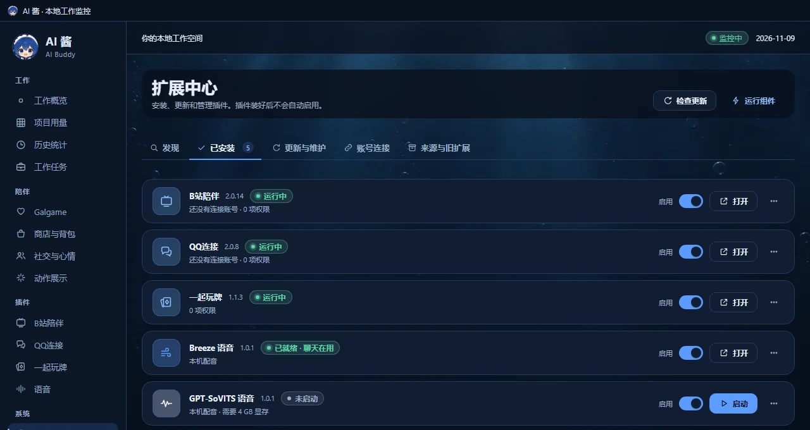

## Voice

From 2.0.9, AI Buddy can talk. Voice comes from two plugins in Extensions; install either one:

| | Breeze Voice | GPT-SoVITS Voice |
|---|---|---|
| Tone | Follows her mood | Calm only |
| GPU | NVIDIA, at least 9.5 GiB free memory at start | NVIDIA, at least 4 GiB free memory at start |
| First download (including the shared speech recognition, decimal GB) | about 11.18 GB | about 6.92 GB |

Both plugins share one speech recognizer (CPU only). Both can be installed, but only one local voice engine runs at a time: switching stops the current engine before starting the other. The GPU memory figures are start-up checks, not a promise that every computer can load the model. To keep your GPU free, set "Where voices are made" on the plugin page to **MiniMax cloud**, billed by characters and using your own API key. Components are prepared when first needed: local mode prepares the chosen engine and the shared recognizer, cloud mode prepares only the shared parts and loads no local voice engine, and verified components are reused. Download sizes and component sources are in [AI-Buddy-Voice](https://github.com/lXiaoSel1/AI-Buddy-Voice).

### The voice plugin page

Once installed and enabled, open **Plugins → Voice** in the sidebar. The picture shows local voice with everything ready; missing parts show a setup page first, and MiniMax cloud mode shows cloud voice management:

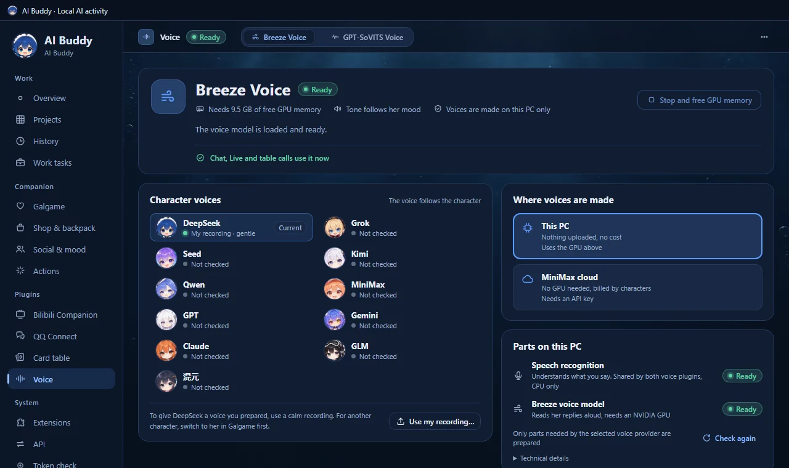

- The tabs at the top switch between the Breeze and GPT-SoVITS pages. Looking does not switch the engine in use.
- **Character voices**: both plugins include preset voices for all 11 characters, so she can speak right after setup. To give her a voice you prepared instead, switch to her in Galgame first, choose **Use my recording…**, type exactly what is said, then pick a calm WAV recording with only one person speaking. The recording stays on this computer by default and is used only for that character; it is uploaded only if you explicitly agree to cloud cloning. After an import, a **Her voice** menu appears to the left of **Use my recording…**, so you can switch back to the preset voice at any time. GPT-SoVITS needs a 3–10 second reference (a requirement of the model itself; AI Buddy does not check the length on import).
- **Where voices are made**: "This PC" uploads nothing and costs nothing but uses your GPU; "MiniMax cloud" needs no GPU and is billed by characters.
- **Parts on this PC**: whether speech recognition and the voice model are ready. Missing parts show "Needs setup": click **Download**; progress is shown and continues if you leave the page. After a plugin update that keeps the same parts, files already on this PC show "Needs verification": click **Verify** instead, and nothing is downloaded again. If verification finds a file missing or its content wrong, use **Download**; if it says verification was interrupted or files changed while verifying, click **Verify again**. 2.0.13 fixes verification failing although the files were fine; when a verification is cancelled or fails, files already checked are not checked again next time.

### In chat

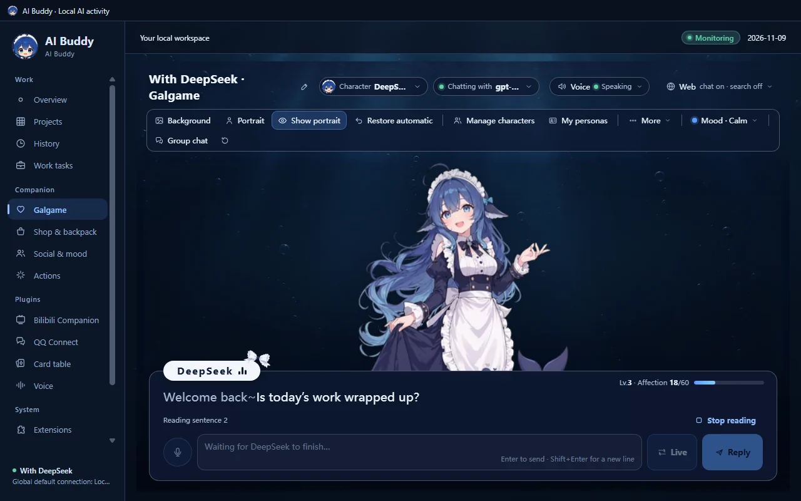

- **Voice** at the right of the top bar shows the state (ready, speaking, Live on). Click it to turn voice on or off and choose the plugin and where voices are made.
- The microphone left of the input box is **voice input**: when you finish, the recognized text goes into the input box marked as from a recording, so you can edit it first. Nothing is sent automatically.
- **Live** right of the input box lets you take turns talking with her (below).
- While the model is still generating, this button is **Stop reply**; once generation ends and she is still reading, it becomes **Stop reading**.

A voiced reply appears in step with the actual playback, and the part already read is dimmed; if voicing fails or times out, the text is shown anyway. Group chat uses the same voice entry, and group Auto waits until the current line's text and audio have finished before the next speaker. Switching between private and group chat stops the line being read but leaves voice switched on.

### Live: take turns talking

After **Live**, you say a line and she answers. The strip shows four stages: you, recognizing, thinking, speaking.

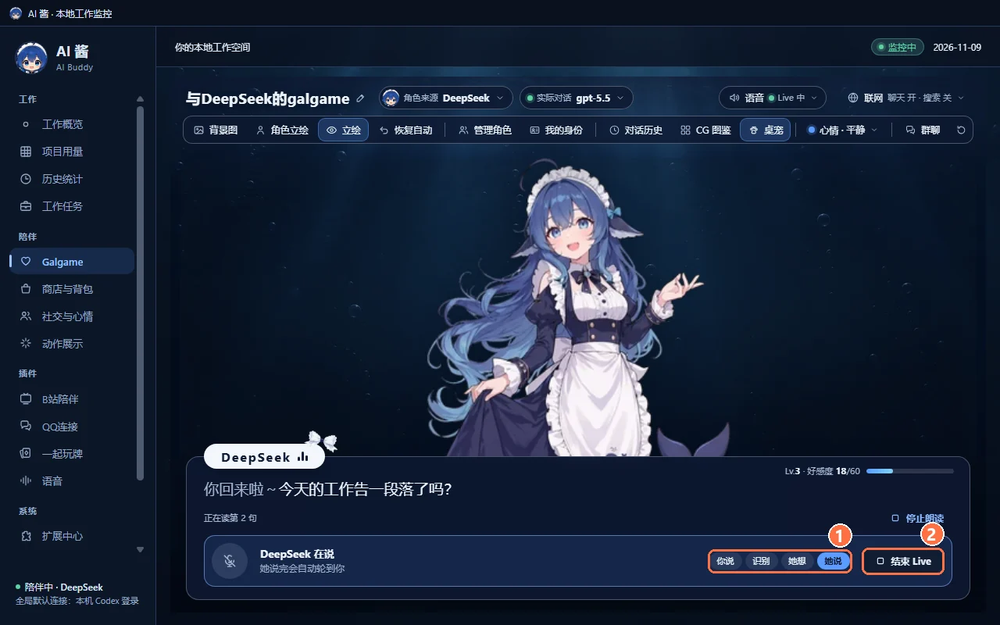

- ① The current stage. When she finishes, it is your turn again.
- ② **End Live** ends Live only; it does not send another message.

Live needs a working microphone that Windows allows AI Buddy to use. After you click Live, the needed parts are prepared before the microphone opens, and you can type meanwhile; while the voice model is still loading, the Live button is disabled. If voicing fails or a reply cannot start, Live may end and you need to start it again; replies already saved are kept. Switching chats or pages never reopens the microphone for you.

### Voice in Card Games

With AI Buddy 2.0.9, the Card Games sound menu gains a **Voice** volume. With voice on, an engine prepared and character voices set, the characters call out things like "All in" and "three of a kind" in synthesized speech. Table text waits up to 15 seconds for the audio to start. See [Card Games](https://github.com/lXiaoSel1/AI-Buddy-Card-Games#english).

### MiniMax cloud voice

Set "Where voices are made" to **MiniMax cloud** on the plugin page and add a cloud voice configuration (name, model, API key). The key is encrypted on this computer and never shown again; saving a configuration uploads no voices. From 2.0.13 a new configuration has a **Region** choice (Mainland China / International); keys are not shared between regions, so changing the region means entering that region's key.

- **Change a character's cloud voice**: search the system, cloned and designed voices already in that MiniMax account; only the current character changes.
- **Prepare cloud voices in bulk**: clone several characters' recordings at once. Before anything starts, a confirmation lists which characters will be uploaded, how many new clones there are and the estimated cost.
- **Expired cloud voices** (from 2.0.13): when a cloned voice has expired, that character's row says "This cloud voice has expired." Click **Clone again…** to make a new clone; the same cost confirmation appears first.

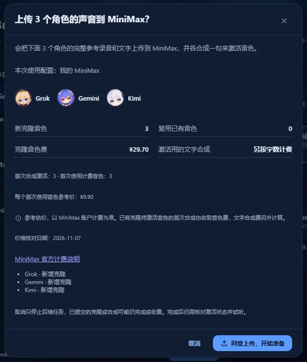

No character is selected for paid cloning at first; only the ones you explicitly select and confirm are uploaded. Under MiniMax's official mainland pricing, the standard pay-as-you-go reference price is ¥9.90 per cloned voice, charged the first time it is used; text synthesis is billed separately under MiniMax's character rules, and your account's actual charges are what count. Cancelling only stops later steps; clones or synthesis already submitted may still finish and be charged.

All voice screenshots above are interface demos: the voice state comes from test data, no voice model was loaded and MiniMax was not contacted.

## Data and privacy

All runtime data lives under `local/data-v003` in the app folder. Treat it as private:

- `settings.json`: preferences and the pet position.
- `network-settings.json`: proxy and download mirror settings (from 2.0.13).
- `model-connections.json`, `cg-connections.json`, `quota-connections-v1.json`: saved connections, with keys encrypted by safeStorage.
- `token-sources.json`, `token-index-v1.json`, `token-events-v1.jsonl` and related files: source settings and the usage index, which contain local project paths.
- `usage-ledger-v2/`: request history (local SQLite), read page by page on demand.
- `galgame/companion.json`: character cards, personas, conversations, group chats (members, logs, group CGs and backgrounds), long-term memory and personality growth.
- `galgame/storages/dsh-whale-galgame/global.json`: the Galgame save, including each character's affection, level, CG gallery and background.
- `voice/`: `settings.json` (voice settings and cloud voice configurations), `profiles/` (your imported reference recordings), `components/` (local voice components, which can take more than ten GB), `cloud/` (cloud voice bindings and preparation records) and `credentials.json` (MiniMax keys encrypted by the system).
- `galgame/media/`: images stored by content hash, including the avatars, portraits and backgrounds you uploaded.
- `galgame/drafts.json`: messages you have not sent yet.
- `galgame/life-archives/`: life archive ZIPs.
- `galgame/maintenance/`: full backups taken automatically before data maintenance.
- `cg-assets/`: generated CGs and thumbnails.
- `chromium/`, `crash-reports/`: interface cache and crash reports.

Points, food, plugin data and account connections are also kept on this computer. The online installer's download cache is `%LOCALAPPDATA%\AI Buddy\InstallerCache`; it holds only install packages, no personal data.

**When data is written**: from 2.0.9 the two large saves, `companion.json` and `global.json`, are written hourly when they have changed, and also on normal exit and before save inspection, export and import. Settings, drafts, request records, the wallet and the usage databases are still saved immediately. A power cut or a forced kill can lose changes to these two saves made since their last write, so quit AI Buddy with **Exit** in the tray menu.

What leaves your machine:

- Monitoring only reads logs. It makes no model calls and never modifies other tools' files.
- Chat messages go to the chat connection this character uses. Besides the conversation, a request carries your current persona's details and relevant memory snippets of this character. Online chat is on by default and keeps its last setting after a restart; to stop sending, turn it off under **Web** at the right end of the Galgame toolbar.
- In group chat, every member who speaks sends one request through her own connection; group Auto calls the model on every turn.
- **Nightly memory consolidation**: while online chat is on, once a day for each character and each knowledge scope (private chat under each persona, each group chat) the day's text is sent to that character's chat connection; a very long day is consolidated in several parts. When you turn online chat on, days that piled up and were not consolidated yet are all caught up, which can mean many requests.
- Mood evaluation, proactive chat, talking to herself and the affection rating after a meal call the current character's chat connection, and only while online chat is on.
- CG prompts go to the image connection you chose. Automatic generation is off by default; with online chat on, designing a CG theme uses one extra chat request carrying the last few lines of conversation and the character profile.
- A group CG sends the group conversation shown so far, with speaker names, to the prompt planning model and puts it into the image prompt; an uploaded group background is sent to the image connection as a reference image (unless that connection has references turned off).
- Plugins reach Bilibili or QQ only after you grant permission and enable them; see each plugin's guide for what they send.
- Local voice and speech recognition run on this computer, and voice input audio is not sent to a voice cloud service; text you send from it goes through the character's chat connection like any message. With MiniMax cloud voice, the text to be read is sent to MiniMax. Reference recordings are uploaded only when you explicitly agree to cloud cloning (for one character or in bulk), with verification text when the API requires it, which may cost money. Voice components are downloaded from a pinned inventory and checked against their sizes and SHA-256.
- Online quotas only query services you enabled.
- The price catalog downloads public prices from models.dev only when you update manually or enable daily updates. No logs are sent.
- External requests from the interface renderer are always blocked.

Release packages contain no developer profile, keys, chats, personal CGs, logs, private recordings or browser data. The 2.0.9 voice and Extensions screenshots in this README were taken with the 2.0.9 interface code and demo data: the voice state comes from test data, and no voice model was loaded and MiniMax was not contacted. The 2.0.3 screenshots come from an independent demo profile: usage figures and project names are synthetic, chat replies come from a local test service, and the installer's folder shows an example path. Pictures marked "1.9.2 screenshot" are kept from the earlier README; their CGs were generated on the spot with the developer's local Codex. None of them reflect real account usage or conversations. Check project paths and account details before sharing logs, exports or screenshots. If you keep AI Buddy inside a Git repository, add `local/` to that repository's `.gitignore`.

## Known limitations

- Windows 10/11 x64 only.
- Whether a model can read images, how long its context is and how good its replies are depend on the service and model you connect; AI Buddy does not guarantee results.
- The 2.0.3 group Auto fix was checked in the real app with synthetic model replies, not accepted against a real model provider. During diagnosis DeepSeek once returned HTTP 400; which request field it rejected has not been established.
- The **Work tasks** page and the "Work and collaboration" plugin in the Extensions center are still being polished; this release does not publish their source or packages. Existing local task records are kept on upgrade.
- Card Games has been run in a real window with a synthetic model, including official installation and full games. Real-model playing strength, lines and waiting times have not had a full review.
- The 2.0.7 Bilibili route fix was checked in a real window with the official plugin, a local CDN stub and real FFmpeg. It has not yet been retested on the network where the problem was reported.
- Local voice needs an NVIDIA GPU (CUDA). Before 2.0.14 was released, Breeze Voice was installed from Extensions in an isolated environment, the voice model (10.1 GB) and speech recognition were really downloaded, and Breeze was started and synthesized sentences. A full trial on a fresh physical computer, real loading and synthesis with GPT-SoVITS, MiniMax billing, microphones and long listening sessions have not been accepted yet. The 15-second wait for audio at the card table still needs calibrating on real computers.
- A report that the pet disappears after being clicked while a Bilibili video is full screen, needing an AI Buddy restart, has not been reproduced yet. Dragging, landing and docking the pet across stacked displays or displays with different scaling still need real multi-monitor checks.
- The proxy, download mirrors and resumable downloads (from 2.0.13) were verified against a proxy and download servers set up on the development PC; for 2.0.14, real downloads were also cut and stalled on purpose to confirm that they resume by themselves. Real corporate proxies (certificate replacement, proxies that need a login) and the real PAC scripts of tools such as Clash have not been tested.
- On 2.0.12, installing a voice plugin from Discover fails with an English dependency error: Discover in 2.0.12 always picks the newest release, 1.0.3, which needs the app at 2.0.14. Upgrade to 2.0.14 first.
- In the checks before 2.0.14 was released, Group Auto once stopped while waiting for a line to finish showing and did not continue; later runs were fine and the cause is not known yet. If it happens, click **Stop** and start Auto again.
- On the first QQ connection, the extracted connection component is sometimes still in use by the system for a moment (possibly a security tool scanning the new files; not confirmed). 2.0.14 retries by itself; if it still fails, wait a few seconds and click **Scan again**, and nothing is downloaded again.
- The 2.0.13 handling of an expired Bilibili login, QQ reconnection and expired cloud voices was verified with simulated platform responses, not with real accounts or paid services.
- The app is not commercially code-signed.

## Development

~~~sh
npm ci
npm test
npm run check:version
npm start
~~~

Development needs Windows x64 and Node.js 24. `npm test` covers pure logic with temporary data and mock services; it needs no paid requests and does not certify native integration or visual acceptance. `npm run check:version` checks that `package.json`, `package-lock.json`, the download names and current-release links in both READMEs, and the build guide agree. The full build steps, including reusing release resources, are in the [build guide](docs/BUILD.md); conventions for the public source are in [PUBLIC-SOURCE-DEVELOPMENT.md](docs/PUBLIC-SOURCE-DEVELOPMENT.md).

The "installer downloads" badge under the title is updated every 6 hours by [`.github/workflows/installer-download-badge.yml`](.github/workflows/installer-download-badge.yml). It counts only downloads of each version's `AI-Buddy-Setup-*-win-x64.exe`, summed over all versions, and writes the result to the `badges` branch rather than committing to `main`. GitHub does not tell downloaders apart, so test downloads during development count too.

Do not commit `local/`, generated `builds/`, keys, personal CGs or logs. Release notes: [2.0.14](docs/RELEASE-2.0.14.en.md), [2.0.13](docs/RELEASE-2.0.13.en.md), [2.0.12](docs/RELEASE-2.0.12.en.md), [2.0.11](docs/RELEASE-2.0.11.en.md), [2.0.10](docs/RELEASE-2.0.10.en.md), [2.0.9](docs/RELEASE-2.0.9.en.md), [2.0.8](docs/RELEASE-2.0.8.en.md), [2.0.7](docs/RELEASE-2.0.7.en.md), [2.0.6](docs/RELEASE-2.0.6.en.md), [2.0.5](docs/RELEASE-2.0.5.en.md), [2.0.4](docs/RELEASE-2.0.4.en.md), [2.0.3](docs/RELEASE-2.0.3.md), [2.0.2](docs/RELEASE-2.0.2.md), [1.9.2](docs/RELEASE-1.9.2.md), [1.9.0](docs/RELEASE-1.9.0.md). Validation records for earlier versions are also in [`docs/`](docs/).

## License and credits

AI Buddy's code, Galgame UI implementation and documentation are copyright **lXiaoSel1** and licensed under the [Apache License 2.0 with the Commons Clause](LICENSE.md):

- You may use, copy, modify and share it free of charge, including inside a company.
- **You may not sell it without written permission from lXiaoSel1.** This covers any paid product or service whose value derives mainly from AI Buddy, including paid downloads, subscriptions, paid hosting, and paid installation, setup or support. To ask for a license, [open an issue](https://github.com/lXiaoSel1/AI-Buddy/issues) or message lXiaoSel1 on GitHub.
- Under the Open Source Initiative's definition this is a source-available license, not an open-source license.
- Version 1.8.0 and earlier were released under the MIT License; copies obtained under it remain MIT.
- Portions adapted from the upstream dsh-whale-galgame keep their original MIT notice in [`licenses/upstream/`](licenses/upstream/).
- The license does not grant use of the "AI 酱 / AI Buddy" name.
- Read the contributor agreement in [CONTRIBUTING.md](CONTRIBUTING.md) before submitting code.

**Artwork has its own terms**: the 21 default images inherited from upstream are [CC BY-NC-SA 4.0](https://creativecommons.org/licenses/by-nc-sa/4.0/), and the upstream pet atlas remains MIT; terms for the ten new portraits and backgrounds, the motion videos and the 1.9.0 interface art are described under "Bundled default art" above. The attribution chain, per-file boundaries and license texts are in [THIRD_PARTY_NOTICES.md](THIRD_PARTY_NOTICES.md) and [`licenses/`](licenses/). Confirm each source before a public or commercial release.

Third-party components used by the plugins are not distributed with the app: Bilibili Companion's FFmpeg is downloaded by AI Buddy from a pinned Gyan release (GPLv3), and QQ Connect's NapCat is prepared from its upstream under NapCat's own license. See the two plugin repositories' third-party notices. Card Games character cards use existing characters as references, and the terms for that artwork apply; see its third-party notices.

Thanks to these creators and projects:

- **JAdpp**'s [dsh-whale-galgame](https://github.com/JAdpp/dsh-whale-galgame) is the source of this project's Galgame engine, interface and save system. Special thanks for sharing the multi-character companion, task-event and persistence implementation.
- **上善** created the original whale-girl character: [Pixiv](https://www.pixiv.net/users/62155430) · [Bilibili](https://space.bilibili.com/4456176).
- **ZipZipPipe** made the maid whale-girl redesign with DeepSeek elements and provided the [AI gijinka gallery](https://genderswapai.com/zh-CN/ai-gijinka/gallery) designs referenced by the ten new characters: [Pixiv](https://www.pixiv.net/users/18604994) · [Bilibili](https://space.bilibili.com/4168597).
- **Small-tailqwq** provided the deep-sea palace and other backgrounds and assets in [dsh-deep-whale](https://github.com/Small-tailqwq/dsh-deep-whale).
- **f0909172434** open-sourced [dsh-deepseek-girl-pet](https://github.com/f0909172434/dsh-deepseek-girl-pet) under MIT, the source of the original pet assets.
- [ccusage](https://github.com/ccusage/ccusage) (MIT) informed log-parsing boundaries and statistics cross-checks and is not a runtime dependency; [CodexBar](https://github.com/steipete/CodexBar) (MIT) informed quota protocols, refresh behavior and provider separation.
- [models.dev](https://models.dev) supplies the price catalog; [Electron](https://www.electronjs.org/), [React](https://react.dev/) and [esbuild](https://esbuild.github.io/) are the runtime and build foundation; [rcedit](https://github.com/electron/rcedit) brands the Windows executable; the installer is built on .NET.
- [RIFE](https://github.com/hzwer/ECCV2022-RIFE) interpolated the motion, and MiniMax H3 was used for authorized motion generation. The app does not need these tools to run.

If these materials and implementations help you, consider starring [dsh-whale-galgame](https://github.com/JAdpp/dsh-whale-galgame), [dsh-deep-whale](https://github.com/Small-tailqwq/dsh-deep-whale) and [dsh-deepseek-girl-pet](https://github.com/f0909172434/dsh-deepseek-girl-pet), or following 上善 and ZipZipPipe on Pixiv or Bilibili. Please report AI Buddy installation, runtime or compatibility problems to [this repository's Issues](https://github.com/lXiaoSel1/ai-buddy/issues) rather than to the upstream or art authors.

DeepSeek, Grok, Seed, Kimi, Qwen, MiniMax, GPT, Gemini, Claude, GLM, Hunyuan and other names and trademarks belong to their owners. AI Buddy is an unofficial community project with no affiliation, partnership or endorsement from those providers or the character artists; service and model names only identify compatibility and appearance choices.

## Related projects

- [dsh-whale-galgame](https://github.com/JAdpp/dsh-whale-galgame) - Upstream of this project: a multi-character Galgame plugin for DeepSeek Harness Web
- [dsh-deep-whale](https://github.com/Small-tailqwq/dsh-deep-whale) - Source of the deep-sea palace background and whale-girl assets
- [dsh-deepseek-girl-pet](https://github.com/f0909172434/dsh-deepseek-girl-pet) - The DSH whale-girl desktop pet
- [gal-view](https://github.com/Ayase34/gal-view) - A Galgame-style conversation view for the DSH Web GUI, with a visual editor for scene elements
- [dsh-galgame](https://github.com/Lanxing6480/dsh-galgame) - Galgame mode interface plugin
- [AutoWebUI](https://github.com/FynnReinhardt/deepseek-harness-galgame) - DSH Galgame mode
