# AI 酱 · AI Buddy · 本地 AI 用量监控与多角色 Galgame 陪伴

  
  
  
  
  
  
  
  
  

**简体中文** · [English](README.en.md)

**AI 酱本体**（本仓库） · [B站陪伴插件](https://github.com/lXiaoSel1/AI-Buddy-Bilibili) · [QQ连接插件](https://github.com/lXiaoSel1/AI-Buddy-QQ) · [一起玩牌插件](https://github.com/lXiaoSel1/AI-Buddy-Card-Games) · [语音插件](https://github.com/lXiaoSel1/AI-Buddy-Voice)

<!-- ai-buddy-source-version: 2.0.11 -->
**当前版本：[v2.0.10](https://github.com/lXiaoSel1/ai-buddy/releases/tag/v2.0.10)** · 2.0 加入了扩展中心和官方插件，还有积分、商店与背包、投喂，以及社交与心情；群聊可以开 Auto，让角色们自己轮流接话。2.0.4 加入了牌桌服务，可以从扩展中心安装「一起玩牌」，和角色打斗地主、德州。2.0.5 修好了它和 B站、QQ 页面切换时卡在「启动中」的问题。2.0.6 修复安装器校验旧存档时卡住的问题。2.0.7 修复 B站陪伴在部分线路无法采集原视频分镜的问题。2.0.8 可以直接在通用设置里更新本体和插件。2.0.9 加入[语音](#语音)：从扩展中心装 Breeze 或 GPT-SoVITS 语音插件，她的回复会读出来；Galgame 里可以开 Live 和她轮流说话，也能录音转成文字；还能改用 MiniMax 云配音。30fps 和 60fps 两版功能相同。见 [2.0.10 更新说明](docs/RELEASE-2.0.10.md)。

## 在线安装（推荐）

**本体 2.0.10。** 扩展中心目前提供 B站陪伴 2.0.14、QQ连接 2.0.8、一起玩牌 1.1.3，以及 Breeze 语音和 GPT-SoVITS 语音 1.0.1。

[下载 Windows x64 安装器 2.0.10](https://github.com/lXiaoSel1/AI-Buddy/releases/download/v2.0.10/AI-Buddy-Setup-2.0.10-win-x64.exe) → 选择 30fps / 60fps 和角色 → 自动下载、校验、安装。补装角色、修复和升级也用这个安装器。

安装器约 50 MiB；全角色资源下载量约为 30fps **1.33 GiB**、60fps **1.75 GiB**，只选部分角色会更小。第一次打开怎么用，见下文[快速上手](#快速上手)。

应用本身免费。聊天和 CG 绘图用的是你自己配置的模型服务，服务商可能另外收费。

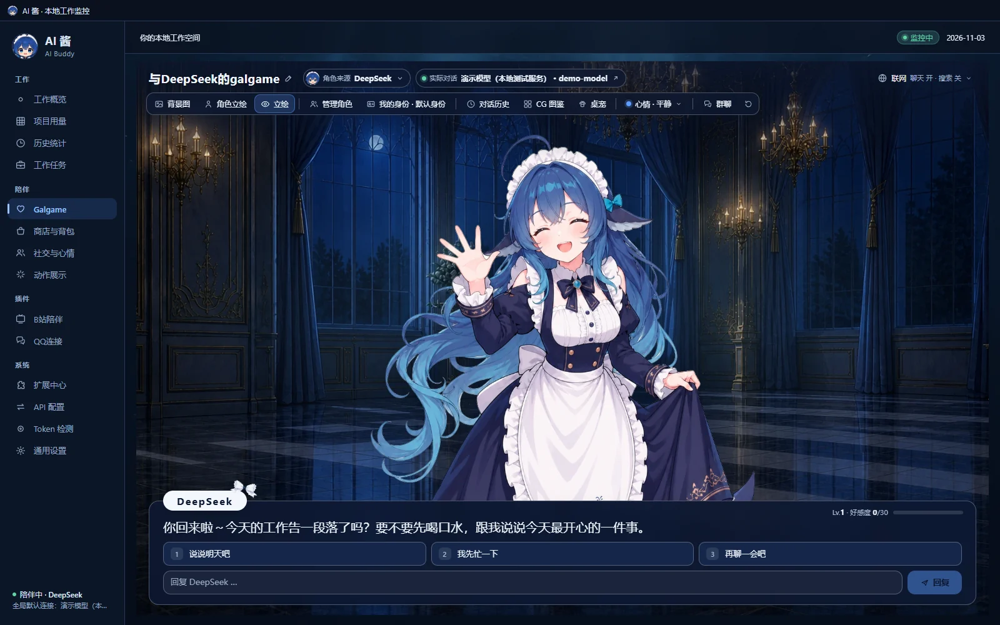

## 简介

AI 在跑任务、你在等结果的间隙，看看今天烧了多少 Token，再和模型娘聊两句吧～(∠・ω< )⌒★

AI 酱（AI Buddy）是一个 Windows 桌面应用。它只读本机 AI 工具的日志，整理 Token 用量、估算费用、按项目汇总；同时把 [JAdpp/dsh-whale-galgame](https://github.com/JAdpp/dsh-whale-galgame) 的多角色 Galgame 搬到桌面上，配了桌宠，聊天和 CG 绘图也能分别接入：

- **8 种 AI 工具的本地账本**：Codex、Claude Code、Gemini CLI、Kimi Code CLI、OpenCode、Cline、Roo Code 和 DeepSeek Harness。只读日志里实际记录的用量，缺的字段显示“未提供”，不按文字长度去猜。
- **11 位模型娘**：DeepSeek、Grok、Seed、Kimi、Qwen、MiniMax、GPT、Gemini、Claude、GLM 和混元，各有立绘、背景、性格和语气，好感度与 CG 图鉴分开记录。也可以自己新建角色。
- **外观与内核解耦**：出场的角色和实际回复的聊天连接分开选，每位角色还能绑定自己的连接和 effort。想用 Qwen 的形象、接 Claude 的 API 聊天也可以。
- **群聊与 Auto**：把几位角色拉进同一个群，围着圆桌聊；打开 Auto 后，她们会按轮次自己接话，你随时可以插一句、暂停或停止。聊完还能拍一张合影 CG。
- **会记事，也会慢慢变**：聊天原文完整保存，每天零点整理一次长期记忆；可以为角色开启人格自成长，也能把她的一整段「人生」存档、导出和恢复。
- **积分、商店与投喂**：AI 酱开着时，本机 AI 工具新增的用量会攒成积分，用来在商店里买 21 种食物，喂给当前角色。
- **社交与心情**：角色有随真实交流变化的心情；主动搭话、自言自语和群聊 Auto 默认都关着，想要再打开。忙的时候可以让她先别打扰你。
- **工作越多，羁绊越深**：开着 AI 酱工作，新增的 Token 会慢慢变成当前角色的好感；升级时还能生成一张纪念 CG。
- **11 位角色都有透明桌宠**：每位 24 个动作，可选 30fps 或 60fps。摸摸她会有表情，5 分钟没动静会睡着，左键拖着走，右键能把她抛出去。任务完成时跳一跳，出错时也会有反应。
- **扩展中心与官方插件**：在扩展中心安装 [B站陪伴](https://github.com/lXiaoSel1/AI-Buddy-Bilibili)（和角色一起看 B站视频）、[QQ连接](https://github.com/lXiaoSel1/AI-Buddy-QQ)（让角色回复你允许的 QQ 好友和群）、[一起玩牌](https://github.com/lXiaoSel1/AI-Buddy-Card-Games)（和角色打斗地主、德州），或 [语音插件](https://github.com/lXiaoSel1/AI-Buddy-Voice)。插件装好后不会自动启用，也不会自动登录、发言或调用模型。
- **语音**：装上 Breeze 或 GPT-SoVITS 语音插件后，她的回复会用她自己的声音读出来，文字跟着播放进度出现。Galgame 里可以开 Live 和她轮流说话，也可以录一段话转成文字、改好再发。每位角色可以换成你准备的录音；不想占显卡时，可以改用 MiniMax 云配音。
- **11 套角色主题，中英双语**：配色、背景和装饰都取自各角色立绘，5 套深色、6 套浅色；可以固定一套，也可以跟着当前角色换。

## 快速上手

第一次使用照下面 5 步走就行。图里的橙色编号就是要点的位置。每一步更细的说明（导入旧存档、换模型、装插件后怎么连接账号）见 [快速上手图文教程](docs/QUICKSTART.md)。

**1. 运行安装器。** 双击 `AI-Buddy-Setup-2.0.10-win-x64.exe`：① 确认安装位置 → ② 选 30fps 或 60fps 和初始角色 → ③ 勾选要装的角色（以后可以补装）→ ④ 点 **安装 / 补装 / 修复**。安装器会显示所选下载量和需要的磁盘空间，下载完逐个核对后再安装。

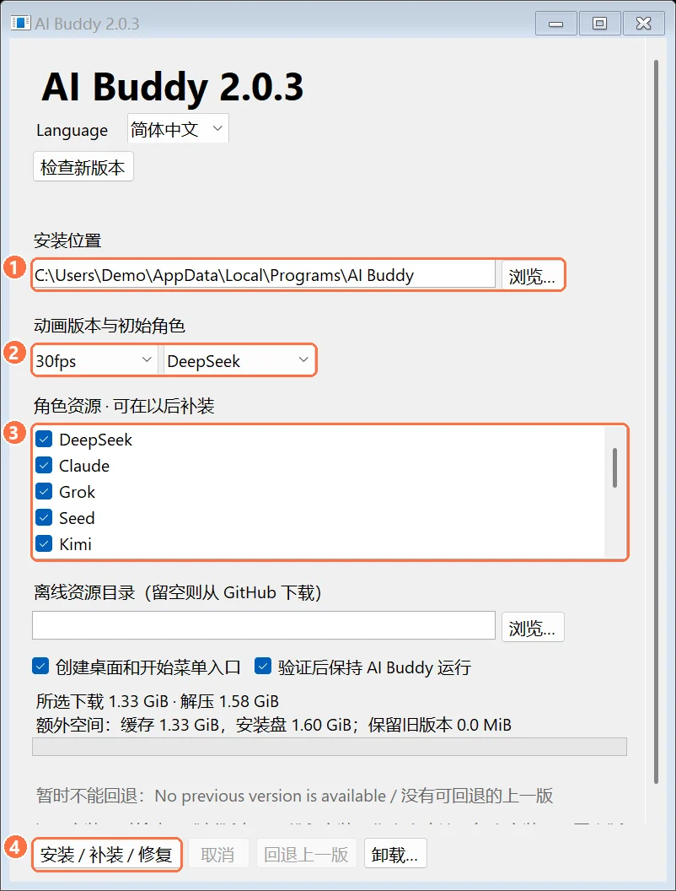

**2. 安装完成后直接进入。** 安装器首次安装会自动初始化本地存档；在原目录更新则直接沿用原存档。无需再选择新建或导入。下面的欢迎页仅用于便携包首次启动；需要迁入另一份资料时，再使用应用的导入存档入口。

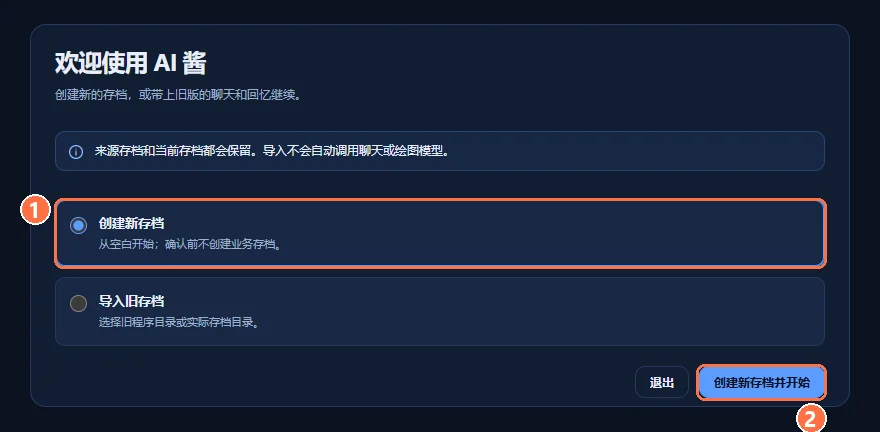

**3. 配置聊天模型。** 左侧栏打开 **API 配置 → 聊天 API**，点右上角 **新增配置**：① 选提供方（DeepSeek、OpenAI、Claude、Gemini、通义千问等，或「自定义接口」）→ ② 粘贴你的 API Key → ③ 点 **获取模型列表** 选模型 → ④ 点 **保存并使用**。也可以先点「测试连接（调用一次模型）」试一下。

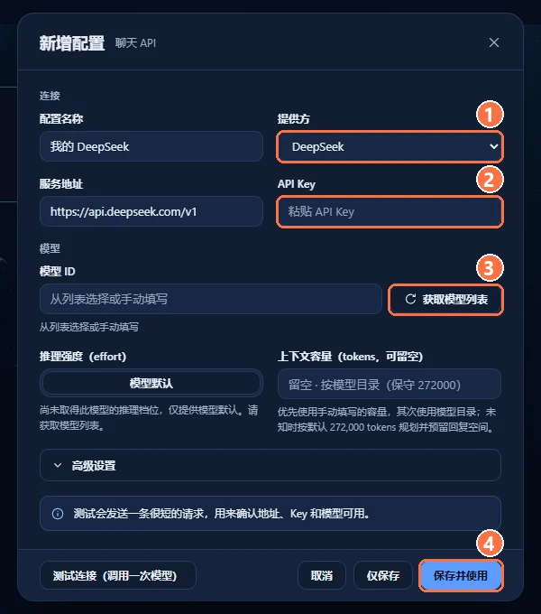

**4. 打开联网聊天，开始聊天。** 左侧栏点 **Galgame**。刚接好第一个模型时，对话框里会显示「联网聊天已关闭」：点 ① **开启联网聊天**（或顶栏右侧的「联网」开关），就可以打字聊天了。这个开关会记住，之后重启也保持开启。没打字时按 1、2、3 也能直接选回复。

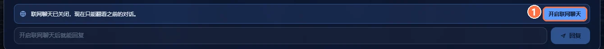

**5. （可选）安装插件。** 左侧栏打开 ① **扩展中心** → ② **发现**，在想要的插件右边点 ③ **安装…**，按提示勾选授予的权限。插件需要的组件由 AI 酱在安装、连接或启动时准备，不用另装 Node 或填写端口。之后怎么用，见插件各自的说明：[B站陪伴](https://github.com/lXiaoSel1/AI-Buddy-Bilibili#快速上手) · [QQ连接](https://github.com/lXiaoSel1/AI-Buddy-QQ#快速上手) · [一起玩牌](https://github.com/lXiaoSel1/AI-Buddy-Card-Games#快速上手) · [语音](#语音)。

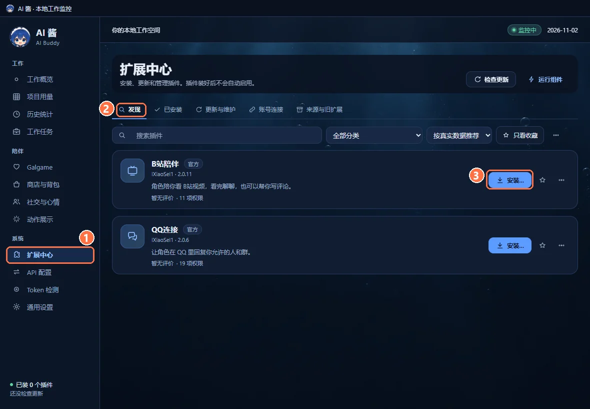

## 功能

<table>
  <tr>
    <td align="center">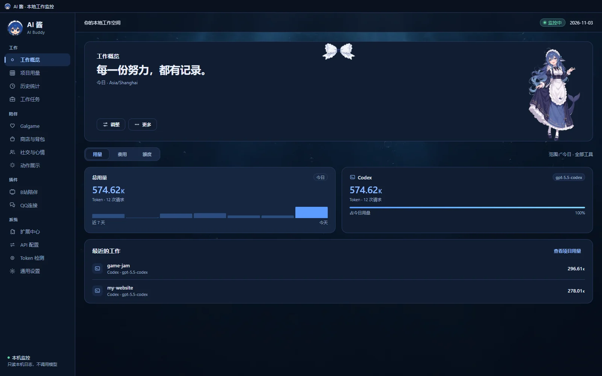 <strong>工作概览</strong>：今天用了多少、各工具占多少、最近在忙哪些项目</td>
    <td align="center">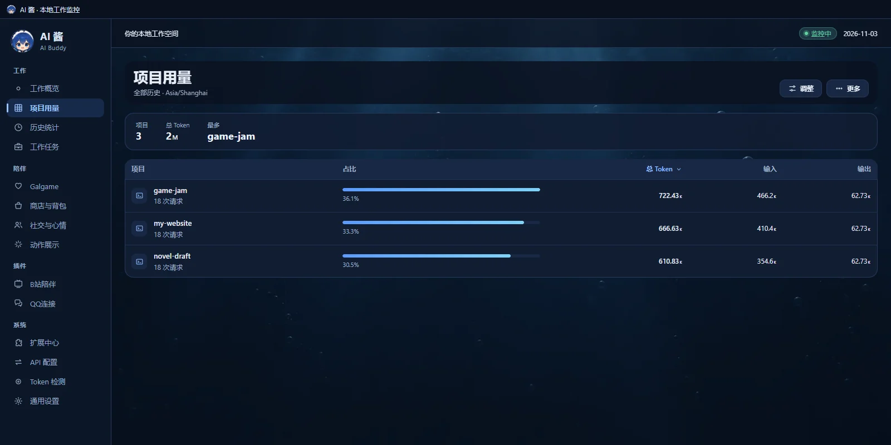 <strong>项目用量</strong>：按项目汇总 Token，可按总量、输入、输出排序</td>
  </tr>
  <tr>
    <td align="center">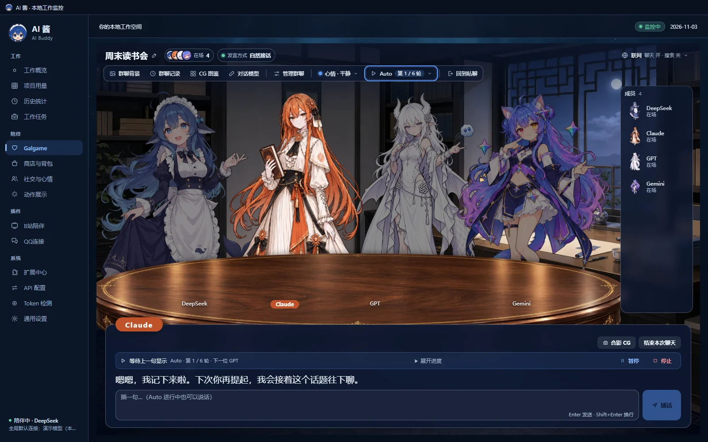 <strong>群聊 Auto</strong>：四位角色围着圆桌轮流接话，进度条写着下一位是谁</td>
    <td align="center">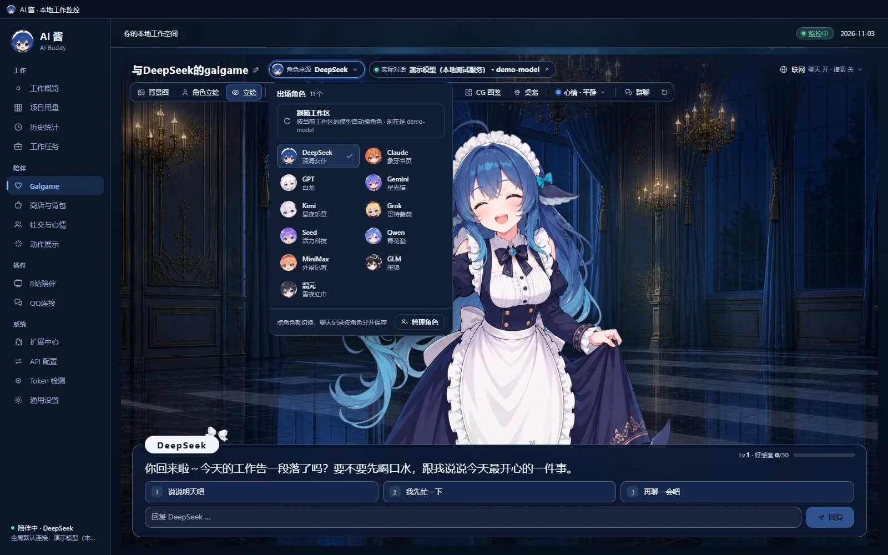 <strong>角色来源</strong>：11 位内置角色随时切换，各自的好感和记录分开保存</td>
  </tr>
  <tr>
    <td align="center"> <strong>商店</strong>：用积分买食物，旁边是她现在饿不饿</td>
    <td align="center">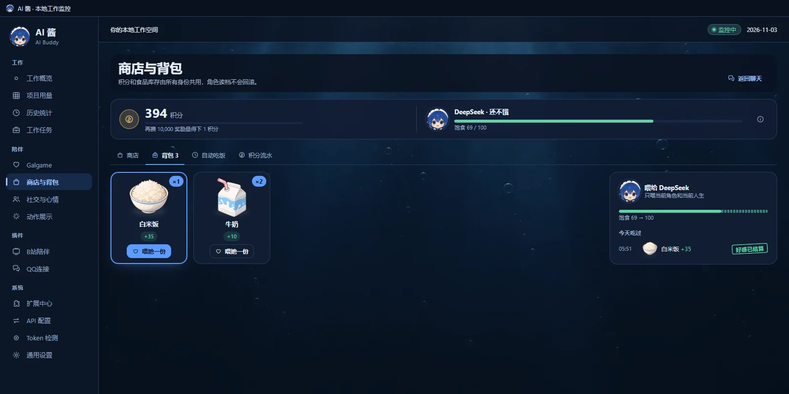 <strong>背包与投喂</strong>：点「喂她一份」，她会说两句，好感另外结算</td>
  </tr>
  <tr>
    <td align="center">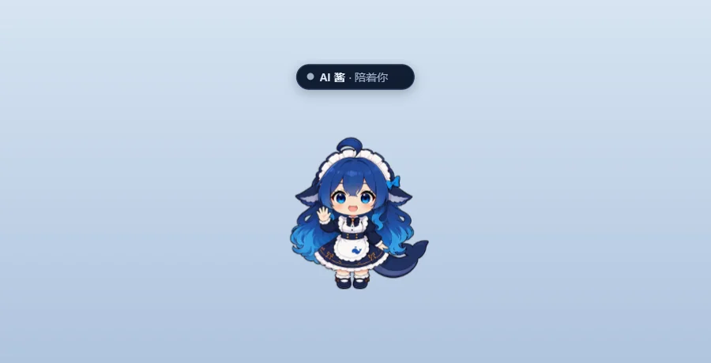 <strong>桌宠</strong>：透明窗口，状态条写着她在做什么（贴在纯色背景上展示）</td>
    <td align="center">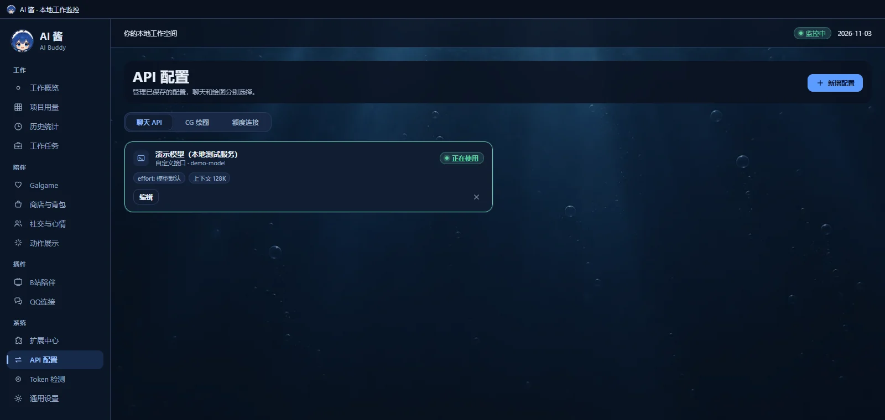 <strong>API 配置</strong>：聊天、CG 绘图和额度查询各用各的连接</td>
  </tr>
</table>

以上截图都来自独立的演示存档：用量和项目名是合成的示例数据，聊天回复来自本机的测试服务，没有用真实账号。

- **工作概览**分为用量、费用、额度三页，显示总数、各工具卡片和最近五项工作。
- **项目用量**可按总 Token、输入、输出或项目名排序；**历史统计**可以查看日、周、月趋势，选择日期范围和时区，并导出 CSV / JSON。
- 工具、模型厂商、服务平台分开记录。Codex 是工具，OpenAI 是厂商或服务平台；光看模型名，无法证明用的是官方 API。
- **费用估算**用输入、输出、缓存读取、缓存写入四类 Token 分别乘以单价，不按请求次数算。订阅工具显示的是按 API 价格折算的参考金额，不是套餐账单。缺少用量或价格时保持“未知”，不当作零。价格目录来自 models.dev，可以在“费用 → 价格设置”里筛选、改价或手动更新。
- **在线额度**是可选功能，支持 Codex、Claude、GLM/Z.ai、Kimi Coding、MiniMax Coding、DeepSeek API 余额，以及受支持账号的 Gemini CLI。每个服务单独启用后才会查询。
- 侧栏「工作」分组里的工作概览、项目用量、历史统计都是 AI 酱自带的本机用量统计。「工作任务」一页属于另一个还没公开的插件，本版不提供。
- **角色与对话**窗口集中管理角色卡、我的身份、对话历史、群聊、长期记忆、人格自成长和人生存档。
- 每位角色的等级、聊天记录、背景、CG 图鉴、回收站和立绘显示状态互不影响，关系进度还按身份分开记。切换角色时会换回她自己的背景。
- 每轮对话提供三个回复选项，输入框为空时按 1、2、3 就能直接选；也可以直接输入。
- 用 CG 做背景时，默认隐藏立绘，免得画面里同时出现两个她。CG 图鉴里右键可以移入回收站，删了也能撤销或恢复。
- 历史请求存在本机 SQLite 里，重启后接着读取，查看时按需分页。

## 好感度与本机工作

### 关系进度

每位角色都从 Lv.1、0 点好感开始，彼此独立。同一位角色在你不同的「身份」下也分开记进度；需要的话，可以在「我的身份」里改成共用一份，数值不会相加。亲近、普通、疏离三个回复选项分别是 +1、0、-1，每轮的排列顺序随机。直接输入时按简单的关键词结算，例如“喜欢”“晚安”加分，“讨厌”“走开”扣分。好感最低为 0。

升级阈值为 `30 + 15 × (Lv - 1)`，即 30、45、60……，超出部分带到下一级，等级没有上限。超过 24 小时没有互动后，所有角色每天减 2 点，最低到 0。角色的语气随等级分为五档，Lv.5 起保持最亲近的一档。开启自动生成 CG 并配好绘图连接后，每次升级会生成一张纪念 CG。

在桌宠身上左键摸一下也能加好感：同一位角色每 60 秒最多加 1 点，每天最多 30 点，同一角色的各个身份共用这个额度。群聊里只有你自己说的话会影响好感，每位成员每轮最多结算一次。

### 本机工作如何影响角色

AI 酱运行期间，新监控到的工作 Token（AI 酱自己发起的聊天和绘图不算）会记进同一份余额。每满 5,000 个，当前角色加 1 点好感，一次最多加 3 点，剩下的留到下次。打开 Galgame 时、每次发送消息前各结算一次。启动之前的历史用量不会补算。

日志里明确记录任务完成时，桌宠会跳两轮并弹出完成气泡；记录失败时，会播放一轮失败动作，点一下出错气泡就会打开 Token 检测。反馈排队播放，失败优先于完成，完成优先于对话；同一事件只提醒一次，1 秒内的同类事件会合并。在 Galgame 里和任何一位角色聊天时，当前桌宠都会按回复里识别出的情绪做动作，并用气泡显示回复的第一句话（超过 40 字会截短），内置角色的名字写在气泡上方。

与上游插件不同，AI 酱不会把工具日志的正文交给 Galgame，角色不会主动提起你具体在做什么任务。

### 积分、商店与投喂

- **积分怎么来**：AI 酱开着时，本机 AI 工具日志里新增的实际 Token 会记成奖励量，每攒满 10,000 得 1 积分；生成一张 CG 而没有 Token 数时按 1,300 计。打开 AI 酱之前的历史用量不发奖，也不会重复发。
- **积分和食物所有身份共用**，角色读档不会让它们回滚；饱腹度按每位角色、每段人生分开记。
- **饱腹度**从 100 开始，醒着时每小时降 8，睡着时降 2，只在她是当前角色时变化。界面按数值显示「吃饱了 / 还不饿 / 有点饿 / 饿了」；吃饱时不能再喂。
- **商店与背包**页有 商店、背包、自动吃饭、积分流水 四个页签。商店有主食、正餐、点心、饮品四类共 21 种食物，价格买的是一份包装，饱腹值按每次吃的一份算。
- **投喂**：在背包里点 **喂她一份**，她的饱腹度会上升，这顿饭会记进她的经历，对话里也会多一句旁白。好感由模型按这顿饭给 0–5 分，需要开着联网聊天，否则先显示「好感结算中」。
- **自动吃饭**默认全关：可以打开「饿了自己吃」（饱腹 ≤20 时开始吃、到 70 停）和「没有食物时自动买一碗米饭」（2 积分，不会透支）。自动吃饭的好感按一半算。

### 社交与心情

- **心情**由模型根据真实发生的事来判断，会随时间慢慢平复；还没评估过时显示「平静」。这里只能看、不能手动改。
- **主动行为**里有 主动搭话、自言自语、群聊 Auto 三个开关，**默认都关**。打开后会调用聊天模型，可能多用一些 Token；也需要开着联网聊天。主动搭话只发给当前角色。
- **免打扰**：「我在忙」可以选 30、60 或 120 分钟，点 **开始** 计时，她会知道你在忙；「不要主动打扰我」打开后一直有效，她不会再主动找你。

## 内置默认美术

发行包内置 11 位角色的默认立绘、Q 版桌宠和默认背景；表情有 DeepSeek 原有的 8 张和其余十位新增的 80 张；另有 264 段独立的透明动作视频（每位 24 段），以及视线方向和情绪峰值的静帧。DeepSeek 另有一张海边书房背景可选，5 张旧版背景也保留为可选项。下面是缩小后的预览，原尺寸图片随软件一起安装。

<table>
  <tr>
    <td align="center"> <strong>DeepSeek</strong></td>
    <td align="center"> <strong>Grok</strong></td>
    <td align="center"> <strong>Seed</strong></td>
    <td align="center"> <strong>Kimi</strong></td>
  </tr>
  <tr>
    <td align="center"> <strong>Qwen</strong></td>
    <td align="center"> <strong>MiniMax</strong></td>
    <td align="center"> <strong>GPT</strong></td>
    <td align="center"> <strong>Gemini</strong></td>
  </tr>
  <tr>
    <td align="center"> <strong>Claude</strong></td>
    <td align="center"> <strong>GLM</strong></td>
    <td align="center"> <strong>混元</strong></td>
    <td></td>
  </tr>
</table>

每位角色也都有自己的 Q 版桌宠，24 个动作一一对应。下面是她们的待机姿势：

<table>
  <tr>
    <td align="center"> <strong>DeepSeek</strong></td>
    <td align="center"> <strong>Grok</strong></td>
    <td align="center"> <strong>Seed</strong></td>
    <td align="center"> <strong>Kimi</strong></td>
  </tr>
  <tr>
    <td align="center"> <strong>Qwen</strong></td>
    <td align="center"> <strong>MiniMax</strong></td>
    <td align="center"> <strong>GPT</strong></td>
    <td align="center"> <strong>Gemini</strong></td>
  </tr>
  <tr>
    <td align="center"> <strong>Claude</strong></td>
    <td align="center"> <strong>GLM</strong></td>
    <td align="center"> <strong>混元</strong></td>
    <td></td>
  </tr>
</table>

每位角色在 Galgame 里默认使用自己的场景：

<table>
  <tr>
    <td align="center"> <strong>DeepSeek · 深海宫殿</strong></td>
    <td align="center"> <strong>Grok · 夜色宇宙观测室</strong></td>
    <td align="center"> <strong>Seed · 日光温室书房</strong></td>
  </tr>
  <tr>
    <td align="center"> <strong>Kimi · 月下阅读室</strong></td>
    <td align="center"> <strong>Qwen · 现代中式书院</strong></td>
    <td align="center"> <strong>MiniMax · 明亮创意工作室</strong></td>
  </tr>
  <tr>
    <td align="center"> <strong>GPT · 现代协作书房</strong></td>
    <td align="center"> <strong>Gemini · 双窗星图工作室</strong></td>
    <td align="center"> <strong>Claude · 琥珀色写作书房</strong></td>
  </tr>
  <tr>
    <td align="center"> <strong>GLM · 简洁知识研究室</strong></td>
    <td align="center"> <strong>混元 · 山水庭院与亭廊</strong></td>
    <td></td>
  </tr>
</table>

桌宠和“动作展示”页共用同一套透明 VP9 WebM 视频，有 30fps 和 60fps 两档，2.0.3 沿用已经验收过的动作资源，没有重新编码。11 位角色各 24 段：18 段日常动作（待机、挥手、开心等都是分别制作的，审查中和认真也不共用素材），以及 6 段互动动作——入睡、睡眠、唤醒、起飞、飞行和落稳，睡觉和被抛出去时自动播放。视线跟随用的是覆盖全部方向的 WebP Q95 静帧（透明通道无损）。在动作展示页选择角色，就能浏览她的全部动作；鼠标移到卡片上或用 Tab 选中时播放预览。

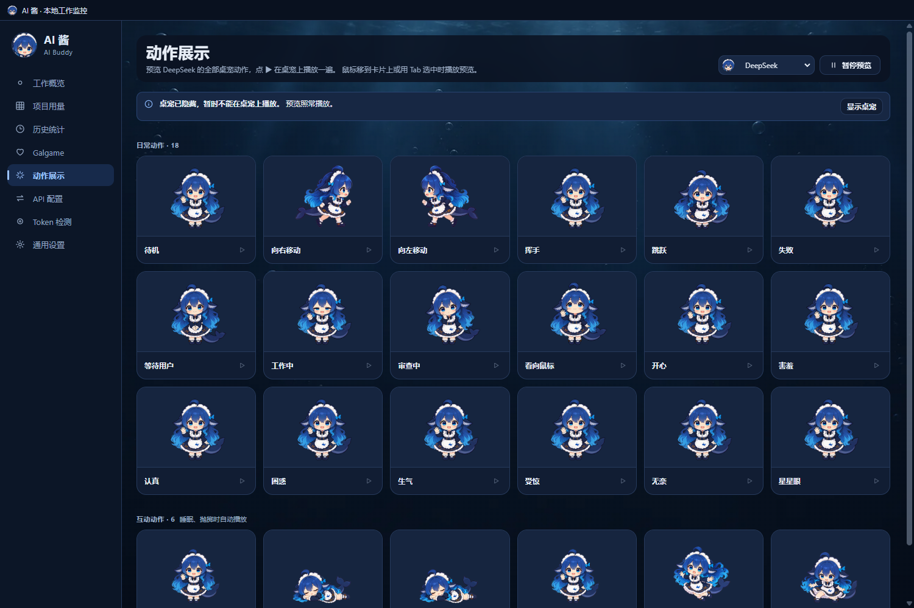

11 套主题的配色、背景和顶部的小装饰都取自对应立绘：DeepSeek、Grok、Kimi、Gemini 和 GLM 是深色，Seed、Qwen、MiniMax、GPT、Claude 和混元是浅色。下面是各主题下的工作概览（1.9.2 版截图，2.0 的侧栏多了陪伴和插件分组）：

<table>
  <tr>
    <td align="center">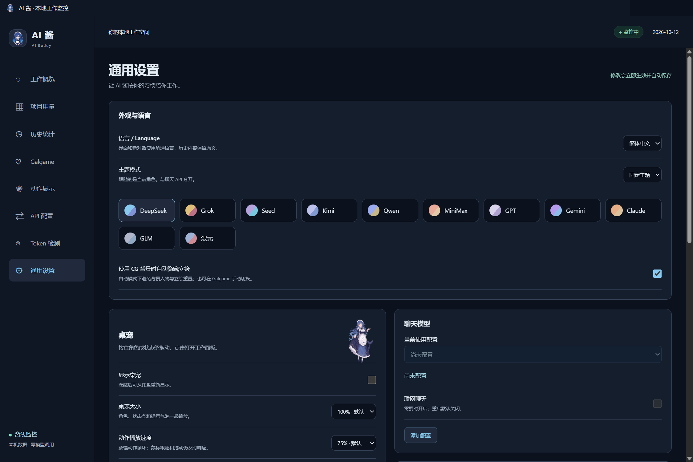 DeepSeek</td>
    <td align="center">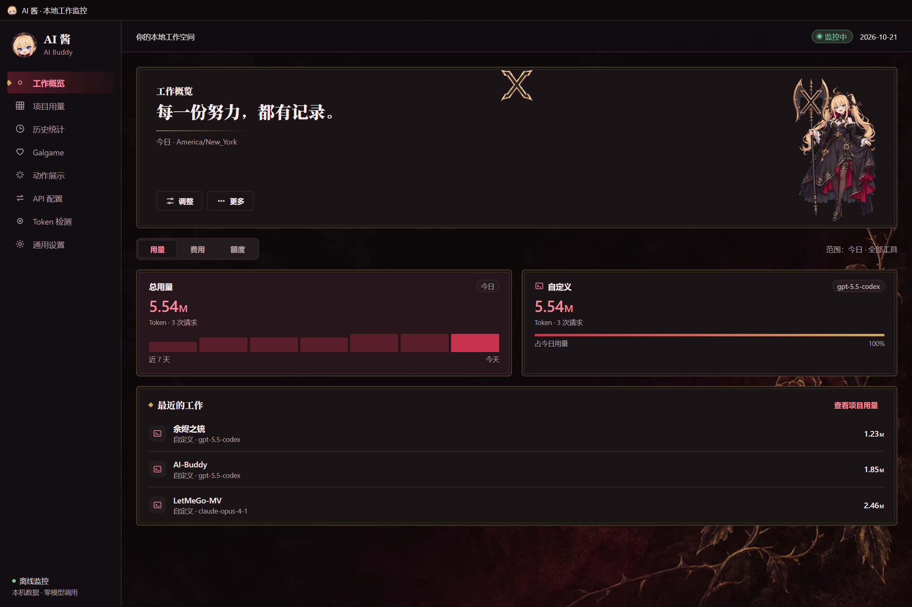 Grok</td>
    <td align="center">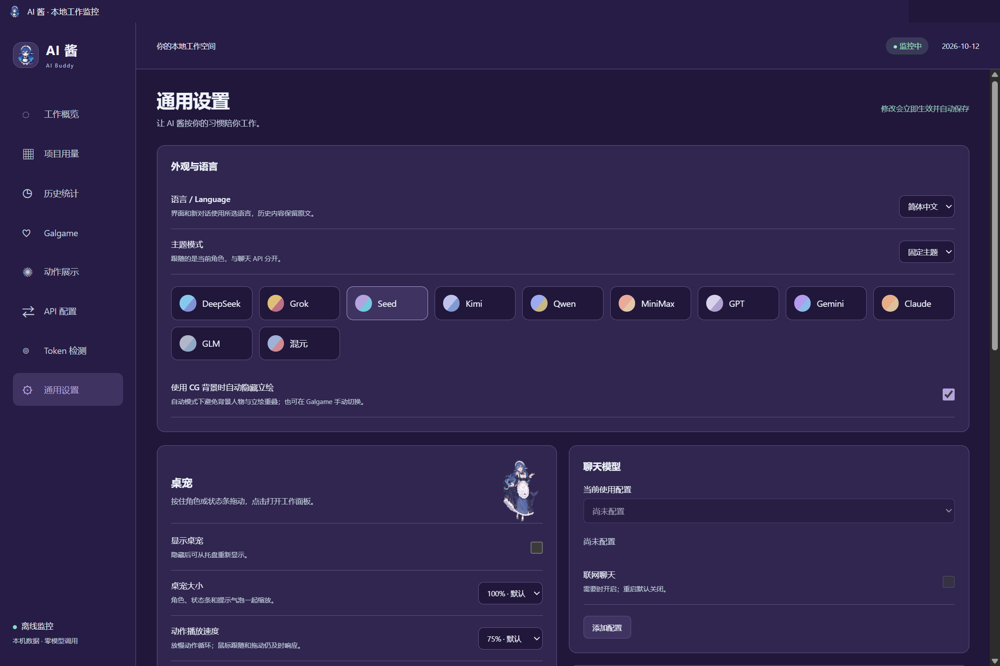 Seed</td>
    <td align="center">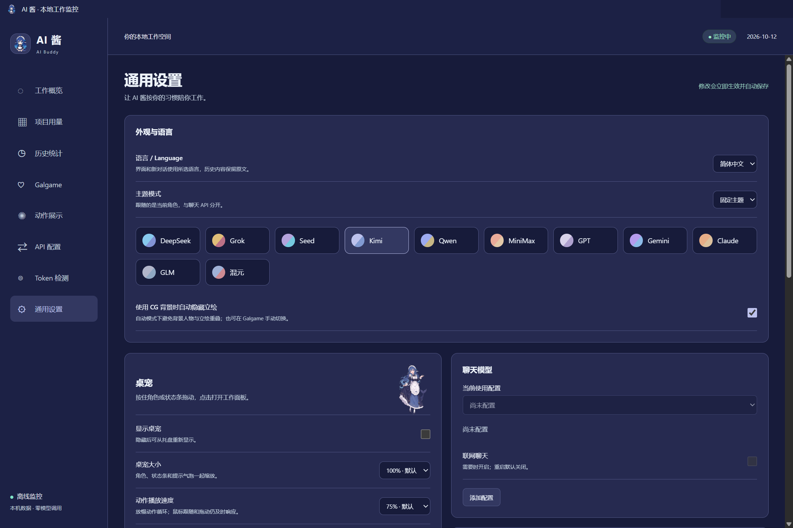 Kimi</td>
  </tr>
  <tr>
    <td align="center">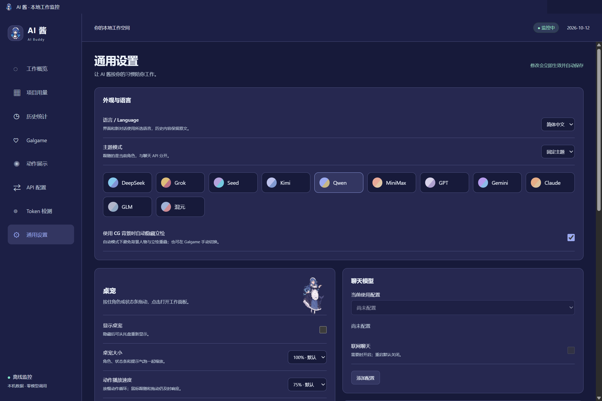 Qwen</td>
    <td align="center">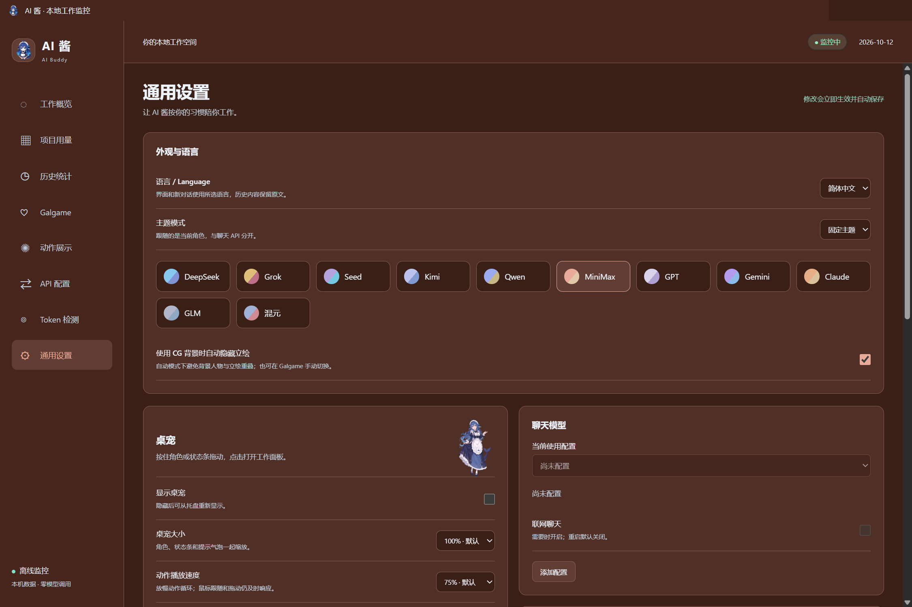 MiniMax</td>
    <td align="center">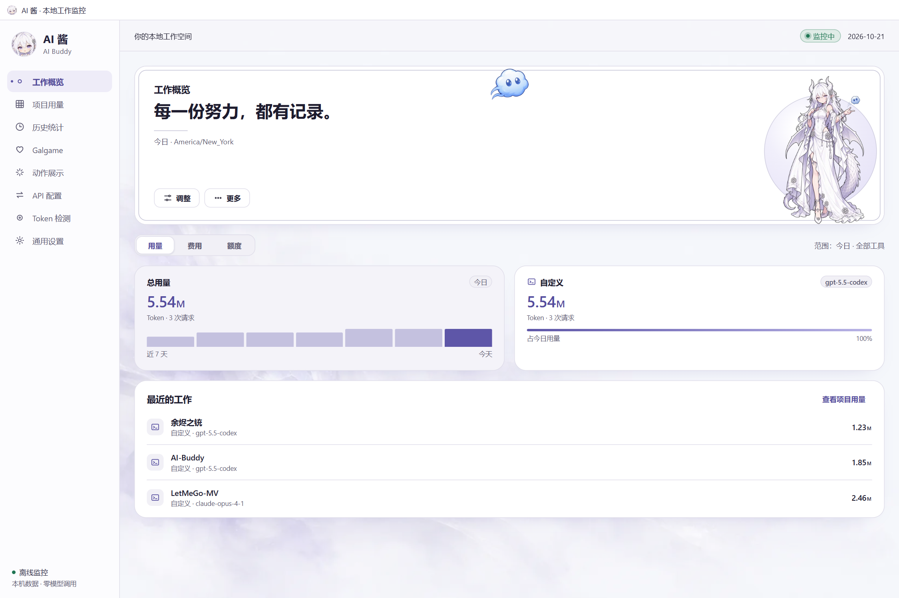 GPT</td>
    <td align="center">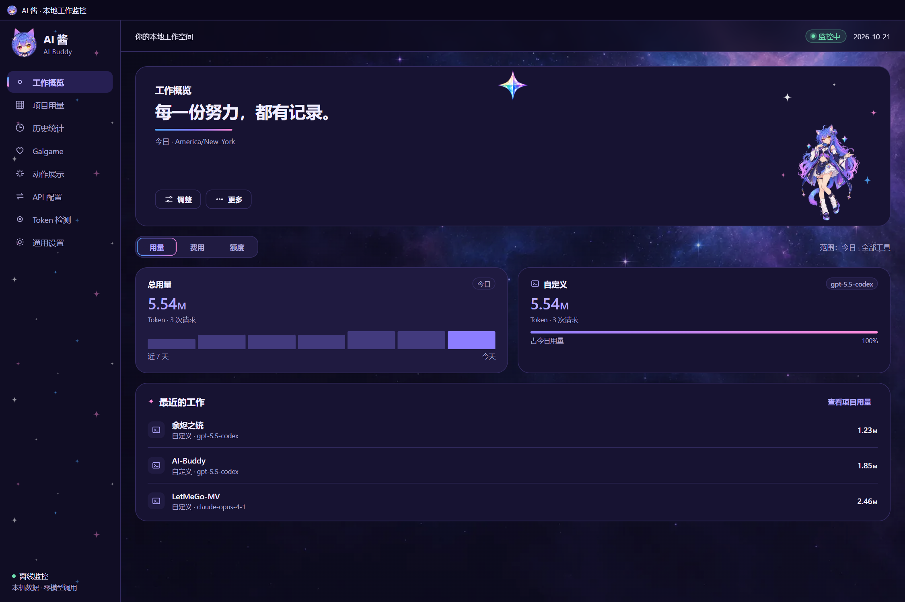 Gemini</td>
  </tr>
  <tr>
    <td align="center">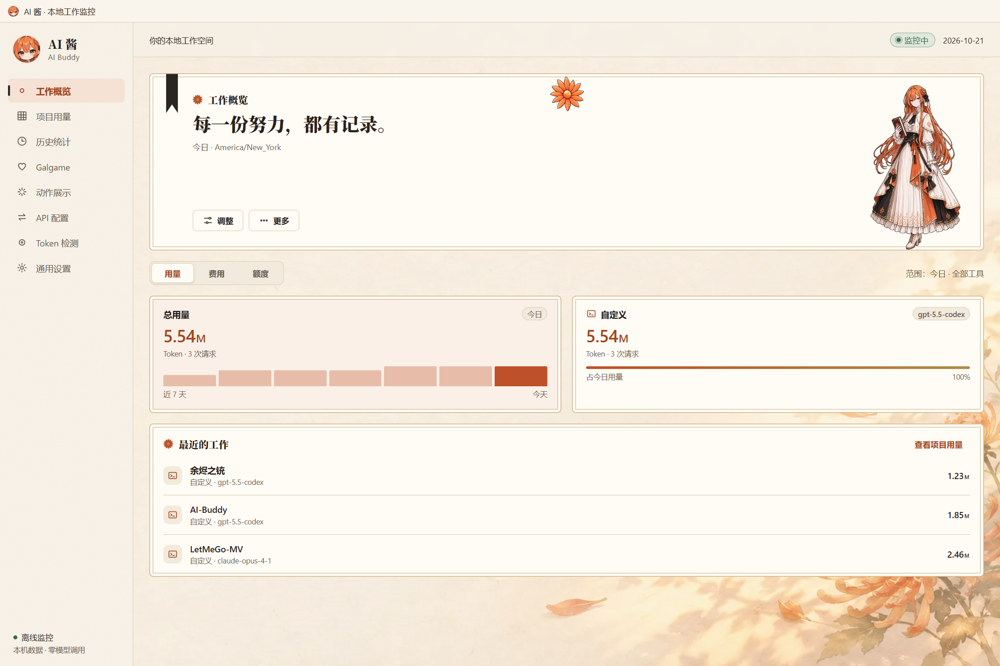 Claude</td>
    <td align="center">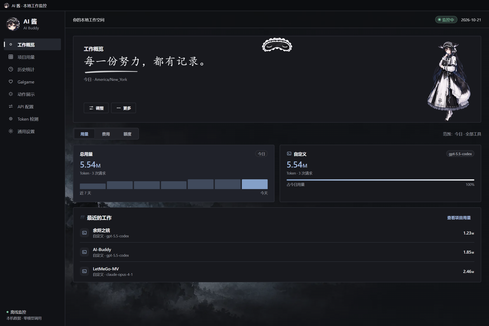 GLM</td>
    <td align="center">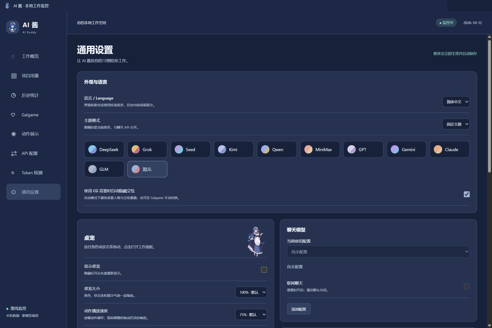 混元</td>
    <td></td>
  </tr>
</table>

素材来源与许可各不相同：

- DeepSeek 的立绘、表情差分以及深海宫殿、海边书房背景来自上游 dsh-whale-galgame，属于上游 21 张 CC BY-NC-SA 4.0 默认图片。
- 其余十套立绘和背景由图像工具以图库中的角色设计为参考生成，不是图库原图。角色设计作者已经署名，但这十套参考的通用再分发授权还没有逐一核实。
- 十位新角色的 Q 版桌宠以各自立绘为参考、按 DeepSeek 桌宠的比例生成，同样不是图库原图。
- 各角色动作视频由 MiniMax H3 生成，再用 RIFE 补帧；新增表情及 Q 版形象沿用各自母版的来源说明，不统一声明为 MIT。
- 1.9.0 新增的界面美术：11 套主题背景和立绘小装饰、桌宠的白手套光标、群聊的圆桌前景，都由 Codex 内置图像工具生成，画面里没有角色，也不是图库原图。手套只参考了 QQ 宠物切换光标的交互方式，没有使用腾讯的光标文件；各主题的袖口颜色由脚本从同一套手套改色得到。窗口和托盘的圆形头像、群聊成员缩略图由现有立绘和桌宠裁切、缩放而来。

逐文件说明见 [THIRD_PARTY_NOTICES.md](THIRD_PARTY_NOTICES.md)。Galgame 的布局、对话框和控件改编自上游，代码在 [`src/adapted/galgame-client.ts`](src/adapted/galgame-client.ts)，不依赖未公开的 UI 图片包。

## 安装

需要 Windows 10/11 x64。安装器自带运行环境，不需要另装 Node.js、Python、.NET 或绘图工具。两档帧率的功能、角色、存档格式和鼠标跟随精度都相同，只是动作视频帧率不同；全角色装好后约 1.6 GiB（30fps）或 2.0 GiB（60fps）。

### 在线安装器（推荐）

1. 到 [v2.0.10 发布页](https://github.com/lXiaoSel1/AI-Buddy/releases/tag/v2.0.10) 下载 `AI-Buddy-Setup-2.0.10-win-x64.exe`（约 50 MiB）。
2. 选择安装位置（默认 `%LOCALAPPDATA%\Programs\AI Buddy`）、30fps 或 60fps、要装的角色和初始角色。首次安装默认选 30fps 和全部角色，初始角色为 DeepSeek。
3. 点 **安装 / 补装 / 修复**。安装器从固定的 v2.0.10 Release 下载资源，逐包、逐文件核对 SHA-256；全角色下载量约为 30fps 1.33 GiB、60fps 1.75 GiB。下载中断时，重新运行同一个安装器、选相同位置就能接着下。
4. 默认会创建桌面和开始菜单入口。装完后安装器会启动 AI 酱检查一次；取消勾选「验证后保持 AI Buddy 运行」的话，检查完会把它关掉。安装器不会开启联网聊天、自动 CG、开机启动或后台自动更新，也不会安装任何插件。

**离线安装**：从 [v2.0.10 发布页](https://github.com/lXiaoSel1/AI-Buddy/releases/tag/v2.0.10) 把 `install-manifest-2.0.10.json` 和需要的资源 ZIP 下载到同一个文件夹，在安装器的「离线资源目录」里选这个文件夹，同样会逐个校验。

**从旧版升级**：运行 2.0.10 安装器，选原来的安装位置。旧版安装器点 **检查新版本** 也能找到它。之前从 2.0.2 升级时卡在下载前的话，换这个安装器重试：校验旧存档时窗口可以操作，也可以取消。从 2.0.3 或更早版本升级时，第一次打开存档会把钱包升级到新格式，升级后旧版不能再写入这份存档，升级前请先备份存档。它会先等聊天和 CG 收尾、正常关闭 AI 酱，保留个人存档、聊天连接、角色设置和上一版程序。如果装到了一个新位置，第一次启动时会出现欢迎页：先在旧版的托盘菜单里正常 **退出**，再选「导入旧存档」，指向旧的程序目录或存档目录；导入会复制一份并逐个核对文件，旧存档保持原样。不要把旧存档手动复制进新目录覆盖。

几点注意：

- 安装器和程序都没有商业代码签名，Windows 可能提示“未知发布者”，可以先用同一下载页的 `SHA256SUMS-2.0.10.txt` 核对文件。
- 首次启动会自动查找当前用户的常见日志目录。没装任何 AI 工具也能用，陪伴功能可以离线运行。
- GitHub 自动生成的 **Source code** 是源码包，不能直接运行。
- 本仓库和正式发行包已公开。发行包不包含开发者存档、连接密钥或本机日志。

安装后的目录：

~~~text
<安装目录>/
├─ AI Buddy.exe / AI Buddy.vbs / AI Buddy.cmd / Start-AI-Buddy.ps1   启动入口
├─ builds/<版本>/                         应用代码、动作和角色资源
├─ runtime/AI-Buddy-<版本>/               Electron 运行时
├─ maintenance/<版本>/AI Buddy Setup.exe  维护工具
├─ local/current-build.json               当前版本指针
├─ local/installation.json                已装的帧率和角色
├─ local/data-v003/                       首次运行后生成的个人存档
├─ assets/  docs/  licenses/
└─ README.md  LICENSE.md  THIRD_PARTY_NOTICES.md
~~~

### 更新与卸载

- 补装角色、修复文件、切换帧率：在通用设置点 **管理角色资源** 打开维护工具，或者重新运行同版本的安装器。没装的角色在界面上标为“待安装”，确认后才会打开安装器，不会自动下载。
- 应用内更新（2.0.8 起）：在通用设置的 **版本与更新** 里检查、下载、准备新版本，然后选择稍后或安装并重启。准备期间可以照常使用，提交前会等正在进行的活动收尾。完全没有迁移能力的旧版需要先用安装器装一次。
- 插件更新：在 **扩展中心 → 更新与维护** 里进行，默认手动，也可以逐个插件开启符合条件的自动补丁更新。更新保留原来的启用状态和插件资料，新增权限仍要你确认。从 2.0.8 升到 2.0.9 后，旧的语音插件 1.0.0 不能直接用，要在这里更新到 1.0.1。
- 升级：运行新版本的安装器。它会先等聊天和 CG 收尾、正常关闭 AI 酱，并保留上一版程序和个人存档。
- 回退：在安装器里点 **回退上一版**，只恢复程序和启动指针，不会用旧存档覆盖新进度。旧程序不支持新数据时会拒绝写入，不会自行转换或删除新数据。
- 卸载：在安装器里点 **卸载…**。默认保留个人数据，也可以勾选同时删除默认目录中的个人数据（不可恢复）；自定义的数据目录不会被删除。下载缓存 `%LOCALAPPDATA%\AI Buddy\InstallerCache` 卸载后保留，用于续传和修复，不需要时可以手动删除。

### 从源码运行

只有想自己构建时才需要这种方式。需要 Windows x64、Node.js 24 和 npm，步骤和版本要求见 [构建说明](docs/BUILD.md)。构建会直接复用发行版里的立绘和动画，不需要重新生成图片或视频。

## 使用与设置

左键单击桌宠是「摸摸」：她会做一个表情。右键单击打开桌宠菜单，里面有打开工作空间、打开 Galgame、让她睡一会儿（睡着时变成「叫醒她」）、显示状态条和隐藏桌宠。点一下状态条会打开工作概览。双击托盘图标也能打开主窗口；托盘菜单里有工作概览、通用设置、动作展示、打开 Galgame，以及显示桌宠、拖动模式和退出。

### Token 检测

首次启动会自动查找下面这些位置（都在当前 Windows 用户目录下）：

| 工具 | 默认位置 |
|---|---|
| Codex | `.codex\sessions`、`archived_sessions`，可用 `CODEX_HOME` 改位置 |
| Claude Code | `.claude\projects`，可用 `CLAUDE_CONFIG_DIR` 改位置 |
| Gemini CLI | `.gemini\tmp` |
| Kimi Code CLI | `.kimi-code\sessions`，以及旧版 `.kimi\sessions` |
| OpenCode | `.local\share\opencode`，也支持 `XDG_DATA_HOME` 或 `OPENCODE_DB` |
| Cline / Roo Code | VS Code、VS Code Insiders、VSCodium、Cursor 的扩展存储；Cline 另有 `.cline\data\sessions` |
| DeepSeek Harness | `.dsh\sessions`，可用 `DSH_HOME` 改位置 |

便携编辑器、WSL 或其他用户目录需要手动添加：在 **Token 检测** 点 **添加数据源**，选择工具模板和实际目录，先做 **本地解析预览**，再点 **保存并启用**。自定义来源支持 JSONL、Zstd 压缩的 JSONL、JSON、CSV 和 SQLite，可以做字段映射，模板能导入导出。移除数据源不会删除原日志，也不会删掉已经记录的用量。

### 通用设置默认值

| 选项 | 默认 |
|---|---|
| 语言 | 首次启动跟随系统语言，可选简体中文 / English |
| 主题模式 | 固定使用 DeepSeek 主题，可改为跟随当前角色 |
| 回复风格 | 自然，可选简短、自然、详细；QQ 会话可以单独设置 |
| 显示桌宠 | 开 |
| 桌宠角色 | 跟随 Galgame 角色；改成固定角色时默认 DeepSeek |
| 桌宠大小 | 125%，可选 75%、100%、125%、150% |
| 动作播放速度 | 75%，可选 25%、50%、75%、100% |
| 保持置顶、透明区域点击穿透、跟随鼠标方向、显示状态条、任务提示气泡 | 开 |
| 自动睡眠、物理互动（抛掷和蓄力） | 开 |
| 抛掷力度 | 标准，可选轻柔、标准、强力、夸张 |
| 使用 CG 背景时自动隐藏立绘 | 开 |
| 模型最多输出 | 8,192 tokens，也可以设为自动或 256–65,536 |
| 备用检查间隔 | 1 秒（文件有变化时会立即读取），可选 1、2、5 秒 |
| 活动时间显示 | 纽约时间，可改为系统本地时间或 UTC |
| 统计时区 | 系统本地时间 |
| 每日更新价格目录 | 关 |

另外两项不在这张表里：**联网聊天**默认开启，重启后沿用上次的开关；还没有可用的聊天连接时它保持关闭，第一次接好模型后要手动开启一次；**自动生成 CG** 首次安装时关闭，打开后除了升级纪念图，每天 10:00 和 22:00（按应用时区）还会为当时的角色画一张日常 CG，错过的时段不补。**恢复默认设置**会把上表的选项全部恢复，语言改回简体中文，隐藏的桌宠也会重新显示，联网聊天恢复为开启；聊天和绘图连接的选择、Token 检测的数据源不受影响，桌宠位置、用量和 Galgame 存档都会保留。

### 角色来源与实际对话

Galgame 顶栏的 **角色来源** 决定谁出场，可以跟随工作区，也可以手动固定；**实际对话** 显示这位角色实际用哪个聊天连接、哪个模型回复，两者互不影响。联网聊天的开关在顶栏右侧的「联网」里。标题可以点一下改名，每位角色分开保存。**背景图** 和 **角色立绘** 可以换成内置选项，也可以上传自己的图片（PNG、JPEG、WebP、AVIF，单张不超过 12 MB）。

单人场景用近景构图：脸和上半身更突出，下半身自然延伸到对话框后面，立绘选择器里仍然显示全身。顶栏的 **立绘** 按钮在显示和隐藏之间切换，手动改过之后会多出一个 **恢复自动**；自动模式下，用 CG 当背景时会隐藏立绘。

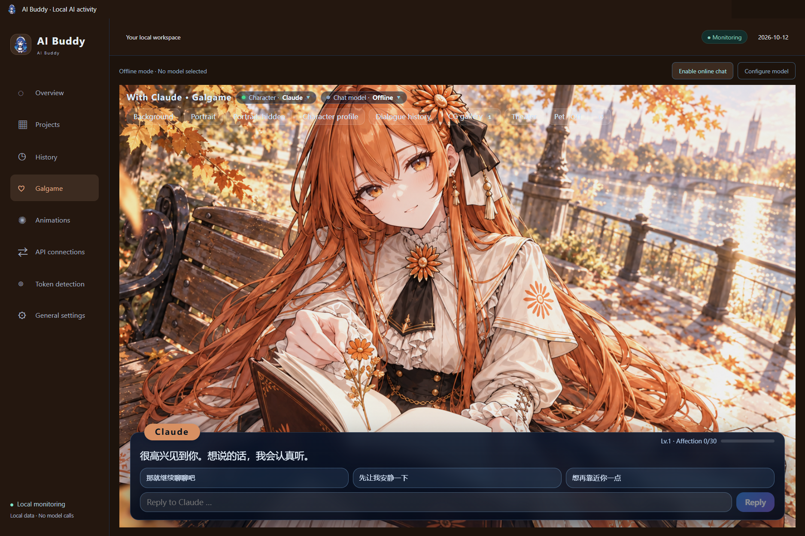

### 角色与对话

在 Galgame 顶栏点 **管理角色**、**我的身份**、**对话历史** 或 **群聊**，会打开「角色与对话」窗口的对应页签；长期记忆、人格自成长和人生存档三页也在这个窗口里。这里保存的内容都不调用模型，没保存的草稿关闭窗口后丢弃。

- **管理角色**：每张角色卡分成基本资料、性格与表达、关系与开场、形象四组，一共 15 项文字和 3 项图片（立绘、背景、CG 参考图），另有示例对话、模型关联和健谈程度。每一项都能选「继承默认」「自定义」或「主动清空」：继承时直接显示内置人设的原文，清空则明确留空、不用默认内容。表单顶上有跳转栏，保存按钮固定在底部，可以先「保存草稿」。内置角色可以「恢复默认人设」，载入草稿后保存才生效；也可以「新建角色」：自建角色不会自动生成图片或桌宠，立绘、背景和 CG 参考图可以自己上传，没有立绘也能直接聊天，桌面上仍是内置角色的桌宠。人设文字和示例台词每项最多 2 万字（名称最多 80 字），这里上传的图片不超过 8 MiB。
- **我的身份**：填你自己的管理名称、对话昵称（角色怎么叫你）、职业、兴趣、背景和交流偏好，以及对当前角色的专属称呼和关系。会话、草稿、回复选项和关系进度都按身份分开；同一位角色的进度可以在独立和共用之间切换。新会话用当前身份，没选时用默认身份。
- **对话历史**：左边是会话列表，可以按内容和日期搜索，也能看已归档的会话；右边直接显示选中会话的消息，不用切换过去。当前会话可以收藏消息；打开「允许更正我发的消息」后还能更正自己说过的话，更正会保留原文和版本，不重新请求模型，也不改变好感，角色的台词不能改。会话可以改名、归档、导出成 JSON，也能从 JSON 恢复（50 MiB 以内）。以前演过的小剧场在列表最下面的「以前的小剧场」里，可以查看。

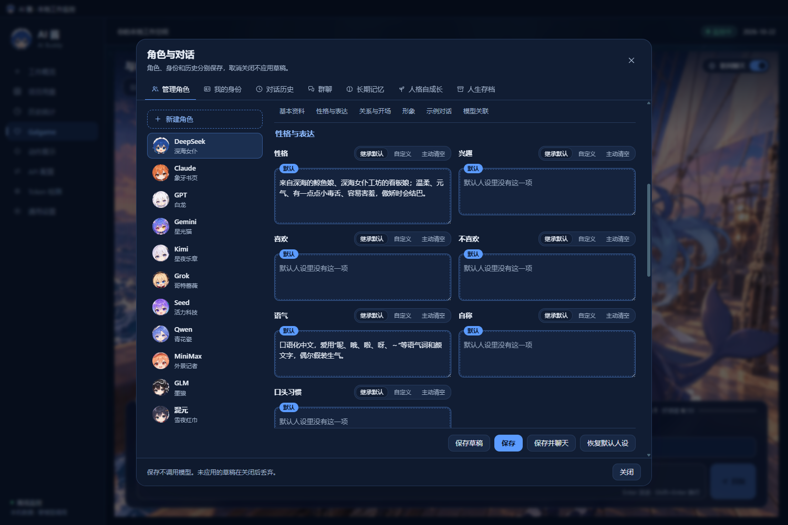

### 群聊

在「角色与对话 › 群聊」里新建群：填群名，选成员和你的身份（建好后身份不能再换），写一段场景，选好发言方式，然后点 **保存并进入**。成员人数不限，舞台上最多同时站 4 位（窗口窄时少一些），正在说话的那位会亮起来。群聊要先打开联网聊天。

| 发言方式 | 谁来回复 |
|---|---|
| 自然接话 | 先是被 @ 的成员，其余成员按角色卡里的健谈程度随机入选；没人入选时随机挑一位，所以 0% 也不等于静音 |
| 列表顺序 | 所有在场、没有静音的成员按列表顺序各回复一次 |
| 手动点名 | 只有被 @ 的成员回复 |
| 轮换池 | 每轮轮到一位成员 |

发消息后，第一位自动回复，后面的点 **继续 ▸** 接话。成员之间会互相搭话，也可能争起来。输入 @ 会弹出成员列表；静音的成员不会被选中发言，@ 她也不会回复。新加入的成员不知道加入之前的对话，离开期间的事也不会知道，再回来时保留原先知道的内容。

**群聊 Auto**：想让她们自己聊下去，先在 **社交与心情** 里打开「群聊 Auto」，再点群聊顶栏的 **Auto**，选结束方式（指定轮数、直到我停止、让 AI 决定；轮数默认 6），然后点 **确认成员并开始**。进度条显示第几轮、谁说完了、下一位是谁，可以展开看每位成员的状态。随时可以 **暂停**、**继续** 或 **停止**；你自己发一句话、打开「不要主动打扰我」或重启 AI 酱时，Auto 会先暂停。某位成员回复失败时 Auto 也会暂停，并给出「重试 DeepSeek」这样带成员名的按钮，不会悄悄重发。每一轮都会调用模型。

每位成员用自己角色卡上的聊天连接（默认跟随全局），也可以在群聊顶栏的 **对话模型** 里逐个改，选完立即保存。这里改的是她角色卡上的设置，私聊也会跟着变。群聊有自己的背景（可以关掉圆桌前景）、聊天记录（能搜索和导出）和 CG 图鉴。

一轮结束后可以点 **合影 CG**。画面分两步生成：先由「提示词策划模型」根据这次已经呈现的对话写画面提示词，再交给 CG 绘图连接出图。策划模型默认是「自动」，沿用入口角色或全局的连接；也可以给这个群指定一条聊天连接，选完立即保存。联网关闭时，「自动」会改用本地模板写提示词；指定了连接却没开联网时，会提示先打开联网，不会悄悄换成别的连接。点头像可以把某位成员从合影里去掉。群设置里还能打开「结束本次聊天时自动合影」。

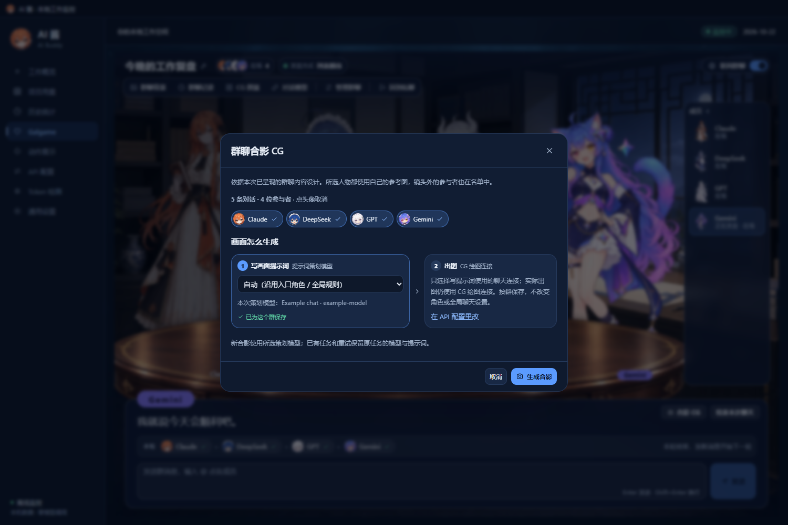

画好的合影收在这个群自己的 CG 图鉴里：

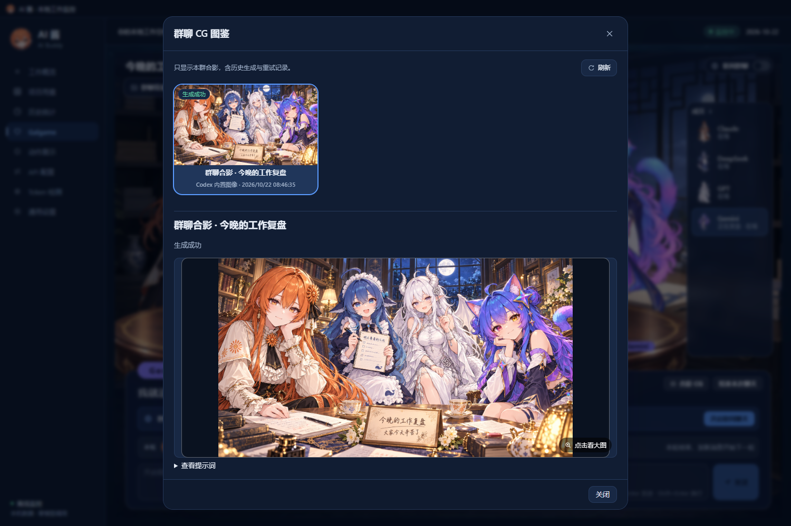

### 长期记忆、人格自成长与人生存档

- **长期记忆**：聊天原文完整保存。每天零点（按本机时区），AI 酱会为每位角色整理当天的总结、Guide 和核心记忆。整理要调用这位角色的聊天连接，只在联网聊天开着时进行；错过的日子会在下次打开联网聊天后补上。记忆页只能查看：记错了就在聊天里纠正，或者说“以后不要主动提起”，原文仍然保留。普通记忆不会随时间自动删除。不同身份之间互不相通；群聊里她只知道本群的事，私聊里则能想起你用同一身份和她一起参加过的群聊。
- **人格自成长**：默认不开，需要在这一页手动开启，可以从当前设定起步，也可以从白板开始新人生。开启后，人设随真实的聊天经历慢慢变化，姓名、人设和示例对话变成只读；外观、聊天连接和健谈程度仍然可以改。人格按角色共享，各身份的关系分开保存。
- **人生存档**：把一位角色的一整段「人生」（角色卡、记忆，以及各身份的关系和进度）存成一份，可以只读预览、导出 ZIP、导入、重置或恢复。重置和恢复之前会先把当前的人生另存一份，并且要输入角色名确认；不会回退其他角色或账号用量。单个存档最大 512 MiB，数量不限，不会过期。

更多细节见 [长期记忆与人生存档说明](docs/long-term-memory-lives.md)。

### 内置桌宠

11 位角色都有自己的桌宠。通用设置里的 **桌宠角色** 默认是 **跟随 Galgame 角色**：你在 Galgame 里换成谁，桌面上就换成谁；也可以改成 **固定角色**，一直留着同一位。没装资源的角色标为“待安装”，选中时会提示补装，不会自动下载。和任何一位角色聊天时，桌宠都会做出对应的情绪动作；在群聊里，桌宠保持进群时选中的那位。

- **摸摸**：鼠标移到她身上会变成白手套，左键点一下，她会做一个表情，手套也会轻轻戳一下。
- **睡觉**：5 分钟没有动静（没有新的工作 Token、互动、任务反馈或聊天）她就会睡着，状态条写着「睡着了 · 点一下叫醒」；真实的聊天和绘图请求进行期间她保持清醒。也可以在右键菜单里让她睡一会儿。
- **拖着走**：按住左键拖动，她会边走边跟着鼠标，松开后停在原处。
- **抛出去**：按住右键拖一下再快速松开，她会飞出去，撞到屏幕边缘会弹回来，落地后站稳。右键拖动途中再按住左键可以蓄力，像拉弹弓一样，松开左键发射；屏幕上会画出预测轨迹、落点和力度。按 Esc 取消。力度可以在通用设置里调；关掉「物理互动」后不能再抛和蓄力，拖着走仍然可以。
- **状态条**会写当前状态，例如「AI 酱 · 陪着你」「工作中 · 2 个会话」「等你回应 · Codex」。鼠标移上去会出现 ×，关掉后会提示可以撤销，之后也能在右键菜单或通用设置里重新打开。
- 手套的袖口、气泡和状态条跟随当前主题；任务栏和托盘图标显示桌面上那位桌宠的头像。

透明区域可以点击穿透。拖动期间收到的任务反馈会排队，松手后再播放。隐藏桌宠后，可以从托盘菜单重新显示。

### 主题与语言

通用设置提供 11 套以角色命名的主题，配色、背景和装饰都取自对应立绘，5 套深色、6 套浅色；可以固定一套，也可以跟随当前角色。界面、窗口标题栏、桌宠状态条和气泡会一起变色，人物图片本身不染色。

语言可选简体中文或 English。切换后，界面和之后的新对话都用新语言；已有的聊天、历史 CG 和你自己填写的文字保持原样。

## 聊天与 CG 接入

聊天和 CG 绘图是两套独立的连接，都在 **API 配置** 里管理（页签：聊天 API、CG 绘图、额度连接）。**保存并使用** 会立刻启用，**仅保存** 不切换当前连接；通用设置只负责选择当前连接和开关。每位角色默认用全局的聊天连接，也可以在角色卡的 **模型关联** 里给她指定一条；群聊里各成员用各自的连接。

| 类型 | 协议 / 通道 | 默认值 |
|---|---|---|
| 聊天 | 本机 Codex 登录、OpenAI Chat Completions / Responses、Gemini 原生、Anthropic Messages | Codex 通道需要本机已登录的 Codex |
| CG | Codex 内置图像 | 沿用本机 Codex 模型，优先横向 16:9 构图 |
| CG | OpenAI Images 兼容 | gpt-image-1 系列默认 1536×1024 |
| CG | 火山方舟 / Seedream | 专用 JSON 协议，支持文生图和参考图，默认 2K；填写账号已开通的模型或绘图接入点 |
| CG | Gemini Interactions | 16:9，默认 1K |
| CG | 通义万相 | 生成与编辑默认 `wan2.6-image`、1280×720；异步文生图默认 1696×960 |

新增聊天配置时，「提供方」里有本机 Codex 登录、Gemini、Kimi / K3、Grok、OpenAI、Claude、DeepSeek、通义千问、MiniMax 和自定义接口。服务地址必须是 HTTPS（本机地址除外）。

聊天连接可以设推理强度（effort），对本机 Codex、OpenAI Responses 和 Chat Completions 生效；本机 Codex 没设时用 low，Gemini 原生和 Anthropic Messages 用模型默认。连接还可以填上下文容量；没填、模型目录里也查不到时，按 272,000 tokens 规划。外部 API 连接的回复被输出上限截断时，会把上限加倍自动重试一次（本机 Codex 不重试）；仍被截断时，会提示你调高通用设置里的输出上限。

可以选预设，也可以填写自定义的兼容服务地址和模型 ID；兼容程度、模型权限和参考图限制由服务端决定。外部密钥用 Electron safeStorage 加密后保存在本机；系统加密不可用时不会保存。不要把真实密钥写进仓库文件，也不要提交到 Git。

**自动生成 CG** 默认关闭；开启后，每次升级会生成一张纪念图，每天 10:00 和 22:00 还会画一张日常 CG。联网聊天开启时，CG 的主题由聊天模型设计，失败就改用本地的角色主题组合；重试时复用已有的主题。也可以在 CG 图鉴里点 **生成纪念 CG** 手动生成一张。群聊合影是手动生成的（或在群设置里开自动合影），只需要配好绘图连接。模型调用和绘图都可能产生服务费用。

当前 CG 构图规则：男性第一人称，男性角色本人不入镜；允许合理的手部互动、文字及服装 Logo，不限制为一只男性手。

新生成的 CG 以当前角色的 Galgame 立绘作参考，自定义立绘优先。重试旧任务时仍用当时保存的参考快照，想换新参考就新建一张 CG。火山方舟出错时，界面会显示 HTTP 状态、服务端给出的错误原因和请求 ID，敏感内容会被过滤。配置步骤见 [CG 绘图指南](CG_API_GUIDE.md)。

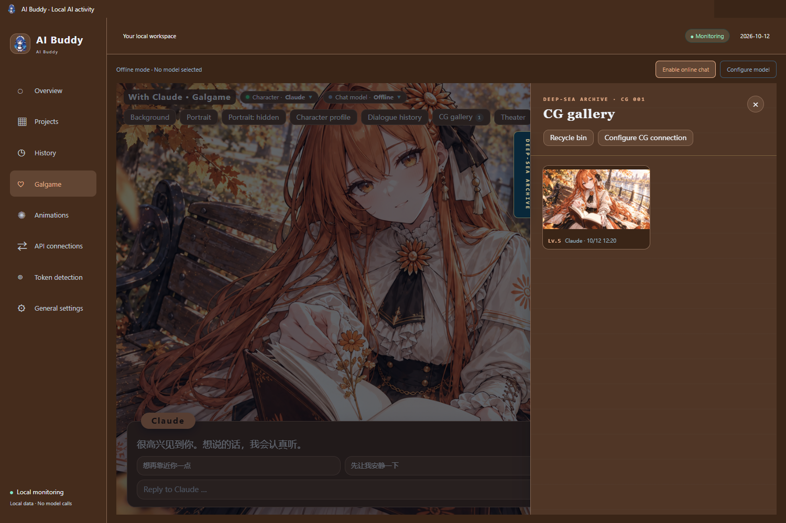

### 使用本机 Codex 绘图

“Codex 内置图像”用的是这台电脑上 Codex 的绘图能力。AI 酱不自带 Codex，也不带登录账号。请先在这台电脑上安装、打开并登录 Codex 桌面端，再到 **API 配置 → CG 绘图 → Codex** 点 **测试连接（不出图）**。

AI 酱能找到桌面端运行缓存、Microsoft Store 安装、常见独立安装和 npm 原生程序里的 Codex，不需要为了路径检测单独安装 npm CLI。自定义安装可以把环境变量 `AI_BUDDY_CODEX_PATH` 设为原生 `codex.exe` 的完整路径，重启 AI 酱后再试。自定义 Codex 配置目录遵循 `CODEX_HOME`；缺少可选的 `config.toml` 不会导致启动失败。

程序是否存在、登录是否可用、图像能力是否可用是三项独立检查。Codex 没有提供图像能力时，请更新 Codex，或改用外部绘图 API。接入协议参考 [OpenAI Codex app-server 文档](https://learn.chatgpt.com/docs/app-server)。

### 在线额度

额度连接和聊天、绘图连接互相独立。各服务能返回的字段不同，不支持的账号会提示原因。只有单独启用后才会查询：窗口显示时约每 2 分钟一次，隐藏时约每 15 分钟一次。AI 酱不会靠发送模型对话来探测额度，也不读取浏览器 Cookie。认证失败时会提示重新登录；临时失败时保留上次成功的数值和更新时间。

## 插件

扩展中心（左侧栏 **系统 → 扩展中心**）有 发现、已安装、更新与维护、账号连接、来源与旧扩展 五个页签。插件来自签名的官方目录，安装时会列出它要的每一项权限，只授予你勾选的那些。装好后不会自动启用：在安装页点「启用并连接 B站账号」或「启用并扫码登录」，或在 **已安装** 页打开它的开关。

| 插件 | 能做什么 | 说明与源码 |
|---|---|---|
| B站陪伴 2.0.14 | 和角色一起看 B站视频：先看完整的阅读计划，确认后她按抽帧画面和平台字幕读完，写下观看笔记；也能预约观看。新的观看用这位角色自己的聊天连接。发评论要另外授权 | [AI-Buddy-Bilibili](https://github.com/lXiaoSel1/AI-Buddy-Bilibili) |
| QQ连接 2.0.8 | 选一位角色接管你的 QQ，只回复你允许的好友和群；群里默认只在被 @ 或被引用时说话 | [AI-Buddy-QQ](https://github.com/lXiaoSel1/AI-Buddy-QQ) |
| 一起玩牌 1.1.3 | 和角色打斗地主和德州（2 到 10 人）。她们用各自绑定的模型出牌，积分走本体钱包，每打完 3 局好感 +1。有背景音乐、牌桌音效，开了语音还会喊出来。需要本体 2.0.4 或更新 | [AI-Buddy-Card-Games](https://github.com/lXiaoSel1/AI-Buddy-Card-Games) |
| Breeze 语音 1.0.1 | 本机配音，能跟着情绪变语气；需要 NVIDIA 显卡，启动时至少 9.5 GiB 空闲显存。也能改用 MiniMax 云配音。需要本体 2.0.9 | [AI-Buddy-Voice](https://github.com/lXiaoSel1/AI-Buddy-Voice) |
| GPT-SoVITS 语音 1.0.1 | 本机配音，以平静的语气为主；需要 NVIDIA 显卡，启动时至少 4 GiB 空闲显存。也能改用 MiniMax 云配音。需要本体 2.0.9 | [AI-Buddy-Voice](https://github.com/lXiaoSel1/AI-Buddy-Voice) |

- B站陪伴需要的视频组件（FFmpeg）在安装插件时由 AI 酱从固定的上游发布版准备，会显示来源、大小和进度；已经核对过的副本不会重复下载。
- B站陪伴的完整精读建议用本体 2.0.7：更早的版本在部分线路上采集不到原视频分镜。之前失败的观看记录会保留，更新后重新点「现在看」，再预览分镜、确认计划。视频地址、连接和分段响应的故障代码显示在「技术详情」里。
- QQ连接需要的第三方连接组件（NapCat）在你点「扫码连接」时才从上游准备，本仓库和插件都不打包它。
- 两个插件的账号都在 **扩展中心 → 账号连接** 里扫码连接。凭据由系统加密保存在本机，插件只拿到一个引用，看不到密码或 Cookie 原文。
- 安装、更新或扫码都不会自动开始观看、发评论、发 QQ 消息或调用模型。
- 一起玩牌的每一步 AI 行动都是一次模型请求，由你点「让 X 出牌」或打开「AI 自动行动」才会发出。规则和结算在本体里，模型只提出行动，不合法的不会执行。
- 两个语音插件可以都装，同一时间只运行一个。语音插件装好后在 **已安装** 页显示「启动」，启动后变成「打开」；在 Galgame 里打开语音时也会自动启动。

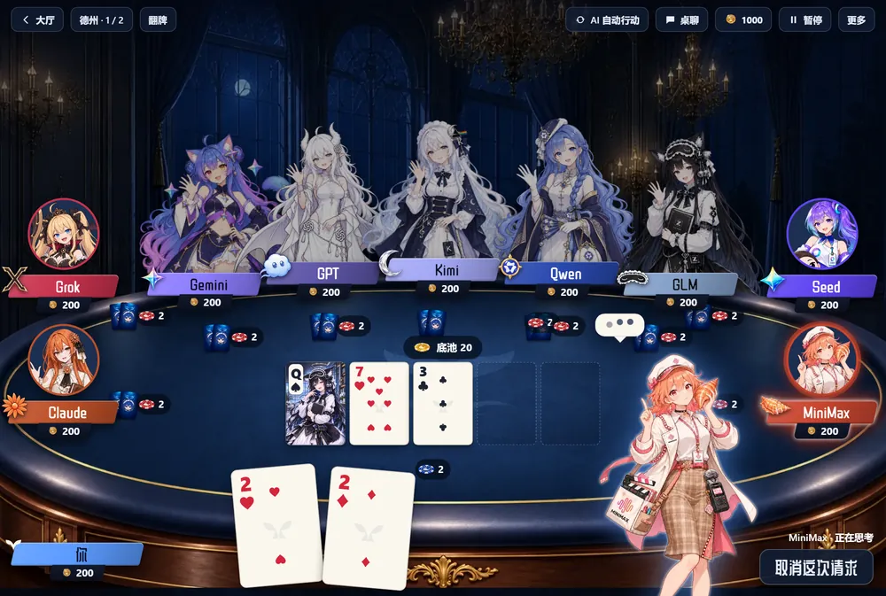

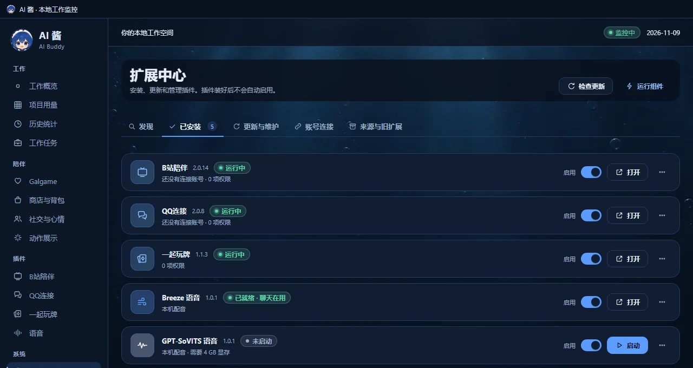

## 语音

2.0.9 起，AI 酱可以开口说话了。语音由扩展中心里的两个插件提供，二选一即可：

| | Breeze 语音 | GPT-SoVITS 语音 |
|---|---|---|
| 语气 | 能跟着情绪变语气 | 以平静的语气为主 |
| 显卡 | NVIDIA，启动时至少 9.5 GiB 空闲显存 | NVIDIA，启动时至少 4 GiB 空闲显存 |
| 第一次准备时下载（含共用的语音识别，十进制 GB） | 约 11.18 GB | 约 6.92 GB |

两个插件共用同一套语音识别（只用 CPU）。两个都可以装，但同一时间只运行一个本机配音引擎：换成另一个时，会先停掉当前这个，再启动新的。显存门槛只是启动检查，不保证每台电脑都能加载成功。不想占显卡时，可以在插件页把「在哪里配音」改成 **MiniMax 云端**，按字数计费，需要你自己的 API Key。组件在第一次用到时按需准备：本机模式准备你选的那个引擎和共用的语音识别，云端模式只准备共用组件、不加载本机配音；已经核对过的组件会复用。下载量和组件来源见 [AI-Buddy-Voice](https://github.com/lXiaoSel1/AI-Buddy-Voice)。

### 语音插件页

装好并启用以后，左侧栏 **插件 → 语音** 打开语音插件页。下图是本机配音、组件都已就绪时的样子；组件没准备好时会先显示准备页，改用 MiniMax 云端时会显示云音色管理：

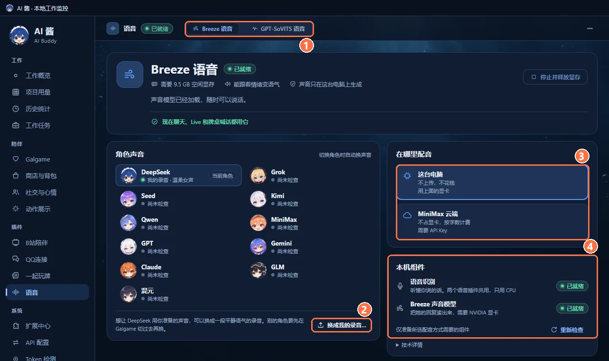

1. 顶部切换 Breeze 和 GPT-SoVITS 的页面。只是看，不会切换正在用的引擎。
2. **角色声音**：每位角色有自己的声音。想让她用你准备的声音，先在 Galgame 切到这位角色，再点 **换成我的录音…**：填上录音里说了什么，点 **换成这段录音**，选一段只有一个人说话、语气平静的 WAV 录音。录音默认只保存在这台电脑上，只给这位角色用；只有你明确同意云端克隆时才会上传。GPT-SoVITS 的参考录音要 3–10 秒（这是模型本身的要求，导入时 AI 酱不会替你检查长度）。
3. **在哪里配音**：「这台电脑」不上传、不花钱，用你的显卡；「MiniMax 云端」不占显卡，按字数计费。
4. **本机组件**：语音识别和声音模型是否就绪。缺组件时，这里会显示「需要准备」；准备时显示下载进度，离开这一页也会继续。

### 在聊天里用

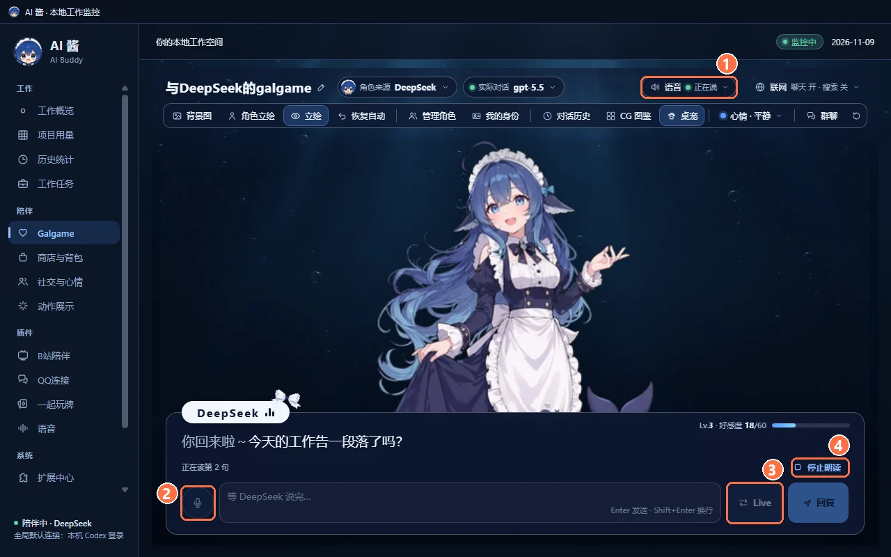

1. 顶栏右侧的 **语音**：显示现在的状态（已就绪、正在说、Live 中），点开可以开关语音、切换配音插件和配音位置。
2. 输入框左边的话筒是 **录音输入**：说完以后，识别出的文字放进输入框，标着「来自录音 · 可以先改再发」，不会自动发送。
3. 输入框右边的 **Live**：和她轮流说话，见下文。
4. 模型还在生成回复时，这里是 **停止回复**；生成完、还在朗读时，变成 **停止朗读**。

配音的回复按实际播放进度显示，已经读完的部分会变暗；配音失败或超时后，文字照常显示。群聊用同一个语音入口；群聊 Auto 会等当前这句的文字和声音呈现完，再轮到下一位。私聊和群聊之间切换时，会停掉正在读的那一句，语音开关保持不变。

### Live：轮流说话

点 **Live** 后，你说一句、她回一句。下面的条显示四个阶段：你说、识别、她想、她说。

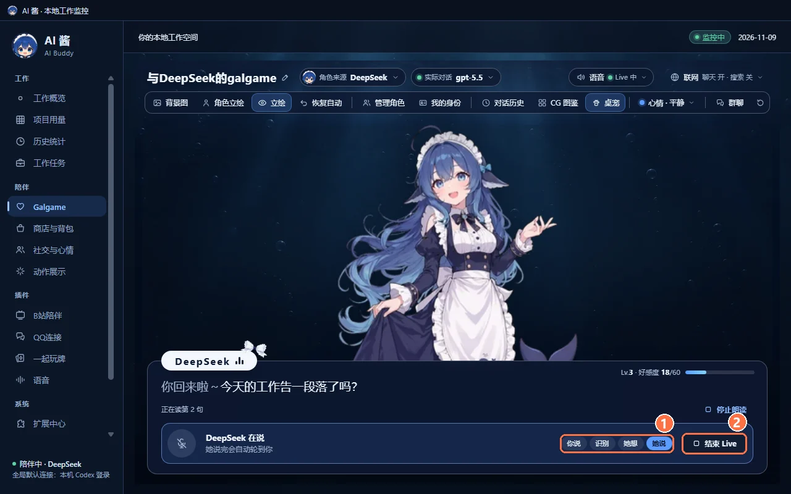

1. 当前阶段。她说完以后自动轮到你。
2. **结束 Live**：只结束这一轮 Live，不会再发一条消息。

Live 需要可用的麦克风，并且 Windows 允许 AI 酱使用它。点 Live 后会先准备好需要的组件再打开麦克风，这期间可以先打字；声音模型还在加载时，Live 按钮不能点。配音失败或回复没能开始时，Live 可能会退出，需要再点一次；已经保存的回复不会丢。切换聊天或页面后，不会自动替你重新打开麦克风。

### 一起玩牌里的语音

用 AI 酱 2.0.9 时，一起玩牌的声音菜单里会多一条 **语音** 音量。开着语音、准备好引擎并配好角色声音后，她们会在牌桌上用合成语音喊出「All in」「三条」这类话。牌桌上的文字会等声音开始再显示，最多等 15 秒。详见 [一起玩牌](https://github.com/lXiaoSel1/AI-Buddy-Card-Games)。

### MiniMax 云配音

在插件页把「在哪里配音」改成 **MiniMax 云端**，按提示新增一条云配音配置（名字、模型、API Key）。Key 加密保存在这台电脑上，保存后不再显示；保存配置不会上传任何声音。

- **给角色换云端音色**：在这个 MiniMax 账号已有的系统音色、克隆音色和设计音色里搜索挑选，只改当前这位角色。
- **批量准备云端声音**：把几位角色的录音一次克隆成云端音色。开始之前会弹出确认窗口，列出要上传哪些角色、新克隆几个、大概多少钱。

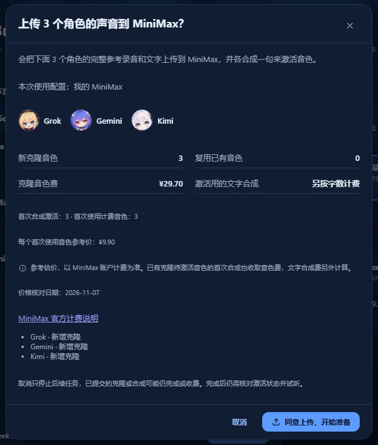

克隆的角色一开始都不勾选，只上传你明确选中并确认的那几位。按 MiniMax 国内版官方定价，标准按量的克隆音色参考价为每个 ¥9.90，第一次用它合成时收取；文字合成另按 MiniMax 的字符计费规则算，一切以账户的实际扣费为准。取消只会停止后面的任务，已经提交的克隆或合成仍可能完成并收费。

以上语音截图都是界面演示：语音状态由测试数据提供，没有加载声音模型，也没有连接 MiniMax。

## 数据与隐私

运行数据都在安装目录的 `local/data-v003` 下，请把它当作私人数据：

- `settings.json`：偏好设置和桌宠位置。
- `model-connections.json`、`cg-connections.json`、`quota-connections-v1.json`：已保存的连接，密钥经 safeStorage 加密。
- `token-sources.json`、`token-index-v1.json`、`token-events-v1.jsonl` 等：数据源配置和用量索引，里面有本机项目路径。
- `usage-ledger-v2/`：请求历史（本机 SQLite），按需分页读取。
- `galgame/companion.json`：角色卡、身份、会话、群聊（成员、记录、合影和背景）、长期记忆和人格成长。
- `galgame/storages/dsh-whale-galgame/global.json`：Galgame 存档，包括各角色的好感、等级、CG 图鉴和背景。
- `voice/`：`settings.json`（语音设置和云配音配置）、`profiles/`（你导入的参考录音）、`components/`（本机语音组件，可能有十几 GB）、`cloud/`（云音色绑定和准备记录）、`credentials.json`（经系统加密的 MiniMax Key）。
- `galgame/media/`：按内容哈希保存的图片，包括你上传的头像、立绘和背景。
- `galgame/drafts.json`：还没发出去的草稿。
- `galgame/life-archives/`：人生存档 ZIP。
- `galgame/maintenance/`：数据维护之前自动做的完整备份。
- `cg-assets/`：生成的 CG 及缩略图。
- `chromium/`、`crash-reports/`：界面缓存和崩溃报告。

积分、食物、插件数据和账号连接也保存在本机。在线安装的下载缓存放在 `%LOCALAPPDATA%\AI Buddy\InstallerCache`，里面只有安装包，不含个人数据。

**什么时候写盘**：2.0.9 起，`companion.json` 和 `global.json` 这两份大存档有改动时每小时保存一次，正常退出、检查存档、导出和导入之前也会保存。设置、草稿、请求记录、钱包和用量数据库仍然随时保存。断电或强制结束 AI 酱时，这两份存档可能丢失上次保存之后的改动，所以请用托盘菜单里的 **退出** 正常关闭。

会发到外部的内容：

- 监控本身只读日志，不调用模型，也不修改其他工具的文件。
- 聊天内容发给这位角色使用的聊天连接。除了对话本身，还会附上你当前身份的资料，以及这位角色的相关记忆片段。联网聊天默认开启，重启后沿用上次的开关；不想发送时，可以在 Galgame 顶栏右侧的「联网」里关掉。
- 群聊里每位发言的成员各发一次请求，用她自己的连接；群聊 Auto 每一轮都会调用模型。
- **日终记忆整理**：联网聊天开着时，每天为每位角色、每个知情范围（每个身份的私聊、每个群聊）整理一次，会把当天的原文发给这位角色的聊天连接；很长的一天会分段整理。打开联网聊天时，之前积攒、还没整理的日子会一起补上，请求可能比较多。
- 心情评估、主动搭话、自言自语、投喂后的好感结算，都会调用当前角色的聊天连接，并且只在联网聊天开着时进行。
- CG 提示词发给你选的绘图连接。自动生成默认关闭；联网聊天开启时，CG 的主题设计会多调用一次聊天模型，带上最近几句对话和角色设定。
- 群聊合影会把这次已经呈现的群聊内容和发言人名字发给提示词策划模型，并写进出图提示词；上传过的群聊背景会作为参考图发给绘图连接（绘图连接关闭了参考图时不发）。
- 插件只在你授权并启用后，才会访问 B站或 QQ；具体发什么见各插件的说明。
- 本机配音和语音识别都在这台电脑上完成，录音输入的声音不会发给语音云服务；你发出识别出的文字时，和普通消息一样走这位角色的聊天连接。改用 MiniMax 云配音时，要读出来的文字会发给 MiniMax。参考录音只有在你明确同意云端克隆时才会上传（单个角色或批量都要确认），接口要求时还会附上用于校验的文字，可能产生费用。语音组件按固定清单下载，并核对大小和 SHA-256。
- 在线额度只查询你启用的服务。
- 价格目录只在手动更新或开启每日更新时从 models.dev 下载公开价格，不发送日志。
- 界面渲染进程发出的外部请求一律会被拦截。

发行包不含开发者的存档、密钥、聊天、个人 CG、日志、私人录音或浏览器配置。README 里 2.0.9 的语音截图和扩展中心截图，是用 2.0.9 的界面代码和演示数据拍的：语音状态由测试数据提供，没有加载声音模型或连接 MiniMax。2.0.3 的截图来自独立的演示存档：用量和项目名是合成的示例数据，聊天回复来自本机的测试服务，安装器窗口的安装位置换成了示例路径；标着“1.9.2 版截图”的图沿用旧版 README，其中 CG 由开发者本机的 Codex 现场生成。这些都不代表真实账号的用量和对话。分享日志、导出数据或截图前，请自己检查项目路径和账号信息。如果把 AI 酱放在某个 Git 仓库里，记得把 `local/` 加进那个仓库的 `.gitignore`。

## 已知限制

- 只支持 Windows 10/11 x64。
- 模型能不能看图、上下文多长、回复质量如何，取决于你接的服务和模型；AI 酱不保证效果。
- 群聊 Auto 的 2.0.3 修复用合成的模型回复做过真实应用检查，没有拿真实模型服务做完整验收。排查时遇到过一次 DeepSeek 返回 HTTP 400，具体是哪个请求字段被拒绝还没有确认。
- 侧栏的「工作任务」和扩展中心里的「工作与协作」插件还在打磨，本版不公开源码和安装包；已有的本地任务记录在升级时会保留。
- 一起玩牌用合成模型在真实窗口里走通过官方安装和完整牌局；真实模型的牌力、台词和等待时间没有做过完整验收。
- 2.0.7 的 B站线路修复用官方插件、本地 CDN 测试桩和真实 FFmpeg 在真实窗口里验证过；反馈问题的原网络线路还没有实测。
- 本机配音需要 NVIDIA 显卡（CUDA）。发布后已在全新的隔离资料里验证过从目录发现插件、安装共用组件和 Breeze 插件、完整准备共用的语音识别组件；还没在全新的实体电脑上完整试用，两套真实声音模型的加载和合成、MiniMax 计费、麦克风和长时间听感也还没验收。牌桌上文字等声音的 15 秒上限，还要按实际电脑校准。
- 有反馈说 B站视频全屏时点了桌宠后它会消失、要重开 AI 酱，目前还没复现；桌宠在上下排列或缩放比例不同的多块显示器之间拖动、落点和停靠，还缺真实多屏验证。
- 程序没有商业代码签名。

## 开发

~~~sh
npm ci
npm test
npm run check:version
npm start
~~~

开发需要 Windows x64 和 Node.js 24。`npm test` 只覆盖纯逻辑，使用临时数据和模拟服务，不需要付费请求，也不代表原生集成或视觉验收。`npm run check:version` 检查 `package.json`、`package-lock.json`、两份 README 里的下载文件名和当前版本链接，以及构建说明的版本是否一致。完整的构建步骤（包括复用发行版资源）见 [构建说明](docs/BUILD.md)；公开源码的开发约定见 [PUBLIC-SOURCE-DEVELOPMENT.md](docs/PUBLIC-SOURCE-DEVELOPMENT.md)。

标题下的「安装器下载」徽章由 [`.github/workflows/installer-download-badge.yml`](.github/workflows/installer-download-badge.yml) 每 6 小时统计一次，只计各版本 `AI-Buddy-Setup-*-win-x64.exe` 的下载次数，累计所有版本；结果写在 `badges` 分支，不会往 `main` 提交。GitHub 不区分下载者，开发测试的下载也算在内。

不要提交 `local/`、生成的 `builds/`、密钥、个人 CG 或日志。更新说明：[2.0.10](docs/RELEASE-2.0.10.md)、[2.0.9](docs/RELEASE-2.0.9.md)、[2.0.8](docs/RELEASE-2.0.8.md)、[2.0.7](docs/RELEASE-2.0.7.md)、[2.0.6](docs/RELEASE-2.0.6.md)、[2.0.5](docs/RELEASE-2.0.5.md)、[2.0.4](docs/RELEASE-2.0.4.md)、[2.0.3](docs/RELEASE-2.0.3.md)、[2.0.2](docs/RELEASE-2.0.2.md)、[1.9.2](docs/RELEASE-1.9.2.md)、[1.9.0](docs/RELEASE-1.9.0.md)。旧版的验收记录也在 [`docs/`](docs/) 里。

## 许可与致谢

AI 酱的代码、Galgame UI 实现与文档版权归 **lXiaoSel1** 所有，采用 [Apache License 2.0 + Commons Clause](LICENSE.md) 许可：

- 可以免费使用、复制、修改和转发，公司内部使用也可以。
- **未经 lXiaoSel1 书面授权，不得售卖。** 凡是价值主要来自本软件的收费产品或服务都不行，包括付费下载、付费订阅、付费托管，以及收费安装、代装或技术支持。需要授权请在[本仓库提交 Issue](https://github.com/lXiaoSel1/AI-Buddy/issues)，或在 GitHub 私信 lXiaoSel1。
- 按开源促进会（OSI）的定义，这属于“源码公开”许可，不是“开源”许可。
- 1.8.0 及更早的版本按 MIT 发布，已经按 MIT 取得的副本仍适用 MIT。
- 改编自上游 dsh-whale-galgame 的部分保留原来的 MIT 声明，见 [`licenses/upstream/`](licenses/upstream/)。
- 许可不包括使用“AI 酱 / AI Buddy”名称的权利。
- 提交代码前请阅读 [CONTRIBUTING.md](CONTRIBUTING.md) 中的贡献协议。

**图片另有许可**：继承自上游的 21 张默认图片采用 [CC BY-NC-SA 4.0](https://creativecommons.org/licenses/by-nc-sa/4.0/)，上游桌宠图集沿用 MIT；十套新增立绘与背景、动作视频和 1.9.0 界面美术的条件见上文“内置默认美术”。作者链、逐文件边界和许可原文见 [THIRD_PARTY_NOTICES.md](THIRD_PARTY_NOTICES.md) 与 [`licenses/`](licenses/)。公开发布或商用前，请按来源分别确认。

插件用到的第三方组件不随本体分发：B站陪伴的 FFmpeg 由 AI 酱从 Gyan 的固定发布版下载（GPLv3），QQ连接的 NapCat 从其上游准备（适用 NapCat 自己的许可）。详见两个插件仓库的第三方说明。一起玩牌的人物牌以现有角色作参考，适用这些角色美术的条件，见它的第三方说明。

感谢以下创作者和项目：

- **JAdpp** 的 [dsh-whale-galgame](https://github.com/JAdpp/dsh-whale-galgame) 是本项目 Galgame 引擎、界面和存档的来源。特别感谢原作者分享多角色陪伴、任务事件和存档的实现。
- **上善** 创作了鲸鱼娘的原始角色形象：[Pixiv](https://www.pixiv.net/users/62155430) · [Bilibili](https://space.bilibili.com/4456176)。
- **ZipZipPipe** 完成了带 DeepSeek 元素的女仆鲸鱼娘二创，也提供了十套新增角色所参考的 [AI 拟人图库](https://genderswapai.com/zh-CN/ai-gijinka/gallery) 形象：[Pixiv](https://www.pixiv.net/users/18604994) · [Bilibili](https://space.bilibili.com/4168597)。
- **Small-tailqwq** 在 [dsh-deep-whale](https://github.com/Small-tailqwq/dsh-deep-whale) 中提供了深海宫殿等背景与素材。
- **f0909172434** 以 MIT 许可开源了 [dsh-deepseek-girl-pet](https://github.com/f0909172434/dsh-deepseek-girl-pet)，是原始桌宠素材的来源。
- [ccusage](https://github.com/ccusage/ccusage)（MIT）提供了日志解析边界与统计对照，不是运行时依赖；[CodexBar](https://github.com/steipete/CodexBar)（MIT）提供了额度协议、刷新和提供方区分的参考。
- [models.dev](https://models.dev) 提供价格目录；[Electron](https://www.electronjs.org/)、[React](https://react.dev/) 和 [esbuild](https://esbuild.github.io/) 是运行与构建的基础；[rcedit](https://github.com/electron/rcedit) 用于 Windows 程序资源；安装器基于 .NET。
- [RIFE](https://github.com/hzwer/ECCV2022-RIFE) 用于动作补帧，MiniMax H3 用于已授权的动作生成。运行应用不需要这些生成工具。

如果这些素材和实现对你有帮助，欢迎给 [dsh-whale-galgame](https://github.com/JAdpp/dsh-whale-galgame)、[dsh-deep-whale](https://github.com/Small-tailqwq/dsh-deep-whale) 和 [dsh-deepseek-girl-pet](https://github.com/f0909172434/dsh-deepseek-girl-pet) 点个 Star，也可以在 Pixiv 或 Bilibili 关注上善与 ZipZipPipe。AI 酱的安装、运行或兼容性问题，请提交到[本仓库 Issues](https://github.com/lXiaoSel1/ai-buddy/issues)，不要去打扰上游作者和素材作者。

DeepSeek、Grok、Seed、Kimi、Qwen、MiniMax、GPT、Gemini、Claude、GLM、混元等名称和商标归各自权利人所有。AI 酱是非官方社区项目，与相关厂商和角色画师没有隶属、合作或背书关系；服务和模型名称只用来说明兼容性和形象选择。

## 相关项目友情链接

- [dsh-whale-galgame](https://github.com/JAdpp/dsh-whale-galgame) - 本项目的上游：DeepSeek Harness Web 的多角色 Galgame 插件
- [dsh-deep-whale](https://github.com/Small-tailqwq/dsh-deep-whale) - 深海宫殿背景与鲸鱼娘素材的来源
- [dsh-deepseek-girl-pet](https://github.com/f0909172434/dsh-deepseek-girl-pet) - DSH 鲸鱼娘桌宠
- [gal-view](https://github.com/Ayase34/gal-view) - DSH Web GUI 会话页的 Galgame 风格对话视图 + 场景元素可视化编辑器
- [dsh-galgame](https://github.com/Lanxing6480/dsh-galgame) - Galgame 模式界面插件
- [AutoWebUI](https://github.com/FynnReinhardt/deepseek-harness-galgame) - DSH galgame 模式
