# AI 酱 · AI Buddy · 本地 AI 用量监控与多角色 Galgame 陪伴

  
  
  
  
  
  
  
  
  

**简体中文** · [English](README.en.md)

<!-- ai-buddy-source-version: 1.9.2 -->
**当前版本：[v1.9.2](https://github.com/lXiaoSel1/ai-buddy/releases/tag/v1.9.2)** · 这是一个修复版。聊天连接的推理强度（effort）只列出当前模型确实支持的档位，换模型时跟着更新，查不到能力信息时只提供“模型默认”，详见[聊天与 CG 接入](#聊天与-cg-接入)；群聊台词右上角的 **合影 CG** 和 **结束本次聊天** 按钮不再挡住正文；API 配置里 effort 档位较多时会换行，不再和上下文容量的说明叠在一起。动作素材与 1.9.0 相同。见 [1.9.2 更新说明](docs/RELEASE-1.9.2.md)。

1.9.1 主要改进升级和维护：便携版覆盖升级会沿用原来的存档，新目录首次启动可以[导入旧存档](#导入旧存档)；安装器会清理用不到的旧版本和下载缓存，清理时不碰个人存档，检查新版本时还会在本机验证发布签名。桌宠被抛出去后会立刻手忙脚乱地挥手；工作概览里“用量不完整”的提示可以关掉了。见 [1.9.1 更新说明](https://github.com/lXiaoSel1/ai-buddy/releases/tag/v1.9.1)。

1.9.0 加入了群聊、角色卡和「我的身份」、每位角色单独的聊天连接与 effort，以及长期记忆、人格自成长和人生存档；桌宠能摸、会睡觉，还能拖着走、抛出去；整个界面也改了版，11 套主题按各自的立绘取色。30fps 和 60fps 两版功能相同。见 [1.9.0 更新说明](docs/RELEASE-1.9.0.md) 和 [验收记录](docs/VALIDATION-1.9.0.md)。

## 在线安装（推荐）

[下载 Windows x64 安装器](https://github.com/lXiaoSel1/ai-buddy/releases/download/v1.9.2/AI-Buddy-Setup-1.9.2-win-x64.exe) → 选择 30fps / 60fps 和角色 → 自动下载、校验、安装。支持补装和离线导入。已经装了 1.9.1 的，打开 1.9.1 的安装器或维护工具会自动检查新版本，点 **下载并打开新版**，再在打开的 1.9.2 安装器里点 **安装 / 补装 / 修复**；从 1.9.0 或 1.8.0 升级也用这个安装器，选原来的安装位置就行，旧版的安装器不会发现新版本，需要手动下载。[安装与维护说明](docs/INSTALLER.md)。

安装器约 50 MiB；全角色资源下载量约为 30fps **1.66 GiB**、60fps **2.33 GiB**，只选部分角色会更小。也可以下载完整便携 ZIP 的分卷离线安装，见下文[安装](#安装)。

## 简介

AI 在跑任务、你在等结果的间隙，看看今天烧了多少 Token，再和模型娘聊两句吧～(∠・ω< )⌒★

AI 酱（AI Buddy）是一个 Windows 桌面应用。它只读本机 AI 工具的日志，整理 Token 用量、估算费用、按项目汇总；同时把 [JAdpp/dsh-whale-galgame](https://github.com/JAdpp/dsh-whale-galgame) 的多角色 Galgame 搬到桌面上，配了桌宠，聊天和 CG 绘图也能分别接入：

- **8 种 AI 工具的本地账本**：Codex、Claude Code、Gemini CLI、Kimi Code CLI、OpenCode、Cline、Roo Code 和 DeepSeek Harness。只读日志里实际记录的用量，缺的字段显示“未提供”，不按文字长度去猜。
- **11 位模型娘**：DeepSeek、Grok、Seed、Kimi、Qwen、MiniMax、GPT、Gemini、Claude、GLM 和混元，各有立绘、背景、性格和语气，好感度与 CG 图鉴分开记录。也可以自己新建角色。
- **外观与内核解耦**：出场的角色和实际回复的聊天连接分开选，每位角色还能绑定自己的连接和 effort。想用 Qwen 的形象、接 Claude 的 API 聊天也可以。
- **群聊**：把几位角色拉进同一个群，围着圆桌聊。第一位自动回复，后面的点「继续」接话，她们之间也会互相搭话；聊完还能拍一张合影 CG。
- **会记事，也会慢慢变**：聊天原文完整保存，每天零点整理一次长期记忆；可以为角色开启人格自成长，也能把她的一整段「人生」存档、导出和恢复。
- **工作越多，羁绊越深**：开着 AI 酱工作，新增的 Token 会慢慢变成当前角色的好感；升级时还能生成一张纪念 CG。
- **11 位角色都有透明桌宠**：每位 24 个动作，可选 30fps 或 60fps。摸摸她会有表情，5 分钟没动静会睡着，左键拖着走，右键能把她抛出去。任务完成时跳一跳，出错时也会有反应。
- **11 套角色主题，中英双语**：配色、背景和装饰都取自各角色立绘，5 套深色、6 套浅色；可以固定一套，也可以跟着当前角色换。

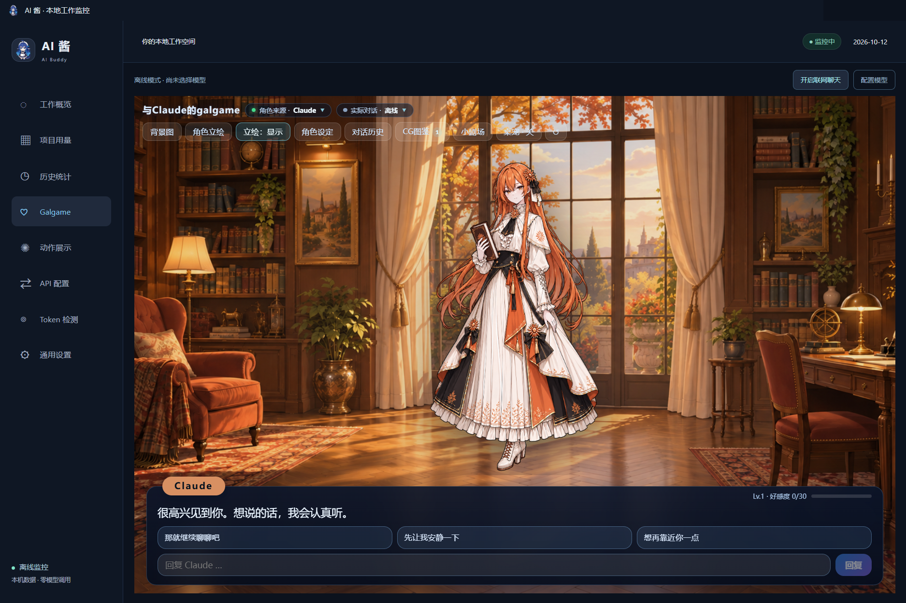

## 功能

- **工作概览**分为用量、费用、额度三页，显示总数、各工具卡片和最近五项工作。
- **项目用量**可按总 Token、输入、输出或项目名排序；**历史统计**可以查看日、周、月趋势，选择日期范围和时区，并导出 CSV / JSON。
- 工具、模型厂商、服务平台分开记录。Codex 是工具，OpenAI 是厂商或服务平台；光看模型名，无法证明用的是官方 API。
- **费用估算**用输入、输出、缓存读取、缓存写入四类 Token 分别乘以单价，不按请求次数算。订阅工具显示的是按 API 价格折算的参考金额，不是套餐账单。缺少用量或价格时保持“未知”，不当作零。价格目录来自 models.dev，可以在“费用 → 价格设置”里筛选、改价或手动更新。
- **在线额度**是可选功能，支持 Codex、Claude、GLM/Z.ai、Kimi Coding、MiniMax Coding、DeepSeek API 余额，以及受支持账号的 Gemini CLI。每个服务单独启用后才会查询。
- **角色与对话**窗口集中管理角色卡、我的身份、对话历史、群聊、长期记忆、人格自成长和人生存档。
- 每位角色的等级、聊天记录、背景、CG 图鉴、回收站和立绘显示状态互不影响，关系进度还按身份分开记。切换角色时会换回她自己的背景。
- 每轮对话提供三个回复选项，输入框为空时按 1、2、3 就能直接选；也可以直接输入。
- 用 CG 做背景时，默认隐藏立绘，免得画面里同时出现两个她。CG 图鉴里右键可以移入回收站，删了也能撤销或恢复。
- 历史请求存在本机 SQLite 里，重启后接着读取，查看时按需分页；升级时会把旧索引一次性迁移过来，原日志和旧快照都保留。第一次建索引、日志被替换或修复索引时会慢一些。

<table>
  <tr>
    <td align="center">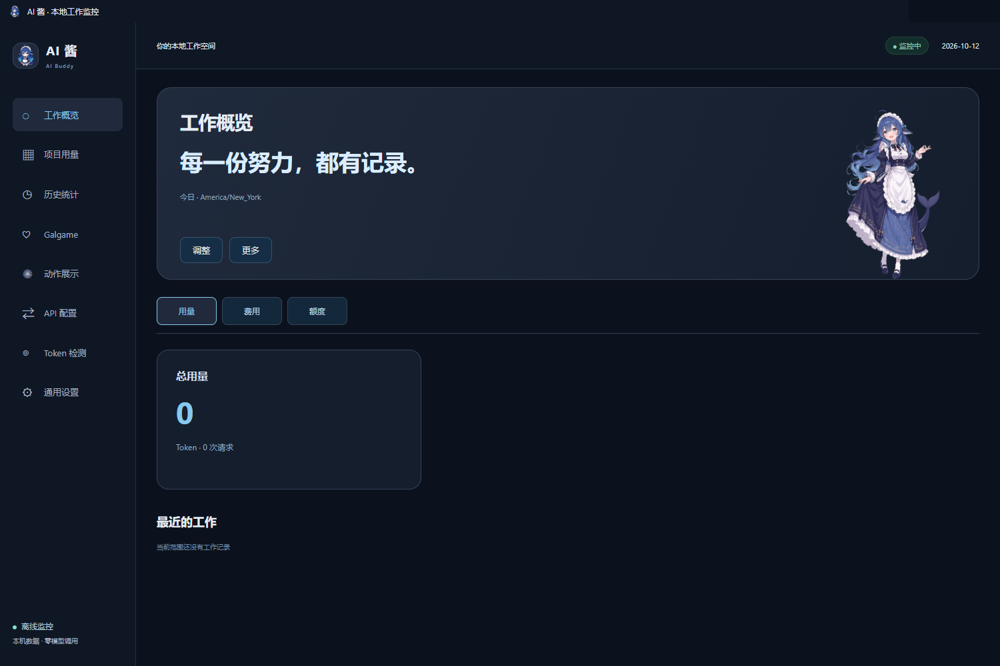 <strong>工作概览</strong></td>
    <td align="center">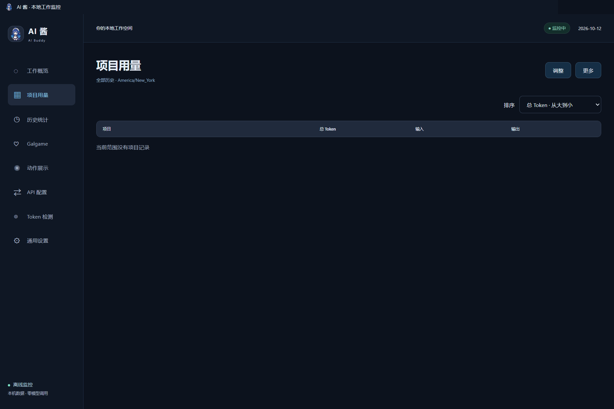 <strong>项目用量</strong></td>
  </tr>
  <tr>
    <td align="center">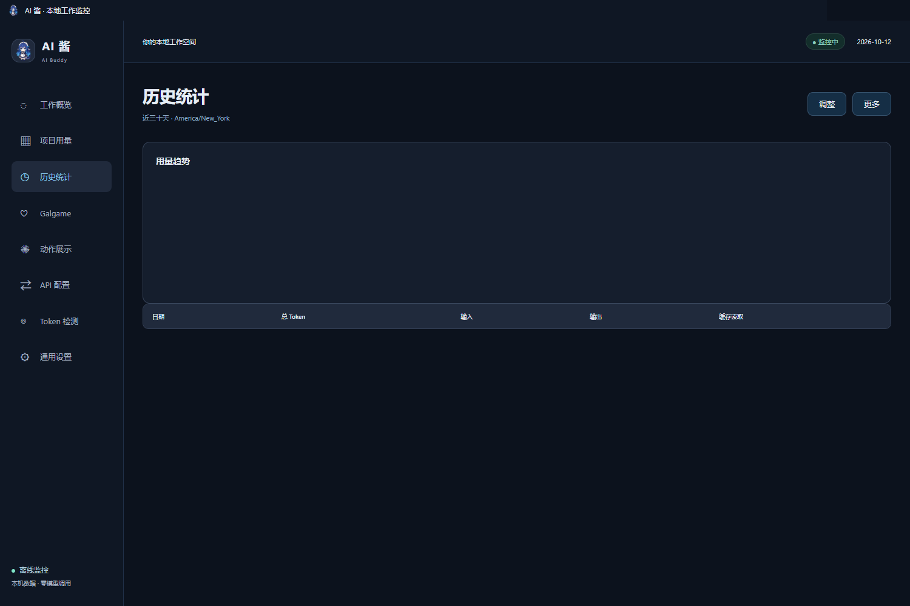 <strong>历史统计</strong></td>
    <td align="center">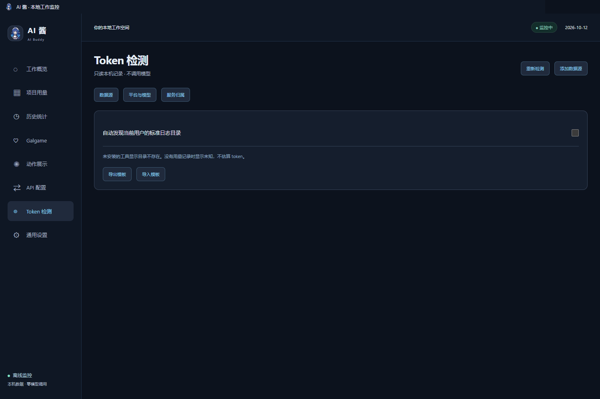 <strong>Token 检测</strong></td>
  </tr>
  <tr>
    <td align="center">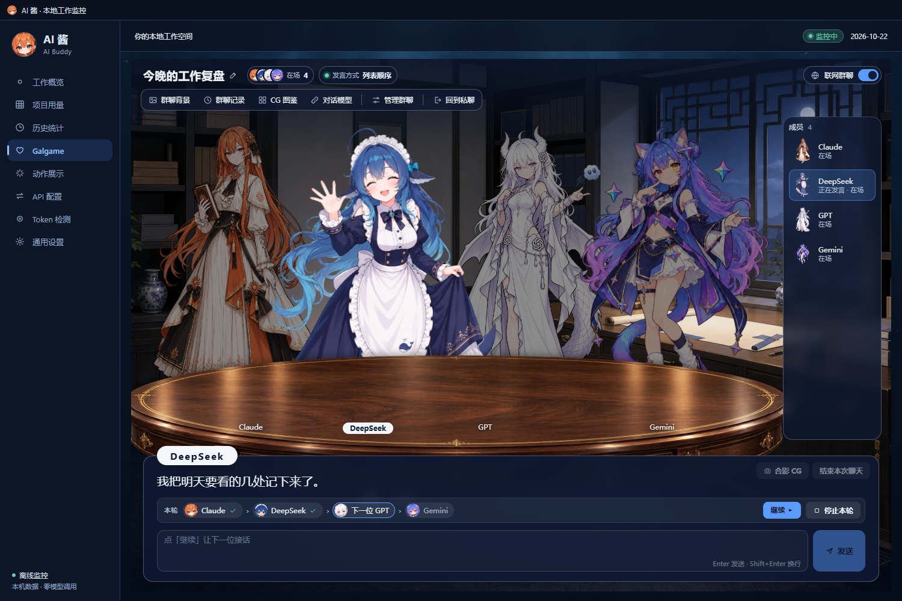 <strong>群聊</strong></td>
    <td align="center">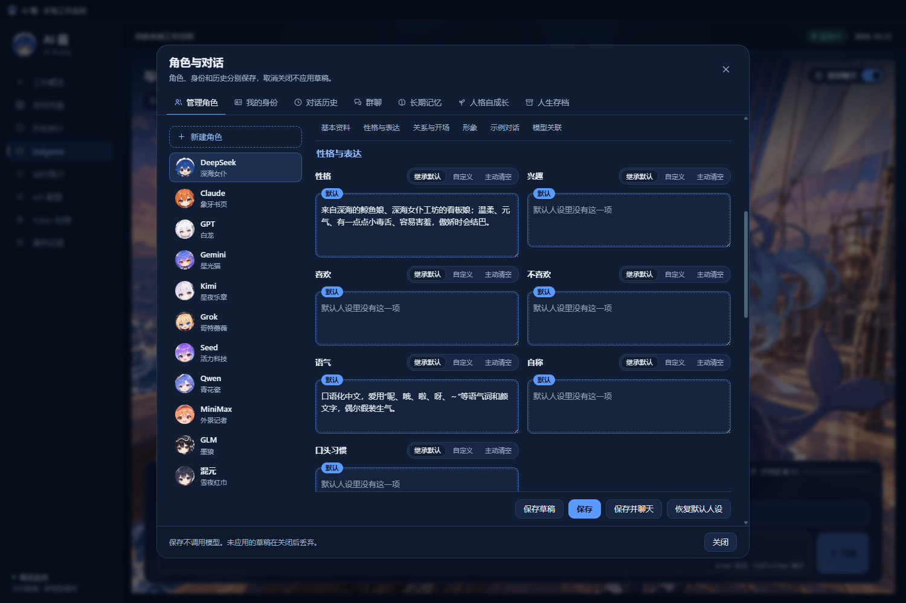 <strong>角色与对话</strong></td>
  </tr>
  <tr>
    <td align="center"> <strong>价格设置</strong>（英文界面）</td>
    <td align="center"> <strong>在线额度</strong>（英文界面）</td>
  </tr>
</table>

## 好感度与本机工作

### 关系进度

每位角色都从 Lv.1、0 点好感开始，彼此独立。同一位角色在你不同的「身份」下也分开记进度；需要的话，可以在「我的身份」里改成共用一份，数值不会相加。亲近、普通、疏离三个回复选项分别是 +1、0、-1，每轮的排列顺序随机。直接输入时按简单的关键词结算，例如“喜欢”“晚安”加分，“讨厌”“走开”扣分。好感最低为 0。

升级阈值为 `30 + 15 × (Lv - 1)`，即 30、45、60……，超出部分带到下一级，等级没有上限。超过 24 小时没有互动后，所有角色每天减 2 点，最低到 0。角色的语气随等级分为五档，Lv.5 起保持最亲近的一档。开启自动生成 CG 并配好绘图连接后，每次升级会生成一张纪念 CG。

在桌宠身上左键摸一下也能加好感：同一位角色每 60 秒最多加 1 点，每天最多 30 点，同一角色的各个身份共用这个额度。群聊里只有你自己说的话会影响好感，每位成员每轮最多结算一次。

### 本机工作如何影响角色

AI 酱运行期间，新监控到的工作 Token（AI 酱自己发起的聊天和绘图不算）会记进同一份余额。每满 5,000 个，当前角色加 1 点好感，一次最多加 3 点，剩下的留到下次。打开 Galgame 时、每次发送消息前各结算一次。启动之前的历史用量不会补算。

日志里明确记录任务完成时，桌宠会跳两轮并弹出完成气泡；记录失败时，会播放一轮失败动作，点一下出错气泡就会打开 Token 检测。反馈排队播放，失败优先于完成，完成优先于对话；同一事件只提醒一次，1 秒内的同类事件会合并。在 Galgame 里和任何一位角色聊天时，当前桌宠都会按回复里识别出的情绪做动作，并用气泡显示回复的第一句话（超过 40 字会截短），内置角色的名字写在气泡上方。

与上游插件不同，AI 酱不会把工具日志的正文交给 Galgame，角色不会主动提起你具体在做什么任务。

## 内置默认美术

发行包内置 11 位角色的默认立绘、Q 版桌宠和默认背景；表情有 DeepSeek 原有的 8 张和其余十位新增的 80 张；另有 264 段独立的透明动作视频（每位 24 段），以及视线方向和情绪峰值的静帧。DeepSeek 另有一张海边书房背景可选，5 张旧版背景也保留为可选项。下面是缩小后的预览，原尺寸图片随软件一起安装。

<table>
  <tr>
    <td align="center"> <strong>DeepSeek</strong></td>
    <td align="center"> <strong>Grok</strong></td>
    <td align="center"> <strong>Seed</strong></td>
    <td align="center"> <strong>Kimi</strong></td>
  </tr>
  <tr>
    <td align="center"> <strong>Qwen</strong></td>
    <td align="center"> <strong>MiniMax</strong></td>
    <td align="center"> <strong>GPT</strong></td>
    <td align="center"> <strong>Gemini</strong></td>
  </tr>
  <tr>
    <td align="center"> <strong>Claude</strong></td>
    <td align="center"> <strong>GLM</strong></td>
    <td align="center"> <strong>混元</strong></td>
    <td></td>
  </tr>
</table>

每位角色也都有自己的 Q 版桌宠，24 个动作一一对应。下面是她们的待机姿势：

<table>
  <tr>
    <td align="center"> <strong>DeepSeek</strong></td>
    <td align="center"> <strong>Grok</strong></td>
    <td align="center"> <strong>Seed</strong></td>
    <td align="center"> <strong>Kimi</strong></td>
  </tr>
  <tr>
    <td align="center"> <strong>Qwen</strong></td>
    <td align="center"> <strong>MiniMax</strong></td>
    <td align="center"> <strong>GPT</strong></td>
    <td align="center"> <strong>Gemini</strong></td>
  </tr>
  <tr>
    <td align="center"> <strong>Claude</strong></td>
    <td align="center"> <strong>GLM</strong></td>
    <td align="center"> <strong>混元</strong></td>
    <td></td>
  </tr>
</table>

每位角色在 Galgame 里默认使用自己的场景：

<table>
  <tr>
    <td align="center"> <strong>DeepSeek · 深海宫殿</strong></td>
    <td align="center"> <strong>Grok · 夜色宇宙观测室</strong></td>
    <td align="center"> <strong>Seed · 日光温室书房</strong></td>
  </tr>
  <tr>
    <td align="center"> <strong>Kimi · 月下阅读室</strong></td>
    <td align="center"> <strong>Qwen · 现代中式书院</strong></td>
    <td align="center"> <strong>MiniMax · 明亮创意工作室</strong></td>
  </tr>
  <tr>
    <td align="center"> <strong>GPT · 现代协作书房</strong></td>
    <td align="center"> <strong>Gemini · 双窗星图工作室</strong></td>
    <td align="center"> <strong>Claude · 琥珀色写作书房</strong></td>
  </tr>
  <tr>
    <td align="center"> <strong>GLM · 简洁知识研究室</strong></td>
    <td align="center"> <strong>混元 · 山水庭院与亭廊</strong></td>
    <td></td>
  </tr>
</table>

桌宠和“动作展示”页共用同一套透明 VP9 WebM 视频，有 30fps 和 60fps 两档；1.9.0 起按 CRF 28 编码，动作的时间轴、画布、尺寸和透明度都不变。11 位角色各 24 段：18 段日常动作（待机、挥手、开心等都是分别制作的，审查中和认真也不共用素材），以及 6 段互动动作——入睡、睡眠、唤醒、起飞、飞行和落稳，睡觉和被抛出去时自动播放。视线跟随用的是覆盖全部方向的 WebP Q95 静帧（透明通道无损）。在动作展示页选择角色，就能浏览她的全部动作；鼠标移到卡片上或用 Tab 选中时播放预览。

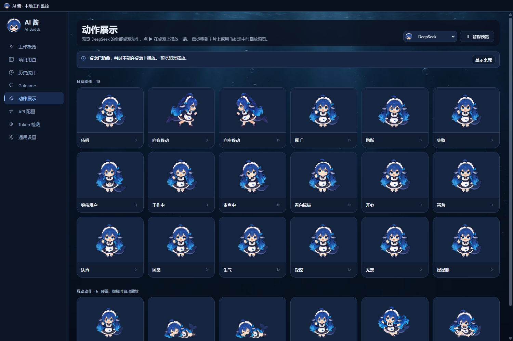

11 套主题的配色、背景和顶部的小装饰都取自对应立绘：DeepSeek、Grok、Kimi、Gemini 和 GLM 是深色，Seed、Qwen、MiniMax、GPT、Claude 和混元是浅色。下面是各主题下的工作概览：

<table>
  <tr>
    <td align="center"> DeepSeek</td>
    <td align="center"> Grok</td>
    <td align="center"> Seed</td>
    <td align="center"> Kimi</td>
  </tr>
  <tr>
    <td align="center"> Qwen</td>
    <td align="center"> MiniMax</td>
    <td align="center"> GPT</td>
    <td align="center"> Gemini</td>
  </tr>
  <tr>
    <td align="center"> Claude</td>
    <td align="center"> GLM</td>
    <td align="center"> 混元</td>
    <td></td>
  </tr>
</table>

素材来源与许可各不相同：

- DeepSeek 的立绘、表情差分以及深海宫殿、海边书房背景来自上游 dsh-whale-galgame，属于上游 21 张 CC BY-NC-SA 4.0 默认图片。
- 其余十套立绘和背景由图像工具以图库中的角色设计为参考生成，不是图库原图。角色设计作者已经署名，但这十套参考的通用再分发授权还没有逐一核实。
- 十位新角色的 Q 版桌宠以各自立绘为参考、按 DeepSeek 桌宠的比例生成，同样不是图库原图。
- 各角色动作视频由 MiniMax H3 生成，再用 RIFE 补帧；新增表情及 Q 版形象沿用各自母版的来源说明，不统一声明为 MIT。
- 1.9.0 新增的界面美术：11 套主题背景和立绘小装饰、桌宠的白手套光标、群聊的圆桌前景，都由 Codex 内置图像工具生成，画面里没有角色，也不是图库原图。手套只参考了 QQ 宠物切换光标的交互方式，没有使用腾讯的光标文件；各主题的袖口颜色由脚本从同一套手套改色得到。窗口和托盘的圆形头像、群聊成员缩略图由现有立绘和桌宠裁切、缩放而来。

逐文件说明见 [THIRD_PARTY_NOTICES.md](THIRD_PARTY_NOTICES.md)。Galgame 的布局、对话框和控件改编自上游，代码在 [`src/adapted/galgame-client.ts`](src/adapted/galgame-client.ts)，不依赖未公开的 UI 图片包。

## 安装

需要 Windows 10/11 x64。可以用在线安装器（推荐），也可以下载完整的便携分卷。两种方式都自带运行环境，不需要另装 Node.js、Python 或绘图工具。两档帧率的功能、角色、存档格式和鼠标跟随精度都相同，只是动作视频帧率不同；全角色装好后约 1.96 GiB（30fps）或 2.62 GiB（60fps），都包括维护工具。

### 在线安装器（推荐）

1. 到 [v1.9.2 下载页](https://github.com/lXiaoSel1/ai-buddy/releases/tag/v1.9.2) 下载 `AI-Buddy-Setup-1.9.2-win-x64.exe`（约 50 MiB）。安装器自带 .NET 运行库。
2. 选择安装位置（默认 `%LOCALAPPDATA%\Programs\AI Buddy`）、30fps 或 60fps、要装的角色和初始角色。首次安装默认选 30fps 和全部角色，初始角色为 DeepSeek。
3. 点击安装。安装器从固定的 v1.9.2 Release 下载资源，逐包、逐文件核对 SHA-256；全角色下载量约为 30fps 1.66 GiB、60fps 2.33 GiB。下载中断时，重新运行同一个安装器、选相同位置就能接着下。装好并确认新版正常启动后，这次下载的安装包会自动删除。
4. 默认会创建桌面和开始菜单入口。安装器不会开启联网聊天、自动 CG、开机启动或后台自动更新。

1.9.1 起，安装器打开时会检查有没有更新的正式版本，也可以点 **检查新版本** 再查一次。有新版本时，点 **下载并打开新版**：安装器先确认发布标签的签名（除了看 GitHub 的验证结果，还会在本机用固定的发布公钥再验一次），下载后核对哈希，然后打开新版安装器，沿用原来的安装位置和已登记的存档位置。下载和安装都要你点击确认；检查失败不影响离线安装、修复和回退。这样下载的新版安装器 EXE 会留在下载缓存里，安装后不会自动删除，见[数据与隐私](#数据与隐私)。

**从 1.9.0 或 1.8.0 升级**：旧版的安装器固定使用旧清单，也不会检查新版本。请下载 1.9.2 安装器，选原来的安装位置。它会接管原目录，保留个人存档、自定义数据目录、聊天连接和角色设置；完整的便携版目录也能这样接管。不要把旧存档复制进新目录覆盖；想在新目录里接着用旧存档，请用下文的[导入旧存档](#导入旧存档)。

### 便携分卷（离线）

1. 在同一个下载页，把所选帧率的全部分卷和合并工具下载到同一个文件夹：
    - 30fps：`AI-Buddy-1.9.2-Windows-x64-30fps.zip.part01`、`.part02`、`AI-Buddy-1.9.2-Windows-x64-30fps.zip.parts.json`、`Combine-AI-Buddy-1.9.2.ps1` 和 `Combine-AI-Buddy-1.9.2-30fps.cmd`。
    - 60fps：`AI-Buddy-1.9.2-Windows-x64-60fps.zip.part01` 到 `.part03`、对应的 `.zip.parts.json`、`Combine-AI-Buddy-1.9.2.ps1` 和 `Combine-AI-Buddy-1.9.2-60fps.cmd`。
2. 双击对应的 `.cmd`。脚本先校验每一卷，合并后再校验完整的 ZIP，只用到 Windows 自带的 PowerShell。不要直接解压其中一卷。合并后的 ZIP 约 1.70 GiB（30fps）或 2.37 GiB（60fps）。
3. 把合并出的 ZIP 完整解压到一个可写目录，进入 `AI-Buddy` 文件夹，双击根目录的 **AI Buddy.exe**。`AI Buddy.vbs` 和 `AI Buddy.cmd` 是兼容入口，启动的是同一个程序。

另一种离线方式：把 `install-manifest-1.9.2.json` 和需要的资源 ZIP 放进同一个文件夹，在安装器里选择这个“离线资源目录”，同样会逐个校验。1.7.10 的旧离线包仍保留在它原来的 Release 页面。

几点注意：

- 不要在 ZIP 里直接运行，也不要只复制 EXE，目录结构要保留。
- 安装器和程序都没有商业代码签名，Windows 可能提示“未知发布者”，可以先用 `SHA256SUMS-1.9.2.txt` 核对文件。
- 首次启动会自动查找当前用户的常见日志目录。没装任何 AI 工具也能用，陪伴功能可以离线运行。
- GitHub 自动生成的 **Source code** 是源码包，不能直接运行。
- 本仓库和正式发行包已公开。发行包不包含开发者存档、连接密钥或本机日志。

安装后的目录：

~~~text
<安装目录>/
├─ AI Buddy.exe / AI Buddy.vbs / AI Buddy.cmd / Start-AI-Buddy.ps1   启动入口
├─ builds/<版本>/                         应用代码、动作和角色资源
├─ runtime/AI-Buddy-<版本>/               Electron 运行时
├─ maintenance/1.9.2/AI Buddy Setup.exe   维护工具
├─ local/current-build.json               当前版本指针
├─ local/installation.json                安装记录：帧率、角色和存档位置
├─ local/portable-defaults.json           便携版自带的程序信息（只有便携版有）
├─ local/data-v003/                       首次运行后生成的个人存档
├─ local/data-profiles/                   导入的旧存档，每次导入一份独立副本
├─ assets/  docs/  licenses/
└─ README.md  LICENSE.md  THIRD_PARTY_NOTICES.md
~~~

### 更新与卸载

在线安装：

- 补装角色、修复文件、切换帧率：在通用设置点 **管理角色资源** 打开维护工具，或者重新运行同版本的安装器。没装的角色在界面上标为“待安装”，确认后才会打开安装器，不会自动下载。
- 升级：运行新版本的安装器。它会先等聊天和 CG 收尾、正常关闭 AI 酱。装好并确认新版正常启动后，保留当前版本和上一版程序，更早的旧版本会被清理，个人存档一律不动；即使存档目录放在旧版本的程序文件夹里，也会保留。装好之后如果创建快捷方式失败，只会提示，不会撤销已经装好的新版。
- 回退：在安装器里点 **回退上一版**，只恢复程序和启动指针，不会用旧存档覆盖新进度。1.9.0 起会写入新格式的图片和人生 / 记忆数据；退回 1.9.0 之前的版本时，如果存档里已经有这些数据，维护工具会拒绝自动降级，也不会自行转换或删除它们。不能回退时（比如没有上一版，或者存档已经有旧版认不出的数据），按钮是灰的，下面会写明原因。
- 卸载：在安装器里点 **卸载…**。默认保留个人数据，也可以勾选同时删除默认目录中的个人数据（不可恢复）；自定义的数据目录和导入的存档不会被自动删除，正在用它们时勾选这一项，卸载会停下来，请自己手动处理。保留着的旧版本程序和下载缓存会一起删掉。

便携版：

- 更新：等聊天和绘图完成后，在托盘菜单选 **退出**，再把新版解压到原来的位置覆盖旧文件（解压后新旧 `AI Buddy.exe` 要在同一个文件夹里，不要多套一层 `AI-Buddy` 文件夹），然后照常启动。个人存档在 `local/data-v003`，发行包里不带这个目录，覆盖解压不会动它。1.9.1 起发行包也不再带安装记录，原来登记的自定义存档位置和初始角色都会沿用。30fps 和 60fps 之间也可以这样覆盖，原来那一档的程序文件夹会留在 `builds/` 里，不需要的话可以手动删除。更新前可以先备份一份存档。
- 卸载：退出后删除整个文件夹即可，AI 酱不会添加开机启动项。想保留聊天记录和 CG，删除前先备份 `local/data-v003`；导入过旧存档的话，还有 `local/data-profiles`。

### 导入旧存档

想在新目录里接着用旧版的聊天和回忆，可以导入旧存档。导入会把旧存档里的全部数据复制一份（界面缓存、崩溃报告和临时文件除外），再切换过去用这份副本，不会把两份聊天、好感或用量合在一起；来源和当前的存档都会保留。导入本身不调用聊天或绘图模型。

1. 先退出旧版本的 AI 酱。
2. 新目录第一次启动时会显示欢迎页，选 **导入旧存档**。已经在用的话，到通用设置的 **存档与迁移** 点 **选择旧存档**。
3. 点 **选择目录**，选旧程序的目录或者实际的存档目录（选程序目录时，会按它登记的位置找到自定义存档）。勾选“我已退出来源版本的 AI 酱”，再点 **核对并预览**。
4. 核对预览：实际的来源目录、副本位置、文件数量和大小，以及角色、身份、会话、群聊、记忆、人生存档、CG 等的数量。没问题就点 **导入副本并切换**。复制完会逐个核对文件的长度和 SHA-256，全部对上才切换到副本并重启；复制期间来源有变化、磁盘空间不够或校验失败，都不会切换。
5. 副本放在 `local/data-profiles/` 里，按相对路径登记，以后把整个文件夹搬到别处也能读到。

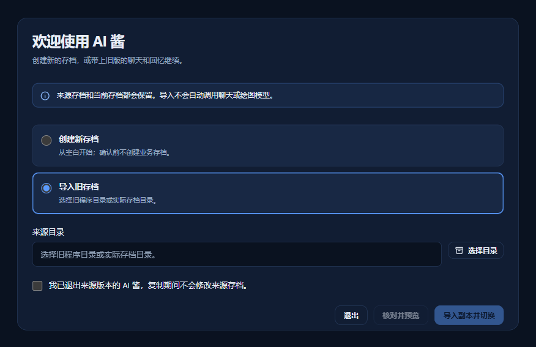

为了不意外产生费用，导入后：联网聊天保持关闭（本来每次重启也都是关的）；旧存档里还没完成的消息和群聊轮次会中断；自动整理记忆会暂停，在通用设置的 **存档与迁移** 里点 **恢复自动整理** 继续；没画完的 CG 也会暂停，要在 CG 图鉴里点开那一张（群聊合影在群聊的 CG 图鉴里），再点 **继续此 CG**。如果无法确认旧请求是否已经提交，这个按钮不可用，以免重复收费。

### 从源码运行

只有想自己构建时才需要这种方式。需要 Windows x64、Node.js 24 和 npm：

~~~sh
npm ci
node scripts/build-public.mjs --resources="C:/path/to/AI-Buddy/builds/<版本>"
npm start
~~~

`--resources` 指向同版本便携包里含 `assets/frame-sequence-manifest.json` 的 `builds/<版本>` 目录。构建会直接复用发行包里的立绘和动画，不需要重新生成图片或视频。详见 [构建说明](docs/BUILD.md)。

## 使用与设置

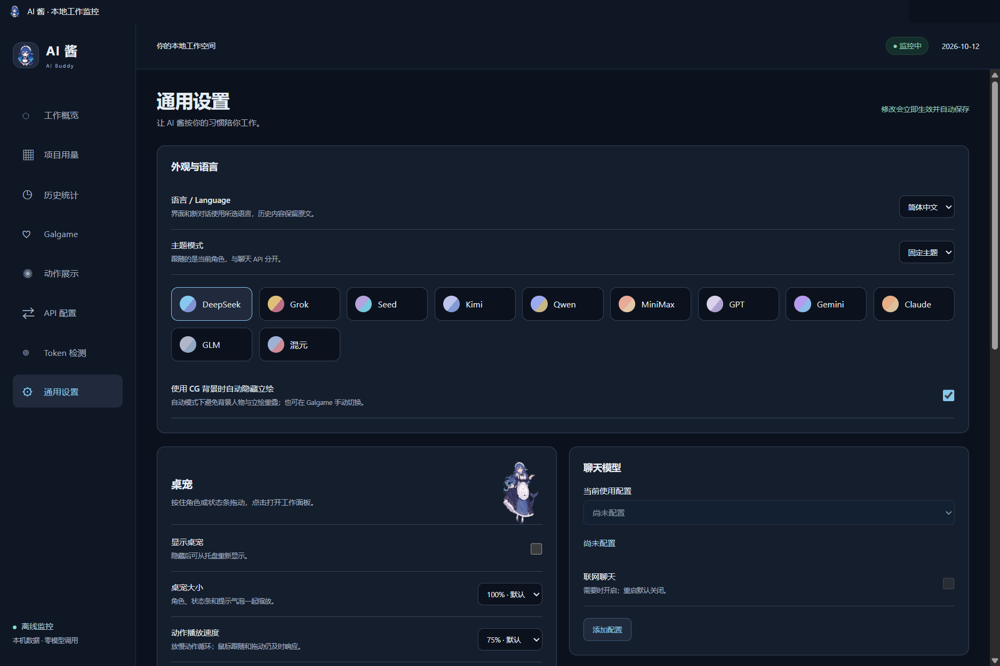

左键单击桌宠是「摸摸」：她会做一个表情。右键单击打开桌宠菜单，里面有打开工作空间、打开 Galgame、让她睡一会儿（睡着时变成「叫醒她」）、显示状态条和隐藏桌宠。点一下状态条会打开工作概览。双击托盘图标也能打开主窗口；托盘菜单里有工作概览、通用设置、动作展示、打开 Galgame，以及显示桌宠、拖动模式和退出。

### Token 检测

首次启动会自动查找下面这些位置（都在当前 Windows 用户目录下）：

| 工具 | 默认位置 |
|---|---|
| Codex | `.codex\sessions`、`archived_sessions`，可用 `CODEX_HOME` 改位置 |
| Claude Code | `.claude\projects`，可用 `CLAUDE_CONFIG_DIR` 改位置 |
| Gemini CLI | `.gemini\tmp` |
| Kimi Code CLI | `.kimi-code\sessions`，以及旧版 `.kimi\sessions` |
| OpenCode | `.local\share\opencode`，也支持 `XDG_DATA_HOME` 或 `OPENCODE_DB` |
| Cline / Roo Code | VS Code、VS Code Insiders、VSCodium、Cursor 的扩展存储；Cline 另有 `.cline\data\sessions` |
| DeepSeek Harness | `.dsh\sessions`，可用 `DSH_HOME` 改位置 |

便携编辑器、WSL 或其他用户目录需要手动添加：在 **Token 检测** 点 **添加数据源**，选择工具模板和实际目录，先做 **本地解析预览**，再点 **保存并启用**。自定义来源支持 JSONL、Zstd 压缩的 JSONL、JSON、CSV 和 SQLite，可以做字段映射，模板能导入导出。移除数据源不会删除原日志，也不会删掉已经记录的用量。

有些请求的日志没有写全用量时，工作概览、项目用量和历史统计顶部会提示“N 条请求缺少完整用量，合计为已记录部分”。点右边的 × 可以关掉，之后这句提示只在 Token 检测页显示；恢复默认设置会让它重新出现。

### 通用设置默认值

| 选项 | 默认 |
|---|---|
| 语言 | 首次启动跟随系统语言，可选简体中文 / English |
| 主题模式 | 固定使用 DeepSeek 主题，可改为跟随当前角色 |
| 显示桌宠 | 开 |
| 桌宠角色 | 跟随 Galgame 角色；改成固定角色时默认 DeepSeek |
| 桌宠大小 | 125%，可选 75%、100%、125%、150% |
| 动作播放速度 | 75%，可选 25%、50%、75%、100% |
| 保持置顶、透明区域点击穿透、跟随鼠标方向、显示状态条、任务提示气泡 | 开 |
| 自动睡眠、物理互动（抛掷和蓄力） | 开 |
| 抛掷力度 | 标准，可选轻柔、标准、强力、夸张 |
| 使用 CG 背景时自动隐藏立绘 | 开 |
| 模型最多输出 | 8,192 tokens，也可以设为自动或 256–65,536 |
| 备用检查间隔 | 1 秒（文件有变化时会立即读取），可选 1、2、5 秒 |
| 活动时间显示 | 纽约时间，可改为系统本地时间或 UTC |
| 统计时区 | 系统本地时间 |
| 每日更新价格目录 | 关 |

另外两项不在这张表里：**联网聊天**每次重启后都是关闭的，需要手动开启；**自动生成 CG** 首次安装时关闭。**恢复默认设置**会把上表的选项全部恢复，语言改回简体中文，隐藏的桌宠会重新显示，关掉的“用量不完整”提示也会重新出现；聊天和绘图连接的选择、Token 检测的数据源不受影响，桌宠位置、用量和 Galgame 存档都会保留。

### 角色来源与实际对话

Galgame 顶栏的 **角色来源** 决定谁出场，可以跟随工作区，也可以手动固定；**实际对话** 显示这位角色实际用哪个聊天连接、哪个模型回复，两者互不影响。联网聊天的开关也在顶栏右侧。标题可以点一下改名，每位角色分开保存。**背景图** 和 **角色立绘** 可以换成内置选项，也可以上传自己的图片（PNG、JPEG、WebP、AVIF，单张不超过 12 MB）。

单人场景用近景构图：脸和上半身更突出，下半身自然延伸到对话框后面，立绘选择器里仍然显示全身。顶栏的 **立绘** 按钮在显示和隐藏之间切换，手动改过之后会多出一个 **恢复自动**；自动模式下，用 CG 当背景时会隐藏立绘。

### 角色与对话

在 Galgame 顶栏点 **管理角色**、**我的身份**、**对话历史** 或 **群聊**，会打开「角色与对话」窗口的对应页签；长期记忆、人格自成长和人生存档三页也在这个窗口里。这里保存的内容都不调用模型，没保存的草稿关闭窗口后丢弃。

- **管理角色**：每张角色卡分成基本资料、性格与表达、关系与开场、形象四组，一共 15 项文字和 3 项图片（立绘、背景、CG 参考图），另有示例对话、模型关联和健谈程度。每一项都能选「继承默认」「自定义」或「主动清空」：继承时直接显示内置人设的原文，清空则明确留空、不用默认内容。表单顶上有跳转栏，保存按钮固定在底部，可以先「保存草稿」。内置角色可以「恢复默认人设」，载入草稿后保存才生效；也可以「新建角色」：自建角色不会自动生成图片或桌宠，立绘、背景和 CG 参考图可以自己上传，没有立绘也能直接聊天，桌面上仍是内置角色的桌宠。人设文字和示例台词每项最多 2 万字（名称最多 80 字），这里上传的图片不超过 8 MiB。
- **我的身份**：填你自己的管理名称、对话昵称（角色怎么叫你）、职业、兴趣、背景和交流偏好，以及对当前角色的专属称呼和关系。会话、草稿、回复选项和关系进度都按身份分开；同一位角色的进度可以在独立和共用之间切换。新会话用当前身份，没选时用默认身份。
- **对话历史**：左边是会话列表，可以按内容和日期搜索，也能看已归档的会话；右边直接显示选中会话的消息，不用切换过去。当前会话可以收藏消息；打开「允许更正我发的消息」后还能更正自己说过的话，更正会保留原文和版本，不重新请求模型，也不改变好感，角色的台词不能改。会话可以改名、归档、导出成 JSON，也能从 JSON 恢复（50 MiB 以内）。以前演过的小剧场在列表最下面的「以前的小剧场」里，可以查看。

### 群聊

在「角色与对话 › 群聊」里新建群：填群名，选成员和你的身份（建好后身份不能再换），写一段场景，选好发言方式，然后点 **保存并进入**。成员人数不限，舞台上最多同时站 4 位（窗口窄时少一些），正在说话的那位会亮起来。群聊要先打开顶栏右侧的 **联网群聊**。

| 发言方式 | 谁来回复 |
|---|---|
| 自然接话 | 先是被 @ 的成员，其余成员按角色卡里的健谈程度随机入选；没人入选时随机挑一位，所以 0% 也不等于静音 |
| 列表顺序 | 所有在场、没有静音的成员按列表顺序各回复一次 |
| 手动点名 | 只有被 @ 的成员回复 |
| 轮换池 | 每轮轮到一位成员 |

发消息后，第一位自动回复，后面的点 **继续 ▸** 接话。对话框里的「本轮」进度条会标出谁说完了、下一位是谁，随时可以 **停止本轮**。成员之间会互相搭话，也可能争起来。输入 @ 会弹出成员列表；静音的成员不会被选中发言，@ 她也不会回复。新加入的成员不知道加入之前的对话，离开期间的事也不会知道，再回来时保留原先知道的内容。

每位成员用自己角色卡上的聊天连接（默认跟随全局），也可以在群聊顶栏的 **对话模型** 里逐个改，选完立即保存。这里改的是她角色卡上的设置，私聊也会跟着变。群聊有自己的背景（可以关掉圆桌前景）、聊天记录（能搜索和导出）和 CG 图鉴。

一轮结束后可以点 **合影 CG**。画面分两步生成：先由「提示词策划模型」根据这次已经呈现的对话写画面提示词，再交给 CG 绘图连接出图。策划模型默认是「自动」，沿用入口角色或全局的连接；也可以给这个群指定一条聊天连接，选完立即保存。联网关闭时，「自动」会改用本地模板写提示词；指定了连接却没开联网时，会提示先打开联网，不会悄悄换成别的连接。点头像可以把某位成员从合影里去掉。群设置里还能打开「结束本次聊天时自动合影」。

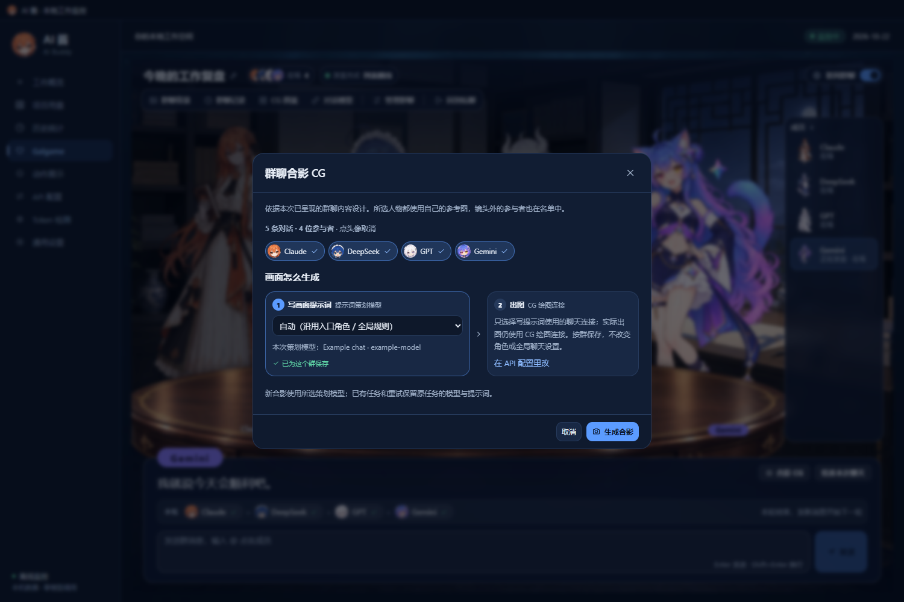

画好的合影收在这个群自己的 CG 图鉴里：

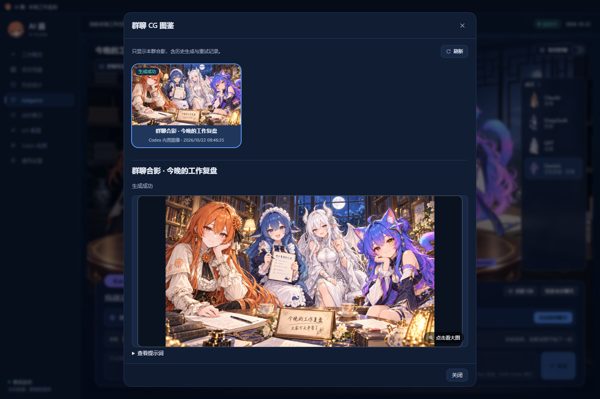

以前的「小剧场」已经由群聊取代，顶栏不再有入口；演过的场次保留在「对话历史」最下面，可以查看，也能补一张合影 CG，但不能再新建。

### 长期记忆、人格自成长与人生存档

- **长期记忆**：聊天原文完整保存。每天零点（按本机时区），AI 酱会为每位角色整理当天的总结、Guide 和核心记忆。整理要调用这位角色的聊天连接，只在联网聊天开着时进行；错过的日子会在下次打开联网聊天后补上（每次启动后联网聊天都是关着的）。记忆页只能查看：记错了就在聊天里纠正，或者说“以后不要主动提起”，原文仍然保留。普通记忆不会随时间自动删除。不同身份之间互不相通；群聊里她只知道本群的事，私聊里则能想起你用同一身份和她一起参加过的群聊。
- **人格自成长**：默认不开，需要在这一页手动开启，可以从当前设定起步，也可以从白板开始新人生。开启后，人设随真实的聊天经历慢慢变化，姓名、人设和示例对话变成只读；外观、聊天连接和健谈程度仍然可以改。人格按角色共享，各身份的关系分开保存。
- **人生存档**：把一位角色的一整段「人生」（角色卡、记忆，以及各身份的关系和进度）存成一份，可以只读预览、导出 ZIP、导入、重置或恢复。重置和恢复之前会先把当前的人生另存一份，并且要输入角色名确认；不会回退其他角色或账号用量。单个存档最大 512 MiB，数量不限，不会过期。

更多细节见 [长期记忆与人生存档说明](docs/long-term-memory-lives.md)。

### 内置桌宠

11 位角色都有自己的桌宠。通用设置里的 **桌宠角色** 默认是 **跟随 Galgame 角色**：你在 Galgame 里换成谁，桌面上就换成谁；也可以改成 **固定角色**，一直留着同一位。没装资源的角色标为“待安装”，选中时会提示补装，不会自动下载。和任何一位角色聊天时，桌宠都会做出对应的情绪动作；在群聊里，桌宠保持进群时选中的那位。

- **摸摸**：鼠标移到她身上会变成白手套，左键点一下，她会做一个表情，手套也会轻轻戳一下。
- **睡觉**：5 分钟没有动静（没有新的工作 Token、互动、任务反馈或聊天）她就会睡着，状态条写着「睡着了 · 点一下叫醒」；真实的聊天和绘图请求进行期间她保持清醒。也可以在右键菜单里让她睡一会儿。
- **拖着走**：按住左键拖动，她会边走边跟着鼠标，松开后停在原处。
- **抛出去**：按住右键拖一下再快速松开，她会飞出去，一路手忙脚乱地挥着手，撞到屏幕边缘会弹回来，落地后站稳。右键拖动途中再按住左键可以蓄力，像拉弹弓一样，松开左键发射；屏幕上会画出预测轨迹、落点和力度。按 Esc 取消。力度可以在通用设置里调；关掉「物理互动」后不能再抛和蓄力，拖着走仍然可以。
- **状态条**会写当前状态，例如「AI 酱 · 陪着你」「工作中 · 2 个会话」「等你回应 · Codex」。鼠标移上去会出现 ×，关掉后会提示可以撤销，之后也能在右键菜单或通用设置里重新打开。
- 手套的袖口、气泡和状态条跟随当前主题；任务栏和托盘图标显示桌面上那位桌宠的头像。

透明区域可以点击穿透。拖动期间收到的任务反馈会排队，松手后再播放。隐藏桌宠后，可以从托盘菜单重新显示。

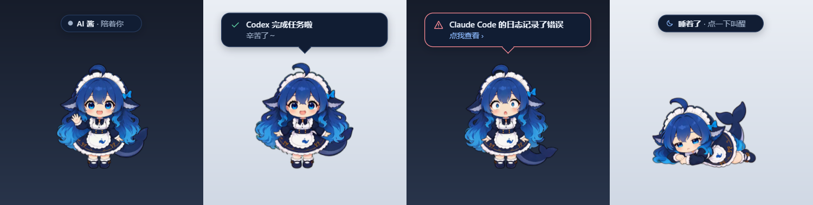

### 主题与语言

通用设置提供 11 套以角色命名的主题，配色、背景和装饰都取自对应立绘，5 套深色、6 套浅色；可以固定一套，也可以跟随当前角色。界面、窗口标题栏、桌宠状态条和气泡会一起变色，人物图片本身不染色。

语言可选简体中文或 English。切换后，界面和之后的新对话都用新语言；已有的聊天、历史 CG 和你自己填写的文字保持原样。

## 聊天与 CG 接入

聊天和 CG 绘图是两套独立的连接，都在 **API 配置** 里管理。**保存并使用** 会立刻启用，**仅保存** 不切换当前连接；通用设置只负责选择当前连接和开关。每位角色默认用全局的聊天连接，也可以在角色卡的 **模型关联** 里给她指定一条；群聊里各成员用各自的连接。

| 类型 | 协议 / 通道 | 默认值 |
|---|---|---|
| 聊天 | 本机 Codex 登录、OpenAI Chat Completions / Responses、Gemini 原生、Anthropic Messages | Codex 通道需要本机已登录的 Codex |
| CG | Codex 内置图像 | 沿用本机 Codex 模型，优先横向 16:9 构图 |
| CG | OpenAI Images 兼容 | gpt-image-1 系列默认 1536×1024 |
| CG | 火山方舟 / Seedream | 专用 JSON 协议，支持文生图和参考图，默认 2K；填写账号已开通的模型或绘图接入点 |
| CG | Gemini Interactions | 16:9，默认 1K |
| CG | 通义万相 | 生成与编辑默认 `wan2.6-image`、1280×720；异步文生图默认 1696×960 |

聊天连接可以设推理强度（effort），对本机 Codex、OpenAI Responses 和 Chat Completions 生效；本机 Codex 没设时用 low，Gemini 原生和 Anthropic Messages 用模型默认。1.9.2 起，可选的档位按这个连接当前的模型来定：点 **获取模型列表** 后，列表里写明了支持哪些档位就用列表的；DeepSeek 和 xAI 官方服务地址上的几款模型（`deepseek-flash`、`deepseek-v4-pro`、`grok-4.5`、`grok-4.6`、`grok-4.7`）按官方文档内置了档位，换成代理地址就不算；其余情况只提供“模型默认”，选它时不发送 effort 参数。所以 OpenAI、Kimi、Qwen、MiniMax 和自定义连接，如果服务的模型列表没写明档位，现在只有“模型默认”可选（1.9.1 会列出除 ultra 外的全部档位）。换模型时，如果新模型不支持原来的档位，会改回模型默认，保存后生效；改服务地址或接口协议会清空模型列表和档位。本机 Codex 连接的模型列表里如果没有档位信息（例如 1.8.0 及更早版本只存了模型名），打开编辑时会自动重新读取一次，保存后生效。

旧版里给外部 API 连接选过、现在不支持或核实不了的档位，升级后这个连接的聊天、连接测试和后台任务都会报错“该模型不支持所选推理强度”，请求在发出前就被拦下，不会产生费用。打开这个连接编辑时会自动改成“模型默认”并提示，点保存即可；如果服务的模型列表写明了档位，也可以先点 **获取模型列表** 再选。连接还可以填上下文容量；没填、模型目录里也查不到时，按 272,000 tokens 规划。外部 API 连接的回复被输出上限截断时，会把上限加倍自动重试一次（本机 Codex 不重试）；仍被截断时，会提示你调高通用设置里的输出上限。

可以选预设，也可以填写自定义的兼容服务地址和模型 ID；兼容程度、模型权限和参考图限制由服务端决定。外部密钥用 Electron safeStorage 加密后保存在本机。不要把真实密钥写进仓库文件，也不要提交到 Git。

**自动生成 CG** 默认关闭；开启后，每次升级会生成一张纪念图。联网聊天开启时，每张新的升级 CG 会多调用一次聊天模型来设计主题，失败就改用本地的角色主题组合；重试时复用已有的主题。也可以在 CG 图鉴里点 **生成纪念 CG** 手动生成一张。群聊合影是手动生成的（或在群设置里开自动合影），只需要配好绘图连接。模型调用和绘图都可能产生服务费用。

当前 CG 构图规则：男性第一人称，男性角色本人不入镜；允许合理的手部互动、文字及服装 Logo，不限制为一只男性手。

从 1.7.5 起，新生成的 CG 以当前角色的 Galgame 立绘作参考，自定义立绘优先；DeepSeek 不再使用 Q 版桌宠的制作母版。重试旧任务时仍用当时保存的参考快照，想换新参考就新建一张 CG。火山方舟出错时，界面会显示 HTTP 状态、服务端给出的错误原因和请求 ID，敏感内容会被过滤。配置步骤见 [CG 绘图指南](CG_API_GUIDE.md)。

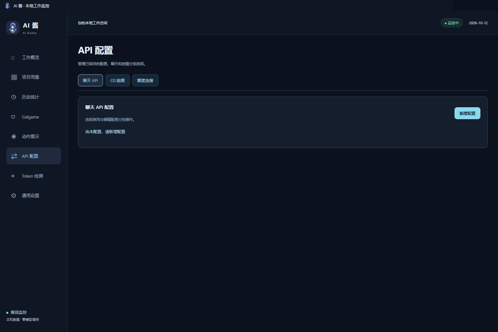

### 使用本机 Codex 绘图

“Codex 内置图像”用的是这台电脑上 Codex 的绘图能力。AI 酱不自带 Codex，也不带登录账号。请先在这台电脑上安装、打开并登录 Codex 桌面端，再到 **API 配置 → CG 绘图 → Codex** 点 **测试连接（不出图）**。

AI 酱能找到桌面端运行缓存、Microsoft Store 安装、常见独立安装和 npm 原生程序里的 Codex，不需要为了路径检测单独安装 npm CLI。自定义安装可以把环境变量 `AI_BUDDY_CODEX_PATH` 设为原生 `codex.exe` 的完整路径，重启 AI 酱后再试。自定义 Codex 配置目录遵循 `CODEX_HOME`；缺少可选的 `config.toml` 不再导致启动失败。

程序是否存在、登录是否可用、图像能力是否可用是三项独立检查。Codex 没有提供图像能力时，请更新 Codex，或改用外部绘图 API。接入协议参考 [OpenAI Codex app-server 文档](https://learn.chatgpt.com/docs/app-server)。

### 在线额度

额度连接和聊天、绘图连接互相独立。各服务能返回的字段不同，不支持的账号会提示原因。只有单独启用后才会查询：窗口显示时约每 2 分钟一次，隐藏时约每 15 分钟一次。AI 酱不会靠发送模型对话来探测额度，也不读取浏览器 Cookie。认证失败时会提示重新登录；临时失败时保留上次成功的数值和更新时间。

## 数据与隐私

运行数据默认在安装目录的 `local/data-v003` 下（导入旧存档后，改用 `local/data-profiles/` 里的那一份），请把它当作私人数据：

- `settings.json`：偏好设置和桌宠位置。
- `model-connections.json`、`cg-connections.json`、`quota-connections-v1.json`：已保存的连接，密钥经 safeStorage 加密。
- `token-sources.json`、`token-index-v1.json`、`token-events-v1.jsonl` 等：数据源配置和用量索引，里面有本机项目路径。
- `usage-ledger-v2/`：请求历史（本机 SQLite），按需分页读取。
- `galgame/companion.json`：角色卡、身份、会话、群聊（成员、记录、合影和背景）、长期记忆和人格成长。
- `galgame/storages/dsh-whale-galgame/global.json`：Galgame 存档，包括各角色的好感、等级、CG 图鉴和背景。
- `galgame/media/`：按内容哈希保存的图片，包括你上传的头像、立绘和背景。
- `galgame/drafts.json`：还没发出去的草稿。
- `galgame/life-archives/`：人生存档 ZIP。
- `galgame/maintenance/`：数据维护之前自动做的完整备份。
- `cg-assets/`：生成的 CG 及缩略图。
- `chromium/`、`crash-reports/`：界面缓存和崩溃报告。

`settings.json`、`model-connections.json`、`cg-connections.json`、`companion.json` 和 Galgame 存档实际都是同名的 `.snapshots/` 文件夹，存着最近的若干版本：1.9.0 起保留最近 50 次修改，再加 90 天内每天一份。在线安装的下载缓存放在 `%LOCALAPPDATA%\AI Buddy\InstallerCache`，里面只有安装包，不含个人数据；资源包在安装成功后会自动删除，卸载时也会清理。用 **下载并打开新版** 下载的新版安装器（文件名形如 `<SHA-256>-AI-Buddy-Setup-1.9.2-win-x64.exe`，旁边还有一个同名的 `.lock` 文件）目前不在清理范围内，安装和卸载后都会留下，不需要的话可以手动删除。

会发到外部的内容：

- 监控本身只读日志，不调用模型，也不修改其他工具的文件。
- 聊天内容发给这位角色使用的聊天连接。除了对话本身，还会附上你当前身份的资料，以及这位角色的相关记忆片段。联网聊天默认关闭，每次重启后都要手动开启。
- 群聊里每位发言的成员各发一次请求，用她自己的连接。
- **日终记忆整理**：联网聊天开着时，每天为每位角色、每个知情范围（每个身份的私聊、每个群聊）整理一次，会把当天的原文发给这位角色的聊天连接；很长的一天会分段整理。打开联网聊天时，之前积攒、还没整理的日子会一起补上，请求可能比较多。
- CG 提示词发给你选的绘图连接。自动生成默认关闭；联网聊天开启时，升级 CG 的主题设计会多调用一次聊天模型，带上最近几句对话和角色设定。
- 群聊合影会把这次已经呈现的群聊内容和发言人名字发给提示词策划模型，并写进出图提示词；上传过的群聊背景会作为参考图发给绘图连接（绘图连接关闭了参考图时不发）。
- 在线额度只查询你启用的服务。
- 价格目录只在手动更新或开启每日更新时从 models.dev 下载公开价格，不发送日志。
- 界面渲染进程发出的外部请求一律会被拦截。

发行 ZIP 不含开发者的存档、密钥、聊天、个人 CG、日志或浏览器配置。README 截图来自独立的测试存档：用量是合成的示例数据，聊天回复来自本机的测试服务，CG 截图里的两张图由开发者本机的 Codex 现场生成，不代表真实账号的用量和对话。分享日志、导出数据或截图前，请自己检查项目路径和账号信息。如果把 AI 酱放在某个 Git 仓库里，记得把 `local/` 加进那个仓库的 `.gitignore`。

## 开发

~~~sh
npm ci
npm test
npm run check:version
node scripts/build-public.mjs --resources="C:/path/to/AI-Buddy/builds/<版本>"
npm start
~~~

开发需要 Windows x64 和 Node.js 24，依赖 Electron 44.6.0、React 19.3.0 和 esbuild 0.28.2。`npm test` 只覆盖纯逻辑，使用临时数据和模拟服务，不需要付费请求，也不代表原生集成或视觉验收。`npm run check:version` 检查 `package.json`、`package-lock.json`、两份 README 里的下载文件名和当前版本链接，以及构建说明的版本是否一致，源码构建会先跑这项检查。构建产物在 `builds/development`。

标题下的「安装器下载」徽章由 [`.github/workflows/installer-download-badge.yml`](.github/workflows/installer-download-badge.yml) 每 6 小时统计一次，只计各版本 `AI-Buddy-Setup-*-win-x64.exe` 的下载次数，累计所有版本；结果写在 `badges` 分支，不会往 `main` 提交。GitHub 不区分下载者，开发测试的下载也算在内。

不要提交 `local/`、生成的 `builds/`、密钥、个人 CG 或日志。发布前的版本同步步骤见 [构建说明](docs/BUILD.md)。验收记录：[1.9.2](https://github.com/lXiaoSel1/ai-buddy/releases/tag/v1.9.2)（按模型提供推理强度档位的界面实测、安装器隔离复测、便携覆盖升级与导入复测、媒体哈希核对；见 Release 附件 `VALIDATION-1.9.2.md`）、[1.9.1](https://github.com/lXiaoSel1/ai-buddy/releases/tag/v1.9.1)（安装器清理与签名校验、存档继承与导入、桌宠抛掷、用量提示；见 Release 附件 `VALIDATION-1.9.1.md`）、[1.9.0](docs/VALIDATION-1.9.0.md)（群聊、角色卡与身份、长期记忆与人生存档、桌宠互动、界面改版，另见 [更新说明](docs/RELEASE-1.9.0.md)）、[1.8.0](docs/VALIDATION-1.8.0.md)（在线安装器与按角色选装）、[1.7.10](docs/VALIDATION-1.7.10.md)（30fps / 60fps 双版本，请求历史改存 SQLite）、[1.7.9](docs/VALIDATION-1.7.9.md)（统一各角色显示大小，修复动作切换和点击检测）、[1.7.8](docs/VALIDATION-1.7.8.md)（11 位角色的独立桌宠和表情）、[1.7.7](docs/VALIDATION-1.7.7.md)（鼠标绕桌宠转圈的卡顿与视线反转）、[1.7.6](docs/VALIDATION-1.7.6.md)（鼠标位置采样与方向帧预取）、[1.7.5](docs/VALIDATION-1.7.5.md)（火山方舟绘图与 Galgame 立绘参考）、[1.7.3](docs/VALIDATION-1.7.3.md)（便携启动与本机 Codex 检测；包括模拟桌面端独立安装、真实本机桌面端 / Store 程序的登录和图像能力读取，未在用户笔记本上远程验证，也未重新生成 CG）、[1.7.2](docs/VALIDATION-1.7.2.md)（近景立绘与发布检查）、[1.7.1](docs/VALIDATION-1.7.1.md)（WebM 动画与主题）、[1.7.0](docs/VALIDATION-1.7.0.md)。

## 许可与致谢

AI 酱的代码、Galgame UI 实现与文档版权归 **lXiaoSel1** 所有，采用 [Apache License 2.0 + Commons Clause](LICENSE.md) 许可：

- 可以免费使用、复制、修改和转发，公司内部使用也可以。
- **未经 lXiaoSel1 书面授权，不得售卖。** 凡是价值主要来自本软件的收费产品或服务都不行，包括付费下载、付费订阅、付费托管，以及收费安装、代装或技术支持。需要授权请在[本仓库提交 Issue](https://github.com/lXiaoSel1/AI-Buddy/issues)，或在 GitHub 私信 lXiaoSel1。
- 按开源促进会（OSI）的定义，这属于“源码公开”许可，不是“开源”许可。
- 1.8.0 及更早的版本按 MIT 发布，已经按 MIT 取得的副本仍适用 MIT。
- 改编自上游 dsh-whale-galgame 的部分保留原来的 MIT 声明，见 [`licenses/upstream/`](licenses/upstream/)。
- 许可不包括使用“AI 酱 / AI Buddy”名称的权利。
- 提交代码前请阅读 [CONTRIBUTING.md](CONTRIBUTING.md) 中的贡献协议。

**图片另有许可**：继承自上游的 21 张默认图片采用 [CC BY-NC-SA 4.0](https://creativecommons.org/licenses/by-nc-sa/4.0/)，上游桌宠图集沿用 MIT；十套新增立绘与背景、动作视频和 1.9.0 界面美术的条件见上文“内置默认美术”。作者链、逐文件边界和许可原文见 [THIRD_PARTY_NOTICES.md](THIRD_PARTY_NOTICES.md) 与 [`licenses/`](licenses/)。公开发布或商用前，请按来源分别确认。

感谢以下创作者和项目：

- **JAdpp** 的 [dsh-whale-galgame](https://github.com/JAdpp/dsh-whale-galgame) 是本项目 Galgame 引擎、界面和存档的来源。特别感谢原作者分享多角色陪伴、任务事件和存档的实现。
- **上善** 创作了鲸鱼娘的原始角色形象：[Pixiv](https://www.pixiv.net/users/62155430) · [Bilibili](https://space.bilibili.com/4456176)。
- **ZipZipPipe** 完成了带 DeepSeek 元素的女仆鲸鱼娘二创，也提供了十套新增角色所参考的 [AI 拟人图库](https://genderswapai.com/zh-CN/ai-gijinka/gallery) 形象：[Pixiv](https://www.pixiv.net/users/18604994) · [Bilibili](https://space.bilibili.com/4168597)。
- **Small-tailqwq** 在 [dsh-deep-whale](https://github.com/Small-tailqwq/dsh-deep-whale) 中提供了深海宫殿等背景与素材。
- **f0909172434** 以 MIT 许可开源了 [dsh-deepseek-girl-pet](https://github.com/f0909172434/dsh-deepseek-girl-pet)，是原始桌宠素材的来源。
- [ccusage](https://github.com/ccusage/ccusage)（MIT）提供了日志解析边界与统计对照，不是运行时依赖；[CodexBar](https://github.com/steipete/CodexBar)（MIT）提供了额度协议、刷新和提供方区分的参考。
- [models.dev](https://models.dev) 提供价格目录；[Electron](https://www.electronjs.org/)、[React](https://react.dev/) 和 [esbuild](https://esbuild.github.io/) 是运行与构建的基础；[rcedit](https://github.com/electron/rcedit) 用于 Windows 程序资源。
- [RIFE](https://github.com/hzwer/ECCV2022-RIFE) 用于动作补帧，MiniMax H3 用于已授权的动作生成。运行应用不需要这些生成工具。

如果这些素材和实现对你有帮助，欢迎给 [dsh-whale-galgame](https://github.com/JAdpp/dsh-whale-galgame)、[dsh-deep-whale](https://github.com/Small-tailqwq/dsh-deep-whale) 和 [dsh-deepseek-girl-pet](https://github.com/f0909172434/dsh-deepseek-girl-pet) 点个 Star，也可以在 Pixiv 或 Bilibili 关注上善与 ZipZipPipe。AI 酱的安装、运行或兼容性问题，请提交到[本仓库 Issues](https://github.com/lXiaoSel1/ai-buddy/issues)，不要去打扰上游作者和素材作者。

DeepSeek、Grok、Seed、Kimi、Qwen、MiniMax、GPT、Gemini、Claude、GLM、混元等名称和商标归各自权利人所有。AI 酱是非官方社区项目，与相关厂商和角色画师没有隶属、合作或背书关系；服务和模型名称只用来说明兼容性和形象选择。

## 相关项目友情链接

- [dsh-whale-galgame](https://github.com/JAdpp/dsh-whale-galgame) - 本项目的上游：DeepSeek Harness Web 的多角色 Galgame 插件
- [dsh-deep-whale](https://github.com/Small-tailqwq/dsh-deep-whale) - 深海宫殿背景与鲸鱼娘素材的来源
- [dsh-deepseek-girl-pet](https://github.com/f0909172434/dsh-deepseek-girl-pet) - DSH 鲸鱼娘桌宠
- [gal-view](https://github.com/Ayase34/gal-view) - DSH Web GUI 会话页的 Galgame 风格对话视图 + 场景元素可视化编辑器
- [dsh-galgame](https://github.com/Lanxing6480/dsh-galgame) - Galgame 模式界面插件
- [AutoWebUI](https://github.com/FynnReinhardt/deepseek-harness-galgame) - DSH galgame 模式
