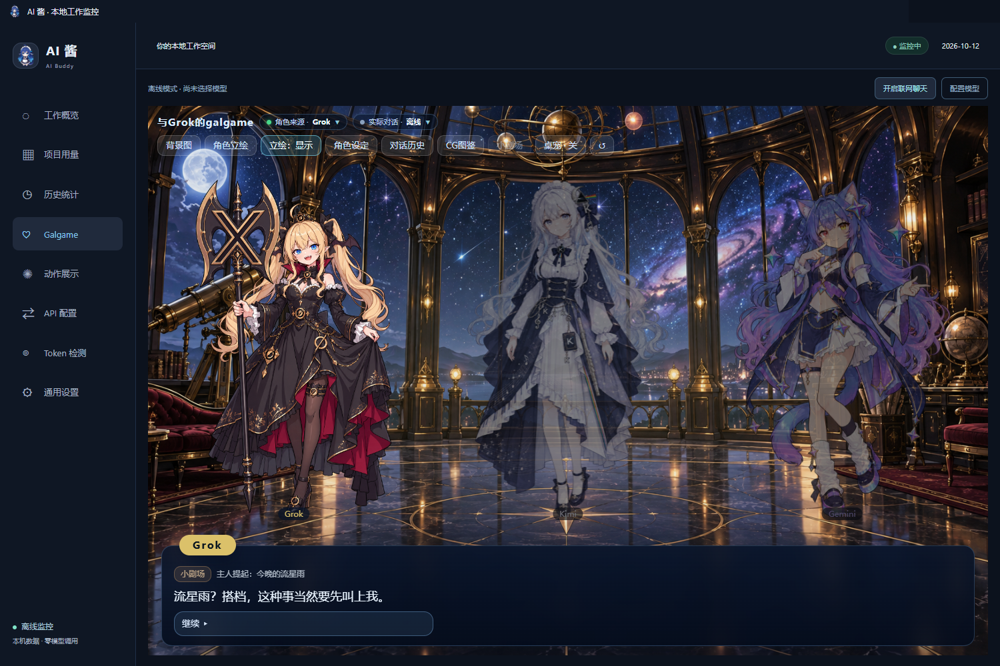

# AI 酱 · AI Buddy · 本地 AI 用量监控与多角色 Galgame 陪伴

**简体中文** · [English](README.en.md)

**当前版本：[v1.7.3](https://github.com/lXiaoSel1/ai-buddy/releases/tag/v1.7.3)** · 修复便携启动及 Codex 桌面端检测，详见 [1.7.3 验收记录](docs/VALIDATION-1.7.3.md)

## 简介

AI 在跑任务、你在等结果的间隙，看看今天烧了多少 Token，再和模型娘聊两句吧～(∠・ω< )⌒★

AI 酱（AI Buddy）是一个 Windows 桌面应用。它只读本机 AI 工具的日志，整理 Token 用量、估算费用、按项目汇总；同时把 [JAdpp/dsh-whale-galgame](https://github.com/JAdpp/dsh-whale-galgame) 的多角色 Galgame 搬到桌面上，配了桌宠，聊天和 CG 绘图也能分别接入：

- **8 种 AI 工具的本地账本**：Codex、Claude Code、Gemini CLI、Kimi Code CLI、OpenCode、Cline、Roo Code 和 DeepSeek Harness。只读日志里实际记录的用量，缺的字段显示“未提供”，不按文字长度去猜。
- **11 位模型娘**：DeepSeek、Grok、Seed、Kimi、Qwen、MiniMax、GPT、Gemini、Claude、GLM 和混元，各有立绘、背景、性格和语气，好感度与 CG 图鉴分开记录。
- **外观与内核解耦**：出场的角色和实际回复的聊天 API 分开选。想用 Qwen 的形象、接 Claude 的 API 聊天也可以。
- **工作越多，羁绊越深**：开着 AI 酱工作，新增的 Token 会慢慢变成当前角色的好感；升级时还能生成一张纪念 CG。
- **60fps 透明桌宠**：常驻桌面一角。任务完成时跳一跳，出错时也会有反应。
- **11 套角色主题，中英双语**：配色取自各角色立绘，可以固定一套，也可以跟着当前角色换。

## 功能

- **工作概览**分为用量、费用、额度三页，显示总数、各工具卡片和最近五项工作。
- **项目用量**可按总 Token、输入、输出或项目名排序；**历史统计**查看日、周、月趋势，可以选日期范围和时区，并导出 CSV / JSON。
- 工具、模型厂商、服务平台分开记录。Codex 是工具，OpenAI 是厂商或服务平台；光看模型名，无法证明用的是官方 API。
- **费用估算**用输入、输出、缓存读取、缓存写入四类 Token 分别乘以单价，不按请求次数算。订阅工具里的金额是 API 等价参考，不是套餐账单。缺少用量或价格时保持“未知”，不当作零。价格目录来自 models.dev，可以在“费用 → 价格设置”里筛选、改价或手动更新。
- **在线额度**为可选功能，支持 Codex、Claude、GLM/Z.ai、Kimi Coding、MiniMax Coding、DeepSeek API 余额，以及受支持账号的 Gemini CLI。每个服务单独启用后才会查询。
- 每位角色的等级、聊天记录、背景、CG 图鉴、回收站和立绘显示状态互不影响。切换角色时会换回她自己的背景。
- 每轮对话提供三个回复选项，也可以直接输入。
- 用 CG 做背景时，默认隐藏立绘，免得画面里同时出现两个她。CG 图鉴里右键可以移入回收站，删了也能撤销或恢复。
- 历史索引会一直保留，重启后只核对新增的记录。第一次建索引、日志被替换或修复索引时会慢一些。

<table>
  <tr>
    <td align="center"> <strong>工作概览</strong></td>
    <td align="center"> <strong>项目用量</strong></td>
  </tr>
  <tr>
    <td align="center"> <strong>历史统计</strong></td>
    <td align="center"> <strong>Token 检测</strong></td>
  </tr>
  <tr>
    <td align="center"> <strong>价格设置</strong>（英文界面）</td>
    <td align="center"> <strong>在线额度</strong>（英文界面）</td>
  </tr>
</table>

## 好感度与本机工作

### 关系进度

每位角色都从 Lv.1、0 点好感开始，彼此独立。亲近、普通、疏离三个回复选项分别是 +1、0、-1，每轮的排列顺序随机。直接输入时按简单的关键词结算，例如“喜欢”“晚安”加分，“讨厌”“走开”扣分。好感最低为 0。

升级阈值为 `30 + 15 × (Lv - 1)`，即 30、45、60……，超出部分带到下一级，等级没有上限。超过 24 小时没有互动后，所有角色每天减 2 点，最低到 0。角色的语气随等级分为五档，Lv.5 起保持最亲近的一档。开启自动生成 CG 并配好绘图连接后，每次升级会生成一张纪念 CG。

### 本机工作如何影响角色

AI 酱运行期间，新监控到的工作 Token（AI 酱自己发起的聊天和绘图不算）会记进同一份余额。每满 5,000 个，当前角色加 1 点好感，一次最多加 3 点，剩下的留到下次。打开 Galgame 时、每次发送消息前各结算一次。启动之前的历史用量不会补算。

日志里明确记录任务完成时，桌宠会跳两轮并弹出完成气泡；记录失败时，会播放一轮失败动作并提示你查看。反馈排队播放，失败优先于完成，完成优先于对话；同一事件只提醒一次，1 秒内的同类事件会合并。在 Galgame 里和 DeepSeek 聊天时，桌宠也会跟着做出对应的情绪动作，并用气泡显示一句简短回复。

与上游插件不同，AI 酱不会把工具日志的正文交给 Galgame。角色不会主动提起你具体在做什么任务，小剧场也不会自动取材。

## 内置默认美术

发行包内置 11 位角色的默认立绘和默认背景、DeepSeek 的 8 张表情差分，以及桌宠用的 15 段透明动作视频和 201 张静帧。DeepSeek 另有一张海边书房背景可选，5 张旧版背景也保留为可选项。下面是缩小后的预览，原尺寸图片在发行 ZIP 里。

<table>
  <tr>
    <td align="center"> <strong>DeepSeek</strong></td>
    <td align="center"> <strong>Grok</strong></td>
    <td align="center"> <strong>Seed</strong></td>
    <td align="center"> <strong>Kimi</strong></td>
  </tr>
  <tr>
    <td align="center"> <strong>Qwen</strong></td>
    <td align="center"> <strong>MiniMax</strong></td>
    <td align="center"> <strong>GPT</strong></td>
    <td align="center"> <strong>Gemini</strong></td>
  </tr>
  <tr>
    <td align="center"> <strong>Claude</strong></td>
    <td align="center"> <strong>GLM</strong></td>
    <td align="center"> <strong>混元</strong></td>
    <td></td>
  </tr>
</table>

每位角色默认使用自己的场景：

<table>
  <tr>
    <td align="center"> <strong>DeepSeek · 深海宫殿</strong></td>
    <td align="center"> <strong>Grok · 夜色宇宙观测室</strong></td>
    <td align="center"> <strong>Seed · 日光温室书房</strong></td>
  </tr>
  <tr>
    <td align="center"> <strong>Kimi · 月下阅读室</strong></td>
    <td align="center"> <strong>Qwen · 现代中式书院</strong></td>
    <td align="center"> <strong>MiniMax · 明亮创意工作室</strong></td>
  </tr>
  <tr>
    <td align="center"> <strong>GPT · 现代协作书房</strong></td>
    <td align="center"> <strong>Gemini · 双窗星图工作室</strong></td>
    <td align="center"> <strong>Claude · 琥珀色写作书房</strong></td>
  </tr>
  <tr>
    <td align="center"> <strong>GLM · 简洁知识研究室</strong></td>
    <td align="center"> <strong>混元 · 山水庭院与亭廊</strong></td>
    <td></td>
  </tr>
</table>

桌宠和“动作展示”页共用 15 段约 60fps 的透明 VP9 WebM，按画质优先编码（CRF 18），对应 18 个逻辑动作；视线跟随和情绪静止画面用少量无损 WebP。视频合计约 38.8 MiB，加上静帧约 87.2 MiB。

11 套主题的配色取自对应立绘。DeepSeek 保留原来的深蓝设计，其余 10 套使用柔和的中深色：

<table>
  <tr>
    <td align="center"> DeepSeek</td>
    <td align="center"> Grok</td>
    <td align="center"> Seed</td>
    <td align="center"> Kimi</td>
  </tr>
  <tr>
    <td align="center"> Qwen</td>
    <td align="center"> MiniMax</td>
    <td align="center"> GPT</td>
    <td align="center"> Gemini</td>
  </tr>
  <tr>
    <td align="center"> Claude</td>
    <td align="center"> GLM</td>
    <td align="center"> 混元</td>
    <td></td>
  </tr>
</table>

素材来源与许可各不相同：

- DeepSeek 的立绘、表情差分以及深海宫殿、海边书房背景来自上游 dsh-whale-galgame，属于上游 21 张 CC BY-NC-SA 4.0 默认图片。
- 其余十套立绘和背景由图像工具以图库中的角色设计为参考生成，不是图库原图。角色设计作者已经署名，但这十套参考的通用再分发授权还没有逐一核实。
- DeepSeek 的动作视频由 MiniMax H3 生成，再用 RIFE 补帧，不声明为 MIT。

逐文件说明见 [THIRD_PARTY_NOTICES.md](THIRD_PARTY_NOTICES.md)。Galgame 的布局、对话框和控件改编自上游，代码在 [`src/adapted/galgame-client.ts`](src/adapted/galgame-client.ts)，不依赖未公开的 UI 图片包。

## 安装

需要 Windows 10/11 x64。AI 酱是免安装的便携版，自带 Electron 运行时，不需要另装 Node.js、Python 或绘图工具。

1. 从 [Releases](https://github.com/lXiaoSel1/ai-buddy/releases) 下载 `AI-Buddy-1.7.3-Windows-x64.zip`。精确大小和 SHA-256 以 Release 附件为准，同页附有 `SHA256SUMS-1.7.3.txt`。
2. 把 ZIP 完整解压到一个可写目录，会得到一个 `AI-Buddy` 文件夹。
3. 进入 **AI-Buddy** 文件夹，双击根目录的 **AI Buddy.exe** 启动。**AI Buddy.vbs / AI Buddy.cmd** 是兼容入口，也会启动同一个程序。旧的 1.7.2 包仅在 `runtime` 版本目录中包含 EXE；启动修正版补上根目录入口，并取消对 PowerShell `Get-FileHash` 命令的依赖。

几点注意：

- 不要在 ZIP 里直接运行，也不要只复制 EXE，目录结构要保留。
- 程序没有商业代码签名，Windows 可能提示“未知发布者”，可以先用 SHA-256 核对文件。
- 首次启动会自动查找当前用户的常见日志目录。没装任何 AI 工具也能用，陪伴功能可以离线运行。
- 当前仓库为私有审阅，下载需要仓库访问权限；是否公开由维护者决定。

解压后的目录：

~~~text
AI-Buddy/
├─ AI Buddy.exe / AI Buddy.vbs / AI Buddy.cmd / Start-AI-Buddy.ps1   启动入口
├─ builds/<版本>/                                     应用代码与内置资源
├─ runtime/AI-Buddy-<版本>/AI Buddy.exe                Electron 运行时
├─ local/current-build.json                            当前版本指针
├─ local/data-v003/                                    首次运行后生成的个人存档
├─ assets/  docs/  licenses/  数据源示例/
└─ README.md  LICENSE.md  THIRD_PARTY_NOTICES.md
~~~

### 更新与卸载

更新：先在托盘菜单选 **退出**，再把新版 ZIP 解压到同一位置，让新的 `AI-Buddy` 文件夹覆盖旧的，然后照常启动。个人存档在 `local/data-v003`，发行包里不带这个目录，覆盖解压不会动它；不要用空目录替换它。稳妥起见，更新前可以先备份一份 `local/data-v003`。

卸载：退出后删除整个 `AI-Buddy` 文件夹即可。设置、存档和界面缓存都在这个文件夹的 `local/` 里，AI 酱不会添加开机启动项。如果还想留着聊天记录和 CG，删除前先备份 `local/data-v003`。

### 从源码运行

只有想自己构建时才需要这条路径。需要 Windows x64、Node.js 24 和 npm：

~~~sh
npm ci
node scripts/build-public.mjs --resources="C:/path/to/AI-Buddy/builds/<版本>"
npm start
~~~

`--resources` 指向同版本便携包里含 `assets/frame-sequence-manifest.json` 的 `builds/<版本>` 目录。构建会直接复用发行包里的立绘和动画，不需要重新生成图片或视频。详见 [构建说明](docs/BUILD.md)。

## 使用与设置

单击桌宠会挥一下手，并打开工作概览。双击托盘图标也能打开主窗口；托盘菜单里还可以直接进入 Galgame、通用设置和动作展示，或者显示、隐藏桌宠。

### Token 检测

首次启动会自动查找下面这些位置（都在当前 Windows 用户目录下）：

| 工具 | 默认位置 |
|---|---|
| Codex | `.codex\sessions`、`archived_sessions`，可用 `CODEX_HOME` 改位置 |
| Claude Code | `.claude\projects`，可用 `CLAUDE_CONFIG_DIR` 改位置 |
| Gemini CLI | `.gemini\tmp` |
| Kimi Code CLI | `.kimi-code\sessions`，以及旧版 `.kimi\sessions` |
| OpenCode | `.local\share\opencode`，也支持 `XDG_DATA_HOME` 或 `OPENCODE_DB` |
| Cline / Roo Code | VS Code、VS Code Insiders、VSCodium、Cursor 的扩展存储；Cline 另有 `.cline\data\sessions` |
| DeepSeek Harness | `.dsh\sessions`，可用 `DSH_HOME` 改位置 |

便携编辑器、WSL 或其他用户目录需要手动添加：在 **Token 检测** 点 **添加数据源**，选择工具模板和实际目录，先做 **本地解析预览**，再点 **保存并启用**。自定义来源支持 JSONL、Zstd 压缩的 JSONL、JSON、CSV 和 SQLite，可以做字段映射，模板能导入导出。移除数据源不会删除原日志，也不会删掉已经记录的用量。

### 通用设置默认值

| 选项 | 默认 |
|---|---|
| 语言 | 首次启动跟随系统语言，可选简体中文 / English |
| 主题模式 | 固定使用 DeepSeek 主题，可改为跟随当前角色 |
| 显示桌宠 | 开 |
| 桌宠大小 | 100%，可选 75%–150% |
| 动作播放速度 | 75%，可选 25%–100% |
| 保持置顶、透明区域点击穿透、跟随鼠标方向、显示状态条、任务提示气泡 | 开 |
| 备用检查间隔 | 1 秒（文件有变化时会立即读取） |
| 活动时间显示 | 纽约时间，可改为系统本地时间或 UTC |
| 统计时区 | 系统本地时间 |
| 每日更新价格目录 | 关 |

另外两项不在这张表里：**联网聊天**每次重启后都是关闭的，需要手动开启；**自动生成 CG** 首次安装时关闭。“恢复默认设置”只重置上表中的选项，桌宠位置、用量和 Galgame 存档都会保留。

### 角色来源与实际对话

Galgame 顶栏的 **角色来源** 决定谁出场，**实际对话** 决定由哪个聊天连接回复，两者互不影响。**背景图** 和 **角色立绘** 可以换成内置选项，也可以上传自己的图片（PNG、JPEG、WebP、AVIF，单张不超过 12 MB）。

从 1.7.2 开始，单人场景改用近景构图：脸和上半身更突出，下半身自然进入对话框后方。多人场景和立绘选择器里仍然显示全身。立绘按钮可以在显示、隐藏和自动之间切换；自动模式下，用 CG 当背景时会隐藏立绘。

### 自定义角色设定

点 **角色设定** 可以编辑当前角色的六项设定：

- 角色昵称（最多 32 字）
- 对用户的称呼（最多 24 字）
- 首次问候（最多 160 字）
- 性格（最多 1200 字）
- 语气（最多 600 字）
- CG 外观描述（最多 800 字）

每位角色的设定分开保存。**保存设定** 和 **恢复默认** 只改当前角色的这六项，不会重置好感度、等级、聊天记录或自定义立绘。如果还没开始真正的对话，修改首次问候会直接替换开场白；已经聊过之后，不会改写历史记录。CG 外观描述只影响之后生成的 CG，图鉴里已有的图片不变。

### 小剧场

小剧场让 2–3 位角色同台演一段短剧，当前角色一定在场。开演步骤：

1. 在 **API 配置 → 聊天 API** 保存并使用一个聊天连接。
2. 回到 **Galgame**，点 **开启联网聊天**。软件重启后需要再开一次。
3. 点顶栏的 **小剧场**，填一个话题（最多 60 字，比如“一起讨论今天的工作”），再点 **开演**。AI 酱不会把工具日志正文交给 Galgame，话题留空时通常没有可用的素材，建议直接填写。
4. 用 **继续** 推进剧情，出现选项时选择或输入回复。看过的剧场在 **对话历史 → 小剧场** 里。

每场最多 10 句台词。选项会分别给本场登场的角色加减 1 点好感；在小剧场里升级不会生成 CG，免得一次触发好几张。两场之间默认冷却 30 分钟，界面会显示等待状态，目前不能调整冷却时间。小剧场使用当前聊天连接，会调用模型；结束后的合影 CG 走单独的绘图连接，没有配置也不影响开演。

### 内置桌宠

桌宠默认显示在桌面上。按住角色或状态条可以拖动，透明区域可以点击穿透。通用设置里可以调整大小、动作速度、是否置顶、是否跟随鼠标方向，以及是否显示状态条（显示运行中的会话数）。拖动期间收到的任务反馈会排队，松手后再播放。隐藏桌宠后，可以从托盘菜单重新显示。

### 主题与语言

通用设置提供 11 套以角色命名的主题，可以固定一套，也可以跟随当前角色。界面、窗口标题栏和桌宠气泡会一起变色，人物图片本身不染色。

语言可选简体中文或 English。切换后，界面、内置默认设定和之后的新对话都用新语言；已有的聊天、历史 CG 和你自己填写的文字保持原样。

## 聊天与 CG 接入

聊天和 CG 绘图是两套独立的连接，都在 **API 配置** 里管理。**保存并使用** 会立刻启用，**仅保存** 不切换当前连接；通用设置只负责选择当前连接和开关。

| 类型 | 协议 / 通道 | 默认值 |
|---|---|---|
| 聊天 | 本机 Codex 登录、OpenAI Chat Completions / Responses、Gemini 原生、Anthropic Messages | Codex 通道需要本机已登录的 Codex |
| CG | Codex 内置图像 | 沿用本机 Codex 模型，优先横向 16:9 构图 |
| CG | OpenAI Images 兼容 | gpt-image-1 系列默认 1536×1024 |
| CG | Gemini Interactions | 16:9，默认 1K |
| CG | 通义万相 | 生成与编辑默认 `wan2.6-image`、1280×720；异步文生图默认 1696×960 |

可以选预设，也可以填写自定义的兼容服务地址和模型 ID；兼容程度、模型权限和参考图限制由服务端决定。外部密钥用 Electron safeStorage 加密后保存在本机。不要把真实密钥写进仓库文件，也不要提交到 Git。

开启 **自动生成 CG** 后，可以选择生成升级纪念图和小剧场合影，这项默认关闭。联网聊天开启时，每张新的升级 CG 会多调用一次聊天模型来设计主题，失败就改用本地的角色主题组合；重试时复用已有的主题。模型调用和绘图都可能产生服务费用。

当前 CG 构图规则：男性第一人称，男性角色本人不入镜；允许合理的手部互动、文字及服装 Logo，不限制为一只男性手。

### 在线额度

额度连接和聊天、绘图连接互相独立。各服务能返回的字段不同，不支持的账号会提示原因。只有单独启用后才会查询：窗口显示时约每 2 分钟一次，隐藏时约每 15 分钟一次。AI 酱不会靠发送模型对话来探测额度，也不读取浏览器 Cookie。认证失败时会提示重新登录；临时失败时保留上次成功的数值和更新时间。

## 数据与隐私

运行数据都在安装目录的 `local/data-v003` 下，请把它当作私人数据：

- `settings.json`：偏好设置和桌宠位置。
- `model-connections.json`、`cg-connections.json`、`quota-connections-v1.json`：已保存的连接，密钥经 safeStorage 加密。
- `token-sources.json`、`token-index-v1.json`、`token-events-v1.jsonl` 等：数据源配置和用量索引，里面有本机项目路径。
- `galgame/storages/dsh-whale-galgame/global.json`：Galgame 存档，包括各角色的好感、设定、聊天记录、自定义立绘、CG 图鉴和背景。
- `cg-assets/`：生成的 CG 及缩略图。
- `chromium/`、`crash-reports/`：界面缓存和崩溃报告。

会发到外部的内容：

- 监控本身只读日志，不调用模型，也不修改其他工具的文件。
- 聊天内容发给你选的聊天连接。联网聊天默认关闭，每次重启后都要手动开启。
- CG 提示发给你选的绘图连接。自动生成默认关闭；联网聊天开启时，升级 CG 的主题设计会多调用一次聊天模型。
- 在线额度只查询你启用的服务。
- 价格目录只在手动更新或开启每日更新时从 models.dev 下载公开价格，不发送日志。
- 界面渲染进程发出的外部请求一律会被拦截。

发行 ZIP 不含开发者的存档、密钥、聊天、个人 CG、日志或浏览器配置。README 截图来自独立测试存档，空数据界面和开发验收 CG 不代表真实账号的用量。分享日志、导出数据或截图前，请自己检查项目路径和账号信息。如果把 AI 酱放在某个 Git 仓库里，记得把 `local/` 加进那个仓库的 `.gitignore`。

## 开发

~~~sh
npm ci
npm test
npm run check:version
node scripts/build-public.mjs --resources="C:/path/to/AI-Buddy/builds/<版本>"
npm start
~~~

开发需要 Windows x64 和 Node.js 24，依赖 Electron 44.6.0、React 19.3.0 和 esbuild 0.28.2。`npm test` 只覆盖纯逻辑，使用临时数据和模拟服务，不需要付费请求，也不代表原生集成或视觉验收。`npm run check:version` 检查 `package.json`、`package-lock.json`、两份 README 里的下载文件名和当前版本链接，以及构建说明的版本是否一致，源码构建会先跑这项检查。构建产物在 `builds/development`。

不要提交 `local/`、生成的 `builds/`、密钥、个人 CG 或日志。发布前的版本同步步骤见 [构建说明](docs/BUILD.md)。验收记录：[1.7.2](docs/VALIDATION-1.7.2.md)（近景立绘与发布检查）、[1.7.1](docs/VALIDATION-1.7.1.md)（WebM 动画与主题）、[1.7.0](docs/VALIDATION-1.7.0.md)。

## 许可与致谢

代码、Galgame UI 实现与文档采用 [MIT License](LICENSE.md)。**图片不统一适用 MIT**：继承自上游的 21 张默认图片采用 [CC BY-NC-SA 4.0](https://creativecommons.org/licenses/by-nc-sa/4.0/)，上游桌宠图集沿用 MIT；十套新增立绘与背景、DeepSeek 动作视频的条件见上文“内置默认美术”。作者链、逐文件边界和许可原文见 [THIRD_PARTY_NOTICES.md](THIRD_PARTY_NOTICES.md) 与 [`licenses/`](licenses/)。公开发布或商用前，请按来源分别确认。

感谢以下创作者和项目：

- **JAdpp** 的 [dsh-whale-galgame](https://github.com/JAdpp/dsh-whale-galgame) 是本项目 Galgame 引擎、界面和存档的来源。特别感谢原作者分享多角色陪伴、任务事件和存档的实现。
- **上善** 创作了鲸鱼娘的原始角色形象：[Pixiv](https://www.pixiv.net/users/62155430) · [Bilibili](https://space.bilibili.com/4456176)。
- **ZipZipPipe** 完成了带 DeepSeek 元素的女仆鲸鱼娘二创，也提供了十套新增角色所参考的 [AI 拟人图库](https://genderswapai.com/zh-CN/ai-gijinka/gallery) 形象：[Pixiv](https://www.pixiv.net/users/18604994) · [Bilibili](https://space.bilibili.com/4168597)。
- **Small-tailqwq** 在 [dsh-deep-whale](https://github.com/Small-tailqwq/dsh-deep-whale) 中提供了深海宫殿等背景与素材。
- **f0909172434** 以 MIT 许可开源了 [dsh-deepseek-girl-pet](https://github.com/f0909172434/dsh-deepseek-girl-pet)，是原始桌宠素材的来源。
- [ccusage](https://github.com/ccusage/ccusage)（MIT）提供了日志解析边界与统计对照，不是运行时依赖；[CodexBar](https://github.com/steipete/CodexBar)（MIT）提供了额度协议、刷新和提供方区分的参考。
- [models.dev](https://models.dev) 提供价格目录；[Electron](https://www.electronjs.org/)、[React](https://react.dev/) 和 [esbuild](https://esbuild.github.io/) 是运行与构建的基础；[rcedit](https://github.com/electron/rcedit) 用于 Windows 程序资源。
- [RIFE](https://github.com/hzwer/ECCV2022-RIFE) 用于动作补帧，MiniMax H3 用于已授权的动作生成。运行应用不需要这些生成工具。

如果这些素材和实现对你有帮助，欢迎给 [dsh-whale-galgame](https://github.com/JAdpp/dsh-whale-galgame)、[dsh-deep-whale](https://github.com/Small-tailqwq/dsh-deep-whale) 和 [dsh-deepseek-girl-pet](https://github.com/f0909172434/dsh-deepseek-girl-pet) 点个 Star，也可以在 Pixiv 或 Bilibili 关注上善与 ZipZipPipe。AI 酱的安装、运行或兼容性问题，请提交到[本仓库 Issues](https://github.com/lXiaoSel1/ai-buddy/issues)，不要去打扰上游作者和素材作者。

DeepSeek、Grok、Seed、Kimi、Qwen、MiniMax、GPT、Gemini、Claude、GLM、混元等名称和商标归各自权利人所有。AI 酱是非官方社区项目，与相关厂商和角色画师没有隶属、合作或背书关系；服务和模型名称只用来说明兼容性和形象选择。

## 相关项目友情链接

- [dsh-whale-galgame](https://github.com/JAdpp/dsh-whale-galgame) - 本项目的上游：DeepSeek Harness Web 的多角色 Galgame 插件
- [dsh-deep-whale](https://github.com/Small-tailqwq/dsh-deep-whale) - 深海宫殿背景与鲸鱼娘素材的来源
- [dsh-deepseek-girl-pet](https://github.com/f0909172434/dsh-deepseek-girl-pet) - DSH 鲸鱼娘桌宠
- [gal-view](https://github.com/Ayase34/gal-view) - DSH Web GUI 会话页的 Galgame 风格对话视图 + 场景元素可视化编辑器
- [dsh-galgame](https://github.com/Lanxing6480/dsh-galgame) - Galgame 模式界面插件
- [AutoWebUI](https://github.com/FynnReinhardt/deepseek-harness-galgame) - DSH galgame模式

## 1.7.3 启动与本机 Codex 修复

解压后进入 AI-Buddy，直接双击根目录的 **AI Buddy.exe**。旧的 1.7.2 脚本可能因 `Get-FileHash` 不可用而退出；新入口直接校验并启动，不依赖 PowerShell。保留完整目录，不要只拷贝 EXE。

“Codex 内置图像”指使用本机 Codex 的绘图能力，并不代表 AI Buddy 自带 Codex 或登录账号。请先在这台电脑安装、打开并登录 Codex 桌面端，再到 **API 配置 → CG 绘图 → Codex → 测试连接**。测试连接不生成图片。已支持桌面端运行缓存、Microsoft Store 安装、常见独立安装和 npm 原生程序，无需为了路径检测单独安装 npm CLI。

自定义安装可将环境变量 `AI_BUDDY_CODEX_PATH` 设为实际原生 `codex.exe` 的完整路径，重启 AI Buddy 后重试。自定义 Codex 配置目录遵循 `CODEX_HOME`；缺少可选 `config.toml` 不再导致启动失败。程序存在、登录可用、图像能力可用是三个独立检查，未提供图像能力时请更新 Codex 或选用外部绘图 API。

本轮验证包括模拟桌面端独立安装、真实本机桌面端/Store 程序登录及图像能力读取；未在用户笔记本远程验证，未重新生成 CG。接入协议参考 [OpenAI Codex app-server 文档](https://learn.chatgpt.com/docs/app-server)。
