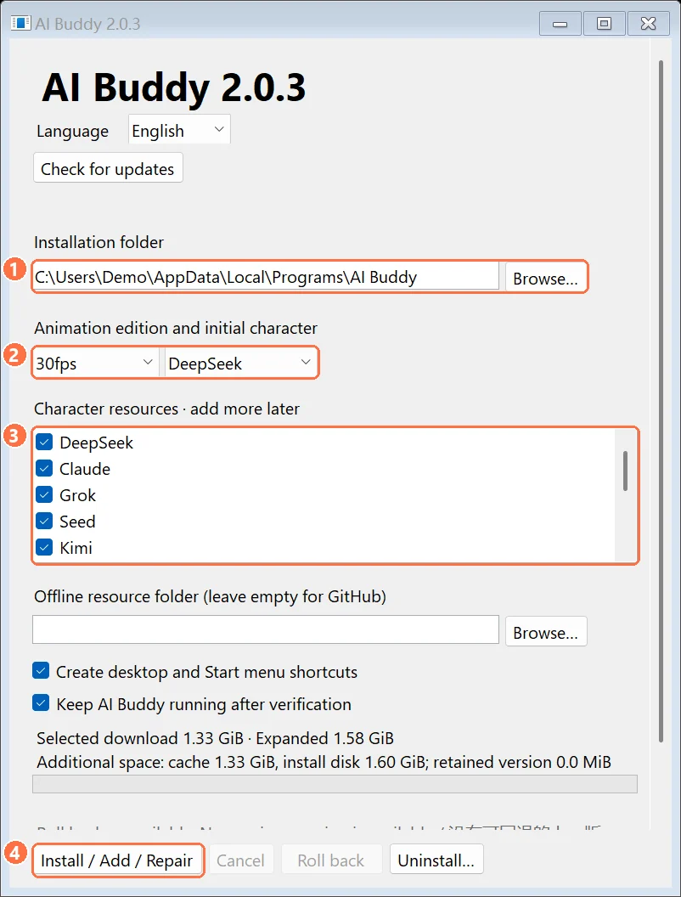
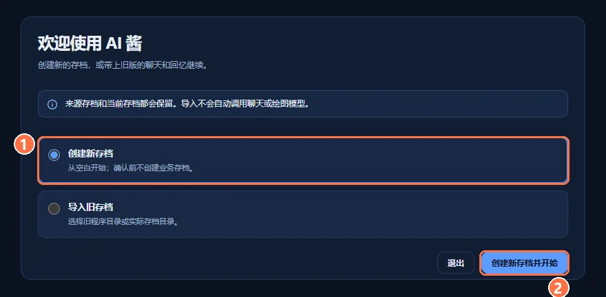
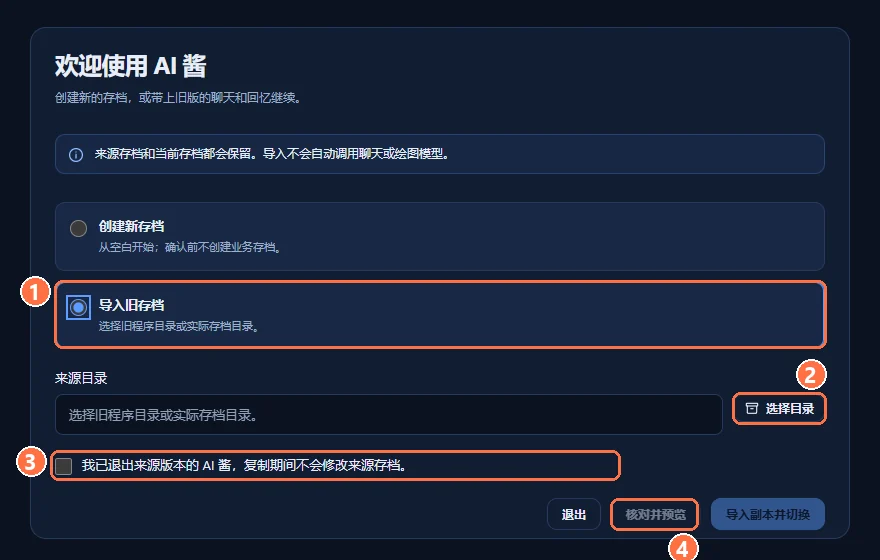
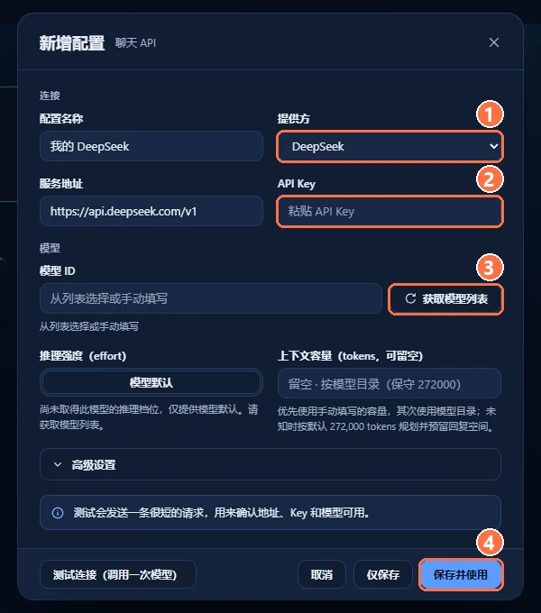
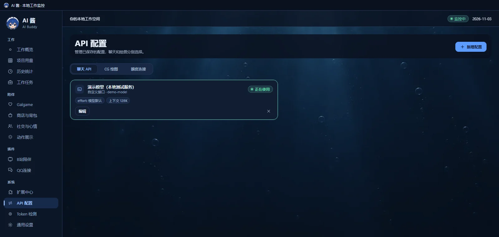
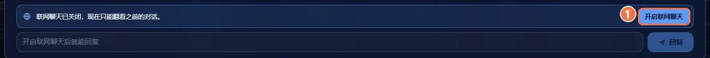
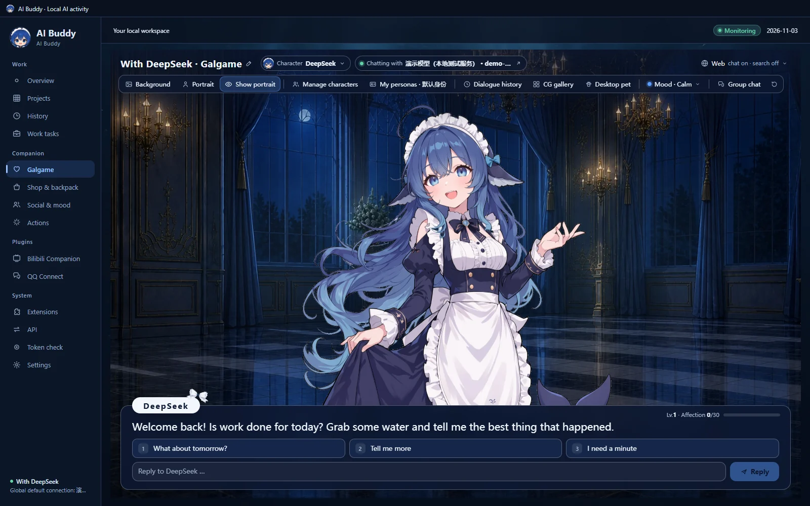
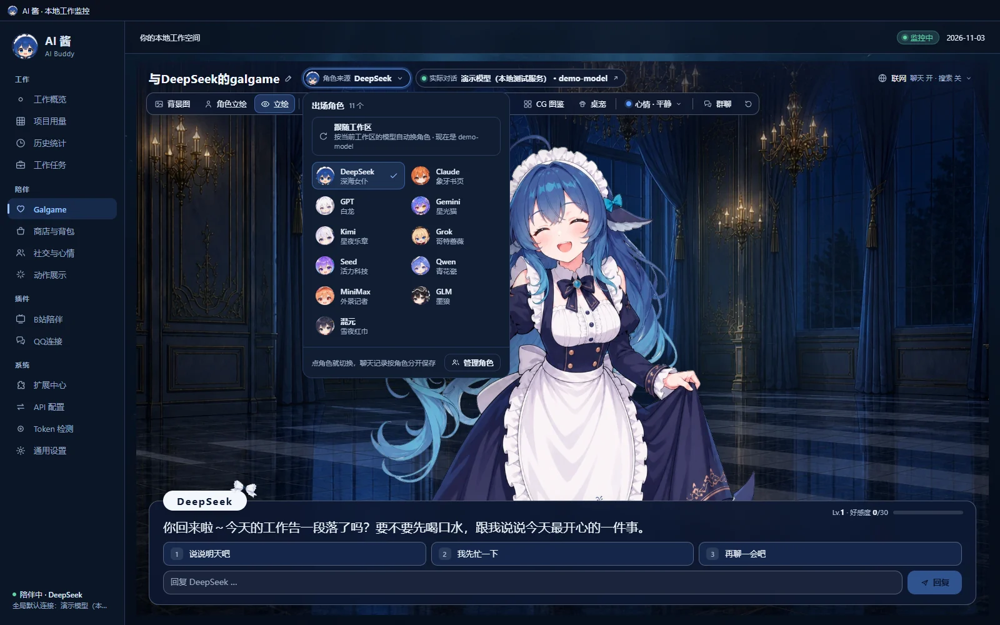
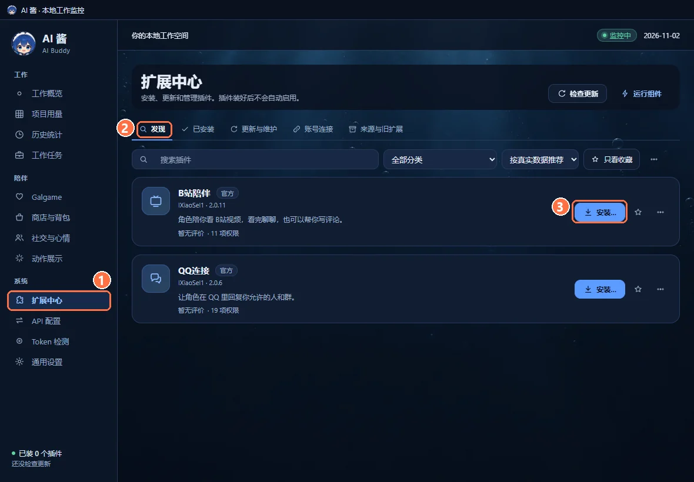

# AI Buddy quick start

[简体中文](QUICKSTART.md) · **English** · [Back to the README](../README.en.md)

This guide follows a first-time setup, from downloading the installer to adding a plugin. The orange numbers in the pictures match ①②③ in the text. The pictures come from an independent AI Buddy 2.0.3 demo profile: usage, project names and chat replies are demo data, and no real account was signed in. The installer picture is in English; the app pictures show the Chinese interface, and the buttons sit in the same places in English (switch the language under **Settings** in the sidebar).

You need a Windows 10/11 x64 PC. To chat, you also need an API key for a model service, or Codex signed in on this computer. AI Buddy itself is free; model providers may charge you.

## 1. Download and run the installer

1. Open the [v2.0.3 release page](https://github.com/lXiaoSel1/ai-buddy/releases/tag/v2.0.3) and download `AI-Buddy-Setup-2.0.3-win-x64.exe` (about 50 MiB). If Windows reports an unknown publisher, you can check the file against `SHA256SUMS-2.0.3.txt` on the same page before choosing to run it anyway.
2. In the installer:
   - ① **Installation folder**: `%LOCALAPPDATA%\Programs\AI Buddy` by default; click **Browse…** to change it. When upgrading, choose the existing folder.
   - ② **Animation edition and initial character**: 30fps and 60fps have exactly the same features; 60fps is smoother and a bigger download. The initial character keeps you company on the first launch.
   - ③ **Character resources**: all 11 are ticked by default. Install fewer if you like and add the rest later. The selected download size and the disk space needed are shown below (every character: about 1.33 GiB at 30fps, 1.75 GiB at 60fps).
   - ④ Click **Install / Add / Repair**.

The installer downloads the resources from GitHub, checks each SHA-256 and then installs them. If a download is interrupted, run the installer again with the same folder and it resumes. After installing, it starts AI Buddy once to check it, and leaves it running by default.

Offline PC: put `install-manifest-2.0.3.json` and the resource ZIPs for your characters and edition from the release page into one folder, then choose it as the installer's "Offline resource folder". If files are missing, the installer lists them.

## 2. First launch: create or import a save

The first launch shows "Welcome to AI Buddy". This sets up your save; it is not a second installation.

**New users**: choose ① **Create a new save** and click ② **Create a new save and start**. Nothing is created until you confirm.

**Used an earlier version and installed to a new folder**: you can bring your old chats, characters and memories.

1. Quit the old AI Buddy normally from its tray menu (**Quit**).
2. ① Choose **Import an old save**.
3. ② Click **Choose folder** and pick the old program folder (the one with `AI Buddy.exe`) or the data folder itself.
4. ③ Tick "I have quit the source AI Buddy and will not modify its save during copying."
5. ④ Click **Check and preview**, review what will be imported, then click **Import a copy and switch**.

The import copies the data and checks every file; the old save stays as it was. It refuses while the old version is still running, and it does not call any chat or image model.

Upgrading in place with the installer keeps your save where it is, so you normally will not see this page.

## 3. Set up a chat model

1. In the sidebar open **API**, stay on the **Chat API** tab and click **Add connection** at the top right.
2. Fill in:
   - **Connection name**: anything, such as "My DeepSeek".
   - ① **Provider**: Local Codex sign-in, Gemini, Kimi / K3, Grok, OpenAI, Claude, DeepSeek, Qwen, MiniMax, or **Custom API** for any compatible service. The service URL fills in when you pick one.
   - ② **API Key**: paste the key from your provider. "Local Codex sign-in" needs no key, but Codex must already be signed in on this computer.
   - ③ Click **Load model list** and pick a model, or type the model ID.
3. To try it first, click **Test connection (one model call)** at the bottom left; it sends one very short request (Local Codex sign-in has no such button).
4. ④ Click **Save and use**. **Save only** stores it without switching.

After saving, the connection is marked **Active** in the list. Keys are encrypted by the system and stored on this computer. CG drawing and quota connections live on the other two tabs and are optional for chat.

## 4. Turn on online chat and start talking

1. Click **Galgame** in the sidebar.
2. So that no model is called without you knowing, **online chat is off after every start**. Click ① **Enable online chat** in the dialogue box, or use **Web** at the right end of the toolbar.

3. Type in the input box and press Enter. After she replies you get three reply choices; with an empty input box, press 1, 2 or 3 to pick one.

4. To switch characters, click **Character** in the toolbar and choose one of the 11. Each keeps her own affection, chat history and CG gallery.

The toolbar also has Background, Portrait, Manage characters, My personas, Dialogue history, CG gallery, Desktop pet, Mood and Group chat. For group chat and Auto, see [Group chat in the README](../README.en.md#group-chat).

## 5. (Optional) Install Bilibili Companion or QQ Connect

1. In the sidebar open ① **Extensions** and find the plugin on the ② **Discover** tab.
2. Click ③ **Install…**. The install page lists every permission the plugin asks for and grants only the ones you tick. Installed plugins are not enabled automatically: click **Enable and connect** or **Enable and sign in** on the install page, or turn on the switch on the **Installed** tab.
3. AI Buddy prepares what a plugin needs: Bilibili Companion's video component (FFmpeg) is downloaded during installation, and QQ Connect's connection component is prepared the first time you connect by QR code. You do not install Node or enter ports or tokens.

To connect your account, choose a character and set the scope afterwards, see:

- [Bilibili Companion guide](https://github.com/lXiaoSel1/AI-Buddy-Bilibili#english)
- [QQ Connect guide](https://github.com/lXiaoSel1/AI-Buddy-QQ#english)

## FAQ

**She stopped replying after a restart.**
Online chat turns off at every start. Click **Enable online chat** in the Galgame.

**The welcome page appears every time.**
It only appears when the current data folder has no save yet. If you have been using AI Buddy and keep seeing it in the same installation folder, do not delete any files; report it in [Issues](https://github.com/lXiaoSel1/ai-buddy/issues) with the installation folder and whether you changed the data folder.

**My points do not go up.**
Points only come from new local AI-tool usage while AI Buddy runs: 1 point per 10,000 actual tokens. Usage from before AI Buddy started does not count. Check under **Token check** that your tool logs were found.

**Auto will not start in group chat.**
Turn on **Group Auto** under **Social & mood** first, and make sure online chat is on.

**The model reports an error or never replies.**
Edit the connection under **API** and click **Test connection (one model call)** to see the actual error. Common causes are a wrong key, no balance or a wrong model ID.

**Adding characters, switching frame rate or repairing files.**
In **Settings**, click **Manage character resources** on the character resources row, or run the same-version installer again.

**Uninstalling.**
Run the installer and click **Uninstall…**. Personal data is kept by default; deleting it with the checkbox cannot be undone.
