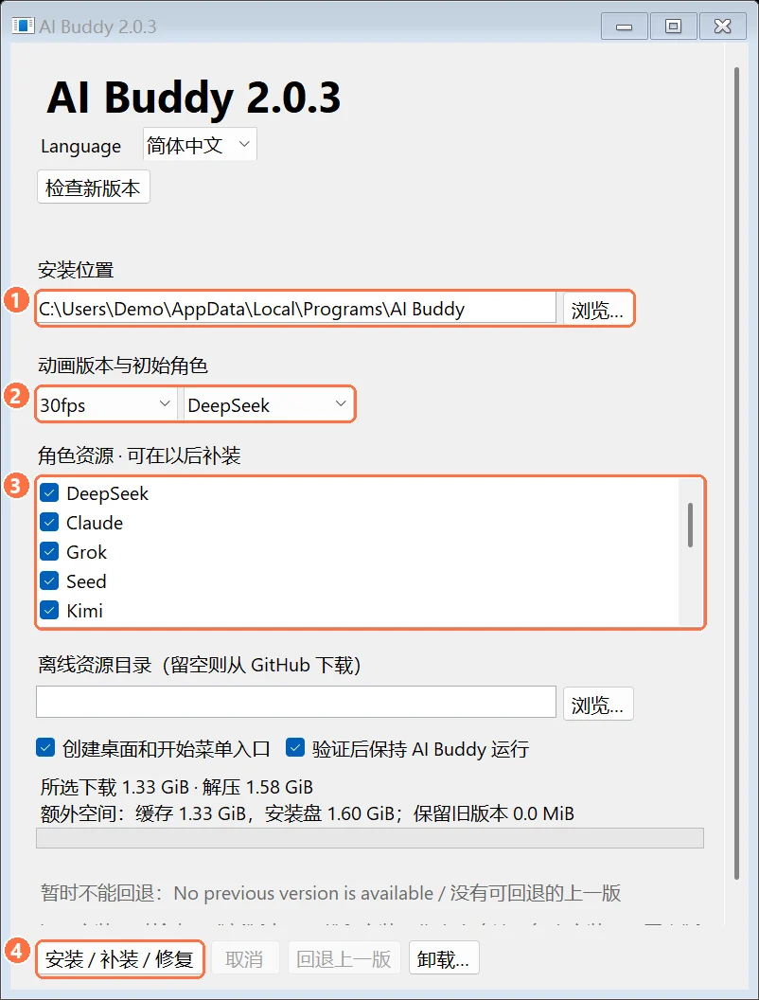
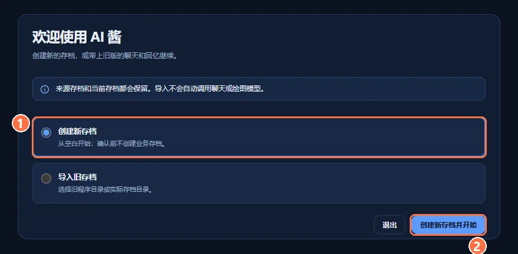
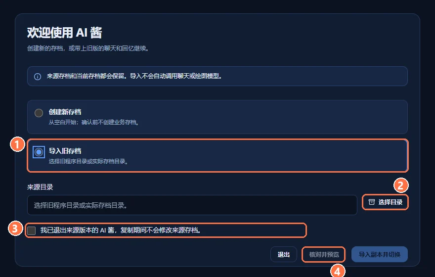
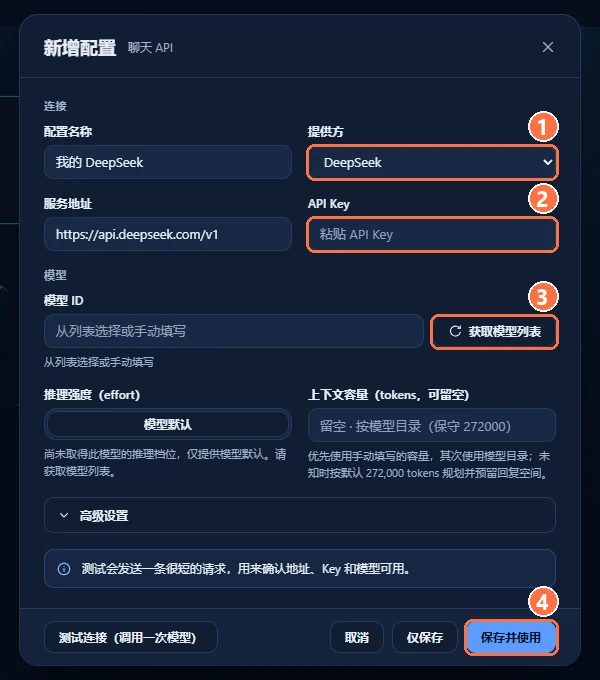
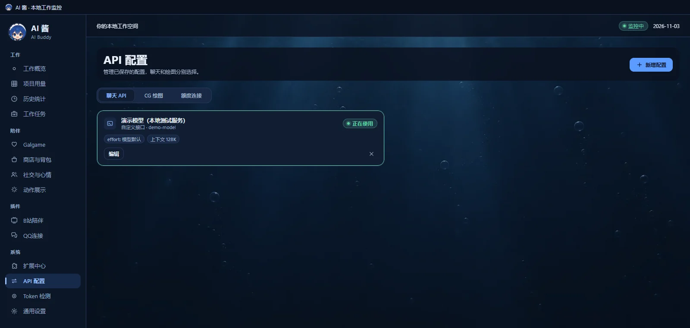
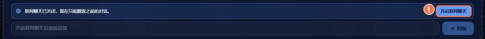
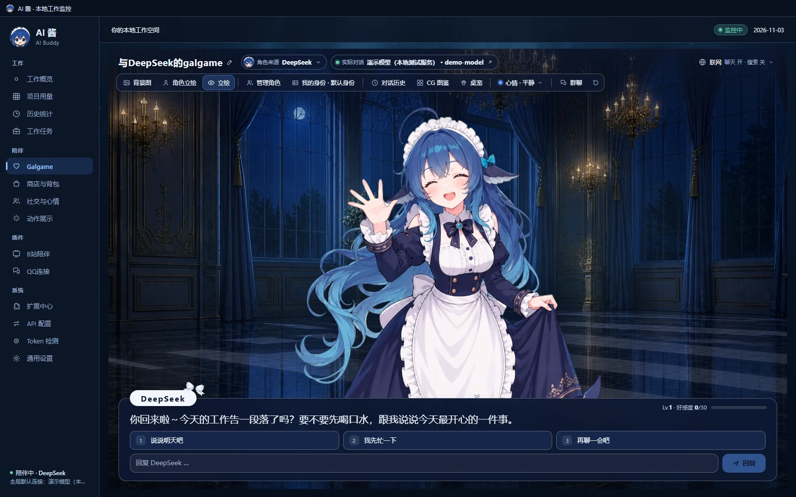
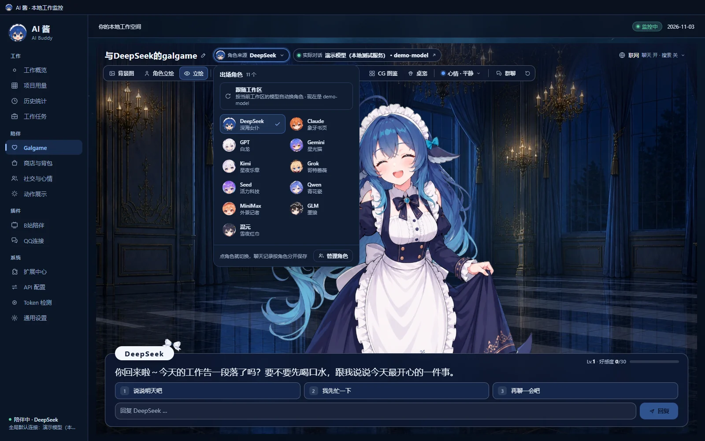
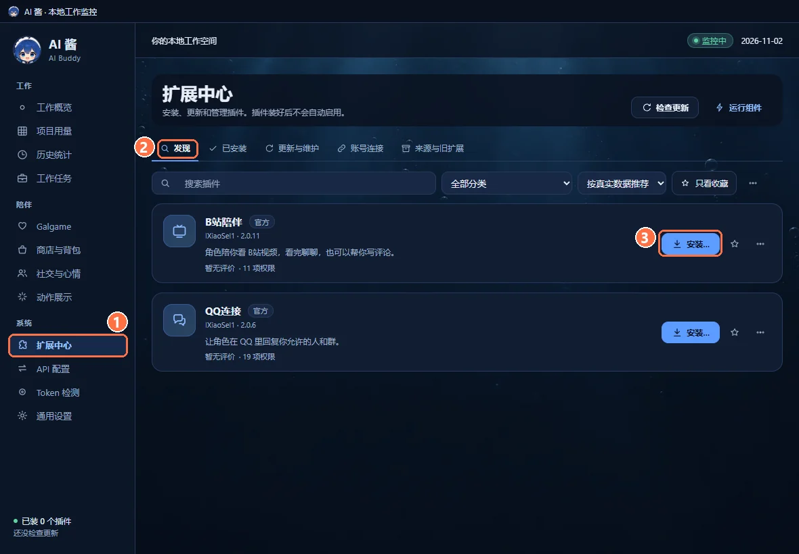

# AI 酱快速上手

**简体中文** · [English](QUICKSTART.en.md) · [返回 README](../README.md)

这份教程按第一次使用的顺序，从下载安装器讲到装好插件。图里的橙色编号对应文字里的 ①②③。截图大多来自 AI 酱 2.0.3 的独立演示存档，扩展中心和语音的截图是用 2.0.9 的界面和演示数据拍的：用量、项目名、聊天回复和语音状态都是演示数据，没有登录真实账号。

需要：一台 Windows 10/11 x64 电脑；想聊天的话，还要有一个模型服务的 API Key，或者本机已登录的 Codex。AI 酱本身免费，模型服务商可能另外收费。

## 1. 下载并运行安装器

1. 打开 [v2.0.9 下载页](https://github.com/lXiaoSel1/ai-buddy/releases/tag/v2.0.9)，下载 `AI-Buddy-Setup-2.0.9-win-x64.exe`（约 50 MiB）。Windows 提示“未知发布者”时，可以先用同一页的 `SHA256SUMS-2.0.9.txt` 核对文件，再选择仍要运行。
2. 在安装器里：
   - ① **安装位置**：默认 `%LOCALAPPDATA%\Programs\AI Buddy`，可以点「浏览…」改。升级时选原来的位置。
   - ② **动画版本与初始角色**：30fps 和 60fps 功能完全相同，60fps 更顺滑、下载更大。初始角色是第一次打开时陪你的那位。
   - ③ **角色资源**：默认全选 11 位，可以少装几位，以后再补。下面会显示所选下载量和需要的磁盘空间（全角色约 30fps 1.33 GiB、60fps 1.75 GiB）。
   - ④ 点 **安装 / 补装 / 修复**。

安装器会从 GitHub 下载资源，逐个核对 SHA-256 后再安装；下载中断了就重新运行安装器、选同一个位置，会接着下。装完后安装器会启动 AI 酱检查一次，默认让它继续开着。

没法联网的电脑：在下载页把 `install-manifest-2.0.9.json` 和所选角色、帧率需要的资源 ZIP 放进同一个文件夹，在安装器的「离线资源目录」里选它。缺文件时安装器会列出缺了哪些。

## 2. 第一次启动：新建或导入存档

**用 2.0.3-r1 或更新的安装器安装时：**首次安装自动初始化存档，原目录更新直接打开原存档，不再弹出新建／导入页。以下欢迎页步骤仅适用于无存档的便携包首次启动；需要迁入另一份资料时，再打开应用的导入存档入口。

**新用户**：选 ① **创建新存档**，点 ② **创建新存档并开始**。在你确认之前，AI 酱不会创建存档。

**用过旧版、装到了新位置**：可以把旧的聊天、角色和回忆带过来。

1. 先在旧版 AI 酱的托盘菜单里选 **退出**，让它正常关闭。
2. ① 选 **导入旧存档**。
3. ② 点 **选择目录**，选旧的程序目录（里面有 `AI Buddy.exe`）或实际的存档目录。
4. ③ 勾选「我已退出来源版本的 AI 酱，复制期间不会修改来源存档。」
5. ④ 点 **核对并预览**，看一下要导入的内容，再点 **导入副本并切换**。

导入是复制一份，并逐个核对文件；旧存档保持原样。旧版还开着时导入会被拒绝。导入不会调用聊天或绘图模型。

用新安装器在原位置升级时，会直接打开原来的存档；资料缺失或异常时，安装器会停下来提示，不会新建一份存档顶替。2.0.8 起也可以在通用设置的「版本与更新」里直接更新。

## 3. 配置聊天模型

1. 左侧栏打开 **API 配置**，确认在 **聊天 API** 页签，点右上角 **新增配置**。
2. 填写：
   - **配置名称**：随便起，比如「我的 DeepSeek」。
   - ① **提供方**：本机 Codex 登录、Gemini、Kimi / K3、Grok、OpenAI、Claude、DeepSeek、通义千问、MiniMax，或「自定义接口」（填任何兼容服务的地址）。选好后服务地址会自动填上。
   - ② **API Key**：粘贴服务商给你的 Key。选「本机 Codex 登录」时不用填 Key，但这台电脑上要已经登录 Codex。
   - ③ 点 **获取模型列表**，从列表里选一个模型，也可以手动填写模型 ID。
3. 想先试一下，点左下角 **测试连接（调用一次模型）**，它会发一条很短的请求（「本机 Codex 登录」没有这个按钮）。
4. ④ 点 **保存并使用**。只想存起来、暂时不换，就点 **仅保存**。

保存后，列表里这条连接会标着「正在使用」。Key 用系统加密保存在本机。CG 绘图和额度查询在另外两个页签里单独配置，不配也能聊天。

## 4. 打开联网聊天，开始聊天

1. 左侧栏点 **Galgame**。
2. 为了不在你不知情时调用模型，**联网聊天每次启动后都是关的**。点对话框里的 ① **开启联网聊天**，或者点顶栏右侧的「联网」打开。

3. 在输入框里打字，按 Enter 发送。她回复后会给出三个回复选项，输入框为空时按 1、2、3 就能直接选。

4. 想换一位角色，点顶栏的 **角色来源**，从 11 位里选。每位角色的好感、聊天记录和 CG 图鉴分开保存。

顶栏还有背景图、角色立绘、管理角色、我的身份、对话历史、CG 图鉴、桌宠、心情和群聊。群聊和 Auto 的用法见 [README 的群聊一节](../README.md#群聊)。

## 5. （可选）安装插件

1. 左侧栏打开 ① **扩展中心**，在 ② **发现** 页签里找到插件。
2. 点 ③ **安装…**，安装页会列出插件要的每一项权限，只授予你勾选的那些。装好后不会自动启用：点安装页的「启用并连接 B站账号」或「启用并扫码登录」，或在 **已安装** 页打开开关。
3. 插件需要的组件由 AI 酱准备：B站陪伴的视频组件（FFmpeg）在安装时下载；QQ连接的连接组件在你第一次扫码连接时准备；语音插件的声音模型在第一次启动时准备（Breeze 约 11 GB，GPT-SoVITS 约 7 GB）。不用另装 Node，也不用填端口或 Token。

装好以后，连接账号、选角色和设置范围的步骤见：

- [B站陪伴：快速上手](https://github.com/lXiaoSel1/AI-Buddy-Bilibili#快速上手)
- [QQ连接：快速上手](https://github.com/lXiaoSel1/AI-Buddy-QQ#快速上手)
- [一起玩牌：快速上手](https://github.com/lXiaoSel1/AI-Buddy-Card-Games#快速上手)
- [语音：插件页、聊天里的语音、Live 和云配音](../README.md#语音)，以及 [语音插件的快速上手](https://github.com/lXiaoSel1/AI-Buddy-Voice#快速上手)

## 常见问题

**重启后她不回我了。**
联网聊天每次启动都会关掉，在 Galgame 里点「开启联网聊天」就好。

**每次打开都出现欢迎页。**
欢迎页只在当前存档目录里还没有存档时出现。如果你已经在用，却在同一个安装位置反复看到它，请不要删除任何文件，先到 [Issues](https://github.com/lXiaoSel1/ai-buddy/issues) 反馈，并说明安装位置和是否改过数据目录。

**积分一直不涨。**
积分只来自 AI 酱开着时新增的本机 AI 工具用量，每 10,000 个实际 Token 得 1 积分；打开 AI 酱之前的历史用量不算。可以在 **Token 检测** 里看看你的工具日志有没有被找到。

**群聊点了 Auto 却开不了。**
先到 **社交与心情** 里打开「群聊 Auto」，并确认联网聊天开着。

**模型报错或一直没回复。**
到 **API 配置** 编辑这条连接，点「测试连接（调用一次模型）」看具体错误；常见原因是 Key 填错、余额不足或模型 ID 不对。

**想补装角色、切换帧率或修复文件。**
在 **通用设置** 的「角色资源」一行点 **管理角色资源**，或重新运行同版本的安装器。

**怎么卸载？**
运行安装器点 **卸载…**。默认保留个人数据；勾选删除个人数据后不可恢复。
